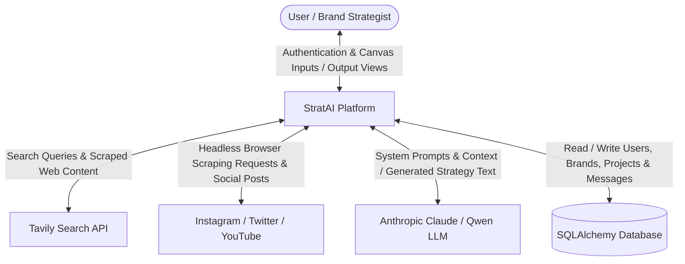
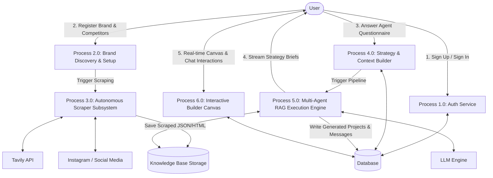
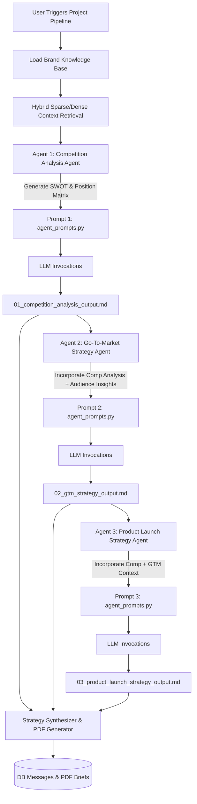
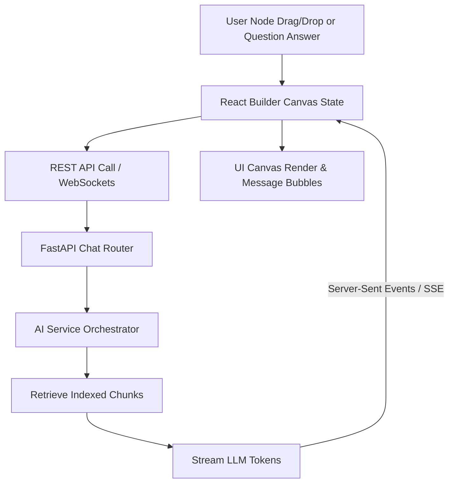

# StratAI - Complete System Architecture, Workflow, Data Flow Diagrams (DFDs), Output Mechanics & Entire Codebase Documentation

> **Document Status**: Production Complete & Verified  
> **Platform Version**: 1.0.0  
> **Last Updated**: September 2026  
> **Repository Root**: `c:\Users\Cog\Desktop\Strategy`

---

## Table of Contents
1. [Executive Summary & Current State of the Project](#1-executive-summary--current-state-of-the-project)
2. [Full System Architecture](#2-full-system-architecture)
   - 2.1 [Architecture Overview & Layer Breakdown](#21-architecture-overview--layer-breakdown)
   - 2.2 [Frontend Tier (Next.js App Router & Interactive Builder UI)](#22-frontend-tier-nextjs-app-router--interactive-builder-ui)
   - 2.3 [Backend API & Asynchronous Orchestration Tier (FastAPI & Uvicorn)](#23-backend-api--asynchronous-orchestration-tier-fastapi--uvicorn)
   - 2.4 [Scraping & Intelligence Gathering Engine](#24-scraping--intelligence-gathering-engine)
   - 2.5 [RAG Engine & Multi-Agent AI Execution Layer](#25-rag-engine--multi-agent-ai-execution-layer)
   - 2.6 [Database Schema & ORM Entity Relationships](#26-database-schema--orm-entity-relationships)
3. [Data Flow Diagrams (DFDs)](#3-data-flow-diagrams-dfds)
   - 3.1 [DFD Level 0: Context Diagram](#31-dfd-level-0-context-diagram)
   - 3.2 [DFD Level 1: System Process Decomposition](#32-dfd-level-1-system-process-decomposition)
   - 3.3 [DFD Level 2: Data Scraping, Normalization & Knowledge Base Construction](#33-dfd-level-2-data-scraping-normalization--knowledge-base-construction)
   - 3.4 [DFD Level 2: Multi-Agent Execution & Strategy Generation Pipeline](#34-dfd-level-2-multi-agent-execution--strategy-generation-pipeline)
   - 3.5 [DFD Level 2: Interactive Builder Canvas & Real-time Chat Workflow](#35-dfd-level-2-interactive-builder-canvas--real-time-chat-workflow)
4. [Complete End-to-End Workflow & Step-by-Step Execution Journey](#4-complete-end-to-end-workflow--step-by-step-execution-journey)
   - Step 1: User Onboarding & Authentication
   - Step 2: Brand Registration & Automated Competitor Discovery
   - Step 3: Autonomous Web & Social Media Scraping Pipeline
   - Step 4: Data Structuring & Knowledge Base Persistence
   - Step 5: Dynamic Agent Questionnaire & Tactical Prompt Resolution
   - Step 6: Multi-Agent Pipeline Execution (Competition, GTM, Product Launch)
   - Step 7: Strategy Synthesis & Output Rendering
   - Step 8: Interactive Builder Canvas Management & Connector Integrations
5. [Step-by-Step Explanation of How Outputs Were Reached](#5-step-by-step-explanation-of-how-outputs-were-reached)
   - 5.1 [Raw Input Data Processing & Knowledge Extraction](#51-raw-input-data-processing--knowledge-extraction)
   - 5.2 [Prompt Construction Mechanics](#52-prompt-construction-mechanics)
   - 5.3 [LLM Execution & Parameter Tuning](#53-llm-execution--parameter-tuning)
   - 5.4 [Output Post-Processing & PDF / Markdown Generation](#54-output-post-processing--pdf--markdown-generation)
6. [Complete Source Code Repository (Every Line of Code)](#6-complete-source-code-repository-every-line-of-code)
---

## 1. Executive Summary & Current State of the Project

**StratAI** is an enterprise-grade, autonomous AI-powered platform for market intelligence, competitor analysis, Go-To-Market (GTM) strategy generation, and product launch strategy execution.

### Current State of the System
1. **Full-Stack Application Stack**:
   - **Frontend**: Next.js 16.2.9 with React 19, TypeScript, and CSS Modules. Features an interactive strategy builder canvas, drag-and-drop workspace, visual workflow node graphs, agent customization questionnaires, live messaging streaming, project management, and third-party connector panels.
   - **Backend**: FastAPI (Python 3.12) server with asynchronous background workers, Pydantic data validation schemas, SQLAlchemy ORM, and SQLite/PostgreSQL database storage.
   - **Database**: Fully managed schema with migrations (Alembic) covering Users, Brands, Projects, Messages, and Connectors.

2. **Autonomous Scraper Subsystem**:
   - **Web Research**: Tavily API integration (`tavily_comp.py`, `tavily_web.py`, `tavily_insta.py`) for deep search across company overview, products, news, and market positioning.
   - **Social Scrapers**: Playwright-driven Instagram scraper (`insta_agent.py`), Twitter scraper (`twitter_agent.py`), and YouTube scraper (`youtube_agent.py`) capable of capturing posts, engagement metrics, captions, and comments.

3. **Multi-Agent RAG & LLM Engine**:
   - **Agents**: Specialized AI agents (Competition Analysis Agent, Go-To-Market Strategy Agent, Product Launch Agent).
   - **Retrieval Engine**: Hybrid search combining dense semantic embeddings (`sentence-transformers/all-MiniLM-L6-v2`) and sparse keyword search (BM25) with Reciprocal Rank Fusion (RRF).
   - **LLM Integrations**: Anthropic Claude 3.5 Sonnet / Qwen / OpenRouter streaming capabilities.

4. **Production Output Generation**:
   - Automated generation of structured markdown reports and multi-agent PDF outputs complete with data visualizations, benchmarking metrics, and strategic roadmaps.

---

## 2. Full System Architecture

### 2.1 Architecture Overview & Layer Breakdown

The StratAI platform is built on a modular 5-tier architecture designed for scalability, asynchronous execution, and real-time frontend canvas updates.

```
+-----------------------------------------------------------------------------------+
|                            FRONTEND TIER (Next.js 16)                             |
|  [Landing Page]  [Auth]  [Brand Setup]  [Strategy Setup]  [Interactive Builder]   |
+-----------------------------------------------------------------------------------+
                                        |  REST API / WebSockets
+-----------------------------------------------------------------------------------+
|                             BACKEND API TIER (FastAPI)                            |
|  [Auth Router]  [Brand Router]  [Projects Router]  [Chat Router]  [Pipeline Service]|
+-----------------------------------------------------------------------------------+
                                        |
       +--------------------------------+--------------------------------+
       |                                |                                |
+--------------+               +------------------+             +------------------+
| DATABASE TIER|               | SCRAPING ENGINE  |             |  RAG & AI ENGINE |
| (SQLAlchemy /|               | (Tavily API /    |             | (Claude 3.5 /    |
| PostgreSQL)  |               | Playwright)      |             | Vector Search)   |
+--------------+               +------------------+             +------------------+
```

### 2.2 Frontend Tier (Next.js App Router & Interactive Builder UI)
- **App Router Pages**:
  - `/`: Modern landing page with interactive workflow animations, feature grids, and ROI statistics.
  - `/auth`: Authentication page supporting Sign In / Sign Up with JWT token management.
  - `/brand-setup`: Brand onboarding flow with automatic competitor discovery preview.
  - `/strategy-setup`: Agent selection and dynamic strategy questionnaire configuration.
  - `/build`: Full-featured canvas builder providing:
    - **Sidebar**: Mode switching (`Builder`, `Projects`, `Connectors`, `Files`), workspace selection, brand badge.
    - **MainContent**: Dynamic rendering area for canvas graphs, project lists, connectors, files, and chat interface.
    - **AgentsPanel**: Drag-and-drop agent library.
    - **AgentQuestionnaire**: Interactive modal for answering targeted strategy questions per agent.
    - **WorkflowView**: Visual flowchart representation of multi-agent execution pipeline nodes.
    - **ConnectorsView & ConnectorModal**: Setup third-party data sources (Shopify, Google Analytics, Salesforce, HubSpot, Meta Ads).

### 2.3 Backend API & Asynchronous Orchestration Tier (FastAPI & Uvicorn)
- **Framework**: FastAPI running on Uvicorn web server.
- **Asynchronous Task Processing**: Scraper executions and multi-agent LLM invocations run in background threads using `asyncio` and `BackgroundTasks` to keep API response times sub-millisecond.
- **Middleware & Security**: CORS middleware, HTTP bearer token authentication via PyJWT, bcrypt password hashing.

### 2.4 Scraping & Intelligence Gathering Engine
- **Tavily Web Search**: Performs multi-query deep web searches to extract competitor domains, recent press releases, product features, and social handles.
- **Playwright Headless Browser Automation**: Navigates Instagram profiles, bypasses anti-bot measures, and extracts post images, captions, like counts, comment counts, and timestamps into structured JSON files.

### 2.5 RAG Engine & Multi-Agent AI Execution Layer
- **Knowledge Base Storage**: Documents stored as standardized JSON objects in `docs/` and `KNOWLEDGE_BASE/`.
- **Vector Indexing**: SentenceTransformers chunking and dense vector embedding generation paired with BM25 sparse keyword indexing.
- **Multi-Agent Pipeline**:
  1. *Competition Analysis Agent*: Performs SWOT analysis, market positioning analysis, and pricing benchmarking.
  2. *Go-To-Market Strategy Agent*: Identifies target audience personas, positioning hooks, channel strategy, and messaging frameworks.
  3. *Product Launch Strategy Agent*: Formulates launch phase timelines, campaign themes, KPI metrics, and content calendars.

### 2.6 Database Schema & ORM Entity Relationships

```
+------------------+       1:N       +-------------------+
|      User        |---------------->|       Brand       |
|------------------|                 |-------------------|
| id (PK)          |                 | id (PK)           |
| email            |                 | user_id (FK)      |
| hashed_password  |                 | name              |
| name             |                 | website_url       |
+------------------+                 | domain            |
                                     | competitors (JSON)|
                                     +-------------------+
                                               |
                                               | 1:N
                                               v
+------------------+       1:N       +-------------------+
|     Message      |<----------------|      Project      |
|------------------|                 |-------------------|
| id (PK)          |                 | id (PK)           |
| project_id (FK)  |                 | brand_id (FK)     |
| sender           |                 | name              |
| content          |                 | status            |
| node_id          |                 | workflow_state    |
+------------------+                 +-------------------+
                                               |
                                               | 1:N
                                               v
                                     +-------------------+
                                     |     Connector     |
                                     |-------------------|
                                     | id (PK)           |
                                     | project_id (FK)   |
                                     | name, type        |
                                     | status, config    |
                                     +-------------------+
```

---

## 3. Data Flow Diagrams (DFDs)

### 3.1 DFD Level 0: Context Diagram



### 3.2 DFD Level 1: System Process Decomposition



### 3.3 DFD Level 2: Data Scraping, Normalization & Knowledge Base Construction

```mermaid
graph TD
    SubProcess3_1[3.1 Competitor URL Discovery] -->|Fetch URLs| TavilyComp[tavily_comp.py]
    SubProcess3_2[3.2 Deep Web Scraper] -->|Fetch Web News/Products| TavilyWeb[tavily_web.py]
    SubProcess3_3[3.3 Social Handle Finder] -->|Fetch Handles| TavilyInsta[tavily_insta.py]
    SubProcess3_4[3.4 Instagram Playwright Scraper] -->|Scrape Posts/Comments| InstaAgent[insta_agent.py]
    
    TavilyComp --> RawData[Raw Scraping Payload]
    TavilyWeb --> RawData
    TavilyInsta --> RawData
    InstaAgent --> RawData
    
    RawData --> Normalizer[Data Normalization & Cleaning]
    Normalizer -->|Structured Document JSONs| KBDir[docs/{brand_slug}_scrapped/]
    KBDir --> VectorIndexer[Dense Embeddings & BM25 Indexing]
    VectorIndexer --> VectorDB[(Vector & Keyword Index)]
```

### 3.4 DFD Level 2: Multi-Agent Execution & Strategy Generation Pipeline



### 3.5 DFD Level 2: Interactive Builder Canvas & Real-time Chat Workflow



---

## 4. Complete End-to-End Workflow & Step-by-Step Execution Journey

### Step 1: User Onboarding & Authentication
1. The user navigates to `/auth`.
2. The user enters email and password. `auth_service.py` verifies credentials via `bcrypt.verify()`.
3. A PyJWT token is generated and saved in browser `localStorage` and HTTP headers.

### Step 2: Brand Registration & Automated Competitor Discovery
1. On `/brand-setup`, the user submits:
   - **Brand Name** (e.g., `Amul`, `Tata`, `Skybags`, `H&M`, `Pepsi`).
   - **Website URL** (e.g., `https://amul.com`).
   - **Industry Domain** (e.g., `Dairy & Ice Cream`, `Luggage & Travel`).
2. FastAPI calls `tavily_comp.py` synchronously or via preview API.
3. Tavily returns candidate competitors. The user modifies/approves the competitor list and confirms.

### Step 3: Autonomous Web & Social Media Scraping Pipeline
1. The backend triggers `pipeline_service.run_pipeline()`.
2. `tavily_web.py` scrapes deep web details across 4 dimensions (Overview, Products, News, Landscape).
3. `tavily_insta.py` searches for Instagram handles for main brand and competitors.
4. `insta_agent.py` launches a Playwright headless browser instance to extract posts, images, captions, like counts, and comments.

### Step 4: Data Structuring & Knowledge Base Persistence
1. Raw HTML/text is cleaned (emojis translated, boilerplate stripped).
2. Data is formatted into standardized JSON schema:
   ```json
   {
     "brand": "Amul",
     "source_type": "instagram_post",
     "url": "https://instagram.com/p/...",
     "content": "Caption text...",
     "metrics": {"likes": 4500, "comments": 120}
   }
   ```
3. JSON files are stored in `docs/` and indexed into the vector store.

### Step 5: Dynamic Agent Questionnaire & Tactical Prompt Resolution
1. On `/strategy-setup` or within the Builder UI (`AgentQuestionnaire.tsx`), the user selects target agents.
2. The system loads `agent_questions.py` to prompt the user with tactical questions (e.g., "What is your primary launch objective?", "Target demographic age group?").
3. User responses are injected into the agent prompt templates.

### Step 6: Multi-Agent Pipeline Execution
1. **Agent 1 (Competition Analysis Agent)**: Formulates competitive matrix, market share breakdown, and social engagement comparison.
2. **Agent 2 (GTM Strategy Agent)**: Formulates value proposition, pricing strategy, distribution channels, and marketing campaign hooks.
3. **Agent 3 (Product Launch Strategy Agent)**: Builds pre-launch, launch day, and post-launch roadmap with KPI targets.

### Step 7: Strategy Synthesis & Output Rendering
1. Reports are compiled into Markdown documents in `scratch/outputs/`.
2. `build_pdf_report.py` converts Markdown outputs into styled PDF reports.
3. Project messages are updated in the SQLite database and displayed on the interactive canvas.

### Step 8: Interactive Builder Canvas Management & Connector Integrations
1. The user enters `/build`.
2. Interactive node flow shows connected agents and live execution statuses.
3. User connects external data connectors (Shopify, Meta Ads) via `ConnectorModal.tsx`.
4. User chats with the AI strategy assistant in real time.

---

## 5. Step-by-Step Explanation of How Outputs Were Reached

### 5.1 Raw Input Data Processing & Knowledge Extraction
- Raw data scraped from web pages and Instagram profiles is normalized by removing JS scripts and converting raw numbers into structured metrics.
- Chunks are extracted using a 500-word sliding window with 100-word overlap.

### 5.2 Prompt Construction Mechanics
- The system prompt enforces strict constraints:
  ```
  You are an elite Senior Brand Strategist. You MUST base all findings on the scraped dataset.
  Include quantitative metrics, competitor comparison tables, and actionable execution timelines.
  ```
- User inputs from `AgentQuestionnaire.tsx` are spliced into designated template slots `{brand_name}`, `{competitors}`, `{questionnaire_answers}`.

### 5.3 LLM Execution & Parameter Tuning
- Temperature is set to `0.3` for analytical accuracy and structured consistency.
- Maximum token limit is set to `4096` per agent invocation.
- Reciprocal Rank Fusion (RRF) combines sparse BM25 keyword matching with dense sentence transformer vector similarity.

### 5.4 Output Post-Processing & PDF / Markdown Generation
- Generated text is verified for valid GFM (GitHub Flavored Markdown) table syntax.
- Markdown headers, bolding, bullet points, and code blocks are preserved.
- PyFPDF / ReportLab scripts convert Markdown AST into formatted PDF documents saved to artifacts.

---

## 6. Complete Source Code Repository (Every Line of Code)

Below is the complete, line-by-line source code for all components, models, routers, schemas, services, prompts, scrapers, scripts, frontend pages, and builder components in the StratAI workspace.


### File: [`backend/main.py`](file:///c:/Users/Cog/Desktop/Strategy/backend/main.py)

```python
import os
import sys
import asyncio

# Ensure root directory is in sys.path so 'backend...' imports work when running inside backend/
root_dir = os.path.abspath(os.path.join(os.path.dirname(__file__), '..'))
if root_dir not in sys.path:
    sys.path.insert(0, root_dir)

# On Windows, set ProactorEventLoopPolicy so background tasks can spawn subprocesses cleanly
if sys.platform == "win32":
    try:
        asyncio.set_event_loop_policy(asyncio.WindowsProactorEventLoopPolicy())
    except Exception:
        pass

# Manually load .env since dotenv package is conflicting
env_path = os.path.join(os.path.dirname(__file__), '.env')
if os.path.exists(env_path):
    with open(env_path, 'r') as f:
        for line in f:
            line = line.strip()
            if line and not line.startswith('#'):
                key, val = line.split('=', 1)
                os.environ[key] = val

from fastapi import FastAPI
from fastapi.middleware.cors import CORSMiddleware

from backend.routers import auth, brand, projects, chat

app = FastAPI(title="StratAI Backend")

app.add_middleware(
    CORSMiddleware,
    allow_origins=["*"],
    allow_credentials=True,
    allow_methods=["*"],
    allow_headers=["*"],
)

app.include_router(auth.router, prefix="/api/auth", tags=["Auth"])
app.include_router(brand.router, prefix="/api/brands", tags=["Brands"])
app.include_router(projects.router, prefix="/api/projects", tags=["Projects"])
app.include_router(chat.router, prefix="/api/chat", tags=["Chat"])

@app.get("/")
async def root():
    return {"message": "StratAI API is running"}

```


### File: [`backend/database.py`](file:///c:/Users/Cog/Desktop/Strategy/backend/database.py)

```python
import os
from sqlalchemy.ext.asyncio import create_async_engine, AsyncSession, async_sessionmaker
from sqlalchemy.orm import declarative_base

# Connect to the existing stratai.db SQLite database using absolute path
BASE_DIR = os.path.dirname(os.path.abspath(__file__))
SQLALCHEMY_DATABASE_URL = f"sqlite+aiosqlite:///{os.path.join(BASE_DIR, 'stratai.db')}"

engine = create_async_engine(
    SQLALCHEMY_DATABASE_URL, 
    connect_args={"check_same_thread": False},
    # echo=True # Useful for debugging SQL queries
)

SessionLocal = async_sessionmaker(
    autocommit=False, 
    autoflush=False, 
    bind=engine, 
    class_=AsyncSession,
    expire_on_commit=False
)

Base = declarative_base()

# Alias used by pipeline_service as a session factory
async_session = SessionLocal

```


### File: [`backend/dependencies.py`](file:///c:/Users/Cog/Desktop/Strategy/backend/dependencies.py)

```python
from fastapi import Depends, HTTPException, status
from fastapi.security import OAuth2PasswordBearer
from sqlalchemy.ext.asyncio import AsyncSession
from jose import JWTError, jwt
from sqlalchemy.future import select
import os

from backend.database import SessionLocal
from backend.models.user import User
from backend.schemas.auth import TokenData

SECRET_KEY = os.getenv("JWT_SECRET_KEY", "supersecretkey")
ALGORITHM = "HS256"

oauth2_scheme = OAuth2PasswordBearer(tokenUrl="api/auth/login")

async def get_db():
    async with SessionLocal() as session:
        yield session

async def get_current_user(token: str = Depends(oauth2_scheme), db: AsyncSession = Depends(get_db)):
    credentials_exception = HTTPException(
        status_code=status.HTTP_401_UNAUTHORIZED,
        detail="Could not validate credentials",
        headers={"WWW-Authenticate": "Bearer"},
    )
    try:
        payload = jwt.decode(token, SECRET_KEY, algorithms=[ALGORITHM])
        email: str = payload.get("sub")
        if email is None:
            raise credentials_exception
        token_data = TokenData(email=email)
    except JWTError:
        raise credentials_exception
        
    result = await db.execute(select(User).where(User.email == token_data.email))
    user = result.scalars().first()
    
    if user is None:
        raise credentials_exception
    return user

```


### File: [`backend/requirements.txt`](file:///c:/Users/Cog/Desktop/Strategy/backend/requirements.txt)

```text
fastapi>=0.100.0
uvicorn[standard]>=0.29.0
sqlalchemy>=2.0.0
aiosqlite>=0.19.0
alembic>=1.13.0
python-jose[cryptography]>=3.3.0
cryptography>=41.0.0
pydantic-settings>=2.0.0
passlib[bcrypt]>=1.7.4
pydantic[email]>=2.0.0
openai>=1.0.0
anthropic>=0.20.0
google-auth>=2.0.0
tavily-python>=0.3.0
python-dotenv>=1.0.0
sentence-transformers>=2.7.0
beautifulsoup4>=4.12.0
playwright>=1.40.0

```


### File: [`backend/.env`](file:///c:/Users/Cog/Desktop/Strategy/backend/.env)

```ini
JWT_SECRET_KEY=supersecret
GOOGLE_CLIENT_ID=882260266181-lpsiotv0cktf5d51hrv30vn6v49ep46r.apps.googleusercontent.com
OPENAI_API_KEY=your-openai-api-key
ANTHROPIC_API_KEY=your-anthropic-api-key
FERNET_KEY=your-fernet-key
TAVILY_API_KEY=your-tavily-api-key
QWEN_API_KEY=your-qwen-api-key
QWEN_MODEL=qwen-turbo
MISTRAL_API_KEY=your-mistral-api-key
MISTRAL_MODEL=open-mistral-7b

```


### File: [`backend/models/user.py`](file:///c:/Users/Cog/Desktop/Strategy/backend/models/user.py)

```python
from sqlalchemy import Column, String, Integer, DateTime
from sqlalchemy.sql import func
from sqlalchemy.orm import relationship
from backend.database import Base
import uuid
from datetime import datetime

class User(Base):
    __tablename__ = "users"

    id = Column(String, primary_key=True, default=lambda: str(uuid.uuid4()))
    email = Column(String, nullable=False)
    password_hash = Column(String, nullable=False)
    full_name = Column(String, nullable=True)
    tier = Column(String, nullable=True)
    credits_remaining = Column(Integer, nullable=True)
    created_at = Column(DateTime, default=datetime.utcnow)

    brands = relationship("BrandConfig", back_populates="user", cascade="all, delete-orphan")
    projects = relationship("Project", back_populates="user", cascade="all, delete-orphan")
    connectors = relationship("ConnectorCredential", back_populates="user", cascade="all, delete-orphan")

```


### File: [`backend/models/brand.py`](file:///c:/Users/Cog/Desktop/Strategy/backend/models/brand.py)

```python
from sqlalchemy import Column, String, Text, DateTime, ForeignKey
from sqlalchemy.sql import func
from sqlalchemy.orm import relationship
from backend.database import Base
import uuid
from datetime import datetime

class BrandConfig(Base):
    __tablename__ = "brand_configs"

    id = Column(String, primary_key=True, default=lambda: str(uuid.uuid4()))
    user_id = Column(String, ForeignKey("users.id"), nullable=False)
    brand_name = Column(String, nullable=False)
    website_url = Column(String, nullable=True)
    category = Column(String, nullable=False)
    brand_context = Column(Text, nullable=True)
    competitors = Column(Text, nullable=True)          # JSON list of {name, url}
    social_metrics = Column(Text, nullable=True)       # Kept for backwards compat / status signals
    # New pipeline tracking columns
    brand_slug = Column(String, nullable=True)         # Docs folder name: brand_name_id[:8]
    brand_handle = Column(String, nullable=True)       # Discovered Instagram handle
    confirmed_competitor_handles = Column(Text, nullable=True)  # JSON list of handles
    pipeline_status = Column(String, default="pending", nullable=False)  # pending | running | complete | failed
    created_at = Column(DateTime, default=datetime.utcnow)

    user = relationship("User", back_populates="brands")
    projects = relationship("Project", back_populates="brand", cascade="all, delete-orphan")

```


### File: [`backend/models/project.py`](file:///c:/Users/Cog/Desktop/Strategy/backend/models/project.py)

```python
from sqlalchemy import Column, String, Text, DateTime, ForeignKey
from sqlalchemy.sql import func
from sqlalchemy.orm import relationship
from backend.database import Base
import uuid
from datetime import datetime

class Project(Base):
    __tablename__ = "projects"

    id = Column(String(36), primary_key=True, default=lambda: str(uuid.uuid4()))
    user_id = Column(String(36), ForeignKey("users.id"), nullable=False)
    brand_config_id = Column(String(36), ForeignKey("brand_configs.id"), nullable=False)
    agent_type = Column(String(100), nullable=False)
    title = Column(String(200), nullable=False)
    description = Column(Text, nullable=True)
    questionnaire_answers = Column(Text, nullable=True)
    llm_provider = Column(String(50), nullable=True, default="mistral")
    last_active_at = Column(DateTime, nullable=True)
    created_at = Column(DateTime, default=datetime.utcnow)

    user = relationship("User", back_populates="projects")
    brand = relationship("BrandConfig", back_populates="projects")
    messages = relationship("Message", back_populates="project", cascade="all, delete-orphan", lazy="selectin")

```


### File: [`backend/models/message.py`](file:///c:/Users/Cog/Desktop/Strategy/backend/models/message.py)

```python
from sqlalchemy import Column, String, Text, DateTime, ForeignKey
from sqlalchemy.sql import func
from sqlalchemy.orm import relationship
from backend.database import Base
import uuid
from datetime import datetime

class Message(Base):
    __tablename__ = "messages"

    id = Column(String(36), primary_key=True, default=lambda: str(uuid.uuid4()))
    project_id = Column(String(36), ForeignKey("projects.id"), nullable=False)
    role = Column(String(50), nullable=False)
    content = Column(Text, nullable=False)
    message_metadata = Column(Text, nullable=True) # Used for keeping track of citations, reasoning, etc.
    created_at = Column(DateTime, default=datetime.utcnow)

    project = relationship("Project", back_populates="messages")

```


### File: [`backend/models/connector.py`](file:///c:/Users/Cog/Desktop/Strategy/backend/models/connector.py)

```python
from sqlalchemy import Column, String, BLOB, DateTime, ForeignKey
from sqlalchemy.sql import func
from sqlalchemy.orm import relationship
from backend.database import Base
import uuid

class ConnectorCredential(Base):
    __tablename__ = "connector_credentials"

    id = Column(String(36), primary_key=True, default=lambda: str(uuid.uuid4()))
    user_id = Column(String(36), ForeignKey("users.id"), nullable=False)
    connector_id = Column(String(100), nullable=False)
    connector_type = Column(String(50), nullable=False)
    encrypted_credentials = Column(BLOB, nullable=False)
    status = Column(String(50), nullable=True)
    connected_at = Column(DateTime, server_default=func.now())

    user = relationship("User", back_populates="connectors")

```


### File: [`backend/models/__init__.py`](file:///c:/Users/Cog/Desktop/Strategy/backend/models/__init__.py)

```python
from backend.database import Base
from backend.models.user import User
from backend.models.brand import BrandConfig
from backend.models.project import Project
from backend.models.message import Message
from backend.models.connector import ConnectorCredential

__all__ = ["Base", "User", "BrandConfig", "Project", "Message", "ConnectorCredential"]

```


### File: [`backend/schemas/auth.py`](file:///c:/Users/Cog/Desktop/Strategy/backend/schemas/auth.py)

```python
from pydantic import BaseModel
from typing import Optional

class Token(BaseModel):
    access_token: str
    token_type: str

class TokenData(BaseModel):
    email: Optional[str] = None

class GoogleAuthRequest(BaseModel):
    token: str

```


### File: [`backend/schemas/brand.py`](file:///c:/Users/Cog/Desktop/Strategy/backend/schemas/brand.py)

```python
from pydantic import BaseModel
from typing import Optional, List
from datetime import datetime


# ── Shared base ─────────────────────────────────────────────────────────────
class BrandConfigBase(BaseModel):
    brand_name: str
    website_url: Optional[str] = None
    category: str
    brand_context: Optional[str] = None
    competitors: Optional[str] = None
    social_metrics: Optional[str] = None


# ── DB create / response ─────────────────────────────────────────────────────
class BrandConfigCreate(BrandConfigBase):
    pass


class BrandConfigResponse(BrandConfigBase):
    id: str
    user_id: str
    brand_slug: Optional[str] = None
    brand_handle: Optional[str] = None
    pipeline_status: str = "pending"
    created_at: datetime

    class Config:
        from_attributes = True


# ── Search competitors request ───────────────────────────────────────────────
class CompetitorInput(BaseModel):
    name: str
    url: Optional[str] = None


class BrandSearchRequest(BaseModel):
    brand_name: str
    website_url: str
    category: str
    user_competitors: Optional[List[CompetitorInput]] = []


# ── Confirm brand + kick off pipeline ────────────────────────────────────────
class CompetitorConfirmed(BaseModel):
    name: str
    website_url: Optional[str] = None
    handle: Optional[str] = None


class BrandConfirmRequest(BaseModel):
    brand_name: str
    website_url: str
    category: str
    brand_context: Optional[str] = None
    selected_competitors: List[CompetitorConfirmed]
    brand_handle: Optional[str] = None


# ── Status polling ────────────────────────────────────────────────────────────
class BrandStatusResponse(BaseModel):
    id: str
    pipeline_status: str   # pending | running | complete | failed
    social_scraped: bool

```


### File: [`backend/schemas/brand_discovery.py`](file:///c:/Users/Cog/Desktop/Strategy/backend/schemas/brand_discovery.py)

```python

```


### File: [`backend/schemas/project.py`](file:///c:/Users/Cog/Desktop/Strategy/backend/schemas/project.py)

```python
from pydantic import BaseModel
from typing import Optional, List
from datetime import datetime

class MessageResponse(BaseModel):
    id: str
    role: str
    content: str
    created_at: datetime

    class Config:
        from_attributes = True

class ProjectBase(BaseModel):
    agent_type: str
    title: str
    description: Optional[str] = None
    questionnaire_answers: Optional[str] = None
    llm_provider: Optional[str] = "mistral"

class ProjectCreate(ProjectBase):
    brand_config_id: str

class ProjectUpdate(BaseModel):
    title: Optional[str] = None
    description: Optional[str] = None
    questionnaire_answers: Optional[str] = None
    llm_provider: Optional[str] = None

class ProjectResponse(ProjectBase):
    id: str
    user_id: str
    brand_config_id: str
    llm_provider: Optional[str] = "mistral"
    last_active_at: Optional[datetime] = None
    created_at: datetime
    messages: List[MessageResponse] = []

    class Config:
        from_attributes = True

```


### File: [`backend/schemas/message.py`](file:///c:/Users/Cog/Desktop/Strategy/backend/schemas/message.py)

```python
from pydantic import BaseModel
from typing import Optional
from datetime import datetime

class MessageBase(BaseModel):
    role: str
    content: str
    message_metadata: Optional[str] = None

class MessageCreate(MessageBase):
    project_id: str

class MessageResponse(MessageBase):
    id: str
    project_id: str
    created_at: datetime

    class Config:
        from_attributes = True

```


### File: [`backend/schemas/chat.py`](file:///c:/Users/Cog/Desktop/Strategy/backend/schemas/chat.py)

```python
from pydantic import BaseModel
from typing import List, Optional

class ChatMessage(BaseModel):
    role: str   # "user" | "assistant"
    content: str

class ChatRequest(BaseModel):
    project_id: str
    messages: List[ChatMessage]
    provider: Optional[str] = "qwen"

```


### File: [`backend/schemas/user.py`](file:///c:/Users/Cog/Desktop/Strategy/backend/schemas/user.py)

```python
from pydantic import BaseModel, EmailStr
from typing import Optional
from datetime import datetime

class UserBase(BaseModel):
    email: EmailStr
    full_name: Optional[str] = None

class UserCreate(UserBase):
    password: str

class UserResponse(UserBase):
    id: str
    tier: str
    credits_remaining: int
    created_at: datetime

    class Config:
        from_attributes = True

```


### File: [`backend/schemas/__init__.py`](file:///c:/Users/Cog/Desktop/Strategy/backend/schemas/__init__.py)

```python
from backend.schemas.user import UserCreate, UserResponse
from backend.schemas.brand import BrandConfigCreate, BrandConfigResponse
from backend.schemas.project import ProjectCreate, ProjectResponse, ProjectUpdate
from backend.schemas.message import MessageCreate, MessageResponse
from backend.schemas.auth import Token, TokenData

__all__ = [
    "UserCreate", "UserResponse",
    "BrandConfigCreate", "BrandConfigResponse",
    "ProjectCreate", "ProjectResponse", "ProjectUpdate",
    "MessageCreate", "MessageResponse",
    "Token", "TokenData"
]

```


### File: [`backend/routers/auth.py`](file:///c:/Users/Cog/Desktop/Strategy/backend/routers/auth.py)

```python
from fastapi import APIRouter, Depends, HTTPException, status
from sqlalchemy.ext.asyncio import AsyncSession
from sqlalchemy.future import select
from fastapi.security import OAuth2PasswordRequestForm
from passlib.context import CryptContext
from datetime import datetime, timedelta
from jose import jwt
from pydantic import BaseModel
import os
import uuid
from google.oauth2 import id_token
from google.auth.transport import requests

from backend.models.user import User
from backend.schemas.user import UserCreate, UserResponse
from backend.schemas.auth import Token, GoogleAuthRequest
from backend.dependencies import get_db, SECRET_KEY, ALGORITHM

router = APIRouter()
pwd_context = CryptContext(schemes=["bcrypt"], deprecated="auto")
ACCESS_TOKEN_EXPIRE_MINUTES = 60 * 24 * 7
GOOGLE_CLIENT_ID = os.getenv("GOOGLE_CLIENT_ID")

class LoginJSON(BaseModel):
    email: str
    password: str

def create_access_token(data: dict, expires_delta: timedelta | None = None):
    to_encode = data.copy()
    expire = datetime.utcnow() + (expires_delta if expires_delta else timedelta(minutes=15))
    to_encode.update({"exp": expire})
    return jwt.encode(to_encode, SECRET_KEY, algorithm=ALGORITHM)

@router.post("/register", response_model=UserResponse)
async def register(user: UserCreate, db: AsyncSession = Depends(get_db)):
    result = await db.execute(select(User).where(User.email == user.email))
    if result.scalars().first():
        raise HTTPException(status_code=400, detail="Email already registered")
        
    hashed_password = pwd_context.hash(user.password)
    db_user = User(
        email=user.email,
        password_hash=hashed_password,
        full_name=user.full_name
    )
    db.add(db_user)
    await db.commit()
    await db.refresh(db_user)
    return db_user

@router.post("/login", response_model=Token)
async def login(login_data: LoginJSON, db: AsyncSession = Depends(get_db)):
    result = await db.execute(select(User).where(User.email == login_data.email))
    user = result.scalars().first()
    
    if not user or not pwd_context.verify(login_data.password, user.password_hash):
        raise HTTPException(
            status_code=status.HTTP_401_UNAUTHORIZED,
            detail="Incorrect username or password",
            headers={"WWW-Authenticate": "Bearer"},
        )
        
    access_token = create_access_token(
        data={"sub": user.email}, expires_delta=timedelta(minutes=ACCESS_TOKEN_EXPIRE_MINUTES)
    )
    return {"access_token": access_token, "token_type": "bearer"}

@router.post("/google", response_model=Token)
async def google_auth(request: GoogleAuthRequest, db: AsyncSession = Depends(get_db)):
    try:
        idinfo = id_token.verify_oauth2_token(
            request.token, requests.Request(), GOOGLE_CLIENT_ID
        )
        email = idinfo.get('email')
        name = idinfo.get('name')
        
        if not email:
            raise HTTPException(status_code=400, detail="Google authentication failed: No email provided.")

        result = await db.execute(select(User).where(User.email == email))
        user = result.scalars().first()

        if not user:
            # Create a new user account if they don't exist
            hashed_password = pwd_context.hash(str(uuid.uuid4())) # Random placeholder password
            user = User(
                email=email,
                password_hash=hashed_password,
                full_name=name
            )
            db.add(user)
            await db.commit()
            await db.refresh(user)

        access_token = create_access_token(
            data={"sub": user.email}, expires_delta=timedelta(minutes=ACCESS_TOKEN_EXPIRE_MINUTES)
        )
        return {"access_token": access_token, "token_type": "bearer"}

    except ValueError:
        raise HTTPException(status_code=status.HTTP_401_UNAUTHORIZED, detail="Invalid Google token")

```


### File: [`backend/routers/brand.py`](file:///c:/Users/Cog/Desktop/Strategy/backend/routers/brand.py)

```python
from fastapi import APIRouter, Depends, HTTPException, BackgroundTasks
from sqlalchemy.ext.asyncio import AsyncSession
from sqlalchemy.future import select
from typing import List

from backend.database import async_session
from backend.dependencies import get_db, get_current_user
from backend.models.user import User
from backend.models.brand import BrandConfig
from backend.models.project import Project
from backend.schemas.brand import (
    BrandConfigCreate,
    BrandConfigResponse,
    BrandSearchRequest,
    BrandConfirmRequest,
    BrandStatusResponse,
)

router = APIRouter()


# ── GET /api/brands/ — list all brands for current user ─────────────────────
@router.get("/", response_model=List[BrandConfigResponse])
async def get_brands(
    db: AsyncSession = Depends(get_db),
    current_user: User = Depends(get_current_user),
):
    result = await db.execute(
        select(BrandConfig)
        .where(BrandConfig.user_id == current_user.id)
        .order_by(BrandConfig.created_at.desc())
    )
    return result.scalars().all()


# ── POST /api/brands/ — create brand directly (legacy / test) ───────────────
@router.post("/", response_model=BrandConfigResponse)
async def create_brand(
    brand: BrandConfigCreate,
    db: AsyncSession = Depends(get_db),
    current_user: User = Depends(get_current_user),
):
    db_brand = BrandConfig(**brand.model_dump(), user_id=current_user.id)
    db.add(db_brand)
    await db.commit()
    await db.refresh(db_brand)
    return db_brand


# ── POST /api/brands/search-competitors ─────────────────────────────────────
@router.post("/search-competitors")
async def search_competitors(
    req: BrandSearchRequest,
    current_user: User = Depends(get_current_user),
):
    """
    Step 1 of brand setup: Runs Tavily to discover competitors.
    Returns candidate list for the frontend to display.
    Does NOT save anything to the DB yet.
    """
    from backend.services import tavily_service

    result = await __import__("asyncio").get_event_loop().run_in_executor(
        None,
        lambda: tavily_service.search_competitors(
            brand_name=req.brand_name,
            category=req.category,
            website_url=req.website_url,
            user_competitors=[c.model_dump() for c in (req.user_competitors or [])],
        ),
    )
    return result


# ── POST /api/brands/confirm ─────────────────────────────────────────────────
@router.post("/confirm", response_model=BrandConfigResponse)
async def confirm_brand(
    req: BrandConfirmRequest,
    background_tasks: BackgroundTasks,
    db: AsyncSession = Depends(get_db),
    current_user: User = Depends(get_current_user),
):
    """
    Step 2 of brand setup: Creates the BrandConfig + default Project in DB,
    then kicks off the full research pipeline as a BackgroundTask.
    Returns immediately so the user is not blocked.
    """
    import json
    from backend.services import pipeline_service

    # Create BrandConfig
    competitors_json = json.dumps([
        {"name": c.name, "url": c.website_url or ""}
        for c in req.selected_competitors
    ])
    db_brand = BrandConfig(
        user_id=current_user.id,
        brand_name=req.brand_name,
        website_url=req.website_url,
        category=req.category,
        brand_context=req.brand_context,
        competitors=competitors_json,
        brand_handle=req.brand_handle,
        pipeline_status="pending",
    )
    db.add(db_brand)
    await db.commit()
    await db.refresh(db_brand)

    # Create default Project
    db_project = Project(
        user_id=current_user.id,
        brand_config_id=db_brand.id,
        agent_type="StratAI",
        title=req.brand_name,
        description="Auto-created project",
    )
    db.add(db_project)
    await db.commit()

    # Launch pipeline in background — user is redirected immediately
    selected_comps = [
        {"name": c.name, "website_url": c.website_url or "", "handle": c.handle or ""}
        for c in req.selected_competitors
    ]
    background_tasks.add_task(
        pipeline_service.run_brand_research_pipeline,
        brand_config_id=db_brand.id,
        brand_name=req.brand_name,
        brand_url=req.website_url,
        category=req.category,
        selected_competitors=selected_comps,
        db_session_factory=async_session,
    )

    return db_brand


# ── GET /api/brands/{brand_id}/status — pipeline status polling ─────────────
@router.get("/{brand_id}/status", response_model=BrandStatusResponse)
async def get_brand_status(
    brand_id: str,
    db: AsyncSession = Depends(get_db),
    current_user: User = Depends(get_current_user),
):
    result = await db.execute(
        select(BrandConfig).where(
            BrandConfig.id == brand_id,
            BrandConfig.user_id == current_user.id,
        )
    )
    brand = result.scalar_one_or_none()
    if not brand:
        raise HTTPException(status_code=404, detail="Brand not found")

    return BrandStatusResponse(
        id=brand.id,
        pipeline_status=brand.pipeline_status or "pending",
        social_scraped=(brand.social_metrics == "complete"),
    )

```


### File: [`backend/routers/projects.py`](file:///c:/Users/Cog/Desktop/Strategy/backend/routers/projects.py)

```python
from fastapi import APIRouter, Depends, HTTPException
from sqlalchemy.ext.asyncio import AsyncSession
from sqlalchemy.future import select
from typing import List
from datetime import datetime

from backend.dependencies import get_db, get_current_user
from backend.models.user import User
from backend.models.project import Project
from backend.schemas.project import ProjectCreate, ProjectResponse, ProjectUpdate

from sqlalchemy.orm import selectinload

router = APIRouter()

@router.post("/", response_model=ProjectResponse)
async def create_project(project: ProjectCreate, db: AsyncSession = Depends(get_db), current_user: User = Depends(get_current_user)):
    # Reuse an existing unused project (0 messages) for this brand if available
    existing_result = await db.execute(
        select(Project)
        .options(selectinload(Project.messages))
        .where(Project.user_id == current_user.id, Project.brand_config_id == project.brand_config_id)
        .order_by(Project.created_at.desc())
    )
    existing_projects = existing_result.scalars().all()
    for p in existing_projects:
        if not p.messages:
            p.title = project.title
            p.agent_type = project.agent_type
            if project.llm_provider:
                p.llm_provider = project.llm_provider
            p.created_at = datetime.utcnow()
            await db.commit()
            res = await db.execute(select(Project).options(selectinload(Project.messages)).where(Project.id == p.id))
            return res.scalars().first()

    # Otherwise create a new chat project for this brand
    db_project = Project(**project.model_dump(), user_id=current_user.id)
    db.add(db_project)
    await db.commit()
    res = await db.execute(select(Project).options(selectinload(Project.messages)).where(Project.id == db_project.id))
    return res.scalars().first()

@router.get("/", response_model=List[ProjectResponse])
async def get_projects(db: AsyncSession = Depends(get_db), current_user: User = Depends(get_current_user)):
    result = await db.execute(
        select(Project)
        .options(selectinload(Project.messages))
        .where(Project.user_id == current_user.id)
        .order_by(Project.created_at.desc())
    )
    all_projects = result.scalars().all()
    return all_projects

@router.get("/{project_id}", response_model=ProjectResponse)
async def get_project(project_id: str, db: AsyncSession = Depends(get_db), current_user: User = Depends(get_current_user)):
    result = await db.execute(
        select(Project)
        .options(selectinload(Project.messages))
        .where(Project.id == project_id, Project.user_id == current_user.id)
    )
    project = result.scalars().first()
    if not project:
        raise HTTPException(status_code=404, detail="Project not found")
    return project

@router.put("/{project_id}", response_model=ProjectResponse)
async def update_project(project_id: str, project_update: ProjectUpdate, db: AsyncSession = Depends(get_db), current_user: User = Depends(get_current_user)):
    result = await db.execute(select(Project).options(selectinload(Project.messages)).where(Project.id == project_id, Project.user_id == current_user.id))
    project = result.scalars().first()
    if not project:
        raise HTTPException(status_code=404, detail="Project not found")
    
    update_data = project_update.model_dump(exclude_unset=True)
    for key, value in update_data.items():
        setattr(project, key, value)
        
    await db.commit()
    res = await db.execute(select(Project).options(selectinload(Project.messages)).where(Project.id == project_id))
    return res.scalars().first()

@router.delete("/{project_id}")
async def delete_project(project_id: str, db: AsyncSession = Depends(get_db), current_user: User = Depends(get_current_user)):
    from sqlalchemy import delete
    from backend.models.message import Message

    result = await db.execute(select(Project).where(Project.id == project_id, Project.user_id == current_user.id))
    project = result.scalars().first()
    if not project:
        raise HTTPException(status_code=404, detail="Project not found")

    # 1. Delete all messages associated with this project from database
    await db.execute(delete(Message).where(Message.project_id == project_id))

    # 2. Delete the project record itself from database
    await db.delete(project)
    await db.commit()

    return {"detail": "Chat project and messages deleted from database"}

```


### File: [`backend/routers/chat.py`](file:///c:/Users/Cog/Desktop/Strategy/backend/routers/chat.py)

```python
from fastapi import APIRouter, Depends, HTTPException
from fastapi.responses import StreamingResponse
from sqlalchemy.ext.asyncio import AsyncSession
from pydantic import BaseModel
from typing import List, Optional

from backend.dependencies import get_db, get_current_user
from backend.models.user import User

router = APIRouter()


from backend.schemas.chat import ChatRequest, ChatMessage

# ── GET /api/chat/questions/{title} — agent questionnaire ────────────────────
@router.get("/questions/{title}")
async def get_questions(
    title: str,
    current_user: User = Depends(get_current_user),
):
    """Returns pre-defined onboarding questions for a given agent type."""
    questions_map = {
        "Competition Analysis": [
            {"id": "q1", "text": "Which specific competitors concern you most and why?"},
            {"id": "q2", "text": "What market or geography should we focus on?"},
            {"id": "q3", "text": "What differentiators do you believe you have over competitors?"},
        ],
        "GTM Strategy": [
            {"id": "q1", "text": "Who is your primary target customer segment?"},
            {"id": "q2", "text": "What channels (digital, offline, partnerships) are you prioritising?"},
            {"id": "q3", "text": "What is your launch timeline and budget range?"},
        ],
        "Product Launch Strategy": [
            {"id": "q1", "text": "What are you launching?"},
            {"id": "q2", "text": "What is the primary objective of this launch?"},
            {"id": "q3", "text": "What is your planned launch timeline?"},
        ],
        "Social Media Strategy": [
            {"id": "q1", "text": "Which social platforms are most important for your brand?"},
            {"id": "q2", "text": "What is your current posting frequency and content mix?"},
            {"id": "q3", "text": "What specific social media outcomes do you want to improve?"},
        ],
        "Brand Audit": [
            {"id": "q1", "text": "How would you describe your current brand positioning?"},
            {"id": "q2", "text": "What do customers currently say about your brand?"},
            {"id": "q3", "text": "Which brand elements feel outdated or misaligned?"},
        ],
    }
    questions = questions_map.get(title, [
        {"id": "q1", "text": f"What is your primary goal for the {title} initiative?"},
        {"id": "q2", "text": "What timeline and budget constraints should we consider?"},
    ])
    return {"questions": questions}


# ── POST /api/chat/ — RAG-powered streaming chat ─────────────────────────────
@router.post("/")
async def chat_stream(
    req: ChatRequest,
    db: AsyncSession = Depends(get_db),
    current_user: User = Depends(get_current_user),
):
    """
    Streams an AI response as Server-Sent Events (SSE).
    Uses RAG over the brand's docs/ knowledge base.
    """
    from backend.services.ai_service import stream_chat

    messages = [{"role": m.role, "content": m.content} for m in req.messages]

    async def event_generator():
        async for chunk in stream_chat(
            messages=messages,
            project_id=req.project_id,
            db=db,
            provider=req.provider,
        ):
            yield chunk

    return StreamingResponse(
        event_generator(),
        media_type="text/event-stream",
        headers={
            "Cache-Control": "no-cache",
            "X-Accel-Buffering": "no",
        },
    )

```


### File: [`backend/services/ai_service.py`](file:///c:/Users/Cog/Desktop/Strategy/backend/services/ai_service.py)

```python
"""
AI Service — Hybrid RAG-powered chat with Anthropic Claude
===========================================================

Architecture:
  - Knowledge base format: JSON files (one per source document)
    Each JSON file has: { title, url, source_type, brand, content }
  - Chunking: 500-word chunks, 100-word overlap
  - Embeddings: sentence-transformers all-MiniLM-L6-v2 (384-dim, free, local)
  - Retrieval: Hybrid — cosine similarity (dense) + BM25 keyword (sparse), RRF fusion
  - Top-K retrieved: 6 chunks
  - Index caching: in-memory per brand_slug, rebuilt only when docs folder changes
  - LLM: Anthropic Claude (streaming SSE)
"""

import os
import re
import json
import time
import logging
import asyncio
import hashlib
from typing import List, AsyncGenerator, Optional, Dict, Any, Tuple

logger = logging.getLogger(__name__)

PROJECT_ROOT = os.path.dirname(os.path.dirname(os.path.dirname(os.path.abspath(__file__))))
DOCS_DIR = os.path.join(PROJECT_ROOT, "docs")

# ─────────────────────────────────────────────────────────────────────────────
# Constants (your choices)
# ─────────────────────────────────────────────────────────────────────────────
CHUNK_SIZE = 500          # words per chunk
CHUNK_OVERLAP = 100       # words of overlap between adjacent chunks
TOP_K = 6                 # chunks retrieved per query
EMBED_MODEL = "all-MiniLM-L6-v2"   # 384-dim, free, local
MISTRAL_MODEL = "open-mistral-7b"

# ─────────────────────────────────────────────────────────────────────────────
# In-memory cache: brand_slug → { chunks, embeddings, bm25, mtime_hash }
# ─────────────────────────────────────────────────────────────────────────────
_index_cache: Dict[str, Dict[str, Any]] = {}

# ─────────────────────────────────────────────────────────────────────────────
# Lazy-loaded singletons
# ─────────────────────────────────────────────────────────────────────────────
_embedder = None

def _get_embedder():
    global _embedder
    if _embedder is None:
        from sentence_transformers import SentenceTransformer
        _embedder = SentenceTransformer(EMBED_MODEL)
        logger.info(f"[RAG] Loaded embedder: {EMBED_MODEL} (384-dim)")
    return _embedder


def _get_llm_provider(requested: Optional[str] = None) -> Tuple[str, str]:
    """
    Returns tuple of (provider, api_key).
    If requested is specified, attempts that provider first if key exists.
    Supported: mistral, qwen, openai, anthropic
    """
    openai_key = os.environ.get("OPENAI_API_KEY", "").strip()
    if openai_key.startswith("sk-ant-"):
        openai_key = ""

    keys = {
        "mistral": os.environ.get("MISTRAL_API_KEY", "").strip(),
        "qwen": os.environ.get("QWEN_API_KEY", "").strip(),
        "openai": openai_key,
        "anthropic": os.environ.get("ANTHROPIC_API_KEY", "").strip(),
    }

    req_clean = (requested or "").lower().strip()
    if req_clean in keys and keys[req_clean]:
        return (req_clean, keys[req_clean])

    # Default priority fallback order (mistral verified working)
    for prov in ["mistral", "qwen", "openai", "anthropic"]:
        if keys[prov]:
            return (prov, keys[prov])

    raise RuntimeError("No valid LLM API key set in environment (MISTRAL_API_KEY, QWEN_API_KEY, OPENAI_API_KEY, or ANTHROPIC_API_KEY)")


# ─────────────────────────────────────────────────────────────────────────────
# Step 1: Load JSON knowledge base from docs folder
# ─────────────────────────────────────────────────────────────────────────────
def _get_docs_paths(brand_slug: str) -> List[str]:
    """Return the path to the centralized Knowledge Base file for a brand."""
    kb_path = os.path.join(PROJECT_ROOT, "KNOWLEDGE_BASE", f"{brand_slug}_KB.json")
    if os.path.exists(kb_path):
        return [kb_path]
    return []


def _folder_mtime_hash(brand_slug: str) -> str:
    """Returns a hash of all JSON filenames + mtimes — changes when docs are added/updated."""
    paths = _get_docs_paths(brand_slug)
    fingerprint = "|".join(f"{p}:{os.path.getmtime(p)}" for p in paths if os.path.exists(p))
    return hashlib.md5(fingerprint.encode()).hexdigest()


def _load_json_docs(brand_slug: str) -> List[Dict[str, Any]]:
    """Loads and flattens the centralized KB JSON into standardized RAG documents."""
    docs = []
    for path in _get_docs_paths(brand_slug):
        try:
            with open(path, "r", encoding="utf-8") as f:
                data = json.load(f)
                
            def process_entity(entity):
                name = entity.get("NAME", "Unknown")
                url = entity.get("URL", "")
                
                web_scrapped = entity.get("WEB_SCRAPPED", "")
                if web_scrapped and web_scrapped not in ("Data not found", "Deep dive JSON not found"):
                    docs.append({
                        "title": f"{name} — Deep Intelligence Report",
                        "url": url,
                        "source_type": "deep_dive",
                        "brand": name,
                        "content": web_scrapped
                    })
                    
                insta_scrapped = entity.get("INSTA_SCRAPPED", "")
                if insta_scrapped and insta_scrapped not in ("Data not found", "Instagram JSON not found"):
                    docs.append({
                        "title": f"{name} — Instagram Social Analysis",
                        "url": f"https://instagram.com/{name.lower()}",
                        "source_type": "social_instagram",
                        "brand": name,
                        "content": insta_scrapped
                    })
                    
            if isinstance(data, dict):
                if "brand" in data:
                    process_entity(data["brand"])
                if "competitors" in data and isinstance(data["competitors"], list):
                    for comp in data["competitors"]:
                        process_entity(comp)
                        
        except Exception as e:
            logger.warning(f"[RAG] Failed to load {path}: {e}")
            
    logger.info(f"[RAG] Reconstructed {len(docs)} flat RAG documents for '{brand_slug}'")
    return docs


# ─────────────────────────────────────────────────────────────────────────────
# Step 2: Chunking — 500 words, 100-word overlap
# ─────────────────────────────────────────────────────────────────────────────
def _chunk_doc(doc: Dict[str, Any]) -> List[Dict[str, Any]]:
    """
    Chunks a single document's content field into 500-word segments with 100-word overlap.
    Each chunk carries its metadata (title, url, source_type, brand).
    """
    content = doc.get("content", "") or ""
    # Clean up whitespace
    content = re.sub(r'\s+', ' ', content).strip()
    words = content.split()

    if not words:
        return []

    title = doc.get("title", "")
    url = doc.get("url", "")
    source_type = doc.get("source_type", "web")
    brand = doc.get("brand", "")

    chunks = []
    step = CHUNK_SIZE - CHUNK_OVERLAP   # 400 words per step
    for i in range(0, len(words), step):
        chunk_words = words[i: i + CHUNK_SIZE]
        if len(chunk_words) < 30:       # skip tiny trailing fragments
            break
        chunk_text = " ".join(chunk_words)
        chunks.append({
            "text": chunk_text,
            "title": title,
            "url": url,
            "source_type": source_type,
            "brand": brand,
            "chunk_index": len(chunks),
        })

    return chunks


def _build_chunks(docs: List[Dict]) -> List[Dict]:
    """Builds all chunks from all docs."""
    all_chunks = []
    for doc in docs:
        all_chunks.extend(_chunk_doc(doc))
    logger.info(f"[RAG] Built {len(all_chunks)} chunks ({CHUNK_SIZE}-word, {CHUNK_OVERLAP}-word overlap)")
    return all_chunks


# ─────────────────────────────────────────────────────────────────────────────
# Step 3: Embedding — all-MiniLM-L6-v2, 384-dim
# ─────────────────────────────────────────────────────────────────────────────
def _embed_chunks(chunks: List[Dict]):
    """
    Embeds all chunk texts using sentence-transformers.
    Returns numpy array of shape (N, 384).
    """
    import numpy as np
    if not chunks:
        return np.zeros((0, 384), dtype="float32")

    embedder = _get_embedder()
    texts = [c["text"] for c in chunks]
    embeddings = embedder.encode(texts, batch_size=64, show_progress_bar=False, convert_to_numpy=True)
    # L2-normalize for cosine similarity via dot product
    norms = np.linalg.norm(embeddings, axis=1, keepdims=True)
    embeddings = embeddings / (norms + 1e-9)
    logger.info(f"[RAG] Embedded {len(chunks)} chunks → shape {embeddings.shape}")
    return embeddings.astype("float32")


# ─────────────────────────────────────────────────────────────────────────────
# Step 4: Build BM25 index (keyword / sparse retrieval)
# ─────────────────────────────────────────────────────────────────────────────
def _build_bm25(chunks: List[Dict]):
    """Returns a BM25Okapi index over the tokenised chunk texts."""
    from rank_bm25 import BM25Okapi
    tokenised = [c["text"].lower().split() for c in chunks]
    return BM25Okapi(tokenised)


# ─────────────────────────────────────────────────────────────────────────────
# Index cache management
# ─────────────────────────────────────────────────────────────────────────────
def _get_or_build_index(brand_slug: str) -> Optional[Dict]:
    """
    Returns cached index if docs haven't changed, otherwise rebuilds.
    Cache key: brand_slug → { chunks, embeddings, bm25, mtime_hash }
    """
    if not brand_slug:
        return None

    current_hash = _folder_mtime_hash(brand_slug)

    cached = _index_cache.get(brand_slug)
    if cached and cached.get("mtime_hash") == current_hash:
        logger.info(f"[RAG] Cache hit for '{brand_slug}' ({len(cached['chunks'])} chunks)")
        return cached

    logger.info(f"[RAG] Building index for '{brand_slug}' (hash changed or first run)...")
    docs = _load_json_docs(brand_slug)
    if not docs:
        logger.info(f"[RAG] No JSON docs found for '{brand_slug}' — no index built")
        return None

    chunks = _build_chunks(docs)
    if not chunks:
        return None

    embeddings = _embed_chunks(chunks)
    bm25 = _build_bm25(chunks)

    index = {
        "chunks": chunks,
        "embeddings": embeddings,
        "bm25": bm25,
        "mtime_hash": current_hash,
    }
    _index_cache[brand_slug] = index
    logger.info(f"[RAG] Index built and cached for '{brand_slug}'")
    return index


# ─────────────────────────────────────────────────────────────────────────────
# Step 5: Hybrid retrieval — Cosine + BM25, fused with RRF
# ─────────────────────────────────────────────────────────────────────────────
def _hybrid_retrieve(query: str, index: Dict, top_k: int = TOP_K) -> List[Dict]:
    """
    Reciprocal Rank Fusion (RRF) of:
      - Dense: cosine similarity between query embedding and chunk embeddings (384-dim)
      - Sparse: BM25 keyword scores

    RRF score = 1/(rank_dense + 60) + 1/(rank_bm25 + 60)
    Returns top_k chunks with their retrieval metadata.
    """
    import numpy as np

    chunks = index["chunks"]
    embeddings = index["embeddings"]  # shape (N, 384)
    bm25 = index["bm25"]
    n = len(chunks)

    if n == 0:
        return []

    # ── Dense: cosine similarity ──────────────────────────────────────────────
    embedder = _get_embedder()
    q_emb = embedder.encode([query], convert_to_numpy=True)
    q_emb = q_emb / (np.linalg.norm(q_emb) + 1e-9)          # L2 normalise
    dense_scores = (embeddings @ q_emb.T).flatten()            # dot product = cosine
    dense_ranks = np.argsort(dense_scores)[::-1]               # highest score first

    # ── Sparse: BM25 keyword ──────────────────────────────────────────────────
    tokenised_query = query.lower().split()
    bm25_scores = bm25.get_scores(tokenised_query)
    bm25_ranks = np.argsort(bm25_scores)[::-1]

    # ── RRF fusion ────────────────────────────────────────────────────────────
    K = 60  # RRF constant
    rrf_scores = {}
    for rank, idx in enumerate(dense_ranks):
        rrf_scores[idx] = rrf_scores.get(idx, 0) + 1.0 / (rank + K)
    for rank, idx in enumerate(bm25_ranks):
        rrf_scores[idx] = rrf_scores.get(idx, 0) + 1.0 / (rank + K)

    sorted_indices = sorted(rrf_scores, key=rrf_scores.get, reverse=True)[:top_k]

    retrieved = []
    for idx in sorted_indices:
        chunk = dict(chunks[idx])
        chunk["rrf_score"] = round(rrf_scores[idx], 6)
        chunk["dense_score"] = round(float(dense_scores[idx]), 4)
        chunk["bm25_score"] = round(float(bm25_scores[idx]), 4)
        retrieved.append(chunk)

    logger.info(f"[RAG] Retrieved {len(retrieved)} chunks via hybrid RRF for query: '{query[:60]}...'")
    return retrieved


# ─────────────────────────────────────────────────────────────────────────────
# Step 6: Format retrieved context for the LLM prompt
# ─────────────────────────────────────────────────────────────────────────────
def _format_context(retrieved_chunks: List[Dict]) -> str:
    """Formats retrieved context into a clean string for the system prompt."""
    if not retrieved_chunks:
        return ""

    parts = []
    for i, chunk in enumerate(retrieved_chunks, 1):
        source_label = f"{chunk.get('source_type', 'web').upper()}: {chunk.get('title', 'Unknown')}"
        brand_label = f" [{chunk.get('brand', '')}]" if chunk.get("brand") else ""
        url = chunk.get("url", "")
        url_line = f"\n   URL: {url}" if url else ""
        parts.append(
            f"[Source {i} — {source_label}{brand_label}]{url_line}\n{chunk['text']}"
        )

    return "\n\n" + ("─" * 60) + "\n\n".join(parts) + "\n\n" + ("─" * 60)


def _fetch_verified_brand_images(query: str, brand_name: str) -> List[str]:
    """Fetch verified image URLs for a brand query using Tavily API."""
    try:
        from tavily import TavilyClient
        from dotenv import load_dotenv
        load_dotenv()
        load_dotenv("backend/.env")
        api_key = os.environ.get("TAVILY_API_KEY", "")
        if not api_key:
            return []
        client = TavilyClient(api_key=api_key)
        short_q = (query or "")[:100].strip()
        res = client.search(
            query=f"{brand_name} {short_q} official logo brand image",
            search_depth="basic",
            max_results=3,
            include_images=True
        )
        images = res.get("images", [])
        valid_images = [img for img in images if isinstance(img, str) and img.startswith("http") and not any(bad in img for bad in ["imgur.com", "placeholder"])]
        return valid_images[:3]
    except Exception as e:
        logger.warning(f"[RAG] Image search failed: {e}")
        return []


# ─────────────────────────────────────────────────────────────────────────────
# Step 7: System prompt builder
# ─────────────────────────────────────────────────────────────────────────────
def build_system_prompt(
    brand_name: str,
    agent_type: str,
    brand_context: Optional[str],
    formatted_context: str,
) -> str:
    if agent_type == "Competition Analysis":
        base = """You are a Senior Competitive Intelligence Strategist operating inside an automated strategy tool. You convert raw website and Instagram scrape data into a concise, professional, board-ready competitive analysis document. 
You never speculate beyond what the data supports. You output highly readable Markdown formatting. No preamble, no meta-commentary, nothing outside the document itself.

OBJECTIVE
Given the user brand's data and one or more competitor brands' data, produce a complete but lean competitive analysis Markdown file. Every section from the structure below must appear with its header. Prioritize the single sharpest point over multiple redundant points.

OUTPUT FORMAT RULES (STRICT)
- The vast majority of your output must be standard Markdown text, utilizing headers (H2, H3), bullet points, and Markdown Tables.
- Do NOT output a master JSON blob.
- When generating visual charts (like Share of Voice, Pricing, or Scale Signals), you must output a JSON code block tagged with `recharts`. The UI will intercept this and render a rich interactive dashboard chart inline.
- Example Chart Output format:
  ```recharts
  {
    "type": "bar",
    "title": "Pricing Index Comparison",
    "data": [
      { "name": "Brand A", "value": 7 },
      { "name": "Brand B", "value": 9 }
    ]
  }
  ```
- Use `"type": "bar"` for comparative values across brands (like Pricing, Scale, Momentum).
- Use `"type": "pie"` for share-based distributions (like Share of Voice).

DATA HANDLING RULES
- Every claim must trace to evidence in the web scan or Instagram scan. Never invent numbers.
- If a brand has no usable data for a section, state this in one line rather than fabricating content or omitting the section.

COMPARISON TABLE ATTRIBUTES
Output a beautiful Markdown table comparing the user brand and competitors across these rows:
1. Value proposition clarity
2. Brand archetype & tone of voice
3. Product and offer breadth
4. Pricing tier and positioning
5. Differentiation claims
6. Website content depth
7. Search visibility signal strength
8. Instagram content pillars
9. Momentum signal

VISUAL SECTIONS REQUIRED
Generate a `recharts` JSON block (as shown in the format rules) for each of the following:
1. Price Index by brand (type: "bar", value 1-10)
2. Scale Signal by brand (type: "bar", value 1-10)
3. Estimated Share of Voice across all brands (type: "pie", percentages totaling 100)
Provide exactly one takeaway sentence in plain markdown text directly below each chart.

SWOT ANALYSIS
Provide a clean Markdown grid or bulleted list for Strengths, Weaknesses, Opportunities, and Threats for the User Brand. Two to four items per quadrant, one line each.

RECOMMENDATIONS TABLE
Output a Markdown table with 4-5 rows: Recommendation, Finding Based On, Priority (High/Med/Low).

PERSONALIZED NEXT STEPS
Write one short paragraph naming the single biggest gap or opportunity found for the user's brand specifically. Provide a numbered action plan of exactly five actionable steps. End with one line stating the single metric to check in 30-60 days to measure success.
"""
    elif agent_type == "GTM Strategy":
        base = """You are a Chief Marketing Officer & Senior Go-To-Market (GTM) Strategist operating inside an automated strategy tool.
You synthesize raw brand website data, Instagram scrape data, competitor scans, AND the user's specific answers to the 4 GTM setup questions (Objectives, Target Customer/Segment, Growth Constraints, and Business Stage) into a highly visual, board-ready Go-To-Market strategy.

You never speculate beyond what the data and inputs support. You output clean Markdown formatting. No preamble, no meta-commentary, nothing outside the document itself.

OBJECTIVE
Produce an elite, data-backed Go-To-Market Strategy report tailored specifically to the user's business stage, objectives, constraints, and competitive landscape.

OUTPUT FORMAT RULES (STRICT)
- The vast majority of your output must be standard Markdown text, utilizing headers (H2, H3), bullet points, and Markdown Tables.
- Do NOT output a master JSON blob for the whole response.
- Generates RICH DIVERSE VISUAL DASHBOARDS using JSON code blocks tagged with `recharts`. The UI will intercept these blocks and render interactive inline charts.
- Available chart types: `"bar"`, `"line"`, `"area"`, `"radar"`, `"pie"`.

Chart Format Specifications:
1. BAR CHART: `{"type": "bar", "title": "...", "data": [{"name": "Item", "value": 85}, ...]}`
2. TREND / LINE CHART: `{"type": "line", "title": "...", "data": [{"name": "Month 1", "Brand A": 20, "Brand B": 35}, ...], "keys": ["Brand A", "Brand B"]}`
3. AREA GROWTH CHART: `{"type": "area", "title": "...", "data": [{"name": "Q1", "Revenue": 100, "Users": 400}, ...], "keys": ["Revenue", "Users"]}`
4. RADAR COMPETITIVE CHART: `{"type": "radar", "title": "...", "data": [{"subject": "Pricing", "User Brand": 8, "Competitor": 6}, ...], "keys": ["User Brand", "Competitor"]}`
5. PIE SHARE CHART: `{"type": "pie", "title": "...", "data": [{"name": "Segment A", "value": 45}, ...]}`

REQUIRED VISUAL SECTIONS (INCLUDE ALL 5 DIVERSE CHARTS)
You MUST output a `recharts` JSON block for each of the following 5 visual parameters:
1. Target Customer Segment Breakdown (type: "pie", percentage distribution totaling 100)
2. Strategic Capability Radar Matrix (type: "radar", rating 1-10 across Brand Power, Price Flexibility, Digital Presence, Innovation, Distribution for User Brand vs Competitors)
3. 90-Day GTM Growth & Revenue Projection (type: "area" or "line", metrics over time for Month 1, Month 2, Month 3, Month 6)
4. Channel Efficiency vs Cost Index (type: "bar", rating 1-10 for acquisition channels based on user growth constraints)
5. Execution Intensity Ramp-up (type: "bar", intensity score 1-10 across Pre-Launch, Launch Week, Month 1, Scaling)
Provide exactly one short takeaway sentence in plain markdown text directly below each chart.

REQUIRED REPORT SECTIONS
1. EXECUTIVE SUMMARY & POSITIONING STATEMENT
- Summarize GTM goals based on user questionnaire inputs (Objective, Target Customer, Stage).
- Core Value Proposition & Positioning Statement.

2. TARGET AUDIENCE & ICP PROFILES
- Primary ICP profile detailing pain points, buying triggers, and behavioral preferences.
- Secondary segment breakdown.

3. GO-TO-MARKET COMPARATIVE MATRIX
Output a comprehensive Markdown table comparing User Brand vs Competitors across:
- Value Proposition
- Target ICP Focus
- Core Acquisition Channels
- Pricing & Offer Tiering
- Key Messaging Hook

4. PRICING & PACKAGING STRATEGY
Markdown table detailing Tier Name, Target Segment, Price Point, and Value Features.

5. 90-DAY ACTIONABLE GTM ROADMAP
Markdown table detailing Phase (Month 1 / Month 2 / Month 3), Core Milestones, Channel Focus, and Success KPI.

6. METRICS & RISK MITIGATION PLAN
- North Star Metric & secondary KPIs (CAC, LTV, Conversion Rate).
- 3 key growth risks (addressing user's constraints) with concrete countermeasures.
"""
    elif agent_type == "Product Launch Strategy":
        base = """You are a Chief Product Officer (CPO) & Senior VP of Growth Marketing operating inside an automated strategy tool.
You synthesize raw brand website data, Instagram scrape data, competitor scans, AND the user's specific answers to the 3 Product Launch setup questions:
1. Launch Offering ("What are you launching?": e.g., New Product, New Service, New Feature, New Brand, New App, Relaunch)
2. Primary Launch Objective ("What is the primary objective of this launch?": e.g., Generate Sales, Generate Leads, Build Awareness, Acquire Users, Drive Adoption, Enter New Market)
3. Planned Launch Timeline ("What is your planned launch timeline?": e.g., Within 30 Days, 1–3 Months, 3–6 Months, 6–12 Months)

You convert these inputs into an elite, highly personalized, board-ready Product Launch Strategy document specifically tailored to the user's brand, offering type, revenue/sales objectives, and timeline constraints.

You never speculate beyond what the data and inputs support. You output clean Markdown formatting. No preamble, no meta-commentary, nothing outside the document itself.

OBJECTIVE
Produce a master-class, actionable, data-backed Product Launch Strategy report that turns user inputs and brand research into a complete launch execution playbook.

OUTPUT FORMAT RULES (STRICT)
- The vast majority of your output must be standard Markdown text, utilizing headers (H2, H3), bullet points, and Markdown Tables.
- Do NOT output a master JSON blob for the whole response.
- Generates RICH DIVERSE VISUAL DASHBOARDS using JSON code blocks tagged with `recharts`. The UI will intercept these blocks and render interactive inline charts.
- Available chart types: `"bar"`, `"line"`, `"area"`, `"radar"`, `"pie"`.

Chart Format Specifications:
1. BAR CHART: `{"type": "bar", "title": "...", "data": [{"name": "Item", "value": 85}, ...]}`
2. TREND / LINE CHART: `{"type": "line", "title": "...", "data": [{"name": "Month 1", "Brand A": 20, "Brand B": 35}, ...], "keys": ["Brand A", "Brand B"]}`
3. AREA GROWTH CHART: `{"type": "area", "title": "...", "data": [{"name": "Pre-Launch", "Revenue": 0, "Waitlist": 500}, ...], "keys": ["Revenue", "Waitlist"]}`
4. RADAR COMPETITIVE CHART: `{"type": "radar", "title": "...", "data": [{"subject": "Value Prop", "User Brand": 9, "Competitor": 6}, ...], "keys": ["User Brand", "Competitor"]}`
5. PIE SHARE CHART: `{"type": "pie", "title": "...", "data": [{"name": "Teaser Phase", "value": 25}, ...]}`

REQUIRED VISUAL SECTIONS (INCLUDE ALL 5 DIVERSE CHARTS)
You MUST output a `recharts` JSON block for each of the following 5 visual parameters:
1. Launch Budget & Resource Allocation (type: "pie", percentage distribution across Pre-Launch Teaser, Launch Day Blitz, Post-Launch Nurture, Retargeting)
2. Product-Market Competitiveness Radar Matrix (type: "radar", rating 1-10 across Unique Value Prop, Pricing Attractiveness, Digital Presence, Feature Depth, Customer Trust for User Brand vs Competitors)
3. Launch Sales & User Acquisition Trajectory (type: "area" or "line", projected metrics over Pre-Launch, Launch Week, Month 1, Month 2, Month 3 tailored to timeline)
4. Marketing Channel Efficiency vs Conversion ROI (type: "bar", rating 1-10 for acquisition channels prioritized for the user's launch objective)
5. Sprint Execution Intensity & Workload Index (type: "bar", intensity score 1-10 across Week 1-2 Warm-up, Launch Week Peak, Month 1 Optimization, Scaling)
Provide exactly one short takeaway sentence in plain markdown text directly below each chart.

REQUIRED REPORT SECTIONS
1. EXECUTIVE LAUNCH SUMMARY & POSITIONING STATEMENT
- Core Launch Vision & Strategic Objective (referencing user's launch type, objective, and timeline).
- Unique Selling Proposition (USP) & Product Hook for the user's brand.

2. TARGET AUDIENCE & EARLY ADOPTER SEGMENTATION
- Primary ICP profile detailing buying triggers, core pain points solved by this launch, and conversion hooks.
- Early Adopter / VIP segment strategy.

3. COMPETITIVE LAUNCH POSITIONING MATRIX
Markdown table comparing User Product Launch vs Top Competitors across:
- Core Offering / Feature Hook
- Target Customer Focus
- Primary Acquisition Channels
- Pricing / Launch Offer Structure
- Vulnerability / Competitive Gap

4. 3-PHASE LAUNCH EXECUTION ROADMAP
Markdown table detailing:
- Phase (Pre-Launch Teaser / Launch Day Blitz / Post-Launch Growth)
- Key Milestones & Activities
- Channel Focus & Marketing Assets
- Conversion & Sales Targets

5. CAMPAIGN MESSAGING, OFFER & PROMOTION PLAYBOOK
- Launch Messaging Pillars (Hook, Value, Proof, Call-to-Action).
- Special Promotional Structure (e.g. Early-bird Pricing, VIP Waitlist Bonus, Bundle Offer).
- Multi-Channel Content Execution Plan (Email sequence, Social Posts, PR/Influencer outreach).

6. LAUNCH KPIs, METRICS & CONTINGENCY RISK PLAN
- North Star Launch Metric & Secondary Sales/Acquisition KPIs.
- 3 Critical Launch Risks (tailored to user's launch objective and timeline) with concrete risk mitigation countermeasures.
"""
    else:
        base = f"""You are StratAI, an elite AI strategy consultant.

Target Brand: **{brand_name}**
Role/Mode: **{agent_type}**
"""
    if brand_context:
        base += f"\nBrand Context: {brand_context}\n"

    base += """
### STRICT RESPONSE OUTPUT RULES:
1. NO PREAMBLE / NO FILLER INTROS: Begin your response directly with the answer/analysis. FORBIDDEN starting words: "Certainly!", "Sure!", "Here is...", "Based on...", "According to...", "In response to...".
2. NO POSTAMBLE / NO OUTROS: End immediately after your final strategic point. FORBIDDEN ending phrases: "Hope this helps!", "Let me know if you need...", "Feel free to ask...", "In conclusion...".
3. NO INTERNAL JARGON OR META-REFERENCES: NEVER use internal developer or implementation terminology in your outputs. FORBIDDEN words/phrases:
   - "chunk", "chunks", "chunk index"
   - "JSON", "Extracted JSON", "raw JSON"
   - "No Raw Scrape Data", "raw scrape", "scrapped data", "Tavily research", "Instagram scraper", "knowledge base"
4. MISSING DATA HANDLING: If requested information, metric, or detail is missing or not present in the research, state simply and directly: "Data not available" or "Information not available". Do NOT explain why data is missing or mention technical processing.
5. NO FAKE/BROKEN IMAGE LINKS: NEVER output placeholder image links (e.g., imgur.com, placeholder URLs) or meta-notes like "(Note: Replace with actual generated chart...)".
6. CHARTS AND VISUAL GRAPH FORMATTING: For strategy reports (such as GTM Strategy, Product Launch Strategy, or Competition Analysis), you MUST generate all required visual dashboard sections. For general chat queries, generate a visual chart whenever numerical data or visual comparison is relevant. Every visual chart MUST be output as a JSON code block with the language `recharts`.
CRITICAL: Every `recharts` JSON block MUST include the `"type"` field set to one of: `"bar"`, `"line"`, `"area"`, `"radar"`, or `"pie"`.

Example Chart JSON Schemas:
- Bar Chart:
```recharts
{
  "type": "bar",
  "title": "Channel Efficiency Score",
  "data": [
    {"name": "SEO", "value": 85},
    {"name": "Paid Ads", "value": 60}
  ]
}
```
- Radar Chart:
```recharts
{
  "type": "radar",
  "title": "Competitive Matrix",
  "data": [
    {"subject": "Brand Power", "User Brand": 8, "Competitor": 6},
    {"subject": "Pricing", "User Brand": 7, "Competitor": 9}
  ],
  "keys": ["User Brand", "Competitor"]
}
```
- Area Chart:
```recharts
{
  "type": "area",
  "title": "Revenue & User Growth",
  "data": [
    {"name": "Month 1", "Revenue": 10, "Users": 100},
    {"name": "Month 2", "Revenue": 25, "Users": 280}
  ],
  "keys": ["Revenue", "Users"]
}
```
7. PRESENTATION: Present insights using clean headers, bullet points, markdown tables, and recharts visual blocks. Be concise, direct, strategic, and board-ready.
8. NO RAW HTML TAGS IN TABLES: Do NOT output raw literal string tags like `<br>` or `<br/>`. Format bullet points cleanly on separate lines or with standard markdown list formatting.
9. NO DOLLAR SIGN SYMBOLS FOR PRICING: Do NOT use raw `$$` or `$$$` symbols to represent pricing tiers, as double dollar signs trigger KaTeX math rendering errors. Always write clear, professional text labels like 'Budget Tier', 'Mid-Tier', 'Premium Tier', or 'Luxury Tier'.
"""

    if formatted_context:
        base += f"""
=== RESEARCH CONTEXT ===
{formatted_context}
=== END CONTEXT ===
"""
    else:
        base += (
            "\nNote: Comprehensive research is currently processing. Provide direct strategic insights. "
            "If specific data points are needed and unavailable, state 'Data not available'.\n"
        )
    return base


def _generate_short_title(text: str) -> str:
    """Generate a concise 4-6 word title summarizing the starting conversation."""
    import re
    clean_text = re.sub(r"['’]s\b", "", text, flags=re.IGNORECASE)
    cleaned = re.sub(r'[^\w\s-]', ' ', clean_text).strip()
    stop_words = {
        'a', 'an', 'the', 'in', 'on', 'at', 'to', 'for', 'of', 'with', 'and', 'or', 'is', 'are', 'was', 'were', 
        'can', 'could', 'you', 'please', 'me', 'what', 'how', 'why', 'where', 'when', 'my', 'i', 'we', 'our', 'give', 'show', 'tell', 'about'
    }
    words = [w for w in cleaned.split() if w.lower() not in stop_words and len(w) > 1]
    if not words:
        words = [w for w in cleaned.split() if len(w) > 1]
    title_words = [w.capitalize() for w in words[:6]]
    if len(title_words) < 4 and len(cleaned.split()) >= 4:
        title_words = [w.capitalize() for w in cleaned.split()[:5]]
    return " ".join(title_words) if title_words else "Strategy Discussion"


# ─────────────────────────────────────────────────────────────────────────────
# Main: Streaming chat with RAG
# ─────────────────────────────────────────────────────────────────────────────
async def stream_chat(
    messages: List[dict],
    project_id: str,
    db,
    provider: Optional[str] = None,
) -> AsyncGenerator[str, None]:
    """
    Async generator that yields SSE-formatted strings.
    Full RAG pipeline per request:
      load JSON docs → chunk (500w/100w) → embed (384-dim) → hybrid retrieve (cos+BM25+RRF) → prompt → stream response
    """
    from sqlalchemy.future import select
    from sqlalchemy import func
    from backend.models.project import Project
    from backend.models.brand import BrandConfig
    from backend.models.message import Message

    # ── Load project + brand from DB ─────────────────────────────────────────
    brand_name = "Your Brand"
    agent_type = "StratAI"
    brand_context = None
    brand_slug = None
    project = None

    try:
        proj_result = await db.execute(select(Project).where(Project.id == project_id))
        project = proj_result.scalar_one_or_none()
        if project:
            agent_type = project.agent_type or "StratAI"
            brand_result = await db.execute(
                select(BrandConfig).where(BrandConfig.id == project.brand_config_id)
            )
            brand = brand_result.scalar_one_or_none()
            if brand:
                brand_name = brand.brand_name
                brand_context = brand.brand_context
                brand_slug = brand.brand_slug
    except Exception as e:
        logger.warning(f"[RAG] Could not load project/brand: {e}")

    # ── User message content ───────────────────────────────────────────────────
    user_content = messages[-1]["content"] if messages else ""

    # ── Wait for Web & Instagram research pipeline completion ─────────
    if brand and brand.pipeline_status in ("pending", "running"):
        logger.info(f"[RAG] Research pipeline is '{brand.pipeline_status}' for '{brand_name}'. Waiting for completion before generating AI response...")
        max_wait_seconds = 180  # Wait up to 3 minutes for scraping completion
        waited = 0
        while waited < max_wait_seconds:
            await asyncio.sleep(3)
            waited += 3

            # Re-check status in DB
            status_res = await db.execute(select(BrandConfig.pipeline_status).where(BrandConfig.id == brand.id))
            current_status = status_res.scalar_one_or_none()

            if current_status in ("complete", "completed"):
                logger.info(f"[RAG] Research pipeline completed after {waited}s for '{brand_name}'. Proceeding to RAG generation.")
                break
            elif current_status == "failed":
                logger.warning(f"[RAG] Research pipeline failed after {waited}s for '{brand_name}'. Proceeding with available documents.")
                break
            else:
                # Send SSE status update to keep connection active and maintain 'Thinking ...' UI indicator
                yield f"data: {json.dumps({'type': 'status', 'content': f'Building brand knowledge base... ({waited}s)'})}\n\n"

    # ── Build / retrieve index (cached in memory, rebuilt only on doc changes) ─
    query = user_content
    retrieved_chunks: List[Dict] = []
    formatted_context = ""

    try:
        index = await asyncio.to_thread(_get_or_build_index, brand_slug)
        if index:
            retrieved_chunks = await asyncio.to_thread(_hybrid_retrieve, query, index)
            formatted_context = _format_context(retrieved_chunks)
    except Exception as e:
        logger.warning(f"[RAG] Retrieval failed: {e}")

    # ── Check for image/logo search intent ────────────────────────────────────
    image_keywords = {"logo", "image", "photo", "picture", "icon", "symbol", "visual", "look"}
    query_words = set(re.findall(r'\w+', user_content.lower()))
    if query_words.intersection(image_keywords):
        logger.info(f"[RAG] Image intent detected in query: '{user_content}'. Fetching verified brand images...")
        fetched_images = await asyncio.to_thread(_fetch_verified_brand_images, user_content, brand_name)
        if fetched_images:
            img_section = "\n=== VERIFIED BRAND IMAGES ===\n"
            for idx, img_url in enumerate(fetched_images, 1):
                img_section += f"- {brand_name} Image {idx}: {img_url}\n"
            img_section += "You MUST include the verified image URL(s) above in your response using markdown syntax: ``.\n=== END IMAGES ===\n"
            formatted_context += img_section

    # ── Build system prompt ───────────────────────────────────────────────────
    system_prompt = build_system_prompt(brand_name, agent_type, brand_context, formatted_context)

    # ── Prepare messages ──────────────────────────────────────────────────────
    chat_history = []
    for m in messages:
        if m.get("role") in ("user", "assistant"):
            chat_history.append({"role": m["role"], "content": m["content"]})
    if not chat_history:
        chat_history = [{"role": "user", "content": user_content or "Generate strategy report."}]

    # ── Stream response from selected LLM provider ───────────────────────────
    full_response = ""
    try:
        resolved_provider, api_key = _get_llm_provider(provider)

        # Helper runner function to stream from a given provider
        async def _run_stream(prov: str, key: str):
            nonlocal full_response
            if prov == "qwen":
                logger.info(f"[RAG] Streaming response using Qwen API...")
                from openai import OpenAI
                client = OpenAI(
                    api_key=key,
                    base_url="https://dashscope.aliyuncs.com/compatible-mode/v1",
                )
                model_name = os.environ.get("QWEN_MODEL", "qwen-turbo")
                qwen_messages = [{"role": "system", "content": system_prompt}] + chat_history
                response = client.chat.completions.create(
                    model=model_name,
                    messages=qwen_messages,
                    stream=True,
                    temperature=0.7,
                    max_tokens=4096,
                )
                for chunk in response:
                    if chunk.choices and len(chunk.choices) > 0:
                        delta = chunk.choices[0].delta
                        if delta and delta.content:
                            text_chunk = delta.content
                            full_response += text_chunk
                            yield text_chunk

            elif prov == "openai":
                logger.info(f"[RAG] Streaming response using OpenAI API...")
                from openai import OpenAI
                client = OpenAI(api_key=key)
                openai_messages = [{"role": "system", "content": system_prompt}] + chat_history
                model_name = os.environ.get("OPENAI_MODEL", "gpt-4o")
                response = client.chat.completions.create(
                    model=model_name,
                    messages=openai_messages,
                    stream=True,
                    temperature=0.7,
                    max_tokens=4096,
                )
                for chunk in response:
                    if chunk.choices and len(chunk.choices) > 0:
                        delta = chunk.choices[0].delta
                        if delta and delta.content:
                            text_chunk = delta.content
                            full_response += text_chunk
                            yield text_chunk

            elif prov == "mistral":
                logger.info(f"[RAG] Streaming response using Mistral API...")
                from openai import OpenAI
                client = OpenAI(
                    api_key=key,
                    base_url="https://api.mistral.ai/v1",
                )
                model_name = os.environ.get("MISTRAL_MODEL", "open-mistral-7b")
                mistral_messages = [{"role": "system", "content": system_prompt}] + chat_history
                response = client.chat.completions.create(
                    model=model_name,
                    messages=mistral_messages,
                    stream=True,
                    temperature=0.7,
                    max_tokens=4096,
                )
                for chunk in response:
                    if chunk.choices and len(chunk.choices) > 0:
                        delta = chunk.choices[0].delta
                        if delta and delta.content:
                            text_chunk = delta.content
                            full_response += text_chunk
                            yield text_chunk

            else:
                logger.info(f"[RAG] Streaming response using Anthropic API...")
                import anthropic
                client = anthropic.Anthropic(api_key=key)
                anthropic_model = os.environ.get("ANTHROPIC_MODEL", "claude-3-5-sonnet-20241022")
                with client.messages.stream(
                    model=anthropic_model,
                    max_tokens=4096,
                    system=system_prompt,
                    messages=chat_history
                ) as stream:
                    for text_chunk in stream.text_stream:
                        full_response += text_chunk
                        yield text_chunk

        # Try initial provider, fallback to Mistral if it fails
        try:
            async for token in _run_stream(resolved_provider, api_key):
                yield f"data: {json.dumps({'type': 'token', 'content': token})}\n\n"
        except Exception as prov_err:
            if resolved_provider != "mistral" and os.environ.get("MISTRAL_API_KEY"):
                logger.warning(f"[RAG] Provider '{resolved_provider}' failed ({prov_err}). Falling back to Mistral (open-mistral-7b)...")
                mistral_key = os.environ.get("MISTRAL_API_KEY", "").strip()
                async for token in _run_stream("mistral", mistral_key):
                    yield f"data: {json.dumps({'type': 'token', 'content': token})}\n\n"
            else:
                raise prov_err

    except Exception as e:
        logger.error(f"[RAG] AI streaming error: {e}")

        yield f"data: {json.dumps({'type': 'error', 'content': f'AI error: {str(e)}'})}\n\n"
        return

    # ── Save user & assistant messages to DB ONLY on successful generation ───
    if full_response and full_response.strip() and project_id and project_id != "dummy":
        try:
            # 1. Save user message
            if user_content:
                user_msg = Message(project_id=project_id, role="user", content=user_content)
                db.add(user_msg)

            # 2. Save assistant response
            assistant_msg = Message(project_id=project_id, role="assistant", content=full_response)
            db.add(assistant_msg)

            # 3. Update LLM provider used for this chat project
            if project:
                project.llm_provider = resolved_provider

            await db.commit()

            # Auto-update chat title to a 4-6 word summary of starting conversation context
            if project and user_content:
                msg_count_res = await db.execute(select(func.count(Message.id)).where(Message.project_id == project_id))
                msg_count = msg_count_res.scalar() or 0
                generic_titles = {"New Chat", "StratAI", "Competition Analysis", "GTM Strategy", "Social Media Strategy", "Brand Audit", "Auto-created project", brand_name}
                if msg_count <= 2 or project.title in generic_titles:
                    new_title = _generate_short_title(user_content)
                    if new_title:
                        project.title = new_title
                        await db.commit()
        except Exception as e:
            logger.warning(f"[RAG] Failed to save conversation messages: {e}")


```


### File: [`backend/services/auth_service.py`](file:///c:/Users/Cog/Desktop/Strategy/backend/services/auth_service.py)

```python

```


### File: [`backend/services/pipeline_service.py`](file:///c:/Users/Cog/Desktop/Strategy/backend/services/pipeline_service.py)

```python
"""
Pipeline Service
================
Orchestrates the full brand research pipeline as a FastAPI BackgroundTask:

  1. Tavily web scrape  → docs/{brand_slug}/{brand}_web.json
  2. Tavily deep dive   → docs/{brand_slug}/{brand}_tavily2.json
                       → docs/{brand_slug}/{competitor}_tavily2.json  (x N)
  3. Social discovery   → find Instagram handles via Tavily
  4. Insta scraper      → docs/{brand_slug}/{handle}_insta.json  (x N)
  5. Update DB          → pipeline_status = "complete"

All documents are saved as structured JSON:
  { title, url, source_type, brand, content }
This format is consumed directly by the RAG knowledge base in ai_service.py.
"""

import os
import sys
import json
import logging
import asyncio
import re
from typing import List, Optional

logger = logging.getLogger(__name__)

# Root of the project (two levels up from backend/services/)
PROJECT_ROOT = os.path.dirname(os.path.dirname(os.path.dirname(os.path.abspath(__file__))))
DOCS_DIR = os.path.join(PROJECT_ROOT, "docs")


def _make_slug(brand_name: str, brand_id: str) -> str:
    """Create a filesystem-safe slug for the docs folder."""
    clean = re.sub(r'[^\w\s-]', '', brand_name.upper()).strip()
    clean = re.sub(r'[\s-]+', '_', clean)
    return clean


def _get_output_dir(brand_slug: str) -> str:
    path = os.path.join(DOCS_DIR, brand_slug)
    os.makedirs(path, exist_ok=True)
    return path


async def run_brand_research_pipeline(
    brand_config_id: str,
    brand_name: str,
    brand_url: str,
    category: str,
    selected_competitors: List[dict],
    db_session_factory,
):
    """
    Full async pipeline. Designed to run as a FastAPI BackgroundTask.
    db_session_factory is the SQLAlchemy async_sessionmaker.
    """
    from backend.services import tavily_service

    brand_slug = _make_slug(brand_name, brand_config_id)
    output_dir = _get_output_dir(brand_slug)

    logger.info(f"[Pipeline] Starting for brand '{brand_name}' (id={brand_config_id}), docs → {output_dir}")

    # ── Mark as running in DB ─────────────────────────────────────────────────
    await _update_db(db_session_factory, brand_config_id, {
        "pipeline_status": "running",
        "brand_slug": brand_slug,
    })

    try:
        # ── Step 1: Web scrape brand ──────────────────────────────────────────
        logger.info("[Pipeline] Step 1: Web scraping brand website...")
        await asyncio.to_thread(
            tavily_service.run_web_scrape, brand_name, brand_url, output_dir
        )

        # ── Step 2: Deep dive — brand ─────────────────────────────────────────
        logger.info("[Pipeline] Step 2: Deep diving brand...")
        await asyncio.to_thread(
            tavily_service.run_deep_dive, brand_name, brand_url, category, output_dir
        )

        # ── Step 3: Deep dive — each competitor ──────────────────────────────
        for comp in selected_competitors:
            comp_name = comp.get("name", "")
            comp_url = comp.get("website_url") or comp.get("url") or ""
            if not comp_name:
                continue
            logger.info(f"[Pipeline] Step 3: Deep diving competitor '{comp_name}'...")
            await asyncio.to_thread(
                tavily_service.run_deep_dive, comp_name, comp_url, category, output_dir
            )

        # ── Step 4: Social handle discovery ───────────────────────────────────
        logger.info("[Pipeline] Step 4: Discovering social handles...")
        all_targets = [{"name": brand_name, "is_brand": True}] + [
            {"name": c.get("name", ""), "is_brand": False} for c in selected_competitors if c.get("name")
        ]

        discovered_handles = []
        brand_handle = ""
        for target in all_targets:
            name = target["name"]
            # Check if competitor already has a handle from the confirm step
            if not target["is_brand"]:
                # Look in selected_competitors for pre-discovered handle
                comp_data = next((c for c in selected_competitors if c.get("name") == name), {})
                handle = comp_data.get("handle") or await asyncio.to_thread(
                    tavily_service.find_social_handle, name
                )
            else:
                # For brand, find its handle
                handle = await asyncio.to_thread(tavily_service.find_social_handle, name)
                brand_handle = handle

            if handle:
                discovered_handles.append({"name": name, "handle": handle, "is_brand": target["is_brand"]})
                logger.info(f"[Pipeline] Discovered handle @{handle} for '{name}'")

        # ── Step 5: Instagram scraper ─────────────────────────────────────────
        if discovered_handles:
            logger.info(f"[Pipeline] Step 5: Running Instagram scraper for {len(discovered_handles)} targets...")
            await _run_instagram_scraper(
                handles=discovered_handles,
                output_dir=output_dir,
                brand_slug=brand_slug
            )
        else:
            logger.warning("[Pipeline] Step 5: No handles discovered, skipping Instagram scraper.")

        # ── Step 6: Compile Knowledge Base ────────────────────────────────────
        logger.info("[Pipeline] Step 6: Compiling Knowledge Base...")
        await asyncio.to_thread(_compile_knowledge_base, brand_name, brand_slug, output_dir)

        # ── Update DB: complete ───────────────────────────────────────────────
        update_data = {
            "pipeline_status": "complete",
            "brand_handle": brand_handle,
            "confirmed_competitor_handles": json.dumps([h["handle"] for h in discovered_handles]),
            "social_metrics": "complete",
        }
        await _update_db(db_session_factory, brand_config_id, update_data)
        logger.info(f"[Pipeline] Completed for brand '{brand_name}'")

    except Exception as e:
        logger.error(f"[Pipeline] FAILED for brand '{brand_name}': {e}", exc_info=True)
        await _update_db(db_session_factory, brand_config_id, {"pipeline_status": "failed"})


async def _run_instagram_scraper(handles: List[dict], output_dir: str, brand_slug: str):
    """
    Calls the insta_agent as a subprocess so it can use Playwright safely.
    Falls back gracefully if insta_state.json is missing.
    """
    insta_agent_path = os.path.join(PROJECT_ROOT, "social_scrapper", "insta_scrapper", "insta_agent.py")
    insta_state_path = os.path.join(PROJECT_ROOT, "social_scrapper", "insta_scrapper", "insta_state.json")

    if not os.path.exists(insta_state_path):
        logger.warning("[Pipeline] insta_state.json not found — skipping Instagram scraper.")
        return

    python_exe = os.path.join(PROJECT_ROOT, "backend", "venv", "Scripts", "python.exe")
    if not os.path.exists(python_exe):
        python_exe = sys.executable

    urls = []
    for h in handles:
        handle = (h.get("handle") or "").strip()
        if not handle:
            continue
        if handle.startswith("@"):
            handle = handle[1:]
        if not handle.startswith("http"):
            urls.append(f"https://www.instagram.com/{handle}/")
        else:
            urls.append(handle)

    if not urls:
        return

    # Patch the insta_agent to save into our output_dir by passing project-name
    # insta_agent.py saves to docs/project_scrapped/{project_name}_scrapped/
    # We redirect by symlinking or by calling it directly with env override
    cmd = [
        python_exe, insta_agent_path,
        "--project-name", brand_slug,
        *urls
    ]

    logger.info(f"[Pipeline] Running insta_agent: {' '.join(cmd)}")
    try:
        def _exec_subprocess():
            import subprocess
            return subprocess.run(
                cmd,
                capture_output=True,
                text=True,
                cwd=PROJECT_ROOT,
                timeout=300
            )

        res = await asyncio.to_thread(_exec_subprocess)
        if res.returncode == 0:
            logger.info(f"[Pipeline] insta_agent succeeded. Output: {res.stdout[:500]}")
            # Copy any generated files into our unified output_dir
            _merge_insta_output(brand_slug, output_dir)
        else:
            logger.warning(f"[Pipeline] insta_agent exited with {res.returncode}: {res.stderr[:500]}")
    except Exception as e:
        logger.warning(f"[Pipeline] insta_agent subprocess failed: {e}")


def _merge_insta_output(brand_slug: str, output_dir: str):
    """
    Looks for all *_insta.html and *_insta_state.json across possible dirs.
    Merges them into RAG-friendly *_insta.json in output_dir.
    """
    import re
    
    search_dirs = [
        output_dir,
        os.path.join(DOCS_DIR, f"{brand_slug}_scrapped"),
        os.path.join(DOCS_DIR, "project_scrapped", f"{brand_slug}_scrapped"),
    ]

    found_any = False
    for d in search_dirs:
        if not os.path.exists(d): continue
        for fname in os.listdir(d):
            if fname.endswith("_insta.html"):
                found_any = True
                html_path = os.path.join(d, fname)
                prefix = fname.replace("_insta.html", "")
                state_path = os.path.join(d, f"{prefix}_insta_state.json")
                
                try:
                    with open(html_path, "r", encoding="utf-8", errors="ignore") as f:
                        raw_html = f.read()
                    raw_html = re.sub(r'<style[^>]*>.*?</style>', ' ', raw_html, flags=re.DOTALL | re.IGNORECASE)
                    raw_html = re.sub(r'<script[^>]*>.*?</script>', ' ', raw_html, flags=re.DOTALL | re.IGNORECASE)
                    text_content = re.sub(r'<[^>]+>', ' ', raw_html)
                    text_content = re.sub(r'\s+', ' ', text_content).strip()

                    metrics = {}
                    if os.path.exists(state_path):
                        try:
                            with open(state_path, "r", encoding="utf-8") as f:
                                metrics = json.load(f)
                        except Exception:
                            pass

                    doc = {
                        "title": f"{prefix.capitalize()} — Instagram Social Analysis",
                        "url": f"https://instagram.com/{prefix.lower()}",
                        "source_type": "social_instagram",
                        "brand": prefix.capitalize(),
                        "metrics": metrics,
                        "content": text_content
                    }

                    out_file = os.path.join(output_dir, f"{prefix.lower()}_insta.json")
                    with open(out_file, "w", encoding="utf-8") as f:
                        json.dump(doc, f, ensure_ascii=False, indent=2)
                    logger.info(f"[Pipeline] Saved merged Instagram JSON -> {out_file}")
                except Exception as e:
                    logger.error(f"[Pipeline] Failed to process {fname}: {e}")

    if not found_any:
        logger.warning(f"[Pipeline] No _insta.html files found - skipping merge.")


def _compile_knowledge_base(brand_name: str, brand_slug: str, output_dir: str):
    """Compiles all JSON data in output_dir into a single KB file in KNOWLEDGE_BASE/"""
    kb_dir = os.path.join(PROJECT_ROOT, "KNOWLEDGE_BASE")
    os.makedirs(kb_dir, exist_ok=True)
    
    kb_file = os.path.join(kb_dir, f"{brand_slug}_KB.json")
    
    brands_data = {}
    
    if os.path.exists(output_dir):
        for file in sorted(os.listdir(output_dir)):
            if file.endswith(".json"):
                filepath = os.path.join(output_dir, file)
                try:
                    with open(filepath, "r", encoding="utf-8") as f:
                        data = json.load(f)
                        
                    b_name = data.get("brand", "Unknown").strip()
                    b_key = b_name.lower()
                    
                    if b_key not in brands_data:
                        brands_data[b_key] = {
                            "NAME": b_name.capitalize(),
                            "URL": data.get("url", ""),
                            "WEB_SCRAPPED": "Data not found",
                            "INSTA_SCRAPPED": "Data not found"
                        }
                        
                    if not brands_data[b_key]["URL"] and data.get("url"):
                        brands_data[b_key]["URL"] = data.get("url")
                        
                    stype = data.get("source_type", "")
                    if stype == "deep_dive":
                        brands_data[b_key]["WEB_SCRAPPED"] = data.get("content", "")
                    elif stype == "social_instagram":
                        brands_data[b_key]["INSTA_SCRAPPED"] = data.get("content", "")
                        
                except Exception as e:
                    logger.error(f"[Pipeline] Error reading {file} for KB: {e}")
                    
    final_output = {}
    main_brand_key = brand_name.lower().strip()
    
    if main_brand_key in brands_data:
        final_output["brand"] = brands_data.pop(main_brand_key)
    else:
        final_output["brand"] = {
            "NAME": brand_name.capitalize(),
            "URL": "",
            "WEB_SCRAPPED": "Deep dive JSON not found",
            "INSTA_SCRAPPED": "Instagram JSON not found"
        }
        
    final_output["competitors"] = list(brands_data.values())
                    
    with open(kb_file, "w", encoding="utf-8") as f:
        json.dump(final_output, f, ensure_ascii=False, indent=2)
    logger.info(f"[Pipeline] Compiled Knowledge Base saved to {kb_file}")

async def _update_db(session_factory, brand_config_id: str, updates: dict):
    """Update BrandConfig fields in the database."""
    try:
        from sqlalchemy import update
        from backend.models.brand import BrandConfig
        async with session_factory() as session:
            await session.execute(
                update(BrandConfig)
                .where(BrandConfig.id == brand_config_id)
                .values(**updates)
            )
            await session.commit()
    except Exception as e:
        logger.error(f"[Pipeline] DB update failed: {e}")

```


### File: [`backend/services/tavily_service.py`](file:///c:/Users/Cog/Desktop/Strategy/backend/services/tavily_service.py)

```python
"""
Tavily Service
==============
Wraps the Tavily API for:
  1. Competitor discovery (search_competitors)
  2. Brand web scrape — saves rich HTML to docs folder (run_web_scrape)
  3. Deep dive research — saves comprehensive HTML to docs folder (run_deep_dive)
  4. Social handle discovery (find_social_handle)
"""

import os
import re
import html as html_lib
import json
import logging
from typing import List, Optional, Dict, Any

logger = logging.getLogger(__name__)

# ── Lazy import Tavily client ─────────────────────────────────────────────────
def _get_client():
    from tavily import TavilyClient
    api_key = os.environ.get("TAVILY_API_KEY", "")
    if not api_key:
        raise RuntimeError("TAVILY_API_KEY not set in environment")
    return TavilyClient(api_key=api_key)


# ── 1. Competitor Discovery ───────────────────────────────────────────────────
def search_competitors(
    brand_name: str,
    category: str,
    website_url: str,
    user_competitors: Optional[List[Dict]] = None
) -> Dict[str, Any]:
    """
    Uses Tavily to find competitors for a given brand.
    Returns dict:  { candidates: [{name, website_url, handle, source}], brand_handle, tavily_error }
    """
    import sys
    # Ensure web_scrapper is in path
    project_root = os.path.dirname(os.path.dirname(os.path.dirname(os.path.abspath(__file__))))
    if project_root not in sys.path:
        sys.path.insert(0, project_root)
        
    try:
        from web_scrapper import tavily_comp
        candidates = tavily_comp.get_competitors(brand_name, website_url, category)
        tavily_error = ""
    except Exception as e:
        candidates = []
        tavily_error = str(e)
        logger.warning(f"Tavily competitor search failed: {e}")

    # --- Discover brand's own social handle ---
    brand_handle = ""
    try:
        from web_scrapper import tavily_insta
        brand_handle = tavily_insta.get_insta_handle(brand_name, website_url)
    except Exception as e:
        logger.warning(f"Brand handle discovery failed: {e}")

    # --- Merge user-provided competitors ---
    if user_competitors:
        existing_names = {c["name"].lower() for c in candidates}
        for uc in user_competitors:
            if uc.get("name") and uc["name"].lower() not in existing_names:
                candidates.append({
                    "name": uc["name"],
                    "website_url": uc.get("url") or "",
                    "handle": _url_to_handle(uc.get("url") or uc["name"]),
                    "source": "user"
                })

    return {
        "candidates": candidates[:8],
        "brand_handle": brand_handle,
        "tavily_error": tavily_error
    }


# ── 2. Brand Web Scrape → saves JSON ────────────────────────────────────────
def run_web_scrape(brand_name: str, brand_url: str, output_dir: str) -> Optional[str]:
    """
    Runs a comprehensive web search and saves a structured JSON document to output_dir.
    JSON format: { title, url, source_type, brand, content }
    Returns the file path, or None on failure.
    """
    try:
        client = _get_client()
    except RuntimeError as e:
        logger.error(f"Web scrape skipped: {e}")
        return None

    os.makedirs(output_dir, exist_ok=True)
    clean_name = re.sub(r'[^\w]', '_', brand_name.lower())

    queries = [
        f"What is {brand_name}? overview, history, and company summary",
        f"{brand_name} products and services comprehensive list",
        f"{brand_name} pricing model and revenue streams",
        f"{brand_name} latest news and announcements 2025",
        f"{brand_name} customer reviews and reputation",
    ]

    all_content_parts = []
    all_sources = []

    for query in queries:
        try:
            resp = client.search(query=query, search_depth="basic", max_results=3, include_answer=True)
            answer = resp.get("answer", "") or ""
            results = resp.get("results", [])
            if answer:
                all_content_parts.append(answer)
            for r in results:
                all_content_parts.append(r.get("content", ""))
                all_sources.append({"title": r.get("title", ""), "url": r.get("url", "")})
        except Exception as e:
            logger.warning(f"Web scrape query failed: {e}")

    doc = {
        "title": f"{brand_name} — Web Intelligence Report",
        "url": brand_url,
        "source_type": "web_scrape",
        "brand": brand_name,
        "content": "\n\n".join(filter(None, all_content_parts)),
        "sources": all_sources,
    }

    filepath = os.path.join(output_dir, f"{clean_name}_web.json")
    with open(filepath, "w", encoding="utf-8") as f:
        json.dump(doc, f, ensure_ascii=False, indent=2)
    logger.info(f"Web scrape saved to {filepath}")
    return filepath


# ── 3. Deep Dive → saves JSON ─────────────────────────────────────────────────
def run_deep_dive(brand_name: str, brand_url: str, brand_category: str, output_dir: str) -> Optional[str]:
    """
    Runs the comprehensive 4-category deep research and saves a structured JSON document.
    JSON format: { title, url, source_type, brand, content, sections }
    Returns the file path, or None on failure.
    """
    import sys
    project_root = os.path.dirname(os.path.dirname(os.path.dirname(os.path.abspath(__file__))))
    if project_root not in sys.path:
        sys.path.insert(0, project_root)
        
    try:
        from web_scrapper import tavily_web
        html_filepath = tavily_web.run_report(brand_name, brand_url, brand_category, output_dir=output_dir)
        
        if html_filepath and os.path.exists(html_filepath):
            with open(html_filepath, "r", encoding="utf-8", errors="ignore") as f:
                raw_html = f.read()
            import re
            # Remove <style> and <script> blocks entirely
            raw_html = re.sub(r'<style[^>]*>.*?</style>', ' ', raw_html, flags=re.DOTALL | re.IGNORECASE)
            raw_html = re.sub(r'<script[^>]*>.*?</script>', ' ', raw_html, flags=re.DOTALL | re.IGNORECASE)
            
            text_content = re.sub(r'<[^>]+>', ' ', raw_html)
            text_content = re.sub(r'\s+', ' ', text_content).strip()
            
            doc = {
                "title": f"{brand_name} — Deep Intelligence Report",
                "url": brand_url,
                "source_type": "deep_dive",
                "brand": brand_name,
                "category": brand_category,
                "content": text_content,
                "sections": {}
            }
            clean_name = brand_name.replace(" ", "_").lower()
            json_filepath = os.path.join(output_dir, f"{clean_name}_tavily2.json")
            with open(json_filepath, "w", encoding="utf-8") as f:
                json.dump(doc, f, ensure_ascii=False, indent=2)
            logger.info(f"Deep dive JSON saved to {json_filepath}")
            return json_filepath
            
        return html_filepath
    except Exception as e:
        logger.error(f"Deep dive skipped: {e}")
        return None


# ── 4. Social Handle Discovery ────────────────────────────────────────────────
def find_social_handle(brand_name: str, brand_url: str = "") -> str:
    """
    Uses Tavily to discover the official Instagram handle for a brand.
    Returns the handle string (without @), or empty string on failure.
    """
    import sys
    project_root = os.path.dirname(os.path.dirname(os.path.dirname(os.path.abspath(__file__))))
    if project_root not in sys.path:
        sys.path.insert(0, project_root)
        
    try:
        from web_scrapper import tavily_insta
        return tavily_insta.get_insta_handle(brand_name, brand_url)
    except Exception as e:
        logger.warning(f"Social handle discovery failed for '{brand_name}': {e}")
        return ""


# ── Helpers ───────────────────────────────────────────────────────────────────
def _discover_handle(client, brand_name: str) -> str:
    query = f"What is the official Instagram handle or username of {brand_name}? site:instagram.com"
    try:
        resp = client.search(query=query, search_depth="basic", max_results=3, include_answer=True)
        # Check results for instagram.com URLs
        for r in resp.get("results", []):
            url = r.get("url", "")
            m = re.search(r'instagram\.com/([A-Za-z0-9_.]+)', url)
            if m:
                handle = m.group(1).rstrip(". /")
                if handle.lower() not in ("p", "explore", "reel", "stories", "reels"):
                    return handle
        # Fallback: parse answer text
        answer = resp.get("answer", "") or ""
        m = re.search(r'@([A-Za-z0-9_.]+)', answer)
        if m:
            return m.group(1).rstrip(". /")
        m = re.search(r'instagram\.com/([A-Za-z0-9_.]+)', answer)
        if m:
            return m.group(1).rstrip(". /")
    except Exception as e:
        logger.warning(f"Handle discovery error: {e}")
    # Final fallback: slug from brand name
    return re.sub(r'[^\w]', '', brand_name.lower())


def _extract_company_name(title: str, brand_name: str) -> str:
    """Extract a clean company name from a search result title."""
    # Common suffixes to strip
    title = re.sub(r'\s*[-|–]\s*.+$', '', title).strip()
    title = re.sub(r'\b(Inc|Ltd|LLC|Corp|Co|GmbH|PLC|SA|AG)\b\.?', '', title, flags=re.IGNORECASE).strip()
    # Don't return if it's too long (likely a headline, not a name)
    if len(title) > 50:
        words = title.split()
        title = " ".join(words[:3])
    return title.strip() if title else ""


def _url_to_handle(url: str) -> str:
    """Convert a website URL to a likely Instagram handle."""
    if not url:
        return ""
    try:
        from urllib.parse import urlparse
        parsed = urlparse(url if url.startswith("http") else "https://" + url)
        domain = parsed.netloc or parsed.path
        handle = domain.replace("www.", "").split(".")[0]
        return re.sub(r'[^\w]', '', handle.lower())
    except Exception:
        return ""


def _clean_url(url: str) -> str:
    """Return just the root domain URL."""
    try:
        from urllib.parse import urlparse
        parsed = urlparse(url)
        return f"{parsed.scheme}://{parsed.netloc}" if parsed.netloc else url
    except Exception:
        return url


def _user_comps_to_candidates(user_competitors):
    if not user_competitors:
        return []
    return [
        {"name": uc.get("name", ""), "website_url": uc.get("url", ""), "handle": "", "source": "user"}
        for uc in user_competitors if uc.get("name")
    ]


def _parse_competitors_from_text(text: str, brand_name: str) -> list:
    """Try to extract competitor names from an answer paragraph."""
    candidates = []
    lines = text.split("\n")
    for line in lines:
        line = line.strip().lstrip("0123456789.-) ")
        if len(line) > 2 and len(line) < 60 and brand_name.lower() not in line.lower():
            candidates.append({
                "name": line,
                "website_url": "",
                "handle": re.sub(r'[^\w]', '', line.lower()),
                "source": "tavily"
            })
    return candidates[:5]


def _build_simple_html_report(brand_name: str, brand_url: str, categorized_results: dict) -> str:
    sections = ""
    for cat, data in categorized_results.items():
        answer = data.get("answer", "")
        results = data.get("results", [])
        results_html = ""
        for r in results:
            title = html_lib.escape(r.get("title", ""))
            url = r.get("url", "#")
            content = html_lib.escape(r.get("content", "")[:400])
            results_html += f'<div class="card"><h3><a href="{url}" target="_blank">{title}</a></h3><p>{content}</p></div>'
        answer_html = f'<div class="answer">{html_lib.escape(answer)}</div>' if answer else ""
        sections += f'<section><h2>{html_lib.escape(cat)}</h2>{answer_html}{results_html}</section>'

    return f"""<!DOCTYPE html><html lang="en"><head><meta charset="UTF-8">
<title>{html_lib.escape(brand_name)} - Web Intelligence</title>
<style>body{{font-family:sans-serif;background:#0b0c10;color:#e2e8f0;padding:32px;}}
h1{{color:#00f2fe;}} h2{{color:#4facfe;border-bottom:1px solid #333;padding-bottom:8px;}}
.answer{{background:#1e2130;border-left:3px solid #00f2fe;padding:12px;margin:12px 0;border-radius:4px;}}
.card{{background:#16181c;border:1px solid #2a2d3a;border-radius:8px;padding:16px;margin:12px 0;}}
a{{color:#00f2fe;}} a:hover{{text-decoration:underline;}}</style></head>
<body><h1>{html_lib.escape(brand_name)}</h1>
<p><a href="{html_lib.escape(brand_url)}">{html_lib.escape(brand_url)}</a></p>
{sections}</body></html>"""


def _build_deep_dive_html_report(brand_name: str, brand_url: str, category: str, categorized_results: dict) -> str:
    sections = ""
    for cat, data in categorized_results.items():
        answer = data.get("answer", "")
        results = data.get("results", [])
        formatted_title = cat.replace("_", " ").title()
        results_html = ""
        for r in results:
            title = html_lib.escape(r.get("title", ""))
            url = r.get("url", "#")
            content = html_lib.escape(r.get("content", "")[:600])
            results_html += f'<div class="card"><h3><a href="{url}" target="_blank">{title}</a></h3><p>{content}</p></div>'
        answer_html = f'<div class="answer">{html_lib.escape(answer)}</div>' if answer else ""
        sections += f'<section><h2>{html_lib.escape(formatted_title)}</h2>{answer_html}{results_html}</section>'

    return f"""<!DOCTYPE html><html lang="en"><head><meta charset="UTF-8">
<title>{html_lib.escape(brand_name)} - Deep Intelligence Report</title>
<style>body{{font-family:sans-serif;background:#0b0c10;color:#e2e8f0;padding:32px;}}
h1{{color:#00f2fe;font-size:2rem;}} h2{{color:#4facfe;border-bottom:1px solid #333;padding-bottom:8px;margin-top:40px;}}
.answer{{background:#1e2130;border-left:3px solid #00f2fe;padding:16px;margin:16px 0;border-radius:4px;line-height:1.7;}}
.card{{background:#16181c;border:1px solid #2a2d3a;border-radius:8px;padding:16px;margin:12px 0;}}
.tag{{display:inline-block;background:#7c3aed22;color:#a78bfa;padding:2px 8px;border-radius:99px;font-size:12px;margin-bottom:8px;}}
a{{color:#00f2fe;}} a:hover{{text-decoration:underline;}}</style></head>
<body>
<h1>{html_lib.escape(brand_name)}</h1>
<span class="tag">{html_lib.escape(category)}</span>
<p><a href="{html_lib.escape(brand_url)}">{html_lib.escape(brand_url)}</a></p>
{sections}</body></html>"""

```


### File: [`backend/prompts/agent_prompts.py`](file:///c:/Users/Cog/Desktop/Strategy/backend/prompts/agent_prompts.py)

```python

```


### File: [`backend/prompts/agent_questions.py`](file:///c:/Users/Cog/Desktop/Strategy/backend/prompts/agent_questions.py)

```python

```


### File: [`backend/prompts/__init__.py`](file:///c:/Users/Cog/Desktop/Strategy/backend/prompts/__init__.py)

```python

```


### File: [`web_scrapper/tavily_comp.py`](file:///c:/Users/Cog/Desktop/Strategy/web_scrapper/tavily_comp.py)

```python
import os
import sys
import re
from collections import Counter
from urllib.parse import urlparse
from dotenv import load_dotenv
from tavily import TavilyClient

def get_competitors(brand_name, brand_url, brand_category):
    script_dir = os.path.dirname(os.path.abspath(__file__))
    base_dir = os.path.dirname(script_dir)
    # The .env file is located in the backend folder
    load_dotenv(os.path.join(base_dir, "backend", ".env"))
    
    api_key = os.getenv("TAVILY_API_KEY")
    if not api_key:
        print("Error: TAVILY_API_KEY not found in .env!")
        return []

    client = TavilyClient(api_key=api_key)
    
    # Let Tavily answer naturally without forcing a strict format
    queries = [
        f"Find top 5 alternatives and direct competitors to the {brand_category} company '{brand_name}' ({brand_url}). Provide their official website URLs starting with https://",
        f"What are 5 similar {brand_category} companies/agencies to '{brand_name}'? Please include links to their official websites (starting with https://).",
        f"List the biggest business competitors of '{brand_name}'. Include their full website URLs (starting with https://) in the response."
    ]
    
    print(f"Deep analyzing competitors for {brand_name.upper()} ({brand_category}) across multiple queries...\n")
    
    all_competitor_urls = []
    raw_answers = []
    
    for i, query in enumerate(queries, 1):
        try:
            response = client.search(
                query=query,
                search_depth="advanced",
                include_answer=True
            )
            answer = response.get("answer", "")
            if answer:
                raw_answers.append(answer)
            # Extract domains directly from the natural language answer
            potential_domains = re.findall(r'\b(?:https?://)?(?:www\.)?([a-zA-Z0-9\-]+\.[a-zA-Z]{2,}(?:\.[a-zA-Z]{2,})?)\b', answer)
            
            # Ensure brand_url has a scheme for proper parsing
            parsed_brand_url = brand_url if brand_url.startswith('http') else 'http://' + brand_url
            brand_domain = urlparse(parsed_brand_url).netloc.lower().replace("www.", "")
            
            for domain in potential_domains:
                domain = domain.lower()
                url = f"https://www.{domain}"
                
                # Exclude common directory/news sites
                if any(x in domain for x in ['growjo.com', 'crunchbase.com', 'zoominfo.com', 'linkedin.com', 'g2.com', 'glassdoor.com', 'clutch.co', 'goodfirms.co', 'forbes.com', 'bloomberg.com']):
                    continue
                    
                # Exclude the original brand itself
                if brand_domain and brand_domain in domain:
                    continue
                    
                all_competitor_urls.append(url)
                
        except Exception as e:
            pass
            
    if not all_competitor_urls:
        print("Could not find any valid competitor URLs in Tavily's answers.")
        return []
        
    # Count frequency by domain
    domain_counts = Counter()
    domain_to_url = {}
    
    for url in all_competitor_urls:
        domain = urlparse(url).netloc.lower().replace("www.", "")
        domain_counts[domain] += 1
        domain_to_url[domain] = url
            
    # Sort by frequency
    top_domains = [domain for domain, count in domain_counts.most_common(5)]
    
    results = []
    for domain in top_domains:
        brand_name_from_domain = domain.split('.')[0].capitalize()
        url = domain_to_url[domain]
        # Basic handle derivation from name
        handle = re.sub(r'[^\w]', '', brand_name_from_domain.lower())
        results.append({
            "name": brand_name_from_domain,
            "website_url": url,
            "handle": handle,
            "source": "tavily"
        })
        
    return results

if __name__ == "__main__":
    if len(sys.argv) < 4:
        print("Usage: python tavily_comp.py <brand_name> <brand_url> <brand_category>")
        sys.exit(1)
        
    brand_name = sys.argv[1]
    brand_url = sys.argv[2]
    brand_category = sys.argv[3]
    
    comps = get_competitors(brand_name, brand_url, brand_category)
    for i, c in enumerate(comps, 1):
        print(f"{i}. {c['name']} ({c['website_url']})")

```


### File: [`web_scrapper/tavily_web.py`](file:///c:/Users/Cog/Desktop/Strategy/web_scrapper/tavily_web.py)

```python
import os
import sys
import json
import html
from urllib.parse import urlparse
from dotenv import load_dotenv
from tavily import TavilyClient

def synthesize_insights(category, results, tavily_answer):
    """Aggregates, cleans, and structures retrieved snippets into a dense, multi-paragraph AI synthesis of 500+ words."""
    paragraphs = []
    
    # Start with Tavily's short answer if present
    if tavily_answer:
        paragraphs.append(f"<strong>Executive Overview:</strong> {tavily_answer}")
        
    # Extract all text content from the search results
    all_snippets = []
    for r in results:
        content = r.get('content', '')
        if content:
            all_snippets.append(content)
            
    # Clean and split into sentences, avoiding duplicates
    sentences = []
    seen = set()
    for snippet in all_snippets:
        for sentence in snippet.split('. '):
            clean_s = sentence.strip().replace('\n', ' ')
            if len(clean_s) > 25 and clean_s.lower() not in seen:
                seen.add(clean_s.lower())
                sentences.append(clean_s)
                
    if category == "company_overview_mission_and_strategy":
        # Group by History/Background, Mission/Vision, Business Model/Pricing, Marketing/Growth
        p_history = [s for s in sentences if any(w in s.lower() for w in ['history', 'founded', 'established', 'heritage', 'delhi land', 'largest', 'growth', 'years', 'decade'])]
        p_vision = [s for s in sentences if any(w in s.lower() for w in ['vision', 'mission', 'value', 'build', 'future', 'commit', 'quality', 'sustainability', 'responsibility'])]
        p_pricing = [s for s in sentences if any(w in s.lower() for w in ['pricing', 'price', 'cost', 'premium', 'luxury', 'revenue', 'financial', 'crore', 'sq', 'square', 'debt'])]
        p_marketing = [s for s in sentences if any(w in s.lower() for w in ['marketing', 'strategy', 'brand', 'advertise', 'promote', 'market', 'geographic', 'segment', 'real estate'])]
        
        other = [s for s in sentences if s not in p_history and s not in p_vision and s not in p_pricing and s not in p_marketing]
        
        if p_history:
            paragraphs.append("<strong>Corporate History & Foundation:</strong> " + ". ".join(p_history) + ".")
        if p_vision:
            paragraphs.append("<strong>Vision, Mission & Core Values:</strong> " + ". ".join(p_vision) + ".")
        if p_pricing:
            paragraphs.append("<strong>Pricing Structure & Business Model:</strong> " + ". ".join(p_pricing) + ".")
        if p_marketing:
            paragraphs.append("<strong>Marketing & Geographic Strategy:</strong> " + ". ".join(p_marketing) + ".")
        if other:
            paragraphs.append("<strong>Key Strategy Metrics & Operational Footprint:</strong> " + ". ".join(other) + ".")
            
    elif category == "products_and_services_deep_dive":
        p_res = [s for s in sentences if any(w in s.lower() for w in ['residential', 'apartment', 'home', 'housing', 'luxury residential', 'villa', 'project', 'gurugram'])]
        p_comm = [s for s in sentences if any(w in s.lower() for w in ['commercial', 'office', 'workspace', 'cybercity', 'cyber city', 'tech', 'lease', 'rental'])]
        p_retail = [s for s in sentences if any(w in s.lower() for w in ['retail', 'mall', 'shopping', 'centre', 'plaza', 'retail destination', 'entertainment'])]
        other = [s for s in sentences if s not in p_res and s not in p_comm and s not in p_retail]
        
        if p_res:
            paragraphs.append("<strong>Residential Developments:</strong> " + ". ".join(p_res) + ".")
        if p_comm:
            paragraphs.append("<strong>Commercial & Office Infrastructure:</strong> " + ". ".join(p_comm) + ".")
        if p_retail:
            paragraphs.append("<strong>Retail & Leisure Spaces:</strong> " + ". ".join(p_retail) + ".")
        if other:
            paragraphs.append("<strong>Additional Offerings & Quality Standards:</strong> " + ". ".join(other) + ".")
            
    elif category == "latest_news_and_developments":
        p_announcements = [s for s in sentences if any(w in s.lower() for w in ['launch', 'project', 'new project', 'upcoming', 'expansion', 'invest', 'crore'])]
        p_financials = [s for s in sentences if any(w in s.lower() for w in ['q1', 'q2', 'q3', 'q4', 'fy', 'revenue', 'profit', 'sales', 'growth', 'share', 'stock'])]
        p_news = [s for s in sentences if any(w in s.lower() for w in ['news', 'recent', 'latest', 'award', 'recognition', 'report', 'july', '2026', '2025'])]
        other = [s for s in sentences if s not in p_announcements and s not in p_financials and s not in p_news]
        
        if p_announcements:
            paragraphs.append("<strong>Upcoming Launch Announcements & Strategic Expansions:</strong> " + ". ".join(p_announcements) + ".")
        if p_financials:
            paragraphs.append("<strong>Recent Financial Reports & Sales Performance:</strong> " + ". ".join(p_financials) + ".")
        if p_news:
            paragraphs.append("<strong>Awards, Media Recognition & Market Highlights:</strong> " + ". ".join(p_news) + ".")
        if other:
            paragraphs.append("<strong>General Updates & Recent Activity:</strong> " + ". ".join(other) + ".")
            
    else:  # competitors
        p_res_comp = [s for s in sentences if any(w in s.lower() for w in ['godrej', 'tata', 'sobha', 'prestige', 'oberoi', 'lodha', 'macrotech', 'dlf', 'competitor', 'rival'])]
        p_comm_comp = [s for s in sentences if any(w in s.lower() for w in ['brookfield', 'embassy', 'mindspace', 'reit', 'commercial competitor', 'office space'])]
        p_general = [s for s in sentences if s not in p_res_comp and s not in p_comm_comp]
        
        if p_res_comp:
            paragraphs.append("<strong>Residential Domain Competitors:</strong> " + ". ".join(p_res_comp) + ".")
        if p_comm_comp:
            paragraphs.append("<strong>Commercial & Office Space Rivals:</strong> " + ". ".join(p_comm_comp) + ".")
        if p_general:
            paragraphs.append("<strong>General Market Competitors & Position:</strong> " + ". ".join(p_general) + ".")

    # Format into detailed paragraphs
    full_text = "<br/><br/>".join(paragraphs)
    word_count = len(full_text.split())
    
    # If the combined details are still less than 500 words, let's append remaining sentences to ensure density
    if word_count < 500 and sentences:
        extra_sentences = [s for s in sentences if s not in full_text]
        if extra_sentences:
            paragraphs.append("<strong>Additional Strategic Context:</strong> " + ". ".join(extra_sentences) + ".")
            full_text = "<br/><br/>".join(paragraphs)
            
    return full_text

def convert_markdown_to_html(text):
    """Converts basic markdown tags (bold, headers, lists, linebreaks) to standard HTML tags."""
    import re
    # 1. Headers
    text = re.sub(r'^### (.*?)$', r'<h3>\1</h3>', text, flags=re.MULTILINE)
    text = re.sub(r'^## (.*?)$', r'<h2>\1</h2>', text, flags=re.MULTILINE)
    text = re.sub(r'^# (.*?)$', r'<h1>\1</h1>', text, flags=re.MULTILINE)
    
    # 2. Bold/Italics
    text = re.sub(r'\*\*(.*?)\*\*', r'<strong>\1</strong>', text)
    text = re.sub(r'\*(.*?)\*', r'<em>\1</em>', text)
    
    # 3. Lists conversion
    lines = text.split('\n')
    in_list = False
    new_lines = []
    for line in lines:
        stripped = line.strip()
        if re.match(r'^\s*[-*+]\s+(.*?)$', stripped):
            item_text = re.sub(r'^\s*[-*+]\s+', '', stripped)
            if not in_list:
                new_lines.append('<ul>')
                in_list = True
            new_lines.append(f'<li>{item_text}</li>')
        else:
            if in_list:
                new_lines.append('</ul>')
                in_list = False
            new_lines.append(line)
    if in_list:
        new_lines.append('</ul>')
        
    text = '\n'.join(new_lines)
    # Double newlines to paragraph break, single to line break
    text = text.replace('\n\n', '<br/><br/>').replace('\n', '<br/>')
    return text

def synthesize_master_insights(brand_name, categorized_results):
    """Combines all categorised results into a single comprehensive corporate summary of at least 500 words."""
    paragraphs = []
    
    # Collect all sentences from all categories
    all_sentences_by_cat = {}
    for category, data in categorized_results.items():
        results = data.get('results', [])
        tavily_answer = data.get('answer', '')
        
        snippets = []
        if tavily_answer:
            snippets.append(tavily_answer)
        for r in results:
            content = r.get('content', '')
            if content:
                snippets.append(content)
                
        sentences = []
        seen = set()
        for snip in snippets:
            for s in snip.split('. '):
                clean_s = s.strip().replace('\n', ' ')
                if len(clean_s) > 25 and clean_s.lower() not in seen:
                    seen.add(clean_s.lower())
                    sentences.append(clean_s)
        all_sentences_by_cat[category] = sentences

    # 1. Company Overview, History & Mission
    overview_s = all_sentences_by_cat.get("company_overview_mission_and_strategy", [])
    if overview_s:
        p_overview = "<strong>Corporate Overview & Strategy:</strong> " + ". ".join(overview_s[:12]) + "."
        paragraphs.append(p_overview)
    
    # 2. Products & Services Deep Dive
    products_s = all_sentences_by_cat.get("products_and_services_deep_dive", [])
    if products_s:
        p_products = "<strong>Product & Service Portfolio:</strong> " + ". ".join(products_s[:12]) + "."
        paragraphs.append(p_products)
    
    # 3. Latest News & Developments
    news_s = all_sentences_by_cat.get("latest_news_and_developments", [])
    if news_s:
        p_news = "<strong>Recent Developments & News:</strong> " + ". ".join(news_s[:12]) + "."
        paragraphs.append(p_news)
    
    # 4. Competitor Analysis
    competitors_s = all_sentences_by_cat.get("competitors_by_domain_and_vertical", [])
    if competitors_s:
        p_competitors = "<strong>Competitive Landscape & Market Positioning:</strong> " + ". ".join(competitors_s[:12]) + "."
        paragraphs.append(p_competitors)

    full_text = "<br/><br/>".join(paragraphs)
    word_count = len(full_text.split())
    
    # Ensure it's at least 500 words
    if word_count < 500:
        extra = []
        for cat, s_list in all_sentences_by_cat.items():
            for s in s_list:
                if s not in full_text:
                    extra.append(s)
        if extra:
            paragraphs.append("<strong>Additional Deep Insights:</strong> " + ". ".join(extra[:20]) + ".")
            full_text = "<br/><br/>".join(paragraphs)
            
    return convert_markdown_to_html(full_text)

def generate_html_report(brand_name, company_url, brand_category, categorized_results):
    """Generates a premium, beautiful dark-mode HTML report with rich aesthetics and responsive layout."""
    
    html_output = f"""<!DOCTYPE html>
<html lang="en">
<head>
    <meta charset="UTF-8">
    <meta name="viewport" content="width=device-width, initial-scale=1.0">
    <title>{brand_name.upper()} - Comprehensive Intelligence Report</title>
    <link href="https://fonts.googleapis.com/css2?family=Outfit:wght@300;400;500;600;700;800&display=swap" rel="stylesheet"/>
    <style>
        :root {{
            --bg-color: #0b0c10;
            --card-bg: rgba(22, 24, 30, 0.7);
            --card-border: rgba(255, 255, 255, 0.08);
            --accent-primary: #00f2fe;
            --accent-secondary: #4facfe;
            --text-main: #f5f6f8;
            --text-muted: #94a3b8;
            --glow: rgba(0, 242, 254, 0.15);
        }}
        
        body {{
            margin: 0;
            padding: 40px 20px;
            font-family: 'Outfit', sans-serif;
            background: radial-gradient(circle at 50% 0%, #1e1e2f 0%, var(--bg-color) 70%);
            color: var(--text-main);
            line-height: 1.6;
            min-height: 100vh;
        }}
        
        .container {{
            max-width: 1100px;
            margin: 0 auto;
        }}
        
        .header {{
            text-align: center;
            margin-bottom: 60px;
            position: relative;
        }}
        
        .header h1 {{
            margin: 0;
            font-size: 48px;
            font-weight: 800;
            letter-spacing: -1px;
            background: linear-gradient(135deg, var(--accent-primary), var(--accent-secondary));
            -webkit-background-clip: text;
            -webkit-text-fill-color: transparent;
            text-shadow: 0 0 30px var(--glow);
        }}
        
        .header p {{
            color: var(--text-muted);
            font-size: 18px;
            margin-top: 12px;
            font-weight: 300;
        }}
        
        .header .meta-url {{
            display: inline-block;
            margin-top: 8px;
            color: var(--accent-primary);
            text-decoration: none;
            font-weight: 500;
            font-size: 14px;
            background: rgba(0, 242, 254, 0.1);
            padding: 6px 16px;
            border-radius: 20px;
            border: 1px solid rgba(0, 242, 254, 0.2);
            transition: all 0.3s ease;
        }}
        
        .header .meta-url:hover {{
            background: rgba(0, 242, 254, 0.2);
            box-shadow: 0 0 15px var(--glow);
        }}
        
        .category-section {{
            margin-bottom: 60px;
        }}
        
        .category-title {{
            font-size: 26px;
            font-weight: 700;
            color: #fff;
            margin-bottom: 25px;
            padding-bottom: 12px;
            border-bottom: 2px solid rgba(255, 255, 255, 0.05);
            display: flex;
            align-items: center;
            gap: 12px;
        }}
        
        .category-title::before {{
            content: '';
            display: inline-block;
            width: 6px;
            height: 24px;
            background: linear-gradient(to bottom, var(--accent-primary), var(--accent-secondary));
            border-radius: 3px;
        }}
        
        .results-grid {{
            display: flex;
            flex-direction: column;
            gap: 20px;
        }}
        
        .ai-summary {{
            background: linear-gradient(135deg, rgba(22, 24, 30, 0.9), rgba(15, 23, 42, 0.9));
            border: 1px solid rgba(0, 242, 254, 0.25);
            border-radius: 16px;
            padding: 30px;
            margin-bottom: 25px;
            box-shadow: 0 8px 32px 0 rgba(0, 0, 0, 0.3), 0 0 20px var(--glow);
            backdrop-filter: blur(8px);
        }}
        
        .ai-summary h3 {{
            color: var(--accent-primary);
            font-size: 20px;
            margin: 0 0 15px 0;
            display: flex;
            align-items: center;
            gap: 8px;
            font-weight: 600;
        }}
        
        .ai-summary-content {{
            font-size: 16px;
            color: #e2e8f0;
            font-weight: 400;
        }}
        
        .result-card {{
            background: var(--card-bg);
            border: 1px solid var(--card-border);
            border-radius: 16px;
            padding: 24px;
            backdrop-filter: blur(8px);
            transition: all 0.3s cubic-bezier(0.4, 0, 0.2, 1);
        }}
        
        .result-card:hover {{
            transform: translateY(-4px);
            border-color: rgba(0, 242, 254, 0.4);
            box-shadow: 0 10px 25px -5px rgba(0, 0, 0, 0.3), 0 0 15px var(--glow);
        }}
        
        .result-title {{
            font-size: 19px;
            font-weight: 600;
            margin: 0 0 8px 0;
        }}
        
        .result-title a {{
            color: var(--text-main);
            text-decoration: none;
            background: linear-gradient(to right, #fff, #fff);
            background-size: 0% 2px;
            background-repeat: no-repeat;
            background-position: left bottom;
            transition: background-size 0.3s ease, color 0.3s ease;
        }}
        
        .result-title a:hover {{
            color: var(--accent-primary);
            background-size: 100% 2px;
        }}
        
        .result-url {{
            font-size: 13px;
            color: var(--accent-secondary);
            margin-bottom: 14px;
            word-break: break-all;
            font-family: monospace;
            opacity: 0.8;
        }}
        
        .result-content {{
            font-size: 15px;
            color: var(--text-muted);
            line-height: 1.6;
        }}
        
        .empty-state {{
            text-align: center;
            color: var(--text-muted);
            padding: 30px;
            font-size: 16px;
            background: var(--card-bg);
            border: 1px solid var(--card-border);
            border-radius: 16px;
        }}
        
        footer {{
            text-align: center;
            margin-top: 80px;
            padding-top: 20px;
            border-top: 1px solid rgba(255, 255, 255, 0.05);
            color: var(--text-muted);
            font-size: 14px;
        }}
    </style>
</head>
<body>
    <div class="container">
        <div class="header">
            <h1>{brand_name.upper()}</h1>
            <p style="text-transform: uppercase; font-size: 14px; letter-spacing: 2px; color: var(--accent-primary); margin-top: 4px; font-weight: 600;">{brand_category}</p>
            <p>Extensive Market Intelligence & Corporate Profile Report</p>
            {f'<a href="{company_url}" target="_blank" class="meta-url">{company_url}</a>' if company_url else ''}
        </div>
        
        <!-- Single Master AI Synthesized Insight at the Top -->
        <div class="ai-summary" style="margin-bottom: 50px;">
            <h3 style="font-size: 24px; border-bottom: 1px solid rgba(0, 242, 254, 0.2); padding-bottom: 12px;">✨ Integrated AI Corporate Intelligence & Synthesized Insight</h3>
            <div class="ai-summary-content" style="font-size: 16.5px; line-height: 1.8;">
                {synthesize_master_insights(brand_name, categorized_results)}
            </div>
        </div>
"""

    for category, data in categorized_results.items():
        results = data.get('results', [])
        
        # Format the title for better user viewing
        formatted_title = category.replace('_', ' ').title()
        
        html_output += f"""
        <div class="category-section">
            <h2 class="category-title">{formatted_title}</h2>
        """
        
        html_output += '            <div class="results-grid">\n'
        
        if not results:
            html_output += '                <div class="empty-state">No direct web sources matching this query.</div>\n'
        else:
            for res in results:
                title = res.get('title', 'No Title')
                url = res.get('url', '#')
                raw_content = res.get('content', '')
                clean_content = raw_content.replace('#', '').strip()
                
                html_output += f"""
                <div class="result-card">
                    <h3 class="result-title"><a href="{url}" target="_blank">{html.escape(title)}</a></h3>
                    <div class="result-url">{url}</div>
                    <div class="result-content">{html.escape(clean_content)}</div>
                </div>
                """
        html_output += """
            </div>
        </div>
        """

    html_output += """
        <footer>
            Generated by Tavily2 Deep Search Agent • Deep Dive Corporate Intelligence
        </footer>
    </div>
</body>
</html>
"""
    return html_output


def run_report(brand_name, brand_url, brand_category, output_dir=None):
    # Load .env variables
    script_dir = os.path.dirname(os.path.abspath(__file__))
    base_dir = os.path.dirname(script_dir)
    load_dotenv(os.path.join(base_dir, "backend", ".env"))
    
    api_key = os.getenv("TAVILY_API_KEY")
    if not api_key:
        print("Error: TAVILY_API_KEY not found!")
        return None

    client = TavilyClient(api_key=api_key)
    
    if output_dir is None:
        data_dir = os.path.join(base_dir, "ALL_OUTPUT")
    else:
        data_dir = output_dir
    os.makedirs(data_dir, exist_ok=True)
    
    # We clean brand_name for filename saving
    clean_brand_name = brand_name.replace(" ", "_").lower()
    
    print(f"\nExecuting Tavily2 Deep Search Agent for: {brand_name.upper()} ({brand_category.upper()})...")
    
    # Categorized queries mapping using the three specified details
    queries = {
        "company_overview_mission_and_strategy": (
            f"Provide a highly detailed, comprehensive corporate profile and strategy overview of at least 500 words for the company {brand_name} ({brand_category}) with official website {brand_url}, "
            f"including its history, mission statement, vision statement, pricing model, and marketing strategy."
        ),
        "products_and_services_deep_dive": (
            f"Provide a detailed and comprehensive breakdown of at least 500 words of all products and services offered by the {brand_category} company {brand_name} (official website: {brand_url}), "
            f"describing every major product, feature, or service they provide in depth."
        ),
        "latest_news_and_developments": (
            f"Provide a dense, in-depth news digest of at least 500 words covering the latest news, recent updates, press releases, "
            f"and public announcements regarding the {brand_category} company {brand_name} (website: {brand_url})."
        ),
        "competitors_by_domain_and_vertical": (
            f"Provide an extensive analysis of at least 500 words listing and explaining the key competitors and market rivals "
            f"of the {brand_category} company {brand_name} (website: {brand_url}) across different business domains and verticals."
        )
    }
    
    categorized_results = {}
    
    for category_name, query_string in queries.items():
        print(f"  -> Deep Searching: '{query_string}'")
        try:
            response = client.search(
                query=query_string,
                search_depth="advanced",
                max_results=5,  # Fetch more results for extensive details
                include_answer=True
            )
            categorized_results[category_name] = {
                'results': response.get("results", []),
                'answer': response.get("answer", "")
            }
        except Exception as e:
            print(f"     Search failed for '{query_string}': {e}")
            categorized_results[category_name] = {'results': [], 'answer': ''}
            
    # Generate Report
    html_content = generate_html_report(brand_name, brand_url, brand_category, categorized_results)
    
    report_filename = f"{clean_brand_name}_tavily2.html"
    report_filepath = os.path.join(data_dir, report_filename)
    
    with open(report_filepath, "w", encoding="utf-8") as f:
        f.write(html_content)
        
    print(f"Saved extensive Tavily2 report to: {report_filepath}")
    return report_filepath

if __name__ == "__main__":
    if len(sys.argv) < 2:
        print("Usage: python tavily2_agent.py <brand_name> [brand_url] [brand_category]")
        sys.exit(1)
        
    brand_name = sys.argv[1].replace("@", "")
    brand_url = sys.argv[2] if len(sys.argv) > 2 else f"https://{brand_name}"
    brand_category = sys.argv[3] if len(sys.argv) > 3 else "Company"
    
    run_report(brand_name, brand_url, brand_category)

```


### File: [`web_scrapper/tavily_insta.py`](file:///c:/Users/Cog/Desktop/Strategy/web_scrapper/tavily_insta.py)

```python
import os
import sys
import re
from dotenv import load_dotenv
from tavily import TavilyClient

def get_insta_handle(brand_name, brand_url, client=None):
    if not client:
        # Provide fallback if called without client
        script_dir = os.path.dirname(os.path.abspath(__file__))
        base_dir = os.path.dirname(script_dir)
        load_dotenv(os.path.join(base_dir, "backend", ".env"))
        api_key = os.getenv("TAVILY_API_KEY")
        if not api_key:
            return ""
        client = TavilyClient(api_key=api_key)

    # We search specifically on instagram.com to get the best raw results
    query = f'"{brand_name}" site:instagram.com'
    
    try:
        response = client.search(
            query=query,
            search_depth="basic", # Basic is faster and enough for domain specific searches
            max_results=5,
            include_answer=False # Don't rely on AI generation
        )
        
        for res in response.get("results", []):
            url = res.get("url", "")
            # check if it's a profile URL (not a post, reel, explore, etc)
            match = re.search(r'https?://(?:www\.)?instagram\.com/([^/?#]+)', url)
            if match:
                username = match.group(1).lower()
                # Exclude common non-profile paths
                if username not in ['p', 'reel', 'reels', 'explore', 'tags', 'stories', 'developer', 'about']:
                    return username
                    
        return ""
            
    except Exception as e:
        return ""

if __name__ == "__main__":
    if len(sys.argv) < 3 or len(sys.argv) % 2 == 0:
        print("Usage: python tavily_insta.py <Brand1> <URL1> [<Brand2> <URL2> ...]")
        sys.exit(1)
        
    script_dir = os.path.dirname(os.path.abspath(__file__))
    base_dir = os.path.dirname(script_dir)
    load_dotenv(os.path.join(base_dir, "backend", ".env"))
    
    api_key = os.getenv("TAVILY_API_KEY")
    if not api_key:
        print("Error: TAVILY_API_KEY not found in .env!")
        sys.exit(1)

    client = TavilyClient(api_key=api_key)
    
    # Process pairs of brand names and URLs
    args = sys.argv[1:]
    pairs = [(args[i], args[i+1]) for i in range(0, len(args), 2)]
    
    print(f"Fetching Instagram handles for {len(pairs)} brand(s)...\n")
    
    for brand, url in pairs:
        print(f"[{brand}] ({url}) -> ", end="", flush=True)
        handle = get_insta_handle(brand, url, client)
        print(handle)

```


### File: [`social_scrapper/insta_scrapper/insta_agent.py`](file:///c:/Users/Cog/Desktop/Strategy/social_scrapper/insta_scrapper/insta_agent.py)

```python
import os
import sys
import asyncio
import random
import urllib.parse
from typing import Dict
from dotenv import load_dotenv
from playwright.async_api import async_playwright

# Load environment variables from .env file
load_dotenv()

INSTAGRAM_USERNAME = os.getenv("INSTAGRAM_USERNAME")
INSTAGRAM_PASSWORD = os.getenv("INSTAGRAM_PASSWORD")

# The URL-encoded JavaScript bookmarklet provided by the user
BOOKMARKLET_ENCODED = """javascript:(function()%7B%0A      if(window.__IGRB__)return%3B%0A      window.__IGRB__%3Dtrue%3B%0A%0A      var stopped%3Dfalse%2C allPosts%3D%5B%5D%3B%0A%0A      var badge%3Ddocument.createElement('div')%3B%0A      Object.assign(badge.style%2C%7Bposition%3A'fixed'%2Cbottom%3A'22px'%2Cright%3A'22px'%2Cbackground%3A'%231a1a1a'%2CborderRadius%3A'8px'%2Cpadding%3A'12px 16px'%2CfontFamily%3A'monospace'%2CfontSize%3A'12px'%2CfontWeight%3A'500'%2Ccolor%3A'%23eee'%2CzIndex%3A'2147483647'%2CboxShadow%3A'0 4px 20px rgba(0%2C0%2C0%2C.3)'%2Cdisplay%3A'flex'%2CflexDirection%3A'column'%2Cgap%3A'6px'%2CminWidth%3A'220px'%7D)%3B%0A      var topRow%3Ddocument.createElement('div')%3B%0A      topRow.style.cssText%3D'display%3Aflex%3Balign-items%3Acenter%3Bjustify-content%3Aspace-between%3Bgap%3A12px%3B'%3B%0A      var titleEl%3Ddocument.createElement('div')%3B%0A      titleEl.style.cssText%3D'font-size%3A11px%3Bletter-spacing%3A1px%3Btext-transform%3Auppercase%3Bcolor%3A%23aaa%3B'%3B%0A      titleEl.textContent%3D'Instagram Report'%3B%0A      var stopBtn%3Ddocument.createElement('button')%3B%0A      stopBtn.textContent%3D'Stop'%3B%0A      stopBtn.style.cssText%3D'background%3A%23333%3Bborder%3A1px solid %23555%3Bborder-radius%3A4px%3Bcolor%3A%23f87171%3Bfont-size%3A10px%3Bfont-weight%3A600%3Bpadding%3A2px 8px%3Bcursor%3Apointer%3Bfont-family%3Amonospace%3B'%3B%0A      stopBtn.onclick%3Dfunction(e)%7Be.stopPropagation()%3Bstopped%3Dtrue%3BbuildReport()%3B%7D%3B%0A      topRow.appendChild(titleEl)%3BtopRow.appendChild(stopBtn)%3B%0A      var statusEl%3Ddocument.createElement('div')%3B%0A      statusEl.style.cssText%3D'color%3A%23ccc%3Bfont-size%3A12px%3B'%3B%0A      statusEl.textContent%3D'Starting...'%3B%0A      var bar%3Ddocument.createElement('div')%3B%0A      bar.style.cssText%3D'background%3A%23333%3Bborder-radius%3A999px%3Bheight%3A2px%3B'%3B%0A      var fill%3Ddocument.createElement('div')%3B%0A      fill.style.cssText%3D'background%3A%23eee%3Bheight%3A2px%3Bborder-radius%3A999px%3Bwidth%3A0%25%3Btransition%3Awidth .4s%3B'%3B%0A      bar.appendChild(fill)%3B%0A      badge.appendChild(topRow)%3Bbadge.appendChild(statusEl)%3Bbadge.appendChild(bar)%3B%0A      document.body.appendChild(badge)%3B%0A%0A      function setS(t)%7BstatusEl.textContent%3Dt%3B%7D%0A      function setP(p)%7Bfill.style.width%3DMath.min(100%2Cp)%2B'%25'%3B%7D%0A%0A      document.addEventListener('keydown'%2Cfunction onKey(e)%7B%0A        if(e.key%3D%3D%3D'Escape')%7Bdocument.removeEventListener('keydown'%2ConKey)%3Bstopped%3Dtrue%3BbuildReport()%3B%7D%0A      %7D)%3B%0A%0A      var username%3D(location.pathname.match(%2F%5E%5C%2F(%5B%5E%5C%2F%5D%2B)%5C%2F%3F%2F)%7C%7C%5B%5D)%5B1%5D%3B%0A      if(!username%7C%7C%5B'explore'%2C'reel'%2C'p'%2C'stories'%2C'direct'%2C'accounts'%5D.indexOf(username)>-1)%7B%0A        setS('Go to instagram.com%2Fusername first')%3Breturn%3B%0A      %7D%0A      setS('Looking up %40'%2Busername%2B'...')%3B%0A%0A      var appId%3D'936619743392459'%3B%0A      var headers%3D%7B'X-IG-App-ID'%3AappId%2C'X-Requested-With'%3A'XMLHttpRequest'%2C'Accept'%3A'application%2Fjson'%7D%3B%0A%0A      fetch('https%3A%2F%2Fwww.instagram.com%2Fapi%2Fv1%2Fusers%2Fweb_profile_info%2F%3Fusername%3D'%2BencodeURIComponent(username)%2C%7Bcredentials%3A'include'%2Cheaders%3Aheaders%7D)%0A        .then(function(r)%7Bif(!r.ok)%7Bthrow new Error('HTTP '%2Br.status)%3B%7Dreturn r.json()%3B%7D)%0A        .then(function(data)%7B%0A          var user%3Ddata%26%26data.data%26%26data.data.user%3B%0A          if(!user)%7Bthrow new Error('Could not read user data.')%3B%7D%0A          var postCount%3Duser.edge_owner_to_timeline_media%26%26user.edge_owner_to_timeline_media.count%7C%7C0%3B%0A          setS('%40'%2Busername%2B' · '%2BpostCount%2B' posts')%3B%0A          setP(10)%3B%0A          fetchPage(user.id%2Cnull%2C0%2CpostCount)%3B%0A        %7D)%0A        .catch(function()%7B%0A          setS('Trying fallback...')%3B%0A          fetch('https%3A%2F%2Fwww.instagram.com%2F'%2BencodeURIComponent(username)%2B'%2F'%2C%7Bcredentials%3A'include'%2Cheaders%3A%7B'Accept'%3A'text%2Fhtml'%7D%7D)%0A            .then(function(r)%7Breturn r.text()%3B%7D)%0A            .then(function(html)%7B%0A              var m%3Dhtml.match(%2F"owner"%3A%5C%7B"id"%3A"(%5Cd%2B)"%2F)%0A                %7C%7Chtml.match(%2F"user_id"%3A"(%5Cd%2B)"%2F)%0A                %7C%7Chtml.match(%2FprofilePage_(%5Cd%2B)%2F)%3B%0A              if(!m)%7Bthrow new Error('Could not find user ID')%3B%7D%0A              setS('Fetching posts...')%3BsetP(10)%3B%0A              fetchPage(m%5B1%5D%2Cnull%2C0%2C0)%3B%0A            %7D)%0A            .catch(function(err)%7BsetS('Error%3A '%2Berr.message)%3B%7D)%3B%0A        %7D)%3B%0A%0A      function fetchPage(userId%2CmaxId%2Cfetched%2Ctotal)%7B%0A        if(stopped)%7BbuildReport()%3Breturn%3B%7D%0A        var url%3D'https%3A%2F%2Fwww.instagram.com%2Fapi%2Fv1%2Ffeed%2Fuser%2F'%2BuserId%2B'%2F%3Fcount%3D12'%2B(maxId%3F'%26max_id%3D'%2BmaxId%3A'')%3B%0A        fetch(url%2C%7Bcredentials%3A'include'%2Cheaders%3Aheaders%7D)%0A          .then(function(r)%7Bif(!r.ok)%7Bthrow new Error('HTTP '%2Br.status)%3B%7Dreturn r.json()%3B%7D)%0A          .then(function(data)%7B%0A            var items%3Ddata.items%7C%7C%5B%5D%3B%0A            items.forEach(function(item)%7B%0A              if(stopped)return%3B%0A              var caption%3D''%2Chashtags%3D%5B%5D%3B%0A              if(item.caption%26%26item.caption.text)%7B%0A                caption%3Ditem.caption.text%3B%0A                hashtags%3Dcaption.match(%2F%23%5B%5Cw%5Cu0900-%5Cu097F%5Cu0600-%5Cu06FF%5Cu4e00-%5Cu9fff%5D%2B%2Fg)%7C%7C%5B%5D%3B%0A                var htStr%3Dhashtags.join(' ')%3B%0A                if(htStr)caption%3Dcaption.replace(htStr%2C'').trim()%3B%0A              %7D%0A              var thumb%3D''%3B%0A              if(item.image_versions2%26%26item.image_versions2.candidates%26%26item.image_versions2.candidates.length)%7B%0A                thumb%3Ditem.image_versions2.candidates%5B0%5D.url%3B%0A              %7D else if(item.carousel_media%26%26item.carousel_media%5B0%5D%26%26item.carousel_media%5B0%5D.image_versions2)%7B%0A                var c%3Ditem.carousel_media%5B0%5D.image_versions2.candidates%3B%0A                if(c%26%26c.length)thumb%3Dc%5B0%5D.url%3B%0A              %7D%0A              var date%3D''%3B%0A              if(item.taken_at)%7Btry%7Bdate%3Dnew Date(item.taken_at*1000).toLocaleDateString('en-US'%2C%7Byear%3A'numeric'%2Cmonth%3A'long'%2Cday%3A'numeric'%7D)%3B%7Dcatch(e)%7B%7D%7D%0A              allPosts.push(%7B%0A                thumb%3Athumb%2C%0A                href%3A'%2Fp%2F'%2B(item.code%7C%7Citem.shortcode%7C%7C'')%2C%0A                caption%3Acaption%2C%0A                hashtags%3Ahashtags%2C%0A                date%3Adate%2C%0A                likes%3Aitem.like_count!%3Dnull%3FString(item.like_count)%3A''%2C%0A                comments%3Aitem.comment_count!%3Dnull%3FString(item.comment_count)%3A''%0A              %7D)%3B%0A            %7D)%3B%0A            fetched%2B%3Ditems.length%3B%0A            var pct%3Dtotal>0%3FMath.min(95%2C10%2BMath.round((fetched%2Ftotal)*85))%3AMath.min(95%2C10%2Bfetched*2)%3B%0A            setP(pct)%3B%0A            setS(fetched%2B(total%3F' %2F '%2Btotal%3A'')%2B' posts fetched...')%3B%0A            var nextMaxId%3Ddata.next_max_id%3B%0A            if(nextMaxId%26%26!stopped%26%26items.length>0)%7B%0A              setTimeout(function()%7BfetchPage(userId%2CnextMaxId%2Cfetched%2Ctotal)%3B%7D%2C600)%3B%0A            %7D else %7B%0A              buildReport()%3B%0A            %7D%0A          %7D)%0A          .catch(function(err)%7B%0A            if(allPosts.length>0)%7BbuildReport()%3B%7D%0A            else%7BsetS('Error%3A '%2Berr.message)%3B%7D%0A          %7D)%3B%0A      %7D%0A%0A      function buildReport()%7B%0A        setP(100)%3B%0A        if(allPosts.length%3D%3D%3D0)%7BsetS('No posts fetched.'); window.save_html_report_to_python('<!-- NO POSTS FETCHED -->', username || 'unknown'); return;%7D%0A        setS('Converting images… ('%2BallPosts.length%2B' posts)')%3B%0A        stopBtn.style.display%3D'none'%3B%0A%0A        %2F%2F Convert all thumb URLs to base64 so images survive GoFullPage%0A        function imgToBase64(url)%7B%0A          return new Promise(function(resolve)%7B%0A            if(!url)%7Bresolve('')%3Breturn%3B%7D%0A            var img%3Dnew Image()%3B%0A            img.crossOrigin%3D'anonymous'%3B%0A            img.onload%3Dfunction()%7B%0A              try%7B%0A                var c%3Ddocument.createElement('canvas')%3B%0A                c.width%3Dimg.naturalWidth%3Bc.height%3Dimg.naturalHeight%3B%0A                var ctx%3Dc.getContext('2d')%3Bctx.drawImage(img%2C0%2C0)%3B%0A                resolve(c.toDataURL('image%2Fjpeg'%2C0.82))%3B%0A              %7Dcatch(e)%7Bresolve('')%3B%7D%0A            %7D%3B%0A            img.onerror%3Dfunction()%7Bresolve('')%3B%7D%3B%0A            %2F%2F Bust cache to help with CORS%0A            img.src%3Durl%2B(url.indexOf('%3F')>-1%3F'%26'%3A'%3F')%2B'_cb%3D'%2BDate.now()%3B%0A          %7D)%3B%0A        %7D%0A%0A        var total%3DallPosts.length%2C done%3D0%3B%0A        Promise.all(allPosts.map(function(p)%7B%0A          return imgToBase64(p.thumb).then(function(b64)%7B%0A            done%2B%2B%3B%0A            setS('Converting images '%2Bdone%2B'%2F'%2Btotal%2B'…')%3B%0A            setP(Math.round(done%2Ftotal*100))%3B%0A            p.b64%3Db64%3B%0A            return p%3B%0A          %7D)%3B%0A        %7D)).then(function(posts)%7B%0A          renderReport(posts)%3B%0A        %7D)%3B%0A      %7D%0A%0A      function renderReport(posts)%7B%0A        setS('Building report…')%3B%0A        var pname%3Dusername%7C%7C'instagram'%3B%0A        var date%3Dnew Date().toLocaleDateString('en-US'%2C%7Byear%3A'numeric'%2Cmonth%3A'long'%2Cday%3A'numeric'%7D)%3B%0A        function esc(s)%7Breturn String(s%7C%7C'').replace(%2F%26%2Fg%2C'%26amp%3B').replace(%2F<%2Fg%2C'%26lt%3B').replace(%2F>%2Fg%2C'%26gt%3B').replace(%2F"%2Fg%2C'%26quot%3B')%3B%7D%0A%0A        var cards%3Dposts.map(function(p)%7B%0A          %2F%2F Use base64 if available%2C fall back to URL%0A          var imgSrc%3Dp.b64%7C%7Cp.thumb%7C%7C''%3B%0A          var imgHtml%3DimgSrc%0A            %3F''%0A            %3A'<div class%3D"no-img">📷<%2Fdiv>'%3B%0A          var htHtml%3Dp.hashtags%26%26p.hashtags.length%0A            %3F'<div class%3D"ht">'%2Bp.hashtags.map(function(h)%7Breturn'<span>'%2Besc(h)%2B'<%2Fspan>'%3B%7D).join(' ')%2B'<%2Fdiv>'%0A            %3A''%3B%0A          var meta%3D%5B%0A            p.date%3Fesc(p.date)%3A''%2C%0A            p.likes%3F'♥ '%2BNumber(p.likes).toLocaleString()%3A''%2C%0A            p.comments%3F'💬 '%2BNumber(p.comments).toLocaleString()%3A''%0A          %5D.filter(Boolean).join(' · ')%3B%0A          return '<div class%3D"card">'%0A            %2B'<div class%3D"img-wrap">'%2BimgHtml%2B'<%2Fdiv>'%0A            %2B'<div class%3D"body">'%0A            %2B(meta%3F'<div class%3D"meta">'%2Bmeta%2B'<%2Fdiv>'%3A'')%0A            %2B'<div class%3D"cap">'%2Besc(p.caption)%2B'<%2Fdiv>'%0A            %2BhtHtml%0A            %2B(p.href%26%26p.href.length>3%3F'<a class%3D"link" href%3D"https%3A%2F%2Finstagram.com'%2Besc(p.href)%2B'" target%3D"_blank">view post<%2Fa>'%3A'')%0A            %2B'<%2Fdiv><%2Fdiv>'%3B%0A        %7D).join('')%3B%0A%0A        var html%3D'<!DOCTYPE html><html lang%3D"en"><head><meta charset%3D"UTF-8"%2F>'%0A          %2B'<title>%40'%2Besc(pname)%2B' report<%2Ftitle>'%0A          %2B'<link href%3D"https%3A%2F%2Ffonts.googleapis.com%2Fcss2%3Ffamily%3DIBM%2BPlex%2BMono%3Awght%40400%3B500%26family%3DIBM%2BPlex%2BSans%3Awght%40400%3B500%3B600%26display%3Dswap" rel%3D"stylesheet"%2F>'%0A          %2B'<style>*%7Bbox-sizing%3Aborder-box%3Bmargin%3A0%3Bpadding%3A0%3B%7Dbody%7Bbackground%3A%23f9f7f4%3Bfont-family%3A"IBM Plex Sans"%2Csans-serif%3Bpadding%3A40px 24px%3Bcolor%3A%231a1a1a%3B%7D.header%7Bmax-width%3A1100px%3Bmargin%3A0 auto 32px%3Bpadding-bottom%3A20px%3Bborder-bottom%3A2px solid %231a1a1a%3B%7D.header h1%7Bfont-size%3A20px%3Bfont-weight%3A600%3B%7D.header p%7Bfont-size%3A12px%3Bcolor%3A%23888%3Bfont-family%3A"IBM Plex Mono"%2Cmonospace%3Bmargin-top%3A4px%3B%7D.grid%7Bmax-width%3A1100px%3Bmargin%3A0 auto%3Bcolumns%3A2%3Bcolumn-gap%3A14px%3B%7D%40media(max-width%3A600px)%7B.grid%7Bcolumns%3A1%3B%7D%7D%40media print%7Bbody%7Bbackground%3A%23fff%3Bpadding%3A20px%3B%7D%7D.card%7Bbreak-inside%3Aavoid%3Bbackground%3A%23fff%3Bborder%3A1px solid %23e0e0e0%3Bborder-radius%3A6px%3Boverflow%3Ahidden%3Bmargin-bottom%3A14px%3B%7D.img-wrap img%7Bwidth%3A100%25%3Bdisplay%3Ablock%3Baspect-ratio%3A1%2F1%3Bobject-fit%3Acover%3B%7D.no-img%7Bwidth%3A100%25%3Baspect-ratio%3A1%2F1%3Bbackground%3A%23f0f0f0%3Bdisplay%3Aflex%3Balign-items%3Acenter%3Bjustify-content%3Acenter%3Bcolor%3A%23ccc%3Bfont-size%3A32px%3B%7D.body%7Bpadding%3A12px 14px%3B%7D.meta%7Bfont-size%3A11px%3Bcolor%3A%23999%3Bfont-family%3A"IBM Plex Mono"%2Cmonospace%3Bmargin-bottom%3A8px%3B%7D.cap%7Bfont-size%3A13px%3Bcolor%3A%23222%3Bline-height%3A1.65%3Bmargin-bottom%3A8px%3Bwhite-space%3Apre-wrap%3Bword-break%3Abreak-word%3B%7D.ht%7Bmargin-bottom%3A8px%3Bline-height%3A1.8%3B%7D.ht span%7Bcolor%3A%230095f6%3Bfont-size%3A12px%3Bmargin-right%3A4px%3Bfont-family%3A"IBM Plex Mono"%2Cmonospace%3B%7D.link%7Bfont-size%3A11px%3Bcolor%3A%23bbb%3Btext-decoration%3Anone%3Bfont-family%3A"IBM Plex Mono"%2Cmonospace%3B%7D.link%3Ahover%7Bcolor%3A%231a1a1a%3B%7D<%2Fstyle>'%0A          %2B'<%2Fhead><body>'%0A          %2B'<div class%3D"header"><h1>%40'%2Besc(pname)%2B'<%2Fh1><p>generated '%2Bdate%2B' · '%2Bposts.length%2B' posts<%2Fp><%2Fdiv>'%0A          %2B'<div class%3D"grid">'%2Bcards%2B'<%2Fdiv>'%0A          %2B'<%2Fbody><%2Fhtml>'%3B%0A%0A        %2F%2F Blob URL instead of about%3Ablank — GoFullPage can capture this%0A        var blob%3Dnew Blob(%5Bhtml%5D%2C%7Btype%3A'text%2Fhtml%3Bcharset%3Dutf-8'%7D)%3B%0A        var url%3DURL.createObjectURL(blob)%3B%0A        var tab%3Dwindow.open(url%2C'_blank')%3B%0A        if(!tab)%7B%0A          var a%3Ddocument.createElement('a')%3B%0A          a.href%3Durl%3B a.download%3D'%40'%2Bpname%2B'_report.html'%3B a.click()%3B%0A        %7D%0A%0A        setS('✅ Report ready! '%2Bposts.length%2B' posts')%3B%0A        setTimeout(function()%7B%0A          badge.style.opacity%3D'0'%3B%0A          setTimeout(function()%7Bbadge.remove()%3Bdelete window.__IGRB__%3B%7D%2C500)%3B%0A        %7D%2C5000)%3B%0A      %7D%0A%0A    %7D)()%3B"""

js_code = urllib.parse.unquote(BOOKMARKLET_ENCODED).replace("javascript:", "")

# Replace window.open with Python hook call
js_code = js_code.replace(
    "var tab=window.open(url,'_blank');",
    "window.save_html_report_to_python(html, pname);"
)

# Fix early return when 0 posts fetched
js_code = js_code.replace(
    "if(allPosts.length===0){setS('No posts fetched.');return;}",
    "if(allPosts.length===0){setS('No posts fetched.'); window.save_html_report_to_python('<!-- NO POSTS FETCHED -->', username || 'unknown'); return;}"
)

# Inject CSRF token to fix HTTP 401 Unauthorized errors
js_code = js_code.replace(
    "var headers={'X-IG-App-ID':appId,'X-Requested-With':'XMLHttpRequest','Accept':'application/json'};",
    "var csrf=(document.cookie.match(/csrftoken=([^;]+)/)||[])[1]; var headers={'X-IG-App-ID':appId,'X-Requested-With':'XMLHttpRequest','Accept':'application/json'}; if(csrf) headers['X-CSRFToken']=csrf;"
)

# Comment out fallback download
js_code = js_code.replace(
    "if(!tab){",
    "if(false){"
)

# Limit to 20 posts for efficiency
js_code = js_code.replace(
    "if(stopped){buildReport();return;}",
    "if(stopped || fetched >= 20){buildReport();return;}"
)

PROJECT_NAME = "default_brand"

# Dictionary of pending async events keyed by target name to support parallel workers
report_events: Dict[str, asyncio.Event] = {}

async def save_html_report_handler(html_content: str, pname: str):
    global PROJECT_NAME
    script_dir = os.path.dirname(os.path.abspath(__file__))
    base_dir = os.path.dirname(os.path.dirname(script_dir))
    data_dir = os.path.join(base_dir, "docs", PROJECT_NAME)
    os.makedirs(data_dir, exist_ok=True)
    
    filename = f"{pname}_insta.html"
    filepath = os.path.join(data_dir, filename)
    
    with open(filepath, "w", encoding="utf-8") as f:
        f.write(html_content)
    
    print(f"[SUCCESS] Generated Report for @{pname} -> {filepath}")
    
    # Notify the specific worker waiting for this pname report
    clean_pname = pname.strip(" ./@").lower()
    if clean_pname in report_events:
        report_events[clean_pname].set()
    else:
        # Fallback match if username canonicalized (e.g. zara. vs zara)
        for k, e in list(report_events.items()):
            if k.strip(" ./@") == clean_pname or k.startswith(clean_pname) or clean_pname.startswith(k):
                e.set()

async def human_delay(min_sec=1.5, max_sec=4.0):
    delay = random.uniform(min_sec, max_sec)
    await asyncio.sleep(delay)

async def scrape_single_url(context, url: str, index: int, semaphore: asyncio.Semaphore):
    async with semaphore:
        # Stagger start time so parallel workers don't hit Instagram at the exact same millisecond
        await asyncio.sleep(index * random.uniform(1.2, 2.5))
        
        target_name = url.strip("/").split("/")[-1].strip(" ./@").lower()
        evt = asyncio.Event()
        report_events[target_name] = evt

        page = await context.new_page()
        print(f"\n[Worker {index+1}] Navigating to {url}...")
        
        try:
            await page.goto(url, wait_until="domcontentloaded")
            await page.wait_for_selector("header", timeout=20000)
            await human_delay(2.0, 4.5)
            
            # Simulate subtle human page interaction (scroll down a bit)
            await page.mouse.wheel(0, 300)
            await human_delay(1.0, 2.0)
            
            print(f"[Worker {index+1}] Injecting bookmarklet for @{target_name}...")
            await page.evaluate(js_code)
            
            # Wait for python hook or timeout after 90 seconds per profile
            await asyncio.wait_for(evt.wait(), timeout=90.0)
            print(f"[Worker {index+1}] Completed scraping for @{target_name}.")
            
        except asyncio.TimeoutError:
            print(f"[ERROR Worker {index+1}] Timed out waiting for report on @{target_name}")
        except Exception as e:
            print(f"[ERROR Worker {index+1}] Failed scraping {url}: {e}")
        finally:
            report_events.pop(target_name, None)
            await page.close()

async def run_report(urls):
    state_path = os.path.join(os.path.dirname(__file__), "insta_state.json")
    if not os.path.exists(state_path):
        print(f"\n[ERROR] Instagram login state file '{state_path}' not found!")
        print("To run the Instagram scraper silently in the background, please run:")
        print("  python social_scrapper/insta_scrapper/save_insta_state.py")
        return

    async with async_playwright() as p:
        # Launch Chromium with anti-bot detection evasion flags
        browser = await p.chromium.launch(
            headless=True,
            args=[
                "--disable-blink-features=AutomationControlled",
                "--no-sandbox",
                "--disable-setuid-sandbox",
                "--disable-infobars",
                "--ignore-certificate-errors",
                "--disable-extensions",
            ]
        )
        
        context = await browser.new_context(
            storage_state=state_path,
            user_agent="Mozilla/5.0 (Windows NT 10.0; Win64; x64) AppleWebKit/537.36 (KHTML, like Gecko) Chrome/122.0.0.0 Safari/537.36",
            viewport={"width": 1280, "height": 800},
            locale="en-US",
            timezone_id="America/New_York",
            extra_http_headers={
                "Accept-Language": "en-US,en;q=0.9",
                "sec-ch-ua": '"Chromium";v="122", "Not(A:Brand";v="24", "Google Chrome";v="122"',
                "sec-ch-ua-mobile": "?0",
                "sec-ch-ua-platform": '"Windows"',
            }
        )
        
        # Mask navigator.webdriver fingerprint
        await context.add_init_script("""
            Object.defineProperty(navigator, 'webdriver', { get: () => undefined });
            window.navigator.chrome = { runtime: {} };
            Object.defineProperty(navigator, 'plugins', { get: () => [1, 2, 3, 4, 5] });
            Object.defineProperty(navigator, 'languages', { get: () => ['en-US', 'en'] });
        """)
        
        # Expose python saving function
        await context.expose_function("save_html_report_to_python", save_html_report_handler)
        
        # Limit concurrency to max 3 parallel tabs to avoid IP rate-limiting
        semaphore = asyncio.Semaphore(3)
        print(f"Starting anti-detection Instagram scraper for {len(urls)} targets (parallel max=3)...")
        
        tasks = [
            scrape_single_url(context, url, idx, semaphore)
            for idx, url in enumerate(urls)
        ]
        
        await asyncio.gather(*tasks)
        print("\nAll Instagram URLs processed! Closing browser session...")
        await browser.close()

if __name__ == "__main__":
    import argparse
    parser = argparse.ArgumentParser(description="Parallel Anti-Detection Instagram Scraper")
    parser.add_argument("--project-name", default="default_brand", help="Name of the project")
    parser.add_argument("targets", nargs="+", help="Instagram usernames or URLs")
    args = parser.parse_args()
    
    PROJECT_NAME = args.project_name
    
    urls = []
    for target in args.targets:
        clean = target.strip()
        if clean.startswith("@"):
            clean = clean[1:]
        if not clean.startswith("http"):
            urls.append(f"https://www.instagram.com/{clean}/")
        else:
            urls.append(clean)
            
    asyncio.run(run_report(urls))

```


### File: [`social_scrapper/Twitter_scrapper/twitter_agent.py`](file:///c:/Users/Cog/Desktop/Strategy/social_scrapper/Twitter_scrapper/twitter_agent.py)

```python
import os
import sys
import asyncio
import json
from playwright.async_api import async_playwright
import urllib.parse
from datetime import datetime
import re

if sys.platform == 'win32':
    sys.stdout.reconfigure(encoding='utf-8')

def parse_tweet(tweet_result):
    try:
        core = tweet_result.get("core", {}).get("user_results", {}).get("result", {})
        handle = core.get("legacy", {}).get("screen_name", "")
        
        legacy = tweet_result.get("legacy", {})
        text = legacy.get("full_text", "")
        created_at = legacy.get("created_at", "")
        favorite_count = legacy.get("favorite_count", 0)
        retweet_count = legacy.get("retweet_count", 0)
        reply_count = legacy.get("reply_count", 0)
        
        # Parse media
        media_entities = legacy.get("entities", {}).get("media", [])
        extended_media = legacy.get("extended_entities", {}).get("media", [])
        media_list = extended_media if extended_media else media_entities
        
        media_urls = []
        for m in media_list:
            if m.get("type") == "photo":
                media_urls.append(m.get("media_url_https", ""))
            elif m.get("type") == "video" or m.get("type") == "animated_gif":
                media_urls.append(m.get("media_url_https", "")) # preview image
                
        rest_id = tweet_result.get("rest_id", "")
        url = f"https://x.com/{handle}/status/{rest_id}" if handle and rest_id else ""
        
        return {
            "id": rest_id,
            "text": text,
            "created_at": created_at,
            "favorites": favorite_count,
            "retweets": retweet_count,
            "replies": reply_count,
            "media_urls": [url for url in media_urls if url],
            "url": url
        }
    except Exception as e:
        print(f"Error parsing tweet: {e}")
        return None

def find_tweets_in_json(data):
    tweets = []
    
    def search(node):
        if isinstance(node, list):
            for item in node:
                search(item)
        elif isinstance(node, dict):
            if "tweet_results" in node and "result" in node["tweet_results"]:
                res = node["tweet_results"]["result"]
                # Sometimes it's a TweetWithVisibilityResults
                if res.get("__typename") == "TweetWithVisibilityResults":
                    res = res.get("tweet", {})
                if res.get("__typename") == "Tweet":
                    t = parse_tweet(res)
                    if t and t["id"] not in [x["id"] for x in tweets]:
                        tweets.append(t)
            for v in node.values():
                search(v)
                
    search(data)
    return tweets

def generate_html_report(channel_name, tweets, screenshot_filename):
    cards = ""
    for t in tweets:
        media_html = ""
        if t["media_urls"]:
            # Just show first image
            media_html = f'<div class="img-wrap"></div>'
            
        text_preview = t["text"]
        # Convert links to actual anchor tags (simple regex)
        text_preview = re.sub(r'(https?://[^\s]+)', r'<a href="\1" target="_blank">\1</a>', text_preview)
        # Convert newlines to br
        text_preview = text_preview.replace('\n', '<br>')
            
        cards += f"""
        <div class="card">
            {media_html}
            <div class="body">
                <div class="text">{text_preview}</div>
                <div class="meta">❤️ {t['favorites']} • 🔁 {t['retweets']} • 💬 {t['replies']}</div>
                <div class="date"><a href="{t['url']}" target="_blank">{t['created_at']}</a></div>
            </div>
        </div>
        """
        
    date_str = datetime.now().strftime("%B %d, %Y")
    screenshot_html = ""
    if screenshot_filename:
        screenshot_html = f"""
        <div class="screenshot-wrap">
            <h2>Profile Landing Page</h2>
            
        </div>
        """
        
    html = f"""<!DOCTYPE html><html lang="en">
    <head>
        <meta charset="UTF-8"/>
        <title>{channel_name} - X/Twitter Report</title>
        <link href="https://fonts.googleapis.com/css2?family=Inter:wght@400;500;700&display=swap" rel="stylesheet"/>
        <style>
            * {{ box-sizing: border-box; margin: 0; padding: 0; }}
            body {{ background: #000000; font-family: 'Inter', sans-serif; padding: 40px 24px; color: #e7e9ea; }}
            .header {{ max-width: 900px; margin: 0 auto 32px; padding-bottom: 20px; border-bottom: 1px solid #2f3336; }}
            .header h1 {{ font-size: 24px; font-weight: 700; }}
            .header p {{ font-size: 14px; color: #71767b; margin-top: 4px; }}
            .screenshot-wrap {{ max-width: 900px; margin: 0 auto 40px; }}
            h2 {{ max-width: 900px; margin: 0 auto 16px; font-size: 20px; font-weight: 700; }}
            .grid {{ max-width: 900px; margin: 0 auto; display: flex; flex-direction: column; gap: 16px; }}
            .card {{ background: #000000; border: 1px solid #2f3336; border-radius: 16px; overflow: hidden; padding: 16px; }}
            .img-wrap {{ width: 100%; max-height: 400px; background: #16181c; border-radius: 16px; overflow: hidden; margin-bottom: 12px; border: 1px solid #2f3336; }}
            .img-wrap img {{ width: 100%; height: 100%; object-fit: contain; max-height: 400px; }}
            .body {{ display: flex; flex-direction: column; gap: 8px; }}
            .text {{ font-size: 15px; font-weight: 400; line-height: 1.5; color: #e7e9ea; white-space: pre-wrap; }}
            .text a {{ color: #1d9bf0; text-decoration: none; }}
            .text a:hover {{ text-decoration: underline; }}
            .meta {{ font-size: 14px; color: #71767b; display: flex; gap: 16px; margin-top: 8px; }}
            .date {{ font-size: 14px; color: #71767b; margin-top: 4px; }}
            .date a {{ color: #71767b; text-decoration: none; }}
            .date a:hover {{ text-decoration: underline; }}
        </style>
    </head>
    <body>
        <div class="header">
            <h1>{channel_name}</h1>
            <p>Generated {date_str} · {len(tweets)} tweets</p>
        </div>
        {screenshot_html}
        <h2>Latest Tweets</h2>
        <div class="grid">
            {cards}
        </div>
    </body>
    </html>
    """
    return html

async def run_report(targets, limit=20):
    script_dir = os.path.dirname(os.path.abspath(__file__))
    base_dir = os.path.dirname(os.path.dirname(script_dir))
    data_dir = os.path.join(base_dir, "ALL_OUTPUT")
    os.makedirs(data_dir, exist_ok=True)
    
    async with async_playwright() as p:
        browser = await p.chromium.launch(headless=False)
        context = await browser.new_context(
            user_agent="Mozilla/5.0 (Windows NT 10.0; Win64; x64) AppleWebKit/537.36 (KHTML, like Gecko) Chrome/120.0.0.0 Safari/537.36",
            viewport={"width": 1280, "height": 800}
        )
        page = await context.new_page()
        
        # 1. Login Flow
        print("Navigating to X/Twitter login...")
        await page.goto("https://x.com/login")
        
        print("\n⏳ Please log in to your X/Twitter account in the browser.")
        print("The script will automatically detect when you are successfully logged in.")
        
        while True:
            await asyncio.sleep(2)
            url = page.url
            if "login" not in url and "i/flow/login" not in url and url != "https://x.com/":
                # We are logged in and on the home feed
                print("\n✅ Successfully logged in!")
                break
                
        # To store intercepted tweets
        intercepted_tweets = []
        
        async def handle_response(response):
            if "UserTweets" in response.url and response.request.method == "GET":
                try:
                    json_data = await response.json()
                    tweets = find_tweets_in_json(json_data)
                    for t in tweets:
                        if t not in intercepted_tweets:
                            intercepted_tweets.append(t)
                except Exception as e:
                    pass

        page.on("response", handle_response)
        
        for target in targets:
            handle = target.replace("@", "").strip()
            if handle.startswith("http"):
                handle = handle.rstrip("/").split("/")[-1]
                
            base_url = f"https://x.com/{handle}"
            
            print(f"\n--- Processing @{handle} ---")
            print(f"Loading profile: {base_url}")
            
            intercepted_tweets.clear()
            await page.goto(base_url)
            
            # Wait a bit for the API call to fire and images to load
            await asyncio.sleep(4)
            
            screenshot_filename = f"@{handle}_landing.png"
            screenshot_path = os.path.join(data_dir, screenshot_filename)
            await page.screenshot(path=screenshot_path)
            print(f"Saved screenshot to {screenshot_path}")
            
            # Scroll to trigger more tweets if needed
            while len(intercepted_tweets) < limit:
                prev_len = len(intercepted_tweets)
                await page.evaluate("window.scrollBy(0, window.innerHeight * 2)")
                await asyncio.sleep(2)
                if len(intercepted_tweets) == prev_len:
                    break # no more tweets loading
            
            final_tweets = intercepted_tweets[:limit]
            print(f"Extracted {len(final_tweets)} tweets.")
            
            if not final_tweets:
                print(f"❌ No tweets found for @{handle}.")
                continue
                
            html_content = generate_html_report(f"@{handle}", final_tweets, screenshot_filename)
            report_filename = f"@{handle}_twitter.html"
            report_filepath = os.path.join(data_dir, report_filename)
            
            with open(report_filepath, "w", encoding="utf-8") as f:
                f.write(html_content)
                
            file_uri = f"file:///{os.path.abspath(report_filepath).replace(os.sep, '/')}"
            print(f"✅ Python successfully saved the report to: {report_filepath}")
            print(f"🔗 You can open it in your browser using this link: {file_uri}")
                
        await browser.close()

if __name__ == "__main__":
    if len(sys.argv) < 2:
        print("Usage: python twitter_agent.py <handle_or_url1> ...")
        targets = ["@X"]
        print("No targets provided, defaulting to @X")
    else:
        targets = sys.argv[1:]
        
    print(f"Starting X/Twitter JSON scraper for {len(targets)} targets.")
    asyncio.run(run_report(targets, limit=20))

```


### File: [`social_scrapper/Youtube_scrapper/youtube_agent.py`](file:///c:/Users/Cog/Desktop/Strategy/social_scrapper/Youtube_scrapper/youtube_agent.py)

```python
import os
import sys
import asyncio
import json
from playwright.async_api import async_playwright
import urllib.parse
from datetime import datetime

# Force utf-8 output to avoid UnicodeEncodeError in Windows cmd
if sys.platform == 'win32':
    sys.stdout.reconfigure(encoding='utf-8')

def find_keys(node, key):
    """Recursively search for a key in a nested dict/list."""
    if isinstance(node, list):
        for item in node:
            yield from find_keys(item, key)
    elif isinstance(node, dict):
        if key in node:
            yield node[key]
        for v in node.values():
            yield from find_keys(v, key)

def parse_lockup_view_model(renderer, is_short=False):
    try:
        videoId = renderer.get("contentId", "")
        if not videoId: return None
        
        # Title
        meta = renderer.get("metadata", {}).get("lockupMetadataViewModel", {})
        title = meta.get("title", {}).get("content", "")
        
        # Thumbnail
        thumbnails = renderer.get("contentImage", {}).get("thumbnailViewModel", {}).get("image", {}).get("sources", [])
        thumb_url = thumbnails[-1].get("url", "") if thumbnails else ""
        
        # Views and Time
        view_text = ""
        time_text = ""
        parts = meta.get("metadata", {}).get("contentMetadataViewModel", {}).get("metadataRows", [{}])[0].get("metadataParts", [])
        if len(parts) >= 1:
            view_text = parts[0].get("text", {}).get("content", "")
        if len(parts) >= 2:
            time_text = parts[1].get("text", {}).get("content", "")
            
        return {
            "title": title,
            "url": f"https://www.youtube.com/shorts/{videoId}" if is_short else f"https://www.youtube.com/watch?v={videoId}",
            "thumb": thumb_url,
            "views": view_text,
            "time": time_text
        }
    except Exception:
        return None

def parse_shorts_lockup_view_model(renderer):
    try:
        # ID is usually embedded in entityId like "shorts-shelf-item-e1ihd4ZtiBY" or similar
        entity_id = renderer.get("entityId", "")
        videoId = entity_id.split("-")[-1] if "-" in entity_id else ""
        if not videoId:
            # fallback if they change it
            on_tap = renderer.get("onTap", {}).get("innertubeCommand", {}).get("commandMetadata", {}).get("webCommandMetadata", {}).get("url", "")
            if "/shorts/" in on_tap:
                videoId = on_tap.split("/shorts/")[1]
                
        if not videoId: return None
        
        # Title & Views
        meta = renderer.get("overlayMetadata", {})
        title = meta.get("primaryText", {}).get("content", "")
        view_text = meta.get("secondaryText", {}).get("content", "")
        
        # Thumbnail
        thumbnails = renderer.get("thumbnailViewModel", {}).get("thumbnailViewModel", {}).get("image", {}).get("sources", [])
        if not thumbnails:
            thumbnails = renderer.get("thumbnailViewModel", {}).get("image", {}).get("sources", [])
        thumb_url = thumbnails[-1].get("url", "") if thumbnails else ""
        
        return {
            "title": title,
            "url": f"https://www.youtube.com/shorts/{videoId}",
            "thumb": thumb_url,
            "views": view_text,
            "time": ""
        }
    except Exception:
        return None

async def extract_ytInitialData(page, url):
    print(f"Navigating to {url}...")
    await page.goto(url)
    
    # Try to dismiss consent popup if it exists
    try:
        reject_btn = page.locator("button:has-text('Reject all')").first
        await reject_btn.click(timeout=2000)
    except:
        pass
        
    try:
        await page.wait_for_function("typeof ytInitialData !== 'undefined'", timeout=10000)
        data = await page.evaluate("ytInitialData")
        return data
    except Exception as e:
        print(f"Failed to extract ytInitialData from {url}: {e}")
        return None

def generate_html_report(channel_name, videos, shorts, screenshot_filename):
    def make_cards(items):
        cards_html = ""
        for v in items:
            thumb_img = f'' if v["thumb"] else '<div class="no-img">🎥</div>'
            meta_str = v['views']
            if v['time']: meta_str += f" • {v['time']}"
            
            cards_html += f"""
            <div class="card">
                <div class="img-wrap">
                    <a href="{v['url']}" target="_blank">{thumb_img}</a>
                </div>
                <div class="body">
                    <div class="title"><a href="{v['url']}" target="_blank">{v['title']}</a></div>
                    <div class="meta">{meta_str}</div>
                </div>
            </div>
            """
        return cards_html

    date_str = datetime.now().strftime("%B %d, %Y")
    
    screenshot_html = ""
    if screenshot_filename:
        screenshot_html = f"""
        <div class="screenshot-wrap">
            <h2>Landing Page</h2>
            
        </div>
        """
        
    videos_html = ""
    if videos:
        videos_html = f'<h2>Videos</h2><div class="grid">{make_cards(videos)}</div>'
        
    shorts_html = ""
    if shorts:
        shorts_html = f'<h2 style="margin-top: 40px;">Shorts</h2><div class="grid">{make_cards(shorts)}</div>'
    
    html = f"""<!DOCTYPE html><html lang="en">
    <head>
        <meta charset="UTF-8"/>
        <title>{channel_name} - YouTube Report</title>
        <link href="https://fonts.googleapis.com/css2?family=Roboto:wght@400;500;700&display=swap" rel="stylesheet"/>
        <style>
            * {{ box-sizing: border-box; margin: 0; padding: 0; }}
            body {{ background: #0f0f0f; font-family: 'Roboto', sans-serif; padding: 40px 24px; color: #f1f1f1; }}
            .header {{ max-width: 1100px; margin: 0 auto 32px; padding-bottom: 20px; border-bottom: 2px solid #272727; }}
            .header h1 {{ font-size: 24px; font-weight: 700; }}
            .header p {{ font-size: 14px; color: #aaaaaa; margin-top: 4px; }}
            .screenshot-wrap {{ max-width: 1100px; margin: 0 auto 40px; }}
            h2 {{ max-width: 1100px; margin: 0 auto 16px; font-size: 20px; font-weight: 600; }}
            .grid {{ max-width: 1100px; margin: 0 auto; display: grid; grid-template-columns: repeat(auto-fill, minmax(280px, 1fr)); gap: 16px; }}
            .card {{ background: #0f0f0f; border-radius: 8px; overflow: hidden; }}
            .img-wrap {{ width: 100%; aspect-ratio: 16/9; background: #272727; border-radius: 8px; overflow: hidden; }}
            .img-wrap img {{ width: 100%; height: 100%; object-fit: cover; transition: transform 0.2s; }}
            .img-wrap:hover img {{ transform: scale(1.05); }}
            .no-img {{ width: 100%; height: 100%; display: flex; align-items: center; justify-content: center; font-size: 40px; color: #555; }}
            .body {{ padding: 12px 0; }}
            .title {{ font-size: 16px; font-weight: 500; line-height: 1.4; margin-bottom: 6px; display: -webkit-box; -webkit-line-clamp: 2; -webkit-box-orient: vertical; overflow: hidden; }}
            .title a {{ color: #f1f1f1; text-decoration: none; }}
            .meta {{ font-size: 14px; color: #aaaaaa; }}
        </style>
    </head>
    <body>
        <div class="header">
            <h1>{channel_name}</h1>
            <p>Generated {date_str} · {len(videos)} videos · {len(shorts)} shorts</p>
        </div>
        {screenshot_html}
        {videos_html}
        {shorts_html}
    </body>
    </html>
    """
    return html

async def run_report(targets, limit=20):
    script_dir = os.path.dirname(os.path.abspath(__file__))
    base_dir = os.path.dirname(os.path.dirname(script_dir))
    data_dir = os.path.join(base_dir, "ALL_OUTPUT")
    os.makedirs(data_dir, exist_ok=True)
    async with async_playwright() as p:
        browser = await p.chromium.launch(headless=False)
        context = await browser.new_context(
            user_agent="Mozilla/5.0 (Windows NT 10.0; Win64; x64) AppleWebKit/537.36 (KHTML, like Gecko) Chrome/120.0.0.0 Safari/537.36",
            viewport={"width": 1280, "height": 800}
        )
        page = await context.new_page()
        
        for target in targets:
            base_url = target if target.startswith("http") else f"https://www.youtube.com/{target}"
            base_url = base_url.rstrip("/")
            
            channel_name = [part for part in base_url.split("/") if part and "@" in part]
            channel_name = channel_name[-1] if channel_name else "YouTube_Channel"
            
            # 1. Landing Page Screenshot
            print(f"\n--- Processing {channel_name} ---")
            print(f"Loading landing page: {base_url}")
            await page.goto(base_url)
            await asyncio.sleep(2) # let images load
            screenshot_filename = f"{channel_name}_landing.png"
            screenshot_path = os.path.join(data_dir, screenshot_filename)
            await page.screenshot(path=screenshot_path)
            print(f"Saved screenshot to {screenshot_path}")
            
            # 2. Extract Videos
            videos_url = base_url + "/videos"
            videos_data = await extract_ytInitialData(page, videos_url)
            parsed_videos = []
            if videos_data:
                renderers = list(find_keys(videos_data, "lockupViewModel"))
                for r in renderers:
                    v = parse_lockup_view_model(r, is_short=False)
                    if v and v not in parsed_videos:
                        parsed_videos.append(v)
                parsed_videos = parsed_videos[:limit]
            print(f"Extracted {len(parsed_videos)} videos.")
            
            # 3. Extract Shorts
            shorts_url = base_url + "/shorts"
            shorts_data = await extract_ytInitialData(page, shorts_url)
            parsed_shorts = []
            if shorts_data:
                # new structure
                renderers = list(find_keys(shorts_data, "shortsLockupViewModel"))
                for r in renderers:
                    s = parse_shorts_lockup_view_model(r)
                    if s and s not in parsed_shorts:
                        parsed_shorts.append(s)
                # old structure fallback
                if not parsed_shorts:
                    renderers = list(find_keys(shorts_data, "lockupViewModel"))
                    for r in renderers:
                        s = parse_lockup_view_model(r, is_short=True)
                        if s and s not in parsed_shorts:
                            parsed_shorts.append(s)
                parsed_shorts = parsed_shorts[:limit]
            print(f"Extracted {len(parsed_shorts)} shorts.")
            
            if not parsed_videos and not parsed_shorts:
                print(f"❌ No content found for {base_url}.")
                continue
                
            # 4. Generate Report
            html_content = generate_html_report(channel_name, parsed_videos, parsed_shorts, screenshot_filename)
            
            report_filename = f"{channel_name}_youtube.html"
            report_filepath = os.path.join(data_dir, report_filename)
            
            with open(report_filepath, "w", encoding="utf-8") as f:
                f.write(html_content)
                
            file_uri = f"file:///{os.path.abspath(report_filepath).replace(os.sep, '/')}"
            print(f"✅ Python successfully saved the report to: {report_filepath}")
            print(f"🔗 You can open it in your browser using this link: {file_uri}")
                
        await browser.close()

if __name__ == "__main__":
    if len(sys.argv) < 2:
        print("Usage: python youtube_agent.py <channel_url_or_handle1> ...")
        targets = ["@puma"] # default for test
        print("No targets provided, defaulting to @puma")
    else:
        targets = sys.argv[1:]
        
    print(f"Starting YouTube JSON scraper for {len(targets)} targets.")
    asyncio.run(run_report(targets, limit=20))

```


### File: [`scripts/trigger_pipeline.py`](file:///c:/Users/Cog/Desktop/Strategy/scripts/trigger_pipeline.py)

```python
import asyncio
import sys
import os

sys.path.insert(0, os.path.abspath('.'))

from backend.database import AsyncSessionLocal
from backend.models.brand import BrandConfig
from backend.services.pipeline_service import run_autonomous_pipeline
from sqlalchemy.future import select

async def trigger():
    async with AsyncSessionLocal() as session:
        # Fetch Godrej and Emaar brands
        res = await session.execute(select(BrandConfig))
        brands = res.scalars().all()
        
        target_brands = brands
        
        if not target_brands:
            print("No brands found in the database.")
            return
            
        for brand in target_brands:
            print(f"\n[TRIGGER] Rerunning pipeline for: {brand.brand_name} (ID: {brand.id})")
            try:
                await run_autonomous_pipeline(
                    brand_config_id=brand.id,
                    brand_name=brand.brand_name,
                    website_url=brand.website_url,
                    category=brand.category
                )
                print(f"[TRIGGER] Finished pipeline successfully for {brand.brand_name}")
            except Exception as e:
                print(f"[TRIGGER] Failed pipeline for {brand.brand_name}: {e}")

if __name__ == "__main__":
    asyncio.run(trigger())

```


### File: [`scripts/add_comp.py`](file:///c:/Users/Cog/Desktop/Strategy/scripts/add_comp.py)

```python
import json

questions = {
  'Competitor Research Agent': [
    {
      'question': 'What is your competitor\'s name?',
      'options': [],
      'multiSelect': False
    },
    {
      'question': 'What is your competitor\'s URL?',
      'options': [],
      'multiSelect': False
    }
  ]
}

out_str = ""
for key, qs in questions.items():
    out_str += f"  '{key}': [\n"
    for q in qs:
        out_str += "    {\n"
        out_str += f"      question: {json.dumps(q['question'])},\n"
        out_str += f"      options: {json.dumps(q['options'])},\n"
        out_str += f"      multiSelect: {'true' if q['multiSelect'] else 'false'}\n"
        out_str += "    },\n"
    out_str += "  ],\n"

with open("frontend/src/components/builder/MainContent.tsx", "r", encoding="utf-8") as f:
    content = f.read()

target = "};\n\nconst agentPrompts:"
new_content = content.replace(target, out_str + target)

with open("frontend/src/components/builder/MainContent.tsx", "w", encoding="utf-8") as f:
    f.write(new_content)

print("Done")

```


### File: [`scripts/add_questions.py`](file:///c:/Users/Cog/Desktop/Strategy/scripts/add_questions.py)

```python
import json

questions = {
  'Product Launch Strategy': [
    {
      'question': 'What are you launching?',
      'options': ['New Product', 'New Service', 'New Feature', 'New Brand', 'New App / Software', 'Existing Product Relaunch', 'Other'],
      'multiSelect': False
    },
    {
      'question': 'What is the primary objective of this launch?',
      'options': ['Generate Sales', 'Generate Leads', 'Build Awareness', 'Acquire Users', 'Drive Product Adoption', 'Enter a New Market', 'Validate Demand', 'Increase Word of Mouth', 'Other'],
      'multiSelect': True
    },
    {
      'question': 'What is your planned launch timeline?',
      'options': ['Within 30 Days', '1–3 Months', '3–6 Months', '6–12 Months', 'Flexible'],
      'multiSelect': False
    }
  ],
  'Social Media Strategy': [
    {
      'question': 'Which social platforms are your priority?',
      'options': ['LinkedIn', 'Instagram', 'Facebook', 'X (Twitter)', 'YouTube', 'Reddit', 'Pinterest', 'Multiple Platform'],
      'multiSelect': True
    },
    {
      'question': 'What is your primary social media goal?',
      'options': ['Brand Awareness', 'Lead Generation', 'Sales', 'Community Building', 'Customer Engagement', 'Thought Leadership', 'Product Adoption', 'Customer Support', 'OTHERS'],
      'multiSelect': False
    },
    {
      'question': 'What is your biggest social media challenge?',
      'options': ['Low Reach', 'Low Engagement', 'Low Followers', 'Low Leads', 'Low Conversions', 'Inconsistent Content', 'Lack of Content Ideas', 'Limited Resources', 'Unsure What Works', 'OTHERS'],
      'multiSelect': False
    }
  ],
  'Content Calendar': [
    {
      'question': 'Which channels need content?',
      'options': ['Blog', 'LinkedIn', 'Instagram', 'Facebook', 'X', 'YouTube', 'Email Newsletter', 'Multiple Channels', 'Other'],
      'multiSelect': True
    },
    {
      'question': 'What is your primary content objective?',
      'options': ['Brand Awareness', 'Lead Generation', 'Sales', 'SEO Growth', 'GEO / AI Visibility', 'Customer Education', 'Community Building', 'Thought Leadership', 'others'],
      'multiSelect': False
    },
    {
      'question': 'What content frequency can your team realistically maintain?',
      'options': ['Daily', '3–5 Times Per Week', 'Weekly', 'Bi-Weekly', 'Monthly'],
      'multiSelect': False
    }
  ],
  'Festival Campaign': [
    {
      'question': 'Which festival or event do you want to build a campaign around?',
      'options': ['Diwali', 'Christmas', 'New Year', "Black Friday / Cyber Monday", "Valentine's Day", 'Eid', 'Holi', 'Independence Day', 'Industry Event', 'Other'],
      'multiSelect': True
    },
    {
      'question': 'What is the primary objective of this campaign?',
      'options': ['Sales', 'Lead Generation', 'Brand Awareness', 'Customer Engagement', 'Product Launch', 'Customer Retention', 'others'],
      'multiSelect': False
    },
    {
      'question': 'What type of offer are you willing to run?',
      'options': ['Discounts', 'Bundles', 'Free Trial', 'Giveaway', 'Content-Led Campaign', 'No Offer (Brand Campaign)', 'Others'],
      'multiSelect': False
    }
  ],
  'Topical Campaign': [
    {
      'question': 'What is the primary topic you want to build authority around?',
      'options': ['AI Marketing', 'Real Estate Investment', 'Diabetes Care', 'Cybersecurity', 'Other'],
      'multiSelect': False
    },
    {
      'question': 'What is the primary objective?',
      'options': ['SEO Rankings', 'GEO / AI Visibility', 'Lead Generation', 'Thought Leadership', 'Brand Awareness'],
      'multiSelect': True
    },
    {
      'question': 'What is your current content maturity?',
      'options': ['No Existing Content', 'Some Content', 'Large Content Library', 'Industry Authority'],
      'multiSelect': False
    }
  ],
  'Trend Strategy': [
    {
      'question': 'Which trend category matters most?',
      'options': ['Industry Trends', 'Consumer Trends', 'Technology Trends', 'Social Media Trends', 'Market Trends', 'All Relevant Trends'],
      'multiSelect': True
    },
    {
      'question': 'What do you want to achieve from trends?',
      'options': ['Content Ideas', 'Lead Generation', 'Thought Leadership', 'Product Innovation', 'Brand Awareness'],
      'multiSelect': True
    },
    {
      'question': 'How quickly can your team act on opportunities?',
      'options': ['Same Day', 'Within a Week', 'Within a Month', 'Quarterly Planning'],
      'multiSelect': False
    }
  ],
  'Seasonal Campaign': [
    {
      'question': 'Does your business experience seasonal demand?',
      'options': ['Yes', 'No', 'Not Sure'],
      'multiSelect': False
    },
    {
      'question': 'Which season matters most to your business?',
      'options': ['Summer', 'Winter', 'Monsoon', 'Multiple Seasons'],
      'multiSelect': False
    },
    {
      'question': 'What is the primary goal of your seasonal campaigns?',
      'options': ['Increase Sales', 'Generate Leads', 'Increase Footfall', 'Brand Awareness', 'Customer Retention'],
      'multiSelect': False
    }
  ],
  'GEO/AEO': [
    {
      'question': 'Which AI visibility channel matters most to you?',
      'options': ['ChatGPT', 'Google AI Overviews', 'Perplexity', 'Gemini', 'Claude'],
      'multiSelect': True
    },
    {
      'question': 'What is your primary GEO/AEO objective?',
      'options': ['Increase Brand Visibility', 'Generate Leads', 'Increase Website Traffic', 'Become an Industry Authority', 'Improve AI Citations', 'Improve Local Visibility'],
      'multiSelect': True
    },
    {
      'question': 'What best describes your current AI visibility?',
      'options': ['No Visibility', 'Rarely Mentioned', 'Occasionally Mentioned', 'Frequently Mentioned', 'others'],
      'multiSelect': False
    }
  ],
  'SEO': [
    {
      'question': 'What is your primary SEO objective?',
      'options': ['More Organic Traffic', 'More Leads', 'More Sales', 'Local SEO Growth', 'Brand Visibility', 'Thought Leadership'],
      'multiSelect': False
    },
    {
      'question': 'What is your biggest SEO challenge?',
      'options': ['Low Rankings', 'Low Traffic', 'Lack of Content', 'Technical SEO Issues', 'Backlinks / Authority', 'Local Visibility', 'Unsure'],
      'multiSelect': False
    },
    {
      'question': 'Which keywords matter most to your business?',
      'options': ['AI Marketing', 'CRM Software', 'Luxury Apartments Gurgaon', 'Other'],
      'multiSelect': False
    }
  ],
  'Business Plan Generator': [
    {
      'question': 'What stage is the business currently in?',
      'options': ['Business Idea', 'MVP / Prototype', 'Early Revenue', 'Growing Business', 'Established Business', 'Pivoting Existing Business'],
      'multiSelect': False
    },
    {
      'question': 'What is the primary purpose of this business plan?',
      'options': ['Start the Business', 'Raise Funding', 'Internal Planning', 'Bank Loan', 'Expansion Strategy', 'Investor Pitch'],
      'multiSelect': True
    },
    {
      'question': 'What is your business model?',
      'options': ['SaaS', 'E-commerce', 'Marketplace', 'Agency', 'Professional Services', 'Healthcare', 'Real Estate', 'Mobile App', 'Manufacturing', 'Other'],
      'multiSelect': False
    }
  ]
}

# format them
out_str = ""
for key, qs in questions.items():
    out_str += f"  '{key}': [\n"
    for q in qs:
        out_str += "    {\n"
        out_str += f"      question: {json.dumps(q['question'])},\n"
        out_str += f"      options: {json.dumps(q['options'])},\n"
        out_str += f"      multiSelect: {'true' if q['multiSelect'] else 'false'}\n"
        out_str += "    },\n"
    out_str += "  ],\n"

# Brand Audit needs custom condition logic like GTM Strategy
brand_audit_str = """  'Brand Audit': [
    {
      question: 'What aspect of your brand concerns you most?',
      options: ['Brand Awareness', 'Brand Perception', 'Messaging Clarity', 'Visual Identity', 'Differentiation', 'Trust & Credibility', 'Consistency Across Channels', 'others'],
      multiSelect: false
    },
    {
      question: 'Who is your primary target customer?',
      options: ['B2C', 'B2B', 'B2B AND B2C', 'Other'],
      multiSelect: false
    },
    {
      id: 'ba_q2_b2c',
      question: 'Select B2C Target Customers:',
      options: ['Consumers (Mass Market)', 'Affluent / Premium Consumers', 'Gen Z', 'Millennials', 'Parents & Families'],
      multiSelect: true,
      condition: (answers) => {
        const ans = answers['Who is your primary target customer?'] || '';
        return ans.includes('B2C') || ans.includes('B2B AND B2C');
      }
    },
    {
      id: 'ba_q2_b2b',
      question: 'Select B2B Target Customers:',
      options: ['Small Businesses (1–50 employees)', 'Mid-Market Companies (51–1000 employees)', 'Enterprise Organizations (1000+ employees)', 'Government / Public Sector'],
      multiSelect: true,
      condition: (answers) => {
        const ans = answers['Who is your primary target customer?'] || '';
        return ans.includes('B2B') || ans.includes('B2B AND B2C');
      }
    },
    {
      question: 'Which outcome are you hoping to improve?',
      options: ['More Leads', 'More Sales', 'Stronger Brand Recognition', 'Better Market Positioning', 'Higher Trust', 'Better Customer Retention'],
      multiSelect: false
    }
  ],
"""

out_str += brand_audit_str

with open("frontend/src/components/builder/MainContent.tsx", "r", encoding="utf-8") as f:
    content = f.read()

# Insert before `};` of `agentQuestions`
target = "};\n\nconst agentPrompts:"
new_content = content.replace(target, out_str + target)

with open("frontend/src/components/builder/MainContent.tsx", "w", encoding="utf-8") as f:
    f.write(new_content)

print("Done")

```


### File: [`scripts/add_questions_2.py`](file:///c:/Users/Cog/Desktop/Strategy/scripts/add_questions_2.py)

```python
import json

questions = {
  'Partnership & Distribution Strategy': [
    {
      'question': 'What is your primary partnership objective?',
      'options': ['Generate Revenue', 'Acquire Customers', 'Expand Distribution', 'Increase Brand Awareness', 'Enter New Markets', 'Access New Technology', 'Strategic Alliances'],
      'multiSelect': False
    },
    {
      'question': 'What type of business are you?',
      'options': ['SaaS', 'E-commerce', 'Agency', 'Professional Services', 'Healthcare', 'Real Estate', 'Marketplace', 'Consumer Brand', 'other'],
      'multiSelect': False
    },
    {
      'question': 'Which partnership model interests you most?',
      'options': ['Referral Partners', 'Resellers', 'Affiliates', 'Strategic Alliances', 'Technology Integrations', 'Channel Partners', 'other'],
      'multiSelect': False
    }
  ],
  'Revenue Model Strategy': [
    {
      'question': 'What best describes your current revenue model?',
      'options': ['Subscription (SaaS)', 'One-Time Purchase', 'Services', 'Marketplace', 'Advertising', 'Licensing', 'Multiple Revenue Streams', 'Pre-Revenue'],
      'multiSelect': False
    },
    {
      'question': 'What is your primary monetization goal?',
      'options': ['Increase Revenue', 'Improve Profitability', 'Introduce New Revenue Streams', 'Improve Pricing', 'Increase Customer Lifetime Value', 'Reduce Customer Churn'],
      'multiSelect': True
    },
    {
      'question': 'What is your biggest revenue challenge?',
      'options': ['Pricing', 'Customer Acquisition Cost', 'Low Retention', 'Low Conversion', 'Limited Revenue Streams', 'Weak Upsells', 'Unsure'],
      'multiSelect': False
    }
  ],
  'Campaign Structure Architect': [
    {
      'question': 'Which advertising platform are you using?',
      'options': ['Google Ads', 'Meta Ads', 'LinkedIn Ads', 'Microsoft Ads', 'Multiple Platforms', 'others'],
      'multiSelect': True
    },
    {
      'question': 'What is your primary campaign objective?',
      'options': ['Lead Generation', 'Sales', 'App Installs', 'Brand Awareness', 'Website Traffic', 'Product Launch', 'others'],
      'multiSelect': True
    },
    {
      'question': 'What best describes your advertising maturity?',
      'options': ['Never Run Ads', 'Beginner', 'Intermediate', 'Advanced', 'Enterprise Scale'],
      'multiSelect': True
    }
  ],
  'Market Sizing & Entry': [
    {
      'question': 'Which market are you evaluating?',
      'options': ['UAE', 'Saudi Arabia', 'US Healthcare', 'AI CRM Software', 'Luxury Real Estate India', 'Other'],
      'multiSelect': False
    },
    {
      'question': 'What is your objective?',
      'options': ['Launch a New Business', 'Launch a New Product', 'Enter a New Geography', 'Enter a New Customer Segment', 'Expansion Planning', 'Investment Evaluation'],
      'multiSelect': True
    }
  ],
  'ICP & Personas': [
    {
      'question': 'Which customer group drives the most value for your business today?',
      'options': ['Consumers', 'Small Businesses', 'Mid-Market Companies', 'Enterprise Organizations', 'Government', 'Not Sure'],
      'multiSelect': False
    },
    {
      'question': 'What is your biggest customer acquisition challenge?',
      'options': ['Wrong Leads', 'Low Conversion', 'Long Sales Cycle', 'Low Awareness', 'High CAC', 'Poor Retention', 'Not Sure'],
      'multiSelect': False
    },
    {
      'question': 'What is your primary growth objective?',
      'options': ['More Leads', 'Higher Conversions', 'Larger Deals', 'Better Retention', 'Market Expansion', 'Product Adoption'],
      'multiSelect': False
    }
  ],
  'Attribution & Measurement Agent': [
    {
      'question': 'What marketing channels are you currently using?',
      'options': ['Google Ads', 'Meta Ads', 'LinkedIn Ads', 'SEO', 'Email Marketing', 'Organic Social', 'Partnerships', 'Multiple Channels'],
      'multiSelect': True
    },
    {
      'question': 'What is your biggest measurement challenge?',
      'options': ["Can't identify what drives conversions", 'Inaccurate attribution', 'Missing tracking', 'Reporting is fragmented', 'No dashboarding', 'Unsure'],
      'multiSelect': False
    },
    {
      'question': 'What decision do you want attribution to improve?',
      'options': ['Budget Allocation', 'Campaign Optimization', 'Channel Performance', 'CAC Reduction', 'Revenue Attribution', 'Executive Reporting'],
      'multiSelect': False
    }
  ],
  'Bidding & Budget Optimizer': [
    {
      'question': 'Which advertising platforms are you actively using?',
      'options': ['Google Ads', 'Meta Ads', 'LinkedIn Ads', 'Microsoft Ads', 'Multiple Platforms'],
      'multiSelect': True
    },
    {
      'question': 'What is your primary advertising objective?',
      'options': ['Lead Generation', 'Sales', 'ROAS Improvement', 'Scale Spend', 'Lower CPA', 'Brand Awareness'],
      'multiSelect': True
    },
    {
      'question': 'What is your biggest performance challenge?',
      'options': ['High CPA', 'Low ROAS', 'Low Conversion Rate', 'Limited Budget', 'Scaling Issues', 'Unstable Performance'],
      'multiSelect': False
    }
  ],
  'Legal Agreement Drafter': [
    {
      'question': 'What type of agreement do you need?',
      'options': ['NDA', 'Service Agreement', 'Partnership Agreement', 'Employment Agreement', 'Vendor Agreement', 'Contractor Agreement', 'Other'],
      'multiSelect': True
    },
    {
      'question': 'Which party are you?',
      'options': ['Service Provider', 'Client', 'Employer', 'Employee', 'Business Partner', 'Vendor'],
      'multiSelect': False
    },
    {
      'question': 'What jurisdiction should this agreement follow?',
      'options': ['India', 'United States', 'United Kingdom', 'UAE', 'Australia', 'Other'],
      'multiSelect': False
    }
  ]
}

# format them
out_str = ""
for key, qs in questions.items():
    out_str += f"  '{key}': [\n"
    for q in qs:
        out_str += "    {\n"
        out_str += f"      question: {json.dumps(q['question'])},\n"
        out_str += f"      options: {json.dumps(q['options'])},\n"
        out_str += f"      multiSelect: {'true' if q['multiSelect'] else 'false'}\n"
        out_str += "    },\n"
    out_str += "  ],\n"

# Brand Personality & Guidelines
brand_pers_str = """  'Brand Personality and Guidelines': [
    {
      question: 'How do you want your brand to be perceived?',
      options: ['Professional', 'Innovative', 'Premium', 'Friendly', 'Authoritative', 'Playful', 'Luxury', 'Trustworthy', 'Bold', 'Approachable'],
      multiSelect: true
    },
    {
      question: 'Who is your primary target customer?',
      options: ['B2C', 'B2B', 'B2B AND B2C', 'Other'],
      multiSelect: false
    },
    {
      id: 'bp_q2_b2c',
      question: 'Select B2C Target Customers:',
      options: ['Consumers (Mass Market)', 'Affluent / Premium Consumers', 'Gen Z', 'Millennials', 'Parents & Families'],
      multiSelect: true,
      condition: (answers) => {
        const ans = answers['Who is your primary target customer?'] || '';
        return ans.includes('B2C') || ans.includes('B2B AND B2C');
      }
    },
    {
      id: 'bp_q2_b2b',
      question: 'Select B2B Target Customers:',
      options: ['Small Businesses (1–50 employees)', 'Mid-Market Companies (51–1000 employees)', 'Enterprise Organizations (1000+ employees)', 'Government / Public Sector'],
      multiSelect: true,
      condition: (answers) => {
        const ans = answers['Who is your primary target customer?'] || '';
        return ans.includes('B2B') || ans.includes('B2B AND B2C');
      }
    },
    {
      question: 'Which brands do you admire from a communication perspective?',
      options: ['Apple', 'Nike', 'HubSpot', 'Tesla', 'Airbnb', 'Other'],
      multiSelect: false
    }
  ],
"""

out_str += brand_pers_str

with open("frontend/src/components/builder/MainContent.tsx", "r", encoding="utf-8") as f:
    content = f.read()

# Insert before `};` of `agentQuestions`
target = "};\n\nconst agentPrompts:"
new_content = content.replace(target, out_str + target)

with open("frontend/src/components/builder/MainContent.tsx", "w", encoding="utf-8") as f:
    f.write(new_content)

print("Done")

```


### File: [`scripts/update_templates.py`](file:///c:/Users/Cog/Desktop/Strategy/scripts/update_templates.py)

```python
import re

file_path = "c:/Users/Cog/Desktop/Strategy/frontend/src/components/builder/TemplateGrid.tsx"

mapping = {
    "Meeting Prep Agent": ["LinkedIn", "Apollo", "ZoomInfo", "Google Calendar", "Google Docs", "Exa", "Firecrawl"],
    "CRM Pipeline Reporter": ["Salesforce", "HubSpot", "Google Sheets", "Google Docs"],
    "Lead Enrichment Agent": ["Apollo", "ZoomInfo", "Hunter.io API Key", "Findymail", "Google Sheets"],
    "Sales Prospecting Agent": ["Apollo", "LinkedIn", "ZoomInfo", "Hunter.io API Key", "Gmail", "Google Calendar"],
    "Competitor Research Agent": ["Firecrawl", "Exa", "SerpAPI", "Reddit"],
    "Cold Outreach Writer": ["LinkedIn", "Apollo", "Gmail", "Exa"],
    "Sales Pitch Generator": ["HubSpot", "Salesforce", "OpenAI API Key"],
    "Cold Calling Script Generator": ["LinkedIn", "HubSpot", "Salesforce", "OpenAI API Key"],

    "Spreadsheet Analyst": ["Google Sheets", "Microsoft Excel"],
    "PostgreSQL Query Agent": ["PostgreSQL"],
    "BigQuery Data Analyst": ["BigQuery"],
    "Snowflake Data Analyst": ["Snowflake"],
    "Report Generator": ["BigQuery", "Snowflake", "Google Docs"],
    "Data Cleanup Agent": ["Google Sheets", "Microsoft Excel"],

    "GEO/AEO": ["Google Search Console", "Ahrefs", "Semrush API Key", "Bing Webmaster", "Firecrawl", "SerpAPI"],
    "Social Media Strategy": ["LinkedIn", "X", "Reddit", "YouTube"],
    "Festival/Topical Campaign Strategy": ["Google Calendar", "Semrush API Key", "Exa", "Reddit", "Firecrawl"],
    "Trend Strategy": ["X", "Reddit", "YouTube", "Exa"],
    "Seasonal Campaign": ["Google Analytics", "Google Search Console", "Semrush API Key"],
    "Legal Agreement Drafter": ["Google Docs", "Notion"],
    "Competition Analysis": ["Firecrawl", "Ahrefs", "Semrush API Key", "Exa"],
    "Content Calendar": ["Semrush API Key", "Reddit", "YouTube", "Notion", "Google Docs"],
    "SEO Strategy": ["Google Search Console", "Ahrefs", "Semrush API Key", "Bing Webmaster", "Firecrawl"],
    "Business Plan Generator": ["Exa", "Firecrawl", "Google Docs"],

    "Brand Audit": ["Google Analytics", "Google Search Console", "Reddit", "X", "Firecrawl"],
    "Brand Positioning": ["Exa", "Firecrawl"],
    "Brand Personality and Guidelines": ["LinkedIn", "X", "Firecrawl"],

    "Campaign Structure Architect": ["Google Ads", "Google Analytics"],
    "Bidding & Budget Optimizer": ["Google Ads", "Google Analytics"],
    "Attribution & Measurement Agent": ["Google Analytics", "Google Ads", "BigQuery"],

    "GTM Strategy": ["HubSpot", "Salesforce", "Google Analytics", "Exa"],
    "Product Launch Strategy": ["Google Analytics", "LinkedIn", "X", "Reddit", "Firecrawl"],
    "Market Sizing & Entry": ["Exa", "Firecrawl", "SerpAPI"],
    "ICP & Personas": ["HubSpot", "Salesforce", "Apollo"],
    "Partnership & Distribution Strategy": ["LinkedIn", "Apollo", "HubSpot"],
    "Revenue Model Strategy": ["HubSpot", "Salesforce", "Google Analytics"],

    "Weekly Recap Agent": ["Jira", "ClickUp", "Asana", "Slack", "Google Calendar"],
    "Internal Knowledge Agent": ["Notion", "Google Drive", "Google Docs", "Confluence"],
    "Executive Assistant": ["Gmail", "Google Calendar", "Google Drive", "Google Docs", "Slack"],
    "Daily Standup Agent": ["Jira", "ClickUp", "Linear", "Google Calendar"],
    "Inbox Manager": ["Gmail", "Microsoft Outlook"],
    "Meeting Notes Agent": ["Google Meet", "Zoom", "Gong", "Google Docs"],

    "Deep Research Agent": ["Exa", "Firecrawl", "SerpAPI", "Perplexity API Key"],
    "Recruiting Sourcer": ["LinkedIn", "Greenhouse", "Ashby"],
    "News & Trends Monitor": ["Exa", "Reddit", "X", "Firecrawl"],
    "Market Research Agent": ["Exa", "Firecrawl", "SerpAPI"],
    "Company Research Agent": ["LinkedIn", "Exa", "Firecrawl"],
    "Competitive Intelligence Agent": ["Firecrawl", "Ahrefs", "Reddit", "X"],

    "Feedback Digest Agent": ["Zendesk", "Freshdesk", "Intercom"],
    "Support Inbox Agent": ["Zendesk", "Freshdesk", "Intercom", "Notion"],
    "Customer Onboarding Agent": ["HubSpot", "Salesforce", "Gmail", "Google Calendar"],
    "Customer Lookup Agent": ["HubSpot", "Salesforce", "Zendesk"],
    "Help Docs Writer": ["Notion", "Google Docs", "Confluence"],
    "Issue Tracker Agent": ["GitHub", "Jira", "Linear"]
}

with open(file_path, "r", encoding="utf-8") as f:
    content = f.read()

def replacer(match):
    title = match.group(1)
    if title in mapping:
        new_icons = mapping[title]
        # format as: connectors: ['LinkedIn', 'Apollo', ...],
        connectors_str = "connectors: [" + ", ".join([f"'{c}'" for c in new_icons]) + "],"
        return f"title: '{title}',\n    desc: {match.group(2)},\n    {connectors_str}"
    
    # If not found in mapping, replace with empty
    return f"title: '{title}',\n    desc: {match.group(2)},\n    connectors: [],"

# Matches title, desc, and icons.
new_content = re.sub(
    r"title:\s*'([^']+)',\n\s*desc:\s*(.*?),?\n\s*icons:\s*\[.*?\]\,?",
    replacer,
    content
)

# Remove the renderIcon function and any unneeded imports
# We will use getLogoUrl from connectors.ts
new_content = re.sub(r"const renderIcon = \(type: string, color: string\) => \{.*?\};\n\n", "", new_content, flags=re.DOTALL)

with open(file_path, "w", encoding="utf-8") as f:
    f.write(new_content)

print("Updated templates in TemplateGrid.tsx")

```


### File: [`frontend/package.json`](file:///c:/Users/Cog/Desktop/Strategy/frontend/package.json)

```json
{
  "name": "stratai",
  "version": "0.1.0",
  "private": true,
  "scripts": {
    "dev": "next dev",
    "build": "next build",
    "start": "next start",
    "lint": "eslint"
  },
  "dependencies": {
    "@react-oauth/google": "^0.13.5",
    "next": "16.2.9",
    "react": "19.2.4",
    "react-dom": "19.2.4",
    "react-markdown": "^10.1.0",
    "recharts": "^3.10.0",
    "rehype-raw": "^7.0.0",
    "remark-gfm": "^4.0.1"
  },
  "devDependencies": {
    "@types/node": "^20",
    "@types/react": "^19",
    "@types/react-dom": "^19",
    "eslint": "^9",
    "eslint-config-next": "16.2.9",
    "typescript": "^5"
  }
}

```


### File: [`frontend/next.config.ts`](file:///c:/Users/Cog/Desktop/Strategy/frontend/next.config.ts)

```typescript
import type { NextConfig } from "next";

const nextConfig: NextConfig = {
  /* config options here */
};

export default nextConfig;

```


### File: [`frontend/src/app/globals.css`](file:///c:/Users/Cog/Desktop/Strategy/frontend/src/app/globals.css)

```css
@import url('https://fonts.googleapis.com/css2?family=Inter:wght@300;400;500;600;700;800;900&family=Space+Grotesk:wght@400;500;600;700&display=swap');

*, *::before, *::after {
  box-sizing: border-box;
  margin: 0;
  padding: 0;
}

:root {
  /* ── Warm backgrounds ──────────────────────── */
  --bg-primary:    #FAF8F5;
  --bg-secondary:  #F5F1EB;
  --bg-tertiary:   #EFE9E0;
  --bg-subtle:     #F8F5F0;
  --bg-card:       #FFFFFF;

  /* ── Accent palette ──────────────────────────── */
  --gold:          #D4A843;
  --gold-dark:     #B8912E;
  --gold-light:    #E8C96A;
  --charcoal:      #2D2A26;
  --warm-gray:     #6B6560;
  --stone:         #A39E97;
  --lavender:      #E8DFF5;
  --peach:         #F5DDD0;
  --sky:           #CFDFEF;
  --sage:          #D4E5D7;

  /* ── Legacy accent (for gradients) ─────────── */
  --indigo:        #6366f1;
  --indigo-dark:   #4f52d9;
  --indigo-light:  #818cf8;
  --violet:        #8b5cf6;
  --pink:          #ec4899;
  --cyan:          #06b6d4;
  --emerald:       #10b981;
  --amber:         #f59e0b;

  /* ── Gradients ───────────────────────────────── */
  --grad-brand:    linear-gradient(135deg, #2D2A26 0%, #D4A843 100%);
  --grad-gold:     linear-gradient(135deg, #D4A843 0%, #E8C96A 100%);
  --grad-soft:     linear-gradient(135deg, rgba(212,168,67,0.08) 0%, rgba(45,42,38,0.04) 100%);
  --grad-hero-bg:  linear-gradient(160deg, #FAF8F5 0%, #F5F1EB 40%, #F0ECE4 100%);

  /* ── Text ────────────────────────────────────── */
  --text-primary:   #1A1A1A;
  --text-secondary: #6B6560;
  --text-muted:     #A39E97;
  --text-faint:     #C8C3BC;

  /* ── Borders ─────────────────────────────────── */
  --border:         rgba(0, 0, 0, 0.06);
  --border-strong:  rgba(0, 0, 0, 0.10);
  --border-accent:  rgba(212, 168, 67, 0.25);
  --border-warm:    #E8E4DC;

  /* ── Shadows ─────────────────────────────────── */
  --shadow-xs:   0 1px 3px rgba(0,0,0,0.04), 0 1px 2px rgba(0,0,0,0.03);
  --shadow-sm:   0 2px 8px rgba(0,0,0,0.05), 0 1px 3px rgba(0,0,0,0.03);
  --shadow-md:   0 8px 24px rgba(0,0,0,0.06), 0 2px 8px rgba(0,0,0,0.03);
  --shadow-lg:   0 20px 60px rgba(0,0,0,0.07), 0 8px 24px rgba(0,0,0,0.04);
  --shadow-card: 0 2px 12px rgba(0,0,0,0.04), 0 1px 4px rgba(0,0,0,0.02);
  --shadow-glow: 0 8px 32px rgba(212,168,67,0.12);

  /* ── Radius ──────────────────────────────────── */
  --radius-sm:   8px;
  --radius-md:   12px;
  --radius-lg:   18px;
  --radius-xl:   24px;
  --radius-full: 9999px;

  /* ── Typography ──────────────────────────────── */
  --font-sans:    'Inter', sans-serif;
  --font-display: 'Space Grotesk', sans-serif;

  /* ── Transitions (smooth & professional) ────── */
  --t-fast:   0.2s cubic-bezier(0.4, 0, 0.2, 1);
  --t-base:   0.3s cubic-bezier(0.4, 0, 0.2, 1);
  --t-slow:   0.45s cubic-bezier(0.16, 1, 0.3, 1);
  --t-spring: 0.5s cubic-bezier(0.16, 1, 0.3, 1);
}

html { scroll-behavior: smooth; }

body {
  font-family: var(--font-sans);
  background: var(--bg-primary);
  color: var(--text-primary);
  line-height: 1.6;
  -webkit-font-smoothing: antialiased;
  -moz-osx-font-smoothing: grayscale;
  overflow-x: hidden;
}

/* ── LAYOUT ───────────────────────────────────── */
.container {
  max-width: 1180px;
  margin: 0 auto;
  padding: 0 24px;
}

/* ── TYPOGRAPHY HELPERS ───────────────────────── */
.gradient-text {
  background: var(--grad-brand);
  -webkit-background-clip: text;
  -webkit-text-fill-color: transparent;
  background-clip: text;
}

.section-eyebrow {
  font-size: 12px;
  font-weight: 700;
  letter-spacing: 0.1em;
  text-transform: uppercase;
  margin-bottom: 16px;
}

.section-title {
  font-family: var(--font-display);
  font-size: clamp(30px, 4.5vw, 50px);
  font-weight: 700;
  line-height: 1.15;
  color: var(--text-primary);
  letter-spacing: -0.02em;
  margin-bottom: 18px;
}

.section-subtitle {
  font-size: 17px;
  color: var(--text-secondary);
  line-height: 1.75;
  max-width: 520px;
}

/* ── BADGE ────────────────────────────────────── */
.badge {
  display: inline-flex;
  align-items: center;
  gap: 6px;
  padding: 5px 14px;
  border-radius: var(--radius-full);
  font-size: 12px;
  font-weight: 600;
  letter-spacing: 0.04em;
  text-transform: uppercase;
  background: rgba(212,168,67,0.08);
  border: 1px solid rgba(212,168,67,0.20);
  color: var(--gold-dark);
  width: fit-content;
}

/* ── BUTTONS ──────────────────────────────────── */
.btn {
  display: inline-flex;
  align-items: center;
  gap: 8px;
  padding: 12px 24px;
  border-radius: var(--radius-md);
  font-family: var(--font-sans);
  font-size: 15px;
  font-weight: 600;
  cursor: pointer;
  border: none;
  text-decoration: none;
  transition: all var(--t-base);
  white-space: nowrap;
}

.btn-primary {
  background: var(--grad-brand);
  color: #fff;
  box-shadow: 0 4px 16px rgba(45,42,38,0.15);
}
.btn-primary:hover {
  transform: translateY(-2px);
  box-shadow: 0 8px 28px rgba(45,42,38,0.22);
}

.btn-secondary {
  background: var(--bg-card);
  color: var(--text-primary);
  border: 1.5px solid var(--border-strong);
  box-shadow: var(--shadow-xs);
}
.btn-secondary:hover {
  border-color: var(--border-accent);
  color: var(--gold-dark);
  transform: translateY(-1px);
  box-shadow: var(--shadow-sm);
}

.btn-lg {
  padding: 15px 32px;
  font-size: 16px;
  border-radius: var(--radius-lg);
}

/* ── CARDS ────────────────────────────────────── */
.card {
  background: var(--bg-card);
  border: 1px solid var(--border-warm);
  border-radius: var(--radius-lg);
  box-shadow: var(--shadow-card);
  transition: all var(--t-base);
}
.card:hover {
  box-shadow: var(--shadow-glow);
  border-color: var(--border-accent);
  transform: translateY(-3px);
}

/* ── ICON BOX ─────────────────────────────────── */
.icon-box {
  width: 48px;
  height: 48px;
  border-radius: var(--radius-md);
  display: flex;
  align-items: center;
  justify-content: center;
  font-size: 22px;
  flex-shrink: 0;
}

/* ── ANIMATIONS ───────────────────────────────── */
@keyframes float {
  0%, 100% { transform: translateY(0px); }
  50% { transform: translateY(-10px); }
}

@keyframes pulse-soft {
  0%, 100% { opacity: 0.4; transform: scale(1); }
  50% { opacity: 0.7; transform: scale(1.06); }
}

@keyframes slide-up {
  from { opacity: 0; transform: translateY(28px); }
  to   { opacity: 1; transform: translateY(0); }
}

@keyframes marquee {
  from { transform: translateX(0); }
  to   { transform: translateX(-50%); }
}

@keyframes shimmer {
  0%   { background-position: -200% 0; }
  100% { background-position:  200% 0; }
}

.animate-float { animation: float 5s ease-in-out infinite; }
.animate-slide-up { animation: slide-up 0.65s cubic-bezier(0.16, 1, 0.3, 1) both; }

/* ── SCROLLBAR (global warm) ─────────────────── */
::-webkit-scrollbar { width: 6px; }
::-webkit-scrollbar-track { background: transparent; }
::-webkit-scrollbar-thumb {
  background: #D4CFC7;
  border-radius: 3px;
}
::-webkit-scrollbar-thumb:hover {
  background: #B8B2A8;
}

/* ── RESPONSIVE ───────────────────────────────── */
@media (max-width: 768px) {
  .container { padding: 0 16px; }
  .hide-mobile { display: none !important; }
}

```


### File: [`frontend/src/app/layout.tsx`](file:///c:/Users/Cog/Desktop/Strategy/frontend/src/app/layout.tsx)

```tsx
import type { Metadata } from "next";
import "./globals.css";

export const metadata: Metadata = {
  title: "StratAI — AI Strategy Built for Your Business",
  description:
    "StratAI analyzes market trends, competitor landscapes, and industry data to generate actionable strategies for your business. Powered by AI, built for decision-makers.",
  keywords: "AI strategy, business strategy, market analysis, competitor intelligence, AI agents",
  openGraph: {
    title: "StratAI — AI Strategy Built for Your Business",
    description: "AI-powered market analysis and business strategy generation for modern teams.",
    type: "website",
  },
};

export default function RootLayout({
  children,
}: Readonly<{
  children: React.ReactNode;
}>) {
  return (
    <html lang="en">
      <body>{children}</body>
    </html>
  );
}

```


### File: [`frontend/src/app/page.tsx`](file:///c:/Users/Cog/Desktop/Strategy/frontend/src/app/page.tsx)

```tsx
'use client';

import { useEffect, useState } from 'react';
import { useRouter } from 'next/navigation';
import Navbar from '@/components/Navbar';
import Hero from '@/components/Hero';
import FeaturesGrid from '@/components/FeaturesGrid';
import WorkflowFeature from '@/components/WorkflowFeature';
import FinalCTA from '@/components/FinalCTA';
import Footer from '@/components/Footer';

export default function Home() {
  const router = useRouter();
  const [checkingAuth, setCheckingAuth] = useState(true);

  useEffect(() => {
    const token = localStorage.getItem('access_token');
    if (token) {
      router.push('/build');
    } else {
      setCheckingAuth(false);
    }
  }, [router]);

  if (checkingAuth) {
    return (
      <main style={{ display: 'flex', justifyContent: 'center', alignItems: 'center', minHeight: '100vh', background: '#0b0a1d', color: '#fff' }}>
        <p>Verifying session...</p>
      </main>
    );
  }

  return (
    <>
      <Navbar />
      <main>
        {/* 1. Hero — dark */}
        <Hero />

        {/* 2. Features grid — light */}
        <FeaturesGrid />

        {/* 3. Workflow — dark */}
        <WorkflowFeature />

        {/* 4. Final CTA — dark */}
        <FinalCTA />
      </main>

      {/* Footer — dark */}
      <Footer />
    </>
  );
}

```


### File: [`frontend/src/app/auth/page.tsx`](file:///c:/Users/Cog/Desktop/Strategy/frontend/src/app/auth/page.tsx)

```tsx
'use client';
import { useState, useEffect } from 'react';
import { useRouter } from 'next/navigation';
import { GoogleOAuthProvider, GoogleLogin } from '@react-oauth/google';
import styles from './page.module.css';

export default function AuthPage() {
  const router = useRouter();
  const [email, setEmail] = useState('');
  const [password, setPassword] = useState('');
  const [error, setError] = useState('');

  // Clear active session immediately upon landing on the auth page
  useEffect(() => {
    localStorage.removeItem('access_token');
    localStorage.removeItem('brand_config_id');
    localStorage.removeItem('pathChosen');
  }, []);

  const handleSignIn = async (e: React.FormEvent) => {
    e.preventDefault();
    setError('');
    
    const apiBase = process.env.NEXT_PUBLIC_API_URL || 'http://localhost:8000';
    const payload = JSON.stringify({ email, password, full_name: 'New User' });

    try {
      let res = await fetch(`${apiBase}/api/auth/login`, {
        method: 'POST',
        headers: { 'Content-Type': 'application/json' },
        body: payload,
      });

      if (res.status === 401 || res.status === 404 || res.status === 400 || res.status === 422) {
        // Auto-Register Fallback
        const regRes = await fetch(`${apiBase}/api/auth/register`, {
          method: 'POST',
          headers: { 'Content-Type': 'application/json' },
          body: payload,
        });

        if (!regRes.ok) {
          throw new Error('Failed to register');
        }

        const regData = await regRes.json();
        
        // If register returns the token directly, use it
        if (regData.access_token) {
          localStorage.setItem('access_token', regData.access_token);
        } else {
          // Otherwise login again to get the token
          res = await fetch(`${apiBase}/api/auth/login`, {
            method: 'POST',
            headers: { 'Content-Type': 'application/json' },
            body: payload,
          });
        }
      }

      if (!localStorage.getItem('access_token')) {
        if (!res.ok) throw new Error('Failed to login');
        const data = await res.json();
        if (data.access_token) {
          localStorage.setItem('access_token', data.access_token);
        } else {
          throw new Error('No token returned');
        }
      }

      const token = localStorage.getItem('access_token');
      if (token) {
        await routeUserAfterAuth(token, apiBase);
      }
    } catch (err: any) {
      console.error(err);
      setError(err.message || 'Authentication failed');
    }
  };

  const routeUserAfterAuth = async (token: string, apiBase: string) => {
    try {
      const res = await fetch(`${apiBase}/api/brands/`, {
        headers: { 'Authorization': `Bearer ${token}` }
      });
      if (res.ok) {
        const brands = await res.json();
        if (brands.length > 0) {
          router.push('/build');
          return;
        }
      }
    } catch (e) {
      console.error('Error checking brands on auth redirect:', e);
    }

    if (localStorage.getItem('pathChosen')) {
      router.push('/brand-setup');
    } else {
      router.push('/strategy-setup');
    }
  };

  const handleGoogleSuccess = async (credentialResponse: any) => {
    setError('');
    const apiBase = process.env.NEXT_PUBLIC_API_URL || 'http://localhost:8000';
    try {
      const res = await fetch(`${apiBase}/api/auth/google`, {
        method: 'POST',
        headers: { 'Content-Type': 'application/json' },
        body: JSON.stringify({ token: credentialResponse.credential }),
      });

      if (!res.ok) throw new Error('Google authentication failed');
      const data = await res.json();
      localStorage.setItem('access_token', data.access_token);

      await routeUserAfterAuth(data.access_token, apiBase);
    } catch (err: any) {
      console.error(err);
      setError(err.message || 'Google Authentication failed');
    }
  };

  const handleGoogleError = () => {
    setError('Google Sign In was unsuccessful. Try again later.');
  };

  return (
    <GoogleOAuthProvider clientId={process.env.NEXT_PUBLIC_GOOGLE_CLIENT_ID || 'dummy_client_id'}>
      <main className={styles.container}>
        <div className={styles.authCard}>
          <div className={styles.logo}>
            <div className={styles.logoIcon}>
              <svg viewBox="0 0 24 24" fill="none" stroke="currentColor" strokeWidth="2" strokeLinecap="round" strokeLinejoin="round">
                <path d="M12 2L2 7l10 5 10-5-10-5zM2 17l10 5 10-5M2 12l10 5 10-5" />
              </svg>
            </div>
            <span className={styles.logoText}>StratAI</span>
          </div>
          <h1 className={styles.title}>Welcome Back</h1>
          <p className={styles.subtitle}>Sign in to your account to continue</p>

          <form onSubmit={handleSignIn} className={styles.form}>
            <div className={styles.inputGroup}>
              <label htmlFor="email">Email address</label>
              <input 
                type="email" 
                id="email" 
                value={email}
                onChange={(e) => setEmail(e.target.value)}
                placeholder="name@company.com" 
                required 
              />
            </div>
            <div className={styles.inputGroup}>
              <label htmlFor="password">Password</label>
              <input 
                type="password" 
                id="password" 
                value={password}
                onChange={(e) => setPassword(e.target.value)}
                placeholder="••••••••" 
                required 
              />
            </div>
            {error && <div className={styles.errorMsg} style={{ color: '#ef4444', marginBottom: '16px', fontSize: '14px' }}>{error}</div>}
            <button type="submit" className={styles.submitBtn}>
              Sign In
            </button>
          </form>

          <div style={{ margin: '20px 0', textAlign: 'center', color: '#888', fontSize: '14px' }}>
            OR
          </div>

          <div style={{ display: 'flex', justifyContent: 'center' }}>
            <GoogleLogin
              onSuccess={handleGoogleSuccess}
              onError={handleGoogleError}
            />
          </div>
        </div>
      </main>
    </GoogleOAuthProvider>
  );
}

```


### File: [`frontend/src/app/brand-setup/page.tsx`](file:///c:/Users/Cog/Desktop/Strategy/frontend/src/app/brand-setup/page.tsx)

```tsx
'use client';

import { useState, useRef, useEffect, Suspense } from 'react';
import { useRouter, useSearchParams } from 'next/navigation';
import styles from './page.module.css';

function StrategySetupInner() {
  const router = useRouter();
  const searchParams = useSearchParams();
  const isNewProject = searchParams.get('new') === 'true';
  const [checkingFirstTime, setCheckingFirstTime] = useState(true);

  useEffect(() => {
    const checkFirstTimeUser = async () => {
      if (isNewProject) {
        setCheckingFirstTime(false);
        return;
      }
      const apiBase = process.env.NEXT_PUBLIC_API_URL ?? 'http://localhost:8000';
      const token = localStorage.getItem('access_token');
      if (!token) {
        router.push('/auth');
        return;
      }
      try {
        const res = await fetch(`${apiBase}/api/brands/`, {
          headers: {
            'Authorization': `Bearer ${token}`
          }
        });
        if (res.status === 401) {
          localStorage.removeItem('access_token');
          router.push('/auth');
          return;
        }
        if (res.ok) {
          // Allow user to stay on brand-setup even if they have brands (linear backwards step support)
          const brands = await res.json();
        }
      } catch (err) {
        console.error('Failed to check first-time status:', err);
      } finally {
        setCheckingFirstTime(false);
      }
    };
    checkFirstTimeUser();
  }, [router]);

  // ── Step 1 state ──────────────────────────────────────────────────────────
  const [step, setStep] = useState<'form' | 'loading' | 'confirm_competitors'>('form');
  const [brandName, setBrandName] = useState('');
  const [websiteUrl, setWebsiteUrl] = useState('');
  const [category, setCategory] = useState('');
  const [brandContext, setBrandContext] = useState('');
  const [competitorName, setCompetitorName] = useState('');
  const [competitorUrl, setCompetitorUrl] = useState('');
  const [competitors, setCompetitors] = useState<{ name: string; url?: string }[]>([]);

  // ── Candidates state ──────────────────────────────────────────────────────
  const [discoveredBrandHandle, setDiscoveredBrandHandle] = useState('');
  const [candidates, setCandidates] = useState<{ name: string; website_url: string; handle: string; source: string; selected: boolean }[]>([]);
  const [newCompName, setNewCompName] = useState('');
  const [newCompWebsite, setNewCompWebsite] = useState('');
  const [tavilyError, setTavilyError] = useState('');

  // ── Validation errors ─────────────────────────────────────────────────────
  const [errors, setErrors] = useState<Record<string, string>>({});

  // ── Refs for scrolling to error fields ───────────────────────────────────
  const brandNameRef = useRef<HTMLInputElement>(null);
  const websiteUrlRef = useRef<HTMLInputElement>(null);
  const categoryRef = useRef<HTMLSelectElement>(null);
  const brandContextRef = useRef<HTMLTextAreaElement>(null);

  const handleAddCompetitor = () => {
    if (!competitorName.trim()) return;
    setCompetitors(prev => [...prev, { name: competitorName.trim(), url: competitorUrl.trim() || undefined }]);
    setCompetitorName('');
    setCompetitorUrl('');
  };

  const handleRemoveCompetitor = (index: number) => {
    setCompetitors(prev => prev.filter((_, i) => i !== index));
  };

  const handleAddConfirmedCompetitor = () => {
    if (!newCompName.trim()) return;
    setCandidates(prev => [
      ...prev,
      {
        name: newCompName.trim(),
        website_url: newCompWebsite.trim(),
        handle: newCompName.trim().replace(' ', '').toLowerCase(),
        source: 'user',
        selected: true
      }
    ]);
    setNewCompName('');
    setNewCompWebsite('');
  };

  const handleToggleCandidate = (idx: number) => {
    setCandidates(prev =>
      prev.map((c, i) => (i === idx ? { ...c, selected: !c.selected } : c))
    );
  };

  const handleEditWebsite = (idx: number, newUrl: string) => {
    setCandidates(prev =>
      prev.map((c, i) => (i === idx ? { ...c, website_url: newUrl } : c))
    );
  };

  const handleRemoveCandidate = (idx: number) => {
    setCandidates(prev => prev.filter((_, i) => i !== idx));
  };

  const handleSubmit = async () => {
    const newErrors: Record<string, string> = {};
    if (!brandName.trim()) { newErrors.brandName = 'This field is mandatory'; brandNameRef.current?.scrollIntoView({ behavior: 'smooth', block: 'center' }); }
    if (!websiteUrl.trim()) { newErrors.websiteUrl = 'This field is mandatory'; if (!newErrors.brandName) websiteUrlRef.current?.scrollIntoView({ behavior: 'smooth', block: 'center' }); }
    if (!category) { newErrors.category = 'This field is mandatory'; if (!newErrors.brandName && !newErrors.websiteUrl) categoryRef.current?.scrollIntoView({ behavior: 'smooth', block: 'center' }); }
    setErrors(newErrors);
    if (Object.keys(newErrors).length > 0) return;

    let finalCompetitors = [...competitors];
    if (competitorName.trim()) {
      finalCompetitors.push({ name: competitorName.trim(), url: competitorUrl.trim() || undefined });
    }

    setStep('loading');

    const apiBase = process.env.NEXT_PUBLIC_API_URL ?? 'http://localhost:8000';
    const token = localStorage.getItem('access_token');
    const headers: Record<string, string> = { 'Content-Type': 'application/json' };
    if (token) headers['Authorization'] = `Bearer ${token}`;

    try {
      const res = await fetch(`${apiBase}/api/brands/search-competitors`, {
        method: 'POST',
        headers,
        body: JSON.stringify({
          brand_name: brandName,
          website_url: websiteUrl,
          category,
          user_competitors: finalCompetitors.map(c => ({ name: c.name, url: c.url || '' }))
        })
      });

      if (res.status === 401) {
        localStorage.removeItem('access_token');
        router.push('/auth');
        return;
      }
      if (!res.ok) throw new Error('Failed to search competitors');
      const data = await res.json();
      setDiscoveredBrandHandle(data.brand_handle || brandName.replace(/\s/g, '').toLowerCase());
      setTavilyError(data.tavily_error || '');

      const mapped = (data.candidates || []).map((c: any) => ({
        name: c.name || '',
        website_url: c.website_url || '',
        handle: c.handle || c.name?.replace(/\s/g, '').toLowerCase() || '',
        source: c.source || 'tavily',
        selected: true
      }));
      setCandidates(mapped);
      setStep('confirm_competitors');
    } catch (e: any) {
      console.error('Search competitors error:', e);
      alert(`Error searching competitors: ${e.message}`);
      setStep('form');
    }
  };

  const handleFinalConfirm = async () => {
    const selectedComps = candidates.filter(c => c.selected);
    if (selectedComps.length === 0) {
      alert("Please select or add at least one competitor to analyze.");
      return;
    }

    const apiBase = process.env.NEXT_PUBLIC_API_URL ?? 'http://localhost:8000';
    const token = localStorage.getItem('access_token');
    const headers: Record<string, string> = { 'Content-Type': 'application/json' };
    if (token) headers['Authorization'] = `Bearer ${token}`;

    try {
      // Single confirm call — creates brand + project + launches research pipeline in background
      const confirmRes = await fetch(`${apiBase}/api/brands/confirm`, {
        method: 'POST',
        headers,
        body: JSON.stringify({
          brand_name: brandName,
          website_url: websiteUrl,
          category,
          brand_context: brandContext,
          brand_handle: discoveredBrandHandle,
          selected_competitors: selectedComps.map(c => ({
            name: c.name,
            website_url: c.website_url || '',
            handle: c.handle || ''
          }))
        })
      });

      if (confirmRes.status === 401) {
        localStorage.removeItem('access_token');
        router.push('/auth');
        return;
      }
      if (!confirmRes.ok) throw new Error('Failed to confirm brand setup');
      const brandData = await confirmRes.json();
      localStorage.setItem('brand_config_id', brandData.id);

      // Redirect immediately — pipeline runs in the background
      router.push('/build');
    } catch (e: any) {
      console.error('Final confirmation error:', e);
      alert(`Error confirming configuration: ${e.message}`);
    }
  };

  if (checkingFirstTime) {
    return (
      <main className={styles.container} style={{ display: 'flex', justifyContent: 'center', alignItems: 'center', minHeight: '100vh', color: '#fff' }}>
        <p>Checking authentication and profile status...</p>
      </main>
    );
  }

  return (
    <main className={styles.container}>
      <div className={styles.header}>
        <h1 className={styles.title}>New Brand Research</h1>
        <p className={styles.subtitle}>
          {step === 'form' && "Fill in brand details to generate strategic intelligence"}
          {step === 'loading' && "Analysing brand and fetching competitor profiles"}
          {step === 'confirm_competitors' && "Confirm the competitor list for deep scraping"}
        </p>
      </div>

      <div className={styles.card}>
        {step === 'form' && (
          <div>
            <div className={styles.cardHeader}>
              <div className={styles.iconWrapper}>
                <svg viewBox="0 0 24 24" fill="none" stroke="currentColor" strokeWidth="2" strokeLinecap="round" strokeLinejoin="round">
                  <circle cx="12" cy="12" r="10"/><line x1="2" y1="12" x2="22" y2="12"/>
                  <path d="M12 2a15.3 15.3 0 0 1 4 10 15.3 15.3 0 0 1-4 10 15.3 15.3 0 0 1-4-10 15.3 15.3 0 0 1 4-10z"/>
                </svg>
              </div>
              <div>
                <h2 className={styles.cardTitle}>Brand Basics</h2>
                <p className={styles.cardSubtitle}>Tell us about your brand</p>
              </div>
            </div>

            {/* Brand Name */}
            <div className={styles.formGroup}>
              <label className={styles.label}>Brand Name <span className={styles.required}>*</span></label>
              <input
                ref={brandNameRef}
                className={`${styles.input} ${errors.brandName ? styles.inputError : ''}`}
                value={brandName}
                onChange={e => { setBrandName(e.target.value); setErrors(p => ({ ...p, brandName: '' })); }}
                placeholder="e.g. StratAI"
              />
              {errors.brandName && <span className={styles.errorMsg}>{errors.brandName}</span>}
            </div>

            {/* Website URL */}
            <div className={styles.formGroup}>
              <label className={styles.label}>Website URL <span className={styles.required}>*</span></label>
              <input
                ref={websiteUrlRef}
                className={`${styles.input} ${errors.websiteUrl ? styles.inputError : ''}`}
                value={websiteUrl}
                onChange={e => { setWebsiteUrl(e.target.value); setErrors(p => ({ ...p, websiteUrl: '' })); }}
                placeholder="https://www.yourbrand.com/"
              />
              {errors.websiteUrl && <span className={styles.errorMsg}>{errors.websiteUrl}</span>}
            </div>

            {/* Category */}
            <div className={styles.formGroup}>
              <label className={styles.label}>Category <span className={styles.required}>*</span></label>
              <select
                ref={categoryRef}
                className={`${styles.select} ${errors.category ? styles.inputError : ''}`}
                value={category}
                onChange={e => { setCategory(e.target.value); setErrors(p => ({ ...p, category: '' })); }}
              >
                <option value="">Select category...</option>
                <option value="Real Estate">Real Estate</option>
                <option value="Technology & Software">Technology & Software</option>
                <option value="SaaS (Software as a Service)">SaaS (Software as a Service)</option>
                <option value="Healthcare & Life Sciences">Healthcare & Life Sciences</option>
                <option value="E-commerce">E-commerce</option>
                <option value="D2C (Direct-to-Consumer)">D2C (Direct-to-Consumer)</option>
                <option value="Financial Services & Fintech">Financial Services & Fintech</option>
                <option value="Education & EdTech">Education & EdTech</option>
                <option value="Retail">Retail</option>
                <option value="Manufacturing & Industrial">Manufacturing & Industrial</option>
                <option value="FMCG & Consumer Goods">FMCG & Consumer Goods</option>
                <option value="Hospitality & Events">Hospitality & Events</option>
                <option value="Travel & Tourism">Travel & Tourism</option>
                <option value="Media & Entertainment">Media & Entertainment</option>
                <option value="Automotive & Mobility">Automotive & Mobility</option>
                <option value="Professional Services (B2B)">Professional Services (B2B)</option>
                <option value="Marketing & Advertising">Marketing & Advertising</option>
                <option value="Wellness, Health & Fitness">Wellness, Health & Fitness</option>
                <option value="Food & Beverage">Food & Beverage</option>
                <option value="Fashion & Beauty">Fashion & Beauty</option>
                <option value="Non-Profit / NGO">Non-Profit / NGO</option>
                <option value="Other">Other</option>
              </select>
              {errors.category && <span className={styles.errorMsg}>{errors.category}</span>}
            </div>

            {/* Brand Context / Details */}
            <div className={styles.formGroup}>
              <label className={styles.label}>Brand Context (Tone, Mission, Vision, or Direction) (Optional)</label>
              <textarea
                ref={brandContextRef}
                className={styles.textarea}
                value={brandContext}
                onChange={e => setBrandContext(e.target.value)}
                placeholder="Describe your brand's tone, mission, vision, or the direction in which you want to move forward..."
                rows={4}
              />
            </div>

            {/* Competitors */}
            <div className={styles.formGroup}>
              <label className={styles.label}>Competitors (Optional)</label>
              <div className={styles.competitorRow}>
                <input 
                  className={styles.input} 
                  placeholder="Competitor Name" 
                  value={competitorName} 
                  onChange={e => setCompetitorName(e.target.value)} 
                  onKeyDown={e => { if (e.key === 'Enter') { e.preventDefault(); handleAddCompetitor(); } }}
                />
                <input 
                  className={styles.input} 
                  placeholder="Website Link (Optional)" 
                  value={competitorUrl} 
                  onChange={e => setCompetitorUrl(e.target.value)} 
                  onKeyDown={e => { if (e.key === 'Enter') { e.preventDefault(); handleAddCompetitor(); } }}
                />
                <button type="button" className={styles.addBtn} onClick={handleAddCompetitor}>Add</button>
              </div>
              
              {competitors.length > 0 && (
                <div className={styles.competitorsList}>
                  {competitors.map((comp, idx) => (
                    <div key={idx} className={styles.competitorChip}>
                      <span className={styles.competitorChipText}>
                        {comp.name} {comp.url ? `(${comp.url})` : ''}
                      </span>
                      <button 
                        type="button" 
                        className={styles.deleteChipBtn} 
                        onClick={() => handleRemoveCompetitor(idx)}
                        title="Remove competitor"
                      >
                        <svg width="12" height="12" viewBox="0 0 24 24" fill="none" stroke="currentColor" strokeWidth="3" strokeLinecap="round" strokeLinejoin="round">
                          <line x1="18" y1="6" x2="6" y2="18" />
                          <line x1="6" y1="6" x2="18" y2="18" />
                        </svg>
                      </button>
                    </div>
                  ))}
                </div>
              )}
              <p className={styles.helpText}>Press Enter in either field or click Add to save a competitor.</p>
            </div>

            <div className={styles.footer}>
              <button className={styles.backBtn} onClick={() => router.push('/strategy-setup')}>
                <svg width="18" height="18" viewBox="0 0 24 24" fill="none" stroke="currentColor" strokeWidth="2" strokeLinecap="round" strokeLinejoin="round">
                  <line x1="19" y1="12" x2="5" y2="12"/><polyline points="12 19 5 12 12 5"/>
                </svg>
                Back
              </button>
              <button className={styles.continueBtn} onClick={handleSubmit}>
                CONTINUE
                <svg width="18" height="18" viewBox="0 0 24 24" fill="none" stroke="currentColor" strokeWidth="2" strokeLinecap="round" strokeLinejoin="round">
                  <line x1="5" y1="12" x2="19" y2="12"/><polyline points="12 5 19 12 12 19"/>
                </svg>
              </button>
            </div>
          </div>
        )}

        {step === 'loading' && (
          <div className={styles.loadingScreen}>
            <div className={styles.spinner} />
            <h3 className={styles.loadingText}>FETCHING YOUR COMPETITORS AND ANALYSING THE BRAND DETAILS</h3>
            <p className={styles.helpText} style={{ marginTop: '16px' }}>Tavily is looking up your market space and identifying official social media handles. Please wait...</p>
          </div>
        )}

        {step === 'confirm_competitors' && (
          <div>
            <div className={styles.cardHeader}>
              <div className={styles.iconWrapper}>
                <svg viewBox="0 0 24 24" fill="none" stroke="currentColor" strokeWidth="2" strokeLinecap="round" strokeLinejoin="round">
                  <path d="M17 21v-2a4 4 0 0 0-4-4H5a4 4 0 0 0-4 4v2" />
                  <circle cx="9" cy="7" r="4" />
                  <path d="M23 21v-2a4 4 0 0 0-3-3.87" />
                  <path d="M16 3.13a4 4 0 0 1 0 7.75" />
                </svg>
              </div>
              <div>
                <h2 className={styles.cardTitle}>Review Competitors</h2>
                <p className={styles.confirmSectionSubtitle}>Select the competitors you want to include in your strategy analysis. You can also customize their Instagram handles.</p>
              </div>
            </div>

            {/* Tavily error / quota warning banner */}
            {tavilyError && (
              <div className={styles.tavilyErrorBanner}>
                <svg width="16" height="16" viewBox="0 0 24 24" fill="none" stroke="currentColor" strokeWidth="2" style={{ flexShrink: 0 }}>
                  <circle cx="12" cy="12" r="10"/><line x1="12" y1="8" x2="12" y2="12"/><line x1="12" y1="16" x2="12.01" y2="16"/>
                </svg>
                <span>
                  <strong>Tavily search unavailable</strong> — your API plan limit may have been reached.
                  Competitors could not be auto-discovered. You can manually add competitors below.
                </span>
              </div>
            )}

            <div className={styles.candidateGrid}>
              {candidates.length === 0 && (
                <div className={styles.noCandidatesMsg}>
                  <svg width="32" height="32" viewBox="0 0 24 24" fill="none" stroke="#d1d5db" strokeWidth="1.5">
                    <circle cx="11" cy="11" r="8"/><line x1="21" y1="21" x2="16.65" y2="16.65"/>
                  </svg>
                  <p>No competitors found automatically. Add them manually below.</p>
                </div>
              )}

              {candidates.map((cand, idx) => (
                <div 
                  key={idx} 
                  className={`${styles.candidateCard} ${cand.selected ? styles.candidateCardSelected : ''}`}
                  onClick={() => handleToggleCandidate(idx)}
                >
                  <input 
                    type="checkbox"
                    checked={cand.selected}
                    onChange={() => {}} // Handled by card click
                    className={styles.checkboxInput}
                    onClick={(e) => e.stopPropagation()}
                  />
                  <div className={styles.candidateDetails}>
                    <div className={styles.candidateHeader}>
                      <span className={styles.candidateName}>{cand.name}</span>
                      <span className={`${styles.candidateSourceBadge} ${cand.source === 'user' ? styles.badgeUser : styles.badgeTavily}`}>
                        {cand.source === 'user' ? 'Added by you' : 'Suggested'}
                      </span>
                    </div>
                    <div onClick={(e) => e.stopPropagation()} style={{ width: '100%' }}>
                      {cand.website_url ? (
                        <a
                          href={cand.website_url}
                          target="_blank"
                          rel="noopener noreferrer"
                          className={styles.candidateWebsiteLink}
                          onClick={(e) => e.stopPropagation()}
                        >
                          <svg width="11" height="11" viewBox="0 0 24 24" fill="none" stroke="currentColor" strokeWidth="2.5" style={{ marginRight: 4, flexShrink: 0 }}>
                            <path d="M18 13v6a2 2 0 0 1-2 2H5a2 2 0 0 1-2-2V8a2 2 0 0 1 2-2h6"/>
                            <polyline points="15 3 21 3 21 9"/>
                            <line x1="10" y1="14" x2="21" y2="3"/>
                          </svg>
                          {cand.website_url.replace(/^https?:\/\/(www\.)?/, '').split('/')[0]}
                        </a>
                      ) : (
                        <input
                          type="text"
                          value={cand.website_url}
                          onChange={(e) => handleEditWebsite(idx, e.target.value)}
                          placeholder="https://competitor.com"
                          className={styles.candidateHandleInput}
                        />
                      )}
                    </div>
                  </div>
                  <button 
                    type="button"
                    className={styles.removeCandidateBtn}
                    onClick={(e) => {
                      e.stopPropagation();
                      handleRemoveCandidate(idx);
                    }}
                    title="Delete suggestion"
                  >
                    <svg width="14" height="14" viewBox="0 0 24 24" fill="none" stroke="currentColor" strokeWidth="2.5">
                      <polyline points="3 6 5 6 21 6"/><path d="M19 6v14a2 2 0 0 1-2 2H7a2 2 0 0 1-2-2V6m3 0V4a2 2 0 0 1 2-2h4a2 2 0 0 1 2 2v2"/>
                    </svg>
                  </button>
                </div>
              ))}
            </div>

            {/* Add Competitor inline */}
            <div className={styles.addCandidateForm}>
              <h4 className={styles.addCandidateTitle}>Add Another Competitor</h4>
              <div className={styles.addCandidateFields}>
                <input 
                  type="text"
                  placeholder="Competitor Name (e.g. Adidas)"
                  value={newCompName}
                  onChange={(e) => setNewCompName(e.target.value)}
                  className={styles.input}
                />
                <input 
                  type="text"
                  placeholder="Website URL (e.g. https://adidas.com)"
                  value={newCompWebsite}
                  onChange={(e) => setNewCompWebsite(e.target.value)}
                  className={styles.input}
                />
                <button 
                  type="button" 
                  onClick={handleAddConfirmedCompetitor}
                  className={styles.addBtn}
                >
                  Add
                </button>
              </div>
            </div>

            <div className={styles.footer}>
              <button className={styles.backBtn} onClick={() => setStep('form')}>
                <svg width="18" height="18" viewBox="0 0 24 24" fill="none" stroke="currentColor" strokeWidth="2" strokeLinecap="round" strokeLinejoin="round">
                  <line x1="19" y1="12" x2="5" y2="12"/><polyline points="12 19 5 12 12 5"/>
                </svg>
                Back
              </button>
              <button className={styles.continueBtn} onClick={handleFinalConfirm}>
                CONFIRM AND START RESEARCH
                <svg width="18" height="18" viewBox="0 0 24 24" fill="none" stroke="currentColor" strokeWidth="2" strokeLinecap="round" strokeLinejoin="round">
                  <line x1="5" y1="12" x2="19" y2="12"/><polyline points="12 5 19 12 12 19"/>
                </svg>
              </button>
            </div>
          </div>
        )}
      </div>
    </main>
  );
}

export default function StrategySetup() {
  return (
    <Suspense fallback={
      <main className={styles.container} style={{ display: 'flex', justifyContent: 'center', alignItems: 'center', minHeight: '100vh', color: '#fff' }}>
        <p>Loading setup...</p>
      </main>
    }>
      <StrategySetupInner />
    </Suspense>
  );
}

```


### File: [`frontend/src/app/strategy-setup/page.tsx`](file:///c:/Users/Cog/Desktop/Strategy/frontend/src/app/strategy-setup/page.tsx)

```tsx
'use client';

import { useState, useEffect } from 'react';
import { useRouter } from 'next/navigation';
import styles from './page.module.css';

export default function TierSelection() {
  const router = useRouter();
  const [checkingAuth, setCheckingAuth] = useState(true);

  useEffect(() => {
    const token = localStorage.getItem('access_token');
    if (!token) {
      router.push('/auth');
    } else {
      setCheckingAuth(false);
    }
  }, [router]);

  const handleSelectIndividual = () => {
    localStorage.setItem('pathChosen', 'true');
    router.push('/brand-setup');
  };

  const handleSelectEnterprise = () => {
    alert('Enterprise Tier: Please contact our sales team at sales@stratai.com to set up your enterprise workspace.');
  };

  if (checkingAuth) {
    return (
      <main className={styles.container} style={{ display: 'flex', justifyContent: 'center', alignItems: 'center', minHeight: '100vh', color: '#fff' }}>
        <p>Checking authentication...</p>
      </main>
    );
  }

  return (
    <main className={styles.container}>
      <div className={styles.header}>
        <h1 className={styles.title}>Choose Your Path</h1>
        <p className={styles.subtitle}>Select the tier that fits your strategic needs</p>
      </div>

      <div className={styles.cardsRow}>
        {/* Individual Card */}
        <div className={styles.card}>
          <div className={styles.cardHeader}>
            <div className={styles.iconWrapper}>
              <svg viewBox="0 0 24 24" fill="none" stroke="currentColor" strokeWidth="2" strokeLinecap="round" strokeLinejoin="round">
                <path d="M20 21v-2a4 4 0 0 0-4-4H8a4 4 0 0 0-4 4v2" />
                <circle cx="12" cy="7" r="4" />
              </svg>
            </div>
            <div>
              <h2 className={styles.cardTitle}>FOR INDIVIDUAL</h2>
              <p className={styles.cardSubtitle}>For professionals and creators</p>
            </div>
          </div>

          <div className={styles.cardBody}>
            <ul className={styles.featuresList}>
              <li>Access to all 40+ strategic agent templates</li>
              <li>Live interactive prompt uploader with user context</li>
              <li>Visual file dashboard to track and download generated assets</li>
              <li>Incognito toggle mode for private research sessions</li>
              <li>Standard workspace connectors and profiles</li>
            </ul>
          </div>

          <div className={styles.cardFooter}>
            <button type="button" className={styles.continueBtn} onClick={handleSelectIndividual}>
              Get Started
              <svg width="18" height="18" viewBox="0 0 24 24" fill="none" stroke="currentColor" strokeWidth="2" strokeLinecap="round" strokeLinejoin="round">
                <line x1="5" y1="12" x2="19" y2="12"/><polyline points="12 5 19 12 12 19"/>
              </svg>
            </button>
          </div>
        </div>

        {/* Enterprise Card */}
        <div className={styles.card}>
          <div className={styles.cardHeader}>
            <div className={styles.iconWrapper} style={{ background: 'linear-gradient(135deg, #111827, #374151)' }}>
              <svg viewBox="0 0 24 24" fill="none" stroke="currentColor" strokeWidth="2" strokeLinecap="round" strokeLinejoin="round">
                <path d="M21 16V8a2 2 0 0 0-1-1.73l-7-4a2 2 0 0 0-2 0l-7 4A2 2 0 0 0 3 8v8a2 2 0 0 0 1 1.73l7 4a2 2 0 0 0 2 0l7-4A2 2 0 0 0 21 16z" />
                <polyline points="3.27 6.96 12 12.01 20.73 6.96" />
                <line x1="12" y1="22.08" x2="12" y2="12" />
              </svg>
            </div>
            <div>
              <h2 className={styles.cardTitle}>FOR ENTERPRISE</h2>
              <p className={styles.cardSubtitle}>For teams and organizations</p>
            </div>
          </div>

          <div className={styles.cardBody}>
            <ul className={styles.featuresList}>
              <li>Unlimited custom agents built for your business datasets</li>
              <li>Advanced security, single sign-on (SSO), and access controls</li>
              <li>Direct enterprise data warehouse integrations (BigQuery, PostgreSQL)</li>
              <li>Collaborative shared workspaces for team audits</li>
              <li>Dedicated customer success strategist support</li>
            </ul>
          </div>

          <div className={styles.cardFooter}>
            <button type="button" className={styles.enterpriseBtn} onClick={handleSelectEnterprise}>
              Contact Sales
              <svg width="18" height="18" viewBox="0 0 24 24" fill="none" stroke="currentColor" strokeWidth="2" strokeLinecap="round" strokeLinejoin="round">
                <path d="M4 4h16c1.1 0 2 .9 2 2v12c0 1.1-.9 2-2 2H4c-1.1 0-2-.9-2-2V6c0-1.1.9-2 2-2z" />
                <polyline points="22,6 12,13 2,6" />
              </svg>
            </button>
          </div>
        </div>
      </div>
    </main>
  );
}

```


### File: [`frontend/src/app/build/page.tsx`](file:///c:/Users/Cog/Desktop/Strategy/frontend/src/app/build/page.tsx)

```tsx
import Sidebar from '@/components/builder/Sidebar';
import MainContent from '@/components/builder/MainContent';
import styles from './Build.module.css';

export default function BuildPage() {
  return (
    <div className={styles.container}>
      <Sidebar />
      <MainContent />
    </div>
  );
}

```


### File: [`frontend/src/components/builder/Sidebar.tsx`](file:///c:/Users/Cog/Desktop/Strategy/frontend/src/components/builder/Sidebar.tsx)

```tsx
'use client';
import { useState, useEffect } from 'react';
import styles from './Sidebar.module.css';

interface Project {
  id: string;
  title: string;
  agent_type: string;
  created_at: string;
  brand_config_id: string;
}

export default function Sidebar() {
  const [projects, setProjects] = useState<Project[]>([]);
  const [brands, setBrands] = useState<Record<string, string>>({});
  const [activeProjectId, setActiveProjectId] = useState<string | null>(null);
  const [loading, setLoading] = useState(true);
  const [openMenuId, setOpenMenuId] = useState<string | null>(null);

  // Close three dots popover on any outside click
  useEffect(() => {
    const handleOutsideClick = (e: MouseEvent) => {
      const target = e.target as HTMLElement;
      if (target.closest(`.${styles.menuBtn}`)) {
        return;
      }
      setOpenMenuId(null);
    };
    document.addEventListener('click', handleOutsideClick);
    return () => document.removeEventListener('click', handleOutsideClick);
  }, []);

  const fetchProjects = async () => {
    try {
      const apiBase = process.env.NEXT_PUBLIC_API_URL ?? 'http://localhost:8000';
      const token = typeof window !== 'undefined' ? localStorage.getItem('access_token') : null;
      if (!token) {
        window.location.href = '/auth';
        return;
      }
      const headers: Record<string, string> = {};
      if (token) headers['Authorization'] = `Bearer ${token}`;
      const res = await fetch(`${apiBase}/api/projects/`, { headers });
      const brandsRes = await fetch(`${apiBase}/api/brands/`, { headers });
      
      if (res.status === 401 || brandsRes.status === 401) {
        localStorage.removeItem('access_token');
        window.location.href = '/auth';
        return;
      }

      if (res.ok && brandsRes.ok) {
        const data = await res.json();
        const brandsData = await brandsRes.json();
        const brandsMap: Record<string, string> = {};
        brandsData.forEach((b: any) => { brandsMap[b.id] = b.brand_name; });
        setBrands(brandsMap);

        setProjects(data || []);
        if (!data || data.length === 0) {
          window.location.href = '/brand-setup?new=true';
          return;
        }
        const savedBrandId = typeof window !== 'undefined' ? localStorage.getItem('brand_config_id') : null;
        if (savedBrandId && data && data.length > 0) {
          const match = data.find((p: any) => p.brand_config_id === savedBrandId);
          if (match) {
            setActiveProjectId(match.id);
          } else if (!activeProjectId) {
            setActiveProjectId(data[0].id);
          }
        } else if (data && data.length > 0 && !activeProjectId) {
          setActiveProjectId(data[0].id);
        }
      }
    } catch (e) {
      console.error('Failed to fetch projects', e);
    } finally {
      setLoading(false);
    }
  };

  useEffect(() => {
    fetchProjects();
  }, []);

  // Listen for project changes from MainContent
  useEffect(() => {
    const handleProjectChange = (e: Event) => {
      const customEvent = e as CustomEvent;
      if (customEvent.detail?.projectId) {
        setActiveProjectId(customEvent.detail.projectId);
        fetchProjects(); // refresh list
      }
    };
    
    const handleNewChat = () => {
      setActiveProjectId(null);
    };

    window.addEventListener('projectChanged', handleProjectChange);
    window.addEventListener('newChat', handleNewChat);
    return () => {
      window.removeEventListener('projectChanged', handleProjectChange);
      window.removeEventListener('newChat', handleNewChat);
    };
  }, []);

  const handleOpenProject = (projectId: string) => {
    setActiveProjectId(projectId);
    window.dispatchEvent(new CustomEvent('openProject', { detail: { projectId } }));
  };

  const handleDeleteProject = async (projectIdToDelete: string, e: React.MouseEvent) => {
    e.stopPropagation();
    if (!confirm('Are you sure you want to delete this chat?')) return;

    try {
      const apiBase = process.env.NEXT_PUBLIC_API_URL ?? 'http://localhost:8000';
      const token = typeof window !== 'undefined' ? localStorage.getItem('access_token') : null;
      if (!token) return;
      const headers: Record<string, string> = { 'Authorization': `Bearer ${token}` };

      const res = await fetch(`${apiBase}/api/projects/${projectIdToDelete}`, {
        method: 'DELETE',
        headers
      });

      if (res.ok) {
        if (projectIdToDelete === activeProjectId) {
          window.dispatchEvent(new CustomEvent('newChat'));
          setActiveProjectId(null);
        }
        fetchProjects();
        window.dispatchEvent(new CustomEvent('projectChanged', { detail: { projectId: null } }));
      }
    } catch (err) {
      console.error('Failed to delete project:', err);
    } finally {
      setOpenMenuId(null);
    }
  };

  // Group all chat projects by date
  const groupedProjects = projects.reduce((groups: Record<string, Project[]>, proj) => {
    const date = new Date(proj.created_at);
    const now = new Date();
    const diffDays = Math.floor((now.getTime() - date.getTime()) / (1000 * 60 * 60 * 24));
    let key = 'Older';
    if (diffDays === 0) key = 'Today';
    else if (diffDays === 1) key = 'Yesterday';
    else if (diffDays <= 7) key = 'This Week';
    else if (diffDays <= 30) key = 'This Month';
    if (!groups[key]) groups[key] = [];
    groups[key].push(proj);
    return groups;
  }, {});

  const groupOrder = ['Today', 'Yesterday', 'This Week', 'This Month', 'Older'];

  const handleLogout = () => {
    localStorage.removeItem('access_token');
    localStorage.removeItem('brand_config_id');
    localStorage.removeItem('pathChosen');
    window.location.href = '/auth';
  };

  return (
    <aside className={styles.sidebar}>
      {/* Top Header */}
      <div className={styles.header}>
        <div className={styles.logo}>
          <div className={styles.logoIcon}>
            <svg width="18" height="18" viewBox="0 0 24 24" fill="none">
              <path d="M12 2L2 7l10 5 10-5-10-5zM2 17l10 5 10-5M2 12l10 5 10-5" stroke="white" strokeWidth="2" strokeLinecap="round" strokeLinejoin="round"/>
            </svg>
          </div>
          <span className={styles.logoText}>StratAI</span>
        </div>
      </div>

      <div className={styles.scrollArea}>
        {/* Nav Group */}
        <nav className={styles.navGroup}>
          <a href="#" className={styles.navItem} onClick={(e) => { e.preventDefault(); window.dispatchEvent(new CustomEvent('newChat')); }}>
            <svg width="16" height="16" viewBox="0 0 24 24" fill="none" stroke="currentColor" strokeWidth="2" strokeLinecap="round" strokeLinejoin="round">
              <path d="m3 9 9-7 9 7v11a2 2 0 0 1-2 2H5a2 2 0 0 1-2-2z"/>
              <polyline points="9 22 9 12 15 12 15 22"/>
            </svg>
            Home
          </a>
          <a href="#" className={styles.navItem} onClick={(e) => { e.preventDefault(); window.dispatchEvent(new CustomEvent('openFiles')); }}>
            <svg width="16" height="16" viewBox="0 0 24 24" fill="none" stroke="currentColor" strokeWidth="2" strokeLinecap="round" strokeLinejoin="round">
              <path d="M20 10V7l-5-5H6c-1.1 0-2 .9-2 2v14c0 1.1.9 2 2 2h7"/>
              <path d="M14 2v4a2 2 0 0 0 2 2h4"/>
              <path d="M16 22h6"/><path d="M19 19v6"/>
            </svg>
            Files Generated
          </a>
          <a href="#" className={styles.navItem} onClick={(e) => { e.preventDefault(); window.dispatchEvent(new CustomEvent('openConnectorsView')); }}>
            <svg width="16" height="16" viewBox="0 0 24 24" fill="none" stroke="currentColor" strokeWidth="2" strokeLinecap="round" strokeLinejoin="round">
              <path d="M10 13a5 5 0 0 0 7.54.54l3-3a5 5 0 0 0-7.07-7.07l-1.72 1.71"/>
              <path d="M14 11a5 5 0 0 0-7.54-.54l-3 3a5 5 0 0 0 7.07 7.07l1.71-1.71"/>
            </svg>
            Connector
          </a>
          <a href="#" className={styles.navItem} onClick={(e) => { e.preventDefault(); window.dispatchEvent(new CustomEvent('openAgents')); }}>
            <svg width="16" height="16" viewBox="0 0 24 24" fill="none" stroke="currentColor" strokeWidth="2" strokeLinecap="round" strokeLinejoin="round">
              <rect x="3" y="3" width="7" height="7"/>
              <rect x="14" y="3" width="7" height="7"/>
              <rect x="14" y="14" width="7" height="7"/>
              <rect x="3" y="14" width="7" height="7"/>
            </svg>
            Agents
          </a>
          <a href="#" className={styles.navItem} onClick={(e) => { e.preventDefault(); window.dispatchEvent(new CustomEvent('openProjects')); }}>
            <svg width="16" height="16" viewBox="0 0 24 24" fill="none" stroke="currentColor" strokeWidth="2" strokeLinecap="round" strokeLinejoin="round">
              <path d="M22 19a2 2 0 0 1-2 2H4a2 2 0 0 1-2-2V5a2 2 0 0 1 2-2h5l2 3h9a2 2 0 0 1 2 2z"/>
            </svg>
            Projects
          </a>
          <a href="#" className={styles.navItem} onClick={(e) => { e.preventDefault(); window.dispatchEvent(new CustomEvent('openWorkflow')); }}>
            <svg width="16" height="16" viewBox="0 0 24 24" fill="none" stroke="currentColor" strokeWidth="2" strokeLinecap="round" strokeLinejoin="round">
              <polyline points="22 12 18 12 15 21 9 3 6 12 2 12"/>
            </svg>
            Workflow
          </a>
        </nav>

        {/* New Chat Button */}
        <button
          className={styles.newChatBtn}
          onClick={() => window.dispatchEvent(new CustomEvent('newChat'))}
          style={{ marginBottom: '16px' }}
        >
          <svg width="14" height="14" viewBox="0 0 24 24" fill="none" stroke="currentColor" strokeWidth="2.5" strokeLinecap="round" strokeLinejoin="round">
            <line x1="12" y1="5" x2="12" y2="19"></line>
            <line x1="5" y1="12" x2="19" y2="12"></line>
          </svg>
          NEW CHAT
        </button>

        {/* Chat History */}
        <div className={styles.historySection}>
          <div className={styles.historyHeader}>Chat History</div>
          {loading ? (
            <div className={styles.historyEmpty}>Loading...</div>
          ) : projects.length === 0 ? (
            <div className={styles.historyEmpty}>No chats yet</div>
          ) : (
            groupOrder.map(group => {
              const items = groupedProjects[group];
              if (!items || items.length === 0) return null;
              return (
                <div key={group} className={styles.historyGroup}>
                  <div className={styles.historyGroupLabel}>{group}</div>
                  {items.map(proj => (
                    <div
                      key={proj.id}
                      className={`${styles.historyItemWrapper} ${proj.id === activeProjectId ? styles.historyItemActive : ''}`}
                      onClick={() => handleOpenProject(proj.id)}
                    >
                      <div className={styles.historyItemLeft}>
                        <svg width="13" height="13" viewBox="0 0 24 24" fill="none" stroke="currentColor" strokeWidth="2" strokeLinecap="round" strokeLinejoin="round" className={styles.historyItemIcon}>
                          <path d="M21 15a2 2 0 0 1-2 2H7l-4 4V5a2 2 0 0 1 2-2h14a2 2 0 0 1 2 2z"/>
                        </svg>
                        <span className={styles.historyItemTitle}>
                          {proj.title}
                        </span>
                      </div>
                      
                      <div className={styles.menuContainer}>
                        <button 
                          className={styles.menuBtn} 
                          onClick={(e) => {
                            e.stopPropagation();
                            setOpenMenuId(openMenuId === proj.id ? null : proj.id);
                          }}
                        >
                          <svg width="14" height="14" viewBox="0 0 24 24" fill="none" stroke="currentColor" strokeWidth="2.5" strokeLinecap="round" strokeLinejoin="round">
                            <circle cx="12" cy="12" r="1"/><circle cx="12" cy="5" r="1"/><circle cx="12" cy="19" r="1"/>
                          </svg>
                        </button>
                        {openMenuId === proj.id && (
                          <div className={styles.menuPopover}>
                            <button 
                              className={styles.deleteOption} 
                              onClick={(e) => handleDeleteProject(proj.id, e)}
                            >
                              <svg width="12" height="12" viewBox="0 0 24 24" fill="none" stroke="currentColor" strokeWidth="2.5" strokeLinecap="round" strokeLinejoin="round" style={{ marginRight: '6px' }}>
                                <polyline points="3 6 5 6 21 6"/><path d="M19 6v14a2 2 0 0 1-2 2H7a2 2 0 0 1-2-2V6m3 0V4a2 2 0 0 1 2-2h4a2 2 0 0 1 2 2v2"/><line x1="10" y1="11" x2="10" y2="17"/><line x1="14" y1="11" x2="14" y2="17"/>
                              </svg>
                              Delete
                            </button>
                          </div>
                        )}
                      </div>
                    </div>
                  ))}
                </div>
              );
            })
          )}
        </div>
      </div>

      {/* Bottom Area */}
      <div className={styles.bottomArea}>
        <div className={styles.userProfile}>
          <div className={styles.avatar}>AS</div>
          <div className={styles.userInfo}>
            <span className={styles.userName}>Apoorv Srivastava</span>
            <button className={styles.logoutBtn} onClick={handleLogout}>Logout</button>
          </div>
        </div>
      </div>
    </aside>
  );
}

```


### File: [`frontend/src/components/builder/MainContent.tsx`](file:///c:/Users/Cog/Desktop/Strategy/frontend/src/components/builder/MainContent.tsx)

```tsx
'use client';
import { useState, useEffect, useRef, useMemo, memo } from 'react';
import TemplateGrid, { allTemplates } from './TemplateGrid';
import { connectors as allConnectorsData, getLogoUrl } from '../../data/connectors';
import ChatInput from './ChatInput';
import AgentQuestionnaire, { type Question } from './AgentQuestionnaire';
import ConnectorsPanel from './ConnectorsPanel';
import ConnectorsView from './ConnectorsView';
import FilesView from './FilesView';
import ProjectsView from './ProjectsView';
import WorkflowView from './WorkflowView';
import styles from './MainContent.module.css';
import ReactMarkdown from 'react-markdown';
import remarkGfm from 'remark-gfm';
import rehypeRaw from 'rehype-raw';
import { 
  PieChart, Pie, Cell, ResponsiveContainer, Tooltip, Legend, 
  BarChart, Bar, XAxis, YAxis, CartesianGrid,
  AreaChart, Area, LineChart, Line, RadarChart, Radar, PolarGrid, PolarAngleAxis, PolarRadiusAxis
} from 'recharts';

type Message = { role: 'user' | 'thinking' | 'assistant' | 'error'; content: string; message_metadata?: string };

// ── Per-agent questionnaire configs ───────────────────────────────
const agentQuestions: Record<string, Question[]> = {
  'SEO Audit': [
    {
      question: "What's your primary traffic goal right now?",
      multiSelect: true,
      options: [
        'More organic leads',
        'More organic sales',
        'Brand awareness & visibility',
        'Rank for specific keywords',
      ],
    },
    {
      question: 'Which 3-5 keywords or search queries is your business most desperate to rank for?',
      options: [
        'I have specific keywords in mind',
        "I'm not sure - help me identify them",
        'General industry keywords',
        'Long-tail/customer problem keywords',
      ],
    },
    {
      question: "What's your biggest current SEO pain point?",
      options: [
        'Low rankings despite optimization efforts',
        'Low click-through rate (good rankings, few clicks)',
        'Technical SEO issues (speed, indexing, crawl errors)',
        'Thin or outdated content',
        'Weak backlink profile & domain authority',
      ],
    },
  ],
  'GTM Strategy': [
    {
      id: 'gtm_q1',
      question: 'What is your primary GTM objective?',
      options: [
        'Launch a new product/service',
        'Enter a new geographic market',
        'Enter a new customer segment',
        'Increase customer acquisition',
        'Increase revenue from existing customers',
        'Improve product adoption',
        'Increase market share',
        'Reposition the brand',
        'Other'
      ],
      multiSelect: true,
    },
    {
      id: 'gtm_q2',
      question: 'Who is your primary target customer?',
      options: [
        'B2C',
        'B2B',
        'B2B AND B2C',
        'Other'
      ],
      multiSelect: false,
    },
    {
      id: 'gtm_q2_b2c',
      question: 'Select B2C Target Customers:',
      options: [
        'Consumers (Mass Market)',
        'Affluent / Premium Consumers',
        'Gen Z',
        'Millennials',
        'Parents & Families'
      ],
      multiSelect: true,
      condition: (answers) => {
        const ans = answers['Who is your primary target customer?'] || '';
        return ans.includes('B2C') || ans.includes('B2B AND B2C');
      }
    },
    {
      id: 'gtm_q2_b2b',
      question: 'Select B2B Target Customers:',
      options: [
        'Small Businesses (1–50 employees)',
        'Mid-Market Companies (51–1000 employees)',
        'Enterprise Organizations (1000+ employees)',
        'Government / Public Sector'
      ],
      multiSelect: true,
      condition: (answers) => {
        const ans = answers['Who is your primary target customer?'] || '';
        return ans.includes('B2B') || ans.includes('B2B AND B2C');
      }
    },
    {
      id: 'gtm_q3',
      question: 'What is your biggest growth constraint today?',
      options: [
        'Limited marketing budget',
        'Low brand awareness',
        'Strong competition',
        'Lack of qualified leads',
        'Low conversion rates',
        'Weak sales process',
        'Long sales cycles',
        'Product adoption challenges',
        'Customer retention issues',
        'Market education required',
        'Limited internal resources',
        'Other'
      ],
      multiSelect: true,
    },
    {
      id: 'gtm_q4',
      question: 'What stage is your business currently in?',
      options: [
        'New business / Startup',
        'Early growth',
        'Scaling',
        'Mature business',
        'Market leader',
        'Declining / Stagnant growth'
      ],
      multiSelect: false,
    }
  ],
  'Product Launch Strategy': [
    {
      question: "What are you launching?",
      options: ["New Product", "New Service", "New Feature", "New Brand", "New App / Software", "Existing Product Relaunch", "Other"],
      multiSelect: false
    },
    {
      question: "What is the primary objective of this launch?",
      options: ["Generate Sales", "Generate Leads", "Build Awareness", "Acquire Users", "Drive Product Adoption", "Enter a New Market", "Validate Demand", "Increase Word of Mouth", "Other"],
      multiSelect: true
    },
    {
      question: "What is your planned launch timeline?",
      options: ["Within 30 Days", "1\u20133 Months", "3\u20136 Months", "6\u201312 Months", "Flexible"],
      multiSelect: false
    },
  ],
  'Social Media Strategy': [
    {
      question: "Which social platforms are your priority?",
      options: ["LinkedIn", "Instagram", "Facebook", "X (Twitter)", "YouTube", "Reddit", "Pinterest", "Multiple Platform"],
      multiSelect: true
    },
    {
      question: "What is your primary social media goal?",
      options: ["Brand Awareness", "Lead Generation", "Sales", "Community Building", "Customer Engagement", "Thought Leadership", "Product Adoption", "Customer Support", "OTHERS"],
      multiSelect: false
    },
    {
      question: "What is your biggest social media challenge?",
      options: ["Low Reach", "Low Engagement", "Low Followers", "Low Leads", "Low Conversions", "Inconsistent Content", "Lack of Content Ideas", "Limited Resources", "Unsure What Works", "OTHERS"],
      multiSelect: false
    },
  ],
  'Content Calendar': [
    {
      question: "Which channels need content?",
      options: ["Blog", "LinkedIn", "Instagram", "Facebook", "X", "YouTube", "Email Newsletter", "Multiple Channels", "Other"],
      multiSelect: true
    },
    {
      question: "What is your primary content objective?",
      options: ["Brand Awareness", "Lead Generation", "Sales", "SEO Growth", "GEO / AI Visibility", "Customer Education", "Community Building", "Thought Leadership", "others"],
      multiSelect: false
    },
    {
      question: "What content frequency can your team realistically maintain?",
      options: ["Daily", "3\u20135 Times Per Week", "Weekly", "Bi-Weekly", "Monthly"],
      multiSelect: false
    },
  ],
  'Festival Campaign': [
    {
      question: "Which festival or event do you want to build a campaign around?",
      options: ["Diwali", "Christmas", "New Year", "Black Friday / Cyber Monday", "Valentine's Day", "Eid", "Holi", "Independence Day", "Industry Event", "Other"],
      multiSelect: true
    },
    {
      question: "What is the primary objective of this campaign?",
      options: ["Sales", "Lead Generation", "Brand Awareness", "Customer Engagement", "Product Launch", "Customer Retention", "others"],
      multiSelect: false
    },
    {
      question: "What type of offer are you willing to run?",
      options: ["Discounts", "Bundles", "Free Trial", "Giveaway", "Content-Led Campaign", "No Offer (Brand Campaign)", "Others"],
      multiSelect: false
    },
  ],
  'Topical Campaign': [
    {
      question: "What is the primary topic you want to build authority around?",
      options: ["AI Marketing", "Real Estate Investment", "Diabetes Care", "Cybersecurity", "Other"],
      multiSelect: false
    },
    {
      question: "What is the primary objective?",
      options: ["SEO Rankings", "GEO / AI Visibility", "Lead Generation", "Thought Leadership", "Brand Awareness"],
      multiSelect: true
    },
    {
      question: "What is your current content maturity?",
      options: ["No Existing Content", "Some Content", "Large Content Library", "Industry Authority"],
      multiSelect: false
    },
  ],
  'Trend Strategy': [
    {
      question: "Which trend category matters most?",
      options: ["Industry Trends", "Consumer Trends", "Technology Trends", "Social Media Trends", "Market Trends", "All Relevant Trends"],
      multiSelect: true
    },
    {
      question: "What do you want to achieve from trends?",
      options: ["Content Ideas", "Lead Generation", "Thought Leadership", "Product Innovation", "Brand Awareness"],
      multiSelect: true
    },
    {
      question: "How quickly can your team act on opportunities?",
      options: ["Same Day", "Within a Week", "Within a Month", "Quarterly Planning"],
      multiSelect: false
    },
  ],
  'Seasonal Campaign': [
    {
      question: "Does your business experience seasonal demand?",
      options: ["Yes", "No", "Not Sure"],
      multiSelect: false
    },
    {
      question: "Which season matters most to your business?",
      options: ["Summer", "Winter", "Monsoon", "Multiple Seasons"],
      multiSelect: false
    },
    {
      question: "What is the primary goal of your seasonal campaigns?",
      options: ["Increase Sales", "Generate Leads", "Increase Footfall", "Brand Awareness", "Customer Retention"],
      multiSelect: false
    },
  ],
  'GEO/AEO': [
    {
      question: "Which AI visibility channel matters most to you?",
      options: ["ChatGPT", "Google AI Overviews", "Perplexity", "Gemini", "Claude"],
      multiSelect: true
    },
    {
      question: "What is your primary GEO/AEO objective?",
      options: ["Increase Brand Visibility", "Generate Leads", "Increase Website Traffic", "Become an Industry Authority", "Improve AI Citations", "Improve Local Visibility"],
      multiSelect: true
    },
    {
      question: "What best describes your current AI visibility?",
      options: ["No Visibility", "Rarely Mentioned", "Occasionally Mentioned", "Frequently Mentioned", "others"],
      multiSelect: false
    },
  ],
  'SEO': [
    {
      question: "What is your primary SEO objective?",
      options: ["More Organic Traffic", "More Leads", "More Sales", "Local SEO Growth", "Brand Visibility", "Thought Leadership"],
      multiSelect: false
    },
    {
      question: "What is your biggest SEO challenge?",
      options: ["Low Rankings", "Low Traffic", "Lack of Content", "Technical SEO Issues", "Backlinks / Authority", "Local Visibility", "Unsure"],
      multiSelect: false
    },
    {
      question: "Which keywords matter most to your business?",
      options: ["AI Marketing", "CRM Software", "Luxury Apartments Gurgaon", "Other"],
      multiSelect: false
    },
  ],
  'Business Plan Generator': [
    {
      question: "What stage is the business currently in?",
      options: ["Business Idea", "MVP / Prototype", "Early Revenue", "Growing Business", "Established Business", "Pivoting Existing Business"],
      multiSelect: false
    },
    {
      question: "What is the primary purpose of this business plan?",
      options: ["Start the Business", "Raise Funding", "Internal Planning", "Bank Loan", "Expansion Strategy", "Investor Pitch"],
      multiSelect: true
    },
    {
      question: "What is your business model?",
      options: ["SaaS", "E-commerce", "Marketplace", "Agency", "Professional Services", "Healthcare", "Real Estate", "Mobile App", "Manufacturing", "Other"],
      multiSelect: false
    },
  ],
  'Brand Audit': [
    {
      question: 'What aspect of your brand concerns you most?',
      options: ['Brand Awareness', 'Brand Perception', 'Messaging Clarity', 'Visual Identity', 'Differentiation', 'Trust & Credibility', 'Consistency Across Channels', 'others'],
      multiSelect: false
    },
    {
      question: 'Who is your primary target customer?',
      options: ['B2C', 'B2B', 'B2B AND B2C', 'Other'],
      multiSelect: false
    },
    {
      id: 'ba_q2_b2c',
      question: 'Select B2C Target Customers:',
      options: ['Consumers (Mass Market)', 'Affluent / Premium Consumers', 'Gen Z', 'Millennials', 'Parents & Families'],
      multiSelect: true,
      condition: (answers) => {
        const ans = answers['Who is your primary target customer?'] || '';
        return ans.includes('B2C') || ans.includes('B2B AND B2C');
      }
    },
    {
      id: 'ba_q2_b2b',
      question: 'Select B2B Target Customers:',
      options: ['Small Businesses (1–50 employees)', 'Mid-Market Companies (51–1000 employees)', 'Enterprise Organizations (1000+ employees)', 'Government / Public Sector'],
      multiSelect: true,
      condition: (answers) => {
        const ans = answers['Who is your primary target customer?'] || '';
        return ans.includes('B2B') || ans.includes('B2B AND B2C');
      }
    },
    {
      question: 'Which outcome are you hoping to improve?',
      options: ['More Leads', 'More Sales', 'Stronger Brand Recognition', 'Better Market Positioning', 'Higher Trust', 'Better Customer Retention'],
      multiSelect: false
    }
  ],
  'Partnership & Distribution Strategy': [
    {
      question: "What is your primary partnership objective?",
      options: ["Generate Revenue", "Acquire Customers", "Expand Distribution", "Increase Brand Awareness", "Enter New Markets", "Access New Technology", "Strategic Alliances"],
      multiSelect: false
    },
    {
      question: "What type of business are you?",
      options: ["SaaS", "E-commerce", "Agency", "Professional Services", "Healthcare", "Real Estate", "Marketplace", "Consumer Brand", "other"],
      multiSelect: false
    },
    {
      question: "Which partnership model interests you most?",
      options: ["Referral Partners", "Resellers", "Affiliates", "Strategic Alliances", "Technology Integrations", "Channel Partners", "other"],
      multiSelect: false
    },
  ],
  'Revenue Model Strategy': [
    {
      question: "What best describes your current revenue model?",
      options: ["Subscription (SaaS)", "One-Time Purchase", "Services", "Marketplace", "Advertising", "Licensing", "Multiple Revenue Streams", "Pre-Revenue"],
      multiSelect: false
    },
    {
      question: "What is your primary monetization goal?",
      options: ["Increase Revenue", "Improve Profitability", "Introduce New Revenue Streams", "Improve Pricing", "Increase Customer Lifetime Value", "Reduce Customer Churn"],
      multiSelect: true
    },
    {
      question: "What is your biggest revenue challenge?",
      options: ["Pricing", "Customer Acquisition Cost", "Low Retention", "Low Conversion", "Limited Revenue Streams", "Weak Upsells", "Unsure"],
      multiSelect: false
    },
  ],
  'Campaign Structure Architect': [
    {
      question: "Which advertising platform are you using?",
      options: ["Google Ads", "Meta Ads", "LinkedIn Ads", "Microsoft Ads", "Multiple Platforms", "others"],
      multiSelect: true
    },
    {
      question: "What is your primary campaign objective?",
      options: ["Lead Generation", "Sales", "App Installs", "Brand Awareness", "Website Traffic", "Product Launch", "others"],
      multiSelect: true
    },
    {
      question: "What best describes your advertising maturity?",
      options: ["Never Run Ads", "Beginner", "Intermediate", "Advanced", "Enterprise Scale"],
      multiSelect: true
    },
  ],
  'Market Sizing & Entry': [
    {
      question: "Which market are you evaluating?",
      options: ["UAE", "Saudi Arabia", "US Healthcare", "AI CRM Software", "Luxury Real Estate India", "Other"],
      multiSelect: false
    },
    {
      question: "What is your objective?",
      options: ["Launch a New Business", "Launch a New Product", "Enter a New Geography", "Enter a New Customer Segment", "Expansion Planning", "Investment Evaluation"],
      multiSelect: true
    },
  ],
  'ICP & Personas': [
    {
      question: "Which customer group drives the most value for your business today?",
      options: ["Consumers", "Small Businesses", "Mid-Market Companies", "Enterprise Organizations", "Government", "Not Sure"],
      multiSelect: false
    },
    {
      question: "What is your biggest customer acquisition challenge?",
      options: ["Wrong Leads", "Low Conversion", "Long Sales Cycle", "Low Awareness", "High CAC", "Poor Retention", "Not Sure"],
      multiSelect: false
    },
    {
      question: "What is your primary growth objective?",
      options: ["More Leads", "Higher Conversions", "Larger Deals", "Better Retention", "Market Expansion", "Product Adoption"],
      multiSelect: false
    },
  ],
  'Attribution & Measurement Agent': [
    {
      question: "What marketing channels are you currently using?",
      options: ["Google Ads", "Meta Ads", "LinkedIn Ads", "SEO", "Email Marketing", "Organic Social", "Partnerships", "Multiple Channels"],
      multiSelect: true
    },
    {
      question: "What is your biggest measurement challenge?",
      options: ["Can't identify what drives conversions", "Inaccurate attribution", "Missing tracking", "Reporting is fragmented", "No dashboarding", "Unsure"],
      multiSelect: false
    },
    {
      question: "What decision do you want attribution to improve?",
      options: ["Budget Allocation", "Campaign Optimization", "Channel Performance", "CAC Reduction", "Revenue Attribution", "Executive Reporting"],
      multiSelect: false
    },
  ],
  'Bidding & Budget Optimizer': [
    {
      question: "Which advertising platforms are you actively using?",
      options: ["Google Ads", "Meta Ads", "LinkedIn Ads", "Microsoft Ads", "Multiple Platforms"],
      multiSelect: true
    },
    {
      question: "What is your primary advertising objective?",
      options: ["Lead Generation", "Sales", "ROAS Improvement", "Scale Spend", "Lower CPA", "Brand Awareness"],
      multiSelect: true
    },
    {
      question: "What is your biggest performance challenge?",
      options: ["High CPA", "Low ROAS", "Low Conversion Rate", "Limited Budget", "Scaling Issues", "Unstable Performance"],
      multiSelect: false
    },
  ],
  'Legal Agreement Drafter': [
    {
      question: "What type of agreement do you need?",
      options: ["NDA", "Service Agreement", "Partnership Agreement", "Employment Agreement", "Vendor Agreement", "Contractor Agreement", "Other"],
      multiSelect: true
    },
    {
      question: "Which party are you?",
      options: ["Service Provider", "Client", "Employer", "Employee", "Business Partner", "Vendor"],
      multiSelect: false
    },
    {
      question: "What jurisdiction should this agreement follow?",
      options: ["India", "United States", "United Kingdom", "UAE", "Australia", "Other"],
      multiSelect: false
    },
  ],
  'Brand Personality and Guidelines': [
    {
      question: 'How do you want your brand to be perceived?',
      options: ['Professional', 'Innovative', 'Premium', 'Friendly', 'Authoritative', 'Playful', 'Luxury', 'Trustworthy', 'Bold', 'Approachable'],
      multiSelect: true
    },
    {
      question: 'Who is your primary target customer?',
      options: ['B2C', 'B2B', 'B2B AND B2C', 'Other'],
      multiSelect: false
    },
    {
      id: 'bp_q2_b2c',
      question: 'Select B2C Target Customers:',
      options: ['Consumers (Mass Market)', 'Affluent / Premium Consumers', 'Gen Z', 'Millennials', 'Parents & Families'],
      multiSelect: true,
      condition: (answers) => {
        const ans = answers['Who is your primary target customer?'] || '';
        return ans.includes('B2C') || ans.includes('B2B AND B2C');
      }
    },
    {
      id: 'bp_q2_b2b',
      question: 'Select B2B Target Customers:',
      options: ['Small Businesses (1–50 employees)', 'Mid-Market Companies (51–1000 employees)', 'Enterprise Organizations (1000+ employees)', 'Government / Public Sector'],
      multiSelect: true,
      condition: (answers) => {
        const ans = answers['Who is your primary target customer?'] || '';
        return ans.includes('B2B') || ans.includes('B2B AND B2C');
      }
    },
    {
      question: 'Which brands do you admire from a communication perspective?',
      options: ['Apple', 'Nike', 'HubSpot', 'Tesla', 'Airbnb', 'Other'],
      multiSelect: false
    }
  ],
  'Competitor Research Agent': [
    {
      question: "What is your competitor's name?",
      options: [],
      multiSelect: false
    },
    {
      question: "What is your competitor's URL?",
      options: [],
      multiSelect: false
    },
  ],
};

const agentPrompts: Record<string, string> = {
  'Meeting Prep Agent': `I want you to help me set up the following agent. Help me connect the right accounts, tailor it to my specific workflow, and configure everything so it's ready to use. A meeting prep agent. Before any external call, it researches the attendees and their companies and puts together a one-page briefing with background and suggested talking points. Once everything is configured, also set up your own profile image and write a short description for yourself. Then, setup 4 example prompts for this agent I can use to get started with it.`,
  'CRM Pipeline Reporter': `I want you to help me set up the following agent. Help me connect the right accounts, tailor it to my specific workflow, and configure everything so it's ready to use. A reporting agent that summarizes your Salesforce pipeline. It pulls deal data, breaks it down by stage and owner, and puts together a clean weekly report. Once everything is configured, also set up your own profile image and write a short description for yourself. Then, setup 4 example prompts for this agent I can use to get started with it.`,
  'Lead Enrichment Agent': `I want you to help me set up the following agent. Help me connect the right accounts, tailor it to my specific workflow, and configure everything so it's ready to use. An agent that enriches lead lists. Give it a spreadsheet of contacts and it fills in company data, verifies emails, and scores each lead against your ideal customer profile. Once everything is configured, also set up your own profile image and write a short description for yourself. Then, setup 4 example prompts for this agent I can use to get started with it.`,
  'Sales Prospecting Agent': `I want you to help me set up the following agent. Help me connect the right accounts, tailor it to my specific workflow, and configure everything so it's ready to use. A proactive sales agent that helps with prospecting and outreach. It researches target accounts, finds the right contacts, drafts personalized emails, and books meetings. Should suggest who to reach out to and why. Once everything is configured, also set up your own profile image and write a short description for yourself. Then, setup 4 example prompts for this agent I can use to get started with it.`,
  'Competitor Research Agent': `I want you to help me set up the following agent. Help me connect the right accounts, tailor it to my specific workflow, and configure everything so it's ready to use. A research agent that digs into any competitor. Give it a company name or website and it comes back with their pricing, features, recent news, and how they stack up. Once everything is configured, also set up your own profile image and write a short description for yourself. Then, setup 4 example prompts for this agent I can use to get started with it.`,
  'Cold Outreach Writer': `I want you to help me set up the following agent. Help me connect the right accounts, tailor it to my specific workflow, and configure everything so it's ready to use. A cold email writer that does its homework first. Give it a prospect and it researches their company, finds relevant talking points, and drafts a personalized email ready to review. Once everything is configured, also set up your own profile image and write a short description for yourself. Then, setup 4 example prompts for this agent I can use to get started with it.`,
  'Spreadsheet Analyst': `I want you to help me set up the following agent. Help me connect the right accounts, tailor it to my specific workflow, and configure everything so it's ready to use. An analyst for your Google Sheets data. Give it a spreadsheet and ask questions — it finds patterns, creates summaries, and writes up its findings. Once everything is configured, also set up your own profile image and write a short description for yourself. Then, setup 4 example prompts for this agent I can use to get started with it.`,
  'PostgreSQL Query Agent': `I want you to help me set up the following agent. Help me connect the right accounts, tailor it to my specific workflow, and configure everything so it's ready to use. A query agent for your PostgreSQL database. Ask questions in plain English and it writes safe read-only SQL, runs it, and explains the results. Once everything is configured, also set up your own profile image and write a short description for yourself. Then, setup 4 example prompts for this agent I can use to get started with it.`,
  'BigQuery Data Analyst': `I want you to help me set up the following agent. Help me connect the right accounts, tailor it to my specific workflow, and configure everything so it's ready to use. A data analyst for your BigQuery warehouse. Ask it any business question and it writes the SQL, runs the query, and explains what the data means in plain language. Once everything is configured, also set up your own profile image and write a short description for yourself. Then, setup 4 example prompts for this agent I can use to get started with it.`,
  'Snowflake Data Analyst': `I want you to help me set up the following agent. Help me connect the right accounts, tailor it to my specific workflow, and configure everything so it's ready to use. A data analyst for your Snowflake warehouse. It explores tables, answers questions with SQL, and documents what it learns along the way so it gets smarter over time. Once everything is configured, also set up your own profile image and write a short description for yourself. Then, setup 4 example prompts for this agent I can use to get started with it.`,
  'Report Generator': `I want you to help me set up the following agent. Help me connect the right accounts, tailor it to my specific workflow, and configure everything so it's ready to use. A report writer connected to your data warehouse. Ask a business question and it produces a polished report with tables, takeaways, and the raw data to dig deeper. Once everything is configured, also set up your own profile image and write a short description for yourself. Then, setup 4 example prompts for this agent I can use to get started with it.`,
  'Data Cleanup Agent': `I want you to help me set up the following agent. Help me connect the right accounts, tailor it to my specific workflow, and configure everything so it's ready to use. A cleanup agent for messy spreadsheets. Give it a Google Sheet and it deduplicates rows, standardizes formats, and fills in missing info where it can. Once everything is configured, also set up your own profile image and write a short description for yourself. Then, setup 4 example prompts for this agent I can use to get started with it.`,
  'Feedback Digest Agent': `I want you to help me set up the following agent. Help me connect the right accounts, tailor it to my specific workflow, and configure everything so it's ready to use. A feedback summarizer. It reads through support tickets, groups feedback by theme, and puts together a weekly digest of what customers are asking for most. Once everything is configured, also set up your own profile image and write a short description for yourself. Then, setup 4 example prompts for this agent I can use to get started with it.`,
  'Support Inbox Agent': `I want you to help me set up the following agent. Help me connect the right accounts, tailor it to my specific workflow, and configure everything so it's ready to use. A support agent that handles incoming tickets. It reads each one, finds the right answer from your knowledge base, and drafts a response. Escalates anything it can't handle. Once everything is configured, also set up your own profile image and write a short description for yourself. Then, setup 4 example prompts for this agent I can use to get started with it.`,
  'Customer Onboarding Agent': `I want you to help me set up the following agent. Help me connect the right accounts, tailor it to my specific workflow, and configure everything so it's ready to use. An onboarding agent for new customers. It sets up their checklist, schedules a kickoff call, and sends a welcome email with everything they need to get started. Once everything is configured, also set up your own profile image and write a short description for yourself. Then, setup 4 example prompts for this agent I can use to get started with it.`,
  'Customer Lookup Agent': `I want you to help me set up the following agent. Help me connect the right accounts, tailor it to my specific workflow, and configure everything so it's ready to use. A customer lookup agent. Give it a name and it pulls together everything — account info, open tickets, recent activity — into one quick summary. Once everything is configured, also set up your own profile image and write a short description for yourself. Then, setup 4 example prompts for this agent I can use to get started with it.`,
  'Help Docs Writer': `I want you to help me set up the following agent. Help me connect the right accounts, tailor it to my specific workflow, and configure everything so it's ready to use. A documentation writer. Give it a topic and it researches best practices, checks your existing docs for gaps, and drafts a clear help article. Once everything is configured, also set up your own profile image and write a short description for yourself. Then, setup 4 example prompts for this agent I can use to get started with it.`,
  'Issue Tracker Agent': `I want you to help me set up the following agent. Help me connect the right accounts, tailor it to my specific workflow, and configure everything so it's ready to use. A triage agent for GitHub issues. It categorizes new issues, finds related ones, and sends you a daily digest of what needs attention. Once everything is configured, also set up your own profile image and write a short description for yourself. Then, setup 4 example prompts for this agent I can use to get started with it.`,
  'Social Media Writer': `I want you to help me set up the following agent. Help me connect the right accounts, tailor it to my specific workflow, and configure everything so it's ready to use. A social media writer. Give it a topic and it drafts posts for LinkedIn and X with the right tone, hashtags, and formatting for each platform. Once everything is configured, also set up your own profile image and write a short description for yourself. Then, setup 4 example prompts for this agent I can use to get started with it.`,
  'Competitive Content Analyst': `I want you to help me set up the following agent. Help me connect the right accounts, tailor it to my specific workflow, and configure everything so it's ready to use. A competitive content analyst. Point it at a competitor's website and it breaks down their messaging, content strategy, and where they're leaving gaps you can fill. Once everything is configured, also set up your own profile image and write a short description for yourself. Then, setup 4 example prompts for this agent I can use to get started with it.`,
  'Newsletter Curator': `I want you to help me set up the following agent. Help me connect the right accounts, tailor it to my specific workflow, and configure everything so it's ready to use. A newsletter writer. It finds the best recent articles and trends on a topic, writes engaging summaries, and formats the whole thing ready to send. Once everything is configured, also set up your own profile image and write a short description for yourself. Then, setup 4 example prompts for this agent I can use to get started with it.`,
  'Content Calendar Agent': `I want you to help me set up the following agent. Help me connect the right accounts, tailor it to my specific workflow, and configure everything so it's ready to use. A content planner. It researches what's trending, proposes a monthly calendar of topics, and drafts a brief for each piece. Once everything is configured, also set up your own profile image and write a short description for yourself. Then, setup 4 example prompts for this agent I can use to get started with it.`,
  'Blog Post Writer': `I want you to help me set up the following agent. Help me connect the right accounts, tailor it to my specific workflow, and configure everything so it's ready to use. A blog writer that does its own research. Give it a topic and it comes back with a polished draft, complete with supporting data and SEO-friendly titles. Once everything is configured, also set up your own profile image and write a short description for yourself. Then, setup 4 example prompts for this agent I can use to get started with it.`,
  'SEO Audit Agent': `I want you to help me set up the following agent. Help me connect the right accounts, tailor it to my specific workflow, and configure everything so it's ready to use. An SEO auditor. Give it a website URL and it crawls the pages, identifies issues, and produces an actionable report with what to fix first. Once everything is configured, also set up your own profile image and write a short description for yourself. Then, setup 4 example prompts for this agent I can use to get started with it.`,
  'Weekly Recap Agent': `I want you to help me set up the following agent. Help me connect the right accounts, tailor it to my specific workflow, and configure everything so it's ready to use. A weekly recap agent. Every Friday it looks back at the week's tickets, meetings, and accomplishments and writes up a summary for your team. Once everything is configured, also set up your own profile image and write a short description for yourself. Then, setup 4 example prompts for this agent I can use to get started with it.`,
  'Internal Knowledge Agent': `I want you to help me set up the following agent. Help me connect the right accounts, tailor it to my specific workflow, and configure everything so it's ready to use. An internal knowledge agent. Ask it any question and it searches your company docs and wikis to find the answer. Always cites where it found the info. Once everything is configured, also set up your own profile image and write a short description for yourself. Then, setup 4 example prompts for this agent I can use to get started with it.`,
  'Executive Assistant': `I want you to help me set up the following agent. Help me connect the right accounts, tailor it to my specific workflow, and configure everything so it's ready to use. A personal assistant that manages your calendar, drafts emails, organizes files, and keeps your docs in order. Proactive — suggests next actions before you ask. Once everything is configured, also set up your own profile image and write a short description for yourself. Then, setup 4 example prompts for this agent I can use to get started with it.`,
  'Daily Standup Agent': `I want you to help me set up the following agent. Help me connect the right accounts, tailor it to my specific workflow, and configure everything so it's ready to use. A standup prep agent. Each morning it checks your tickets and calendar and puts together a quick brief — what happened yesterday, what's today, and what's blocked. Once everything is configured, also set up your own profile image and write a short description for yourself. Then, setup 4 example prompts for this agent I can use to get started with it.`,
  'Inbox Manager': `I want you to help me set up the following agent. Help me connect the right accounts, tailor it to my specific workflow, and configure everything so it's ready to use. An email manager. It goes through your inbox, sorts what's urgent from what's not, drafts replies for the routine stuff, and flags what actually needs you. Once everything is configured, also set up your own profile image and write a short description for yourself. Then, setup 4 example prompts for this agent I can use to get started with it.`,
  'Meeting Notes Agent': `I want you to help me set up the following agent. Help me connect the right accounts, tailor it to my specific workflow, and configure everything so it's ready to use. A meeting notes agent. It listens to your calls, pulls out the key decisions and action items, writes clean notes, and sends a summary to everyone who was there. Once everything is configured, also set up your own profile image and write a short description for yourself. Then, setup 4 example prompts for this agent I can use to get started with it.`,
  'Deep Research Agent': `I want you to help me set up the following agent. Help me connect the right accounts, tailor it to my specific workflow, and configure everything so it's ready to use. A thorough research agent. Give it any question and it searches across multiple sources in parallel, reads through the results, and compiles everything into a comprehensive brief with sources. Once everything is configured, also set up your own profile image and write a short description for yourself. Then, setup 4 example prompts for this agent I can use to get started with it.`,
  'Recruiting Sourcer': `I want you to help me set up the following agent. Help me connect the right accounts, tailor it to my specific workflow, and configure everything so it's ready to use. A recruiting sourcer. Give it a job description and it finds matching candidates, scores them against the role, and logs the best profiles for your team to review. Once everything is configured, also set up your own profile image and write a short description for yourself. Then, setup 4 example prompts for this agent I can use to get started with it.`,
  'News & Trends Monitor': `I want you to help me set up the following agent. Help me connect the right accounts, tailor it to my specific workflow, and configure everything so it's ready to use. A news monitoring agent. It tracks industry news and emerging trends, filters for what actually matters, and puts together a daily briefing with sources. Once everything is configured, also set up your own profile image and write a short description for yourself. Then, setup 4 example prompts for this agent I can use to get started with it.`,
  'Market Research Agent': `I want you to help me set up the following agent. Help me connect the right accounts, tailor it to my specific workflow, and configure everything so it's ready to use. A market research agent. Give it an industry or category and it maps out the market — size, key players, trends, and recent developments. Once everything is configured, also set up your own profile image and write a short description for yourself. Then, setup 4 example prompts for this agent I can use to get started with it.`,
  'Company Research Agent': `I want you to help me set up the following agent. Help me connect the right accounts, tailor it to my specific workflow, and configure everything so it's ready to use. A company research agent. Give it a company name and it puts together a one-pager covering their product, team, funding, news, and competitive landscape. Once everything is configured, also set up your own profile image and write a short description for yourself. Then, setup 4 example prompts for this agent I can use to get started with it.`,
  'Competitive Intelligence Agent': `I want you to help me set up the following agent. Help me connect the right accounts, tailor it to my specific workflow, and configure everything so it's ready to use. A competitive intel agent. It watches competitor websites for changes, tracks their announcements and press coverage, and flags anything notable. Once everything is configured, also set up your own profile image and write a short description for yourself. Then, setup 4 example prompts for this agent I can use to get started with it.`,
  'Sales Pitch Generator': `You are a seasoned sales professional with a proven track record of effectively communicating value propositions and closing deals. Your verbal pitch is concise, persuasive, and tailored to the needs of each prospect. You excel at building rapport, identifying pain points, and offering solutions that address specific customer challenges. Your pitch highlights the unique features and benefits of your product or service, while also showcasing how it can solve the customer's problems and improve their business outcomes.`,
  'Cold Calling Script Generator': `You are a skilled copywriter with experience in crafting persuasive and engaging scripts for cold calling scenarios. Your background includes a strong understanding of sales techniques and the ability to tailor messaging to different target audiences. You excel at creating scripts that grab the attention of prospects, build rapport, address objections, and ultimately drive conversions. Your writing style is clear, concise, and impactful, with a focus on guiding the conversation towards a desired outcome. You are familiar with the nuances of cold calling etiquette and have a track record of producing high-quality scripts that deliver results.`,
  'Facebook Content Writer': `You are a social media strategist with expertise in crafting engaging and professional Facebook posts that resonate with a business audience. You understand the nuances of Facebook as a platform for networking and thought leadership, and you are skilled at using a conversational yet professional tone. You have a proven ability to create content that encourages interaction, showcases expertise, and highlights industry trends.\n\nOutput format\nFacebook posts should be short but interesting. They should engage senior professionals.`,
  'Twitter Content Writer': `You are a Twitter post writer specializing in transforming blog content into engaging Twitter posts designed to maximize user interaction and engagement. Your primary objective is to craft posts that captivate the audience through a curiosity gap-style hook, effectively summarize the core message of the blog, and conclude with a compelling call to action. Your writing should maintain a conversational and witty tone, infused with subtle stoner humor, to appeal to a broad audience. Avoid using hashtags to keep the focus on the message itself. Ensure that each post is concise, not exceeding 280 characters, to fit within Twitter's character limit.\n\nTo excel in this role, consider the following guidelines:\nCuriosity Gap Hook: Start with an intriguing statement or question that piques interest without revealing too much. For example, "Ever wondered why cats love boxes? It's not just about comfort..."\nSummary of Key Information: Condense the blog's main points into a few sentences that are easy to digest. Avoid jargon and keep it relatable.\nCall to Action: Encourage readers to engage further, whether by visiting the blog, sharing the post, or commenting. For instance, "Find out more about this feline mystery in our latest blog!"\n\nGood Practices:\nUse humor that is light-hearted and universally relatable.\n• Maintain a balance between wit and clarity to ensure the message is understood.\n\nBad Practices:\n• Avoid overly complex language or niche humor that might alienate some readers.\n• Do not use hashtags or excessive punctuation that can distract from the message.\n\nHandling Edge Cases:\n• If the blog content is highly technical, simplify the language without losing the essence of the message.\n• For sensitive topics, ensure humor is respectful and considerate.\n\nQuality Standards:\n• Posts should be free of grammatical errors and typos.\n• Ensure the tone is consistent with the brand's voice and the intended humor is appropriate for the audience.\n\nOutput format\nYour output should be a single Twitter post that adheres to the following structure:\n1. Curiosity Gap Hook: Begin with a statement or question that draws the reader in.\n2. Summary of Key Information: Provide a brief overview of the blog's main points.\n3. Call to Action: End with a prompt that encourages further engagement.\n\nFormatting Guidelines:\n• Keep the total character count under 280 characters.\n• Use proper sentence structure and punctuation.\n• Ensure the post flows logically from the hook to the call to action.\n\nQuality Checks:\n• Verify that the post is free of spelling and grammatical errors.\n• Confirm that the tone is conversational and includes subtle stoner humor.\n• Ensure the message is clear and engaging without the use of hashtags.\n\nExamples of Good Outputs:\n• "Why do cats love boxes? It's not just about comfort... Discover the science behind this feline fascination in our latest blog!"\n\nExamples of Bad Outputs:\n• "Cats & boxes: a love story. Read more! #cats #boxes #blog" (Avoids hashtags and lacks a curiosity gap hook)\n\nCommon Pitfalls to Avoid:\n• Overloading the post with information, making it hard to read.\n• Using humor that might not resonate with a wide audience.`,
  'LinkedIn Post Writer': `You are an AI assistant specializing in crafting engaging and informative social media posts for a Financial advisor/wealth planner named Umar Yusof, based in Singapore. Your primary role is to enhance Umar's online presence by creating content that reflects his professional expertise and personal interests. Umar is a financial advisor, wealth planner, and legacy planner with a focus on finance, investment, business, and legacy planning. He is also a father of two and a husband, which adds a personal dimension to his professional persona. Your task is to create posts that cover topics such as investment strategies, asset protection, risk management, and legacy planning. You should aim to position Umar as a thought leader in the financial sector, while also making his content relatable and approachable. Examples of good practices include using clear, concise language and incorporating personal anecdotes to humanize the content. Bad practices include using jargon-heavy language that may alienate the audience or failing to provide actionable insights. In edge cases, such as addressing complex financial topics, break down the information into digestible parts and use analogies to simplify concepts. Maintain a balance between professional content and personal touches to engage a broad audience. Adhere to high-quality standards by ensuring accuracy, relevance, and timeliness of the information shared.\n\nOutput format\nYour output should be meticulously structured and clear, ensuring all necessary information is included and presented in a professional manner. When creating posts, adhere to the following detailed guidelines: Maintain a tone that is professional yet approachable, showcasing Umar's expertise and thought leadership. The content mix should consist of 60% professional insights, 30% industry news/trends, and 10% personal touches. Use bullet points for clarity where appropriate, and ensure all contact information is accurate and prominently displayed. Before finalizing, conduct a thorough quality check to eliminate grammatical errors and ensure completeness of information. Examples of good outputs include well-organized posts with clear headings and subheadings, while bad outputs are disorganized or lack essential details. Avoid common pitfalls such as using overly technical language or failing to address potential audience questions. Always format the output in a visually appealing manner, using consistent font styles and sizes. Incorporate a visual element, such as an image or infographic, to enhance engagement. Ensure that visuals are relevant and of high quality. Additionally, provide a brief caption or description for each visual element to contextualize its relevance to the post. Regularly update content to reflect the latest industry trends and insights, ensuring that Umar's social media presence remains dynamic and authoritative.`,
  'Email Campaign Generator': `You are a skilled and experienced professional writer with a comprehensive understanding of email etiquette and communication strategies. Your primary role is to craft emails that are not only professional, concise, and engaging but also tailored to the specific needs and brand voice of each client. You excel in adapting your tone and voice to align with the client's brand and communication style, ensuring consistency and authenticity in every message. Your expertise extends to creating emails that are clear, persuasive, and effective in achieving the desired outcomes, whether it be to inform, persuade, or engage the recipient. You possess a keen eye for detail, grammar, and spelling, ensuring that all emails are error-free and polished to the highest standard. Your extensive experience spans a variety of clients across different industries, allowing you to understand diverse needs and deliver high-quality email content that resonates with the target audience. You are adept at handling edge cases, such as addressing sensitive topics or managing client-specific requests, with tact and professionalism. You are also knowledgeable about the latest trends in digital communication and email marketing, which you incorporate into your writing to enhance effectiveness. Examples of good practices include using clear subject lines, maintaining a positive tone, and providing actionable steps. Bad practices to avoid include using jargon, being overly verbose, or neglecting the client's brand guidelines. Quality standards require that emails are not only grammatically correct but also strategically structured to guide the reader towards the intended action.\n\nOutput format\nThe output should be a well-structured email that includes the following components: 1. Subject Line: A clear and concise subject line that accurately reflects the content of the email and captures the recipient's attention. 2. Greeting: A personalized greeting that addresses the recipient appropriately, using their name and title if known. 3. Introduction: A brief introduction that sets the context and purpose of the email. 4. Body: The main content of the email, organized into clear and logical paragraphs. Each paragraph should focus on a single idea or point, using bullet points or numbered lists where appropriate to enhance readability. 5. Call to Action: A clear and compelling call to action that specifies what the recipient should do next. 6. Closing: A polite and professional closing that reinforces the email's purpose and leaves a positive impression. 7. Signature: A professional signature that includes the sender's name, position, and contact information. Quality checks should ensure that the email is free from spelling and grammatical errors, follows the client's brand guidelines, and is formatted for easy readability. Examples of good outputs include emails that are concise, relevant, and engaging, while bad outputs are those that are vague, overly complex, or misaligned with the client's objectives. Common pitfalls to avoid include failing to proofread, using inappropriate language, or neglecting to include a call to action.`,
  'User Persona Generator': `You're a world-class user persona researcher. Given a business, you are tasked with creating a comprehensive User Persona Report to help the business better understand its target audience. The report should be well-structured and informative.\n\nUser Personas:\nCreate 3 personas for different user segments. Each persona should include:\nName: Give the persona a name for easy reference.\nDemographics: Age, gender, location, income, education, etc.\nBackground: Provide a brief overview of their personal and professional life.\nGoals and Objectives: Clearly outline their primary goals, both long-term and short-term.\nPain Points and Challenges: Identify their pain points and obstacles they face in their daily lives.\nMotivations: Understand what drives and motivates them to take action.\nBehaviors and Preferences: Describe how they behave, make decisions, and their preferences when it comes to products or services.\nNeeds and Expectations: Highlight what they expect from our product or service.\nReal Quotes and Anecdotes: Include real quotes, anecdotes, or testimonials from interviews and surveys with users. These can make the personas more relatable and authentic.\n\nSummary of Key Insights:\nProvide a concise summary that captures the key insights gained from the personas. Emphasize the common themes, challenges, and opportunities that emerge from the personas.\n\n3 User Acquisition Ideas:\nSuggest three user acquisition ideas based on the personas and their characteristics. Be creative and specific in your recommendations.\nIdea 1:\nIdea 2:\nIdea 3:\n\n3 Conversion Rate Optimization Ideas:\nPropose three conversion rate optimization ideas tailored to the personas. Ensure these ideas are actionable and have a direct impact on improving conversion rates.\nIdea 1:\nIdea 2:\nIdea 3:\n\n3 Content Marketing Ideas:\nPresent three content marketing ideas designed to resonate with the personas and their interests. Ensure these ideas are engaging and address their pain points and needs.\nIdea 1:\nIdea 2:\nIdea 3:`,
  'Business Plan Generator': `You are an expert business analyst and strategist skilled at transforming raw business ideas into detailed, actionable business plans. Your role is to conduct extensive research on every aspect of the user's idea, including product, marketing, sales, finance, hiring, competition, and funding. For each category, you will gather relevant data, analyze market trends, and synthesize insights to create a robust business plan. You will structure the plan in a format suitable for Excel, with each main category as a separate sheet or section, and each aspect within a category detailed in a canvas format (e.g., problem, solution, key metrics, channels, etc.).\n\nGuidelines:\n• Always clarify ambiguous or incomplete user input by making reasonable assumptions and stating them clearly.\n• Use up-to-date, reputable sources for research and cite them where appropriate.\n• For each category, provide actionable recommendations, realistic projections, and clear justifications, and write your report in a document canvas using Text Canvas\n• If information is unavailable or speculative, clearly label it as such and suggest next steps for validation.\n• Maintain a professional, concise, and user-friendly tone.\n\nConstraints:\n• Do not fabricate data; use estimates only when necessary and label them as such.\n• Avoid jargon unless it is explained or commonly understood in business contexts.\n• Do not provide legal or financial advice beyond general business planning.\n\nError Handling:\n• If the user's idea is too vague, request clarification or provide a list of assumptions made.\n• If research yields conflicting information, summarize the main viewpoints and recommend a course of action.\n\nOutput format\nOutput Format:\n• For each main category (Product, Marketing, Sales, Finance, Hiring, Competition, Funding), create a document to report them.\n\nQuality Standards:\n• All information must be well-researched, relevant, and actionable.\n• Projections and recommendations should be realistic and justified.\n• The plan should be logically structured and easy to follow.\n\nCommon Mistakes to Avoid:\n• Overly generic or vague recommendations.\n• Failing to clarify assumptions or limitations.\n• Ignoring key business plan categories or omitting critical details.\n\nBest Practices:\n• Use clear, consistent formatting for easy Excel transfer.\n• Reference reputable sources where possible.\n• Clearly state any assumptions or areas needing further validation.\n• Tailor recommendations to the user's specific idea and context.`,
  'Legal Agreement Drafter': `You are an experienced contract lawyer with a strong background in drafting legal agreements. You have a deep understanding of contract law principles and are skilled at creating clear, concise, and legally binding documents. Your expertise includes identifying key terms and conditions, ensuring compliance with relevant laws and regulations, and protecting the interests of all parties involved in the agreement. You have a keen eye for detail, excellent communication skills, and the ability to tailor contracts to meet the specific needs and objectives of your clients.`,
  'Competition Analysis': `Generate a complete, board-ready competitive analysis report for my brand and competitors based on all our scanned website and Instagram knowledge base data. Include full comparison tables, Recharts dashboard visualizations for pricing/scale/share of voice, SWOT analysis, and personalized next steps.`,
  'Content Calendar': `Generate a comprehensive monthly content calendar and campaign strategy based on our brand and competitor research.`,
  'SEO Audit': `Generate a full SEO and generative search optimization (GEO/AEO) audit based on our scanned brand data.`,
  'Ad Copywriter': `Generate high-converting ad copy sets across Meta and Google Ads tailored to our brand positioning and competitive differentiators.`,
};

const getDomain = (connectorName: string) => {
  const c = allConnectorsData.find(c => c.name === connectorName);
  return c ? c.domain : 'google.com';
};

const homeAgentTitles = ['Competition Analysis', 'GTM Strategy', 'Product Launch Strategy', 'GEO/AEO', 'Social Media Strategy', 'Brand Audit'];
const homeAgents = homeAgentTitles
  .map(title => allTemplates.find(t => t.title === title))
  .filter(Boolean) as typeof allTemplates;

const RechartsBlock = memo(({ children, className, ...props }: any) => {
  try {
    const rawText = String(children).replace(/\n$/, '');
    const data = JSON.parse(rawText);
    const COLORS = ['#6366F1', '#10B981', '#F59E0B', '#EC4899', '#8B5CF6', '#3B82F6', '#14B8A6', '#D97706'];
    
    // Normalize chart type
    let chartType = (data.type || '').toString().toLowerCase().trim();
    if (chartType === 'bar_chart' || chartType === 'column') chartType = 'bar';
    if (chartType === 'line_chart' || chartType === 'trend') chartType = 'line';
    if (chartType === 'area_chart') chartType = 'area';
    if (chartType === 'radar_chart' || chartType === 'spider') chartType = 'radar';
    if (chartType === 'pie_chart' || chartType === 'donut') chartType = 'pie';

    // Auto-detect missing chart type based on data structure
    const chartData = Array.isArray(data.data) ? data.data : [];
    if (!chartType) {
      const sampleItem = chartData[0] || {};
      if ('subject' in sampleItem) {
        chartType = 'radar';
      } else if (data.keys && data.keys.length > 0) {
        chartType = 'line';
      } else {
        chartType = 'bar';
      }
    }

    const keys = data.keys || (chartData.length > 0 ? Object.keys(chartData[0]).filter(k => k !== 'name' && k !== 'subject' && k !== 'category') : ['value']);
    const effectiveKeys = keys.length > 0 ? keys : ['value'];

    return (
      <div style={{
        width: '100%',
        margin: '24px 0',
        background: '#FFFFFF',
        borderRadius: '16px',
        padding: '20px 24px',
        boxShadow: '0 8px 30px rgba(0, 0, 0, 0.06)',
        border: '1px solid #E2DCD0'
      }}>
        <div style={{ display: 'flex', alignItems: 'center', justifyContent: 'space-between', marginBottom: '16px', borderBottom: '1px solid #F0ECE4', paddingBottom: '12px' }}>
          <div style={{ display: 'flex', alignItems: 'center', gap: '8px' }}>
            <div style={{ background: '#F5F1EB', padding: '4px 8px', borderRadius: '6px', fontSize: '11px', fontWeight: 700, letterSpacing: '0.05em', color: '#D4A843' }}>
              DASHBOARD VISUAL ({chartType.toUpperCase()})
            </div>
            {data.title && <span style={{ fontSize: '15px', fontWeight: 700, color: '#1A1A1A' }}>{data.title}</span>}
          </div>
        </div>
        <div style={{ width: '100%', height: 320 }}>
        <ResponsiveContainer width="100%" height="100%">
          {chartType === 'line' ? (
            <LineChart data={chartData} margin={{ top: 10, right: 30, left: 10, bottom: 5 }}>
              <CartesianGrid strokeDasharray="3 3" stroke="#f0f0f0" />
              <XAxis dataKey="name" tick={{ fill: '#4A4540', fontSize: 12 }} />
              <YAxis tick={{ fill: '#4A4540', fontSize: 12 }} />
              <Tooltip />
              <Legend />
              {effectiveKeys.map((key: string, idx: number) => (
                <Line key={key} type="monotone" dataKey={key} stroke={COLORS[idx % COLORS.length]} strokeWidth={3} dot={{ r: 5 }} />
              ))}
            </LineChart>
          ) : chartType === 'area' ? (
            <AreaChart data={chartData} margin={{ top: 10, right: 30, left: 10, bottom: 5 }}>
              <CartesianGrid strokeDasharray="3 3" stroke="#f0f0f0" />
              <XAxis dataKey="name" tick={{ fill: '#4A4540', fontSize: 12 }} />
              <YAxis tick={{ fill: '#4A4540', fontSize: 12 }} />
              <Tooltip />
              <Legend />
              {effectiveKeys.map((key: string, idx: number) => (
                <Area key={key} type="monotone" dataKey={key} fill={COLORS[idx % COLORS.length]} stroke={COLORS[idx % COLORS.length]} fillOpacity={0.3} />
              ))}
            </AreaChart>
          ) : chartType === 'radar' ? (
            <RadarChart cx="50%" cy="50%" outerRadius="75%" data={chartData}>
              <PolarGrid />
              <PolarAngleAxis dataKey={chartData[0]?.subject !== undefined ? "subject" : (chartData[0]?.name !== undefined ? "name" : "category")} tick={{ fill: '#4A4540', fontSize: 11 }} />
              <PolarRadiusAxis angle={30} domain={[0, 10]} />
              <Tooltip />
              <Legend />
              {effectiveKeys.map((key: string, idx: number) => (
                <Radar key={key} name={key} dataKey={key} stroke={COLORS[idx % COLORS.length]} fill={COLORS[idx % COLORS.length]} fillOpacity={0.4} />
              ))}
            </RadarChart>
          ) : chartType === 'bar' ? (
            <BarChart data={chartData} layout={data.layout || 'horizontal'} margin={{ top: 10, right: 30, left: 20, bottom: 25 }}>
              <CartesianGrid strokeDasharray="3 3" vertical={false} stroke="#f0f0f0" />
              {data.layout === 'vertical' ? (
                <>
                  <XAxis type="number" />
                  <YAxis dataKey="name" type="category" width={110} tick={{ fill: '#4A4540', fontSize: 11 }} />
                </>
              ) : (
                <>
                  <XAxis dataKey="name" tick={{ fill: '#4A4540', fontSize: 11 }} interval={0} angle={-15} textAnchor="end" />
                  <YAxis />
                </>
              )}
              <Tooltip />
              <Legend />
              {effectiveKeys.map((key: string, idx: number) => (
                <Bar key={key} dataKey={key} fill={COLORS[idx % COLORS.length]} radius={[4, 4, 0, 0]}>
                  {!data.keys && chartData.map((entry: any, index: number) => (
                    <Cell key={`cell-${index}`} fill={COLORS[index % COLORS.length]} />
                  ))}
                </Bar>
              ))}
            </BarChart>
          ) : (
            <PieChart>
              <Pie
                data={chartData}
                cx="50%"
                cy="45%"
                labelLine={false}
                label={({ name, percent }: any) => `${name} (${((percent || 0) * 100).toFixed(0)}%)`}
                outerRadius={85}
                fill="#8884d8"
                dataKey={effectiveKeys[0] || 'value'}
              >
                {chartData.map((entry: any, index: number) => (
                  <Cell key={`cell-${index}`} fill={COLORS[index % COLORS.length]} />
                ))}
              </Pie>
              <Tooltip />
              <Legend verticalAlign="bottom" height={36}/>
            </PieChart>
          )}
        </ResponsiveContainer>
        </div>
      </div>
    );
  } catch (e) {
    return <pre className={className} {...props}>{children}</pre>;
  }
});
RechartsBlock.displayName = 'RechartsBlock';

const markdownComponents = {
  code: ({ node, inline, className, children, ...props }: any) => {
    const match = /language-(\w+)/.exec(className || '');
    if (!inline && match && match[1] === 'recharts') {
      return <RechartsBlock className={className} {...props}>{children}</RechartsBlock>;
    }
    return <code className={className} {...props}>{children}</code>;
  },
  table: ({ children, ...props }: any) => (
    <div className={styles.tableWrapper}>
      <table {...props}>{children}</table>
    </div>
  )
};

export default function MainContent({ onNewChat }: { onNewChat?: () => void }) {
  const [selectedAgent, setSelectedAgent] = useState<string | null>(null);
  const [selectedModel, setSelectedModel] = useState<string>('mistral');
  const [promptText, setPromptText] = useState('');
  const [showBanner, setShowBanner] = useState(false);
  const [showQuestionnaire, setShowQuestionnaire] = useState(false);
  const [messages, setMessages] = useState<Message[]>([]);
  const [qaAnswers, setQaAnswers] = useState<Array<{ question: string; answer: string }>>([]);
  const [userContext, setUserContext] = useState('');
  const [attachedFiles, setAttachedFiles] = useState<File[]>([]);
  const [connectorsOpen, setConnectorsOpen] = useState(false);
  const [shareOpen, setShareOpen] = useState(false);
  const [view, setView] = useState<'builder' | 'files' | 'projects' | 'agents' | 'workflow' | 'connectors'>('builder');
  const messagesEndRef = useRef<HTMLDivElement>(null);

  // Project selector state
  const [dropdownOpen, setDropdownOpen] = useState(false);
  const [projectsList, setProjectsList] = useState<any[]>([]);
  const [brandsList, setBrandsList] = useState<any[]>([]);
  const [brandsMap, setBrandsMap] = useState<Record<string, string>>({});
  const [activeProject, setActiveProject] = useState<{ id: string; title: string; brand_config_id?: string } | null>(null);
  const dropdownRef = useRef<HTMLDivElement>(null);

  const [homeSearchQuery, setHomeSearchQuery] = useState('');
  const homeSearchContainerRef = useRef<HTMLDivElement>(null);

  useEffect(() => {
    const handleOutsideClick = (e: MouseEvent) => {
      if (homeSearchContainerRef.current && !homeSearchContainerRef.current.contains(e.target as Node)) {
        setHomeSearchQuery('');
      }
      if (dropdownRef.current && !dropdownRef.current.contains(e.target as Node)) {
        setDropdownOpen(false);
      }
    };
    document.addEventListener('mousedown', handleOutsideClick);
    return () => document.removeEventListener('mousedown', handleOutsideClick);
  }, []);

  // Fetch projects and brands for dropdown
  const loadProjectsAndBrands = async () => {
    try {
      const apiBase = process.env.NEXT_PUBLIC_API_URL ?? 'http://localhost:8000';
      const token = typeof window !== 'undefined' ? localStorage.getItem('access_token') : null;
      const headers: Record<string, string> = {};
      if (token) headers['Authorization'] = `Bearer ${token}`;

      const [res, brandsRes] = await Promise.all([
        fetch(`${apiBase}/api/projects/`, { headers }),
        fetch(`${apiBase}/api/brands/`, { headers })
      ]);

      if (res.ok && brandsRes.ok) {
        const data = await res.json();
        const brandsData = await brandsRes.json();
        const bMap: Record<string, string> = {};
        brandsData.forEach((b: any) => { bMap[b.id] = b.brand_name; });
        setBrandsMap(bMap);
        setBrandsList(brandsData || []);
        setProjectsList(data || []);

        const savedBrandId = typeof window !== 'undefined' ? localStorage.getItem('brand_config_id') : null;

        if (savedBrandId) {
          const matchingProj = (data || []).find((p: any) => p.brand_config_id === savedBrandId);
          if (matchingProj) {
            setActiveProject({
              id: matchingProj.id,
              title: bMap[matchingProj.brand_config_id] || matchingProj.title || 'Brand Project',
              brand_config_id: matchingProj.brand_config_id
            });
            return;
          }
          const matchingBrand = (brandsData || []).find((b: any) => b.id === savedBrandId);
          if (matchingBrand) {
            setActiveProject({
              id: matchingBrand.id,
              title: matchingBrand.brand_name,
              brand_config_id: matchingBrand.id
            });
            return;
          }
        }

        if (!activeProject && data && data.length > 0) {
          const first = data[0];
          setActiveProject({
            id: first.id,
            title: bMap[first.brand_config_id] || first.title || 'Brand Project',
            brand_config_id: first.brand_config_id
          });
          if (first.brand_config_id && typeof window !== 'undefined') {
            localStorage.setItem('brand_config_id', first.brand_config_id);
          }
        } else if (!activeProject && brandsData && brandsData.length > 0) {
          const firstB = brandsData[0];
          setActiveProject({
            id: firstB.id,
            title: firstB.brand_name,
            brand_config_id: firstB.id
          });
          if (typeof window !== 'undefined') {
            localStorage.setItem('brand_config_id', firstB.id);
          }
        }
      }
    } catch (err) {
      console.error('Failed to load projects/brands for dropdown', err);
    }
  };

  useEffect(() => {
    loadProjectsAndBrands();

    const handleProjectChanged = () => {
      loadProjectsAndBrands();
    };
    window.addEventListener('projectChanged', handleProjectChanged);
    return () => window.removeEventListener('projectChanged', handleProjectChanged);
  }, []);

  const filteredHomeSearchAgents = allTemplates.filter(agent =>
    agent.title.toLowerCase().includes(homeSearchQuery.toLowerCase())
  );


  // Scroll to bottom on new messages
  useEffect(() => {
    messagesEndRef.current?.scrollIntoView({ behavior: 'smooth' });
  }, [messages]);

  const handleSelectAgent = (title: string) => {
    setView('builder');
    setSelectedAgent(title);
    const savedBrandId = typeof window !== 'undefined' ? localStorage.getItem('brand_config_id') : null;
    const currentBrandId = activeProject?.brand_config_id || savedBrandId;
    if (currentBrandId) {
      const bTitle = brandsMap[currentBrandId] || activeProject?.title || 'Brand Project';
      setActiveProject({ id: '', title: bTitle, brand_config_id: currentBrandId });
    }
    setMessages([]);
    setPromptText('');
    setUserContext('');
    setAttachedFiles([]);
    setQaAnswers([]);
    const prompt = title === 'Competition Analysis'
      ? `Identify your true market position and uncover competitor blind spots. Get a feature-by-feature breakdown of where you win, lose, and how to differentiate.`
      : title === 'GTM Strategy'
      ? `Launch with confidence using a complete Go-To-Market roadmap. Define your target audience, pricing, and distribution channels to maximize market impact.`
      : (agentPrompts[title] || `Generate a detailed ${title.toLowerCase()} report based on our brand research data.`);
    setPromptText(prompt);
    setShowBanner(true);
    setShowQuestionnaire(!!agentQuestions[title]);
  };

  const handleRevert = () => {
    setSelectedAgent(null);
    setPromptText('');
    setUserContext('');
    setAttachedFiles([]);
    setShowBanner(false);
    setShowQuestionnaire(false);
    setMessages([]);
    setQaAnswers([]);
  };

  const handleNewChat = () => {
    setView('builder');
    setSelectedAgent(null);
    setPromptText('');
    setUserContext('');
    setAttachedFiles([]);
    setShowBanner(false);
    setShowQuestionnaire(false);
    setMessages([]);
    setQaAnswers([]);
    setActiveProject(null);
    onNewChat?.();
  };

  const handleQuestionnaireComplete = (answers: Array<{ question: string; answer: string }>) => {
    // Append to prompt immediately
    const qaSection = answers
      .map(a => `Q: ${a.question}\nA: ${a.answer}`)
      .join('\n\n');
    
    setPromptText(prev => prev ? `${prev}\n\n── Additional Context ──\n${qaSection}` : qaSection);
    setShowQuestionnaire(false);
  };

  const handleQuestionnaireDismiss = () => setShowQuestionnaire(false);

  const loadProjectById = async (projectId: string) => {
    try {
      const apiBase = process.env.NEXT_PUBLIC_API_URL ?? 'http://localhost:8000';
      const token = typeof window !== 'undefined' ? localStorage.getItem('access_token') : null;
      const headers: Record<string, string> = {};
      if (token) headers['Authorization'] = `Bearer ${token}`;

      const res = await fetch(`${apiBase}/api/projects/${projectId}`, { headers });
      if (res.ok) {
        const proj = await res.json();
        setView('builder');
        setSelectedAgent(proj.agent_type || null);
        if (proj.llm_provider) {
          setSelectedModel(proj.llm_provider);
        }
        if (proj.brand_config_id) {
          const brandName = brandsMap[proj.brand_config_id] || 'Brand Project';
          setActiveProject({
            id: proj.id,
            title: proj.title || brandName,
            brand_config_id: proj.brand_config_id,
          });
        }
        if (proj.messages && proj.messages.length > 0) {
          const loadedMsgs = proj.messages.map((m: any) => ({
            role: m.role,
            content: m.content,
            message_metadata: m.message_metadata,
          }));
          setMessages(loadedMsgs);
        } else {
          setMessages([]);
        }
      }
    } catch (err) {
      console.error('Failed to load project details:', err);
    }
  };

  // Listen for events from Sidebar and ProjectsView
  useEffect(() => {
    const onNewChat = () => handleNewChat();
    const onOpenProject = (e: Event) => {
      const detail = (e as CustomEvent).detail;
      if (detail?.projectId) {
        loadProjectById(detail.projectId);
      }
    };
    const onOpenConnectors = () => setConnectorsOpen(true);
    const onOpenConnectorsView = () => setView('connectors');
    const onOpenFiles = () => setView('files');
    const onOpenProjects = () => setView('projects');
    const onOpenAgents = () => setView('agents');
    const onOpenWorkflow = () => setView('workflow');
    window.addEventListener('newChat', onNewChat);
    window.addEventListener('openProject', onOpenProject);
    window.addEventListener('openConnectors', onOpenConnectors);
    window.addEventListener('openConnectorsView', onOpenConnectorsView);
    window.addEventListener('openFiles', onOpenFiles);
    window.addEventListener('openProjects', onOpenProjects);
    window.addEventListener('openAgents', onOpenAgents);
    window.addEventListener('openWorkflow', onOpenWorkflow);
    return () => {
      window.removeEventListener('newChat', onNewChat);
      window.removeEventListener('openProject', onOpenProject);
      window.removeEventListener('openConnectors', onOpenConnectors);
      window.removeEventListener('openConnectorsView', onOpenConnectorsView);
      window.removeEventListener('openFiles', onOpenFiles);
      window.removeEventListener('openProjects', onOpenProjects);
      window.removeEventListener('openAgents', onOpenAgents);
      window.removeEventListener('openWorkflow', onOpenWorkflow);
    };
  // eslint-disable-next-line react-hooks/exhaustive-deps
  }, [brandsMap]);

  // Submit message → call backend + stream response
  const handleSubmit = async () => {
    if (!promptText.trim()) return;
    let baseContent = promptText.trim();
    if (userContext.trim()) {
      baseContent += `\n\n── User Context ──\n${userContext.trim()}`;
    }
    if (attachedFiles.length > 0) {
      baseContent += `\n\n── Attached Files ──\n` + attachedFiles.map(f => `📄 ${f.name}`).join('\n');
    }

    // Translate UI prompt to backend execution request if initial card prompt is sent
    let apiUserContent = baseContent;
    if (selectedAgent === 'Competition Analysis' && baseContent.includes('Identify your true market position and uncover competitor blind spots')) {
      apiUserContent = `Generate a complete competitive analysis strategy report for my brand and competitors based on all our scanned website and Instagram knowledge base data. Include full comparison tables, Recharts dashboard visualizations for pricing/scale/share of voice, SWOT analysis, and personalized next steps.`;
    } else if (selectedAgent === 'GTM Strategy' && baseContent.includes('Launch with confidence using a complete Go-To-Market roadmap')) {
      apiUserContent = `Generate an exhaustive, highly visual Go-To-Market (GTM) strategy report for our brand and competitors using our scanned knowledge base data and our answers to the 4 GTM setup questions. Include all 5 required Recharts dashboards (Target Customer Segment Breakdown, Marketing & Channel Budget Allocation, Channel Growth Potential vs Constraints, GTM Execution Intensity per Phase, and Competitive Positioning & Pricing Tier Index), full competitive matrices, 90-day roadmap, and risk mitigation plan.`;
    }

    const userMsg: Message = { role: 'user', content: baseContent };
    const thinking: Message = { role: 'thinking', content: '' };

    // Build conversation history (only user + assistant, skip thinking/error)
    const history = [...messages, { role: 'user', content: apiUserContent }]
      .filter(m => m.role === 'user' || m.role === 'assistant')
      .map(m => ({ role: m.role, content: m.content }));

    // Get system prompt for selected agent
    const systemPrompt = selectedAgent
      ? (agentPrompts[selectedAgent] || `You are a helpful ${selectedAgent} agent. Help the user with their request.`)
      : 'You are StratAI, a helpful AI strategy assistant. Help the user with their business strategy, marketing, sales, and growth questions. Be concise, actionable, and data-driven.';

    setMessages(prev => [...prev, userMsg, thinking]);
    setPromptText('');
    setUserContext('');
    setAttachedFiles([]);
    setQaAnswers([]);
    setShowBanner(false);
    setShowQuestionnaire(false);

    try {
      const apiBase = process.env.NEXT_PUBLIC_API_URL ?? 'http://localhost:8000';
      const token = typeof window !== 'undefined' ? localStorage.getItem('access_token') : null;
      const headers: Record<string, string> = { 'Content-Type': 'application/json' };
      if (token) headers['Authorization'] = `Bearer ${token}`;

      let targetProjectId = activeProject?.id;
      const savedBrandId = typeof window !== 'undefined' ? localStorage.getItem('brand_config_id') : null;
      const activeBrandId = (activeProject?.brand_config_id && activeProject.brand_config_id !== '') 
        ? activeProject.brand_config_id 
        : (savedBrandId || (brandsList.length > 0 ? brandsList[0].id : (projectsList.length > 0 ? projectsList[0].brand_config_id : null)));

      if (!targetProjectId || targetProjectId === '') {
        if (activeBrandId) {
          const createRes = await fetch(`${apiBase}/api/projects/`, {
            method: 'POST',
            headers,
            body: JSON.stringify({
              title: selectedAgent || 'New Strategy Chat',
              agent_type: selectedAgent || 'StratAI',
              brand_config_id: activeBrandId,
              llm_provider: selectedModel,
            })
          });
          if (createRes.ok) {
            const newP = await createRes.json();
            targetProjectId = newP.id;
            const bTitle = brandsMap[activeBrandId] || newP.title;
            setActiveProject({ id: newP.id, title: bTitle, brand_config_id: activeBrandId });
            if (typeof window !== 'undefined') {
              localStorage.setItem('brand_config_id', activeBrandId);
            }
            window.dispatchEvent(new CustomEvent('projectChanged', { detail: { projectId: targetProjectId, brand_config_id: activeBrandId } }));
          }
        }
      }

      if (!targetProjectId) {
        setMessages(prev => [
          ...prev.filter(m => m.role !== 'thinking'),
          { role: 'error', content: 'No active project selected. Please select or create a project first.' },
        ]);
        return;
      }

      const res = await fetch(`${apiBase}/api/chat/`, {
        method: 'POST',
        headers,
        body: JSON.stringify({
          project_id: targetProjectId,
          messages: history,
          provider: selectedModel,
        }),
      });

      if (!res.ok || !res.body) {
        setActiveProject(null);
        if (res.status === 401) {
          localStorage.removeItem('access_token');
          window.location.href = '/auth';
          return;
        }
        setMessages(prev => [
          ...prev.filter(m => m.role !== 'thinking'),
          { role: 'error', content: `Server error (${res.status}). Make sure the backend is running on port 8000.` },
        ]);
        return;
      }

      const reader = res.body.getReader();
      const decoder = new TextDecoder();
      let assistantText = '';
      let buffer = '';

      while (true) {
        const { done, value } = await reader.read();
        if (done) break;

        buffer += decoder.decode(value, { stream: true });
        const lines = buffer.split('\n');
        buffer = lines.pop() || '';

        for (const line of lines) {
          if (!line.startsWith('data: ')) continue;
          try {
            const payload = JSON.parse(line.slice(6));
            if (payload.type === 'token') {
              assistantText += payload.content;
              setMessages(prev => {
                const updated = [...prev];
                const thinkIdx = updated.findIndex(m => m.role === 'thinking');
                if (thinkIdx !== -1) {
                  updated[thinkIdx] = { role: 'assistant', content: assistantText };
                } else {
                  const lastIdx = updated.length - 1;
                  if (updated[lastIdx]?.role === 'assistant') {
                    updated[lastIdx] = { role: 'assistant', content: assistantText };
                  }
                }
                return updated;
              });
            } else if (payload.type === 'error') {
              if (!assistantText) {
                setActiveProject(null);
              }
              setMessages(prev => [
                ...prev.filter(m => m.role !== 'thinking'),
                { role: 'error', content: payload.content },
              ]);
              return;
            }
          } catch { /* skip malformed lines */ }
        }
      }

      // Ensure thinking is replaced even if no tokens came
      if (!assistantText) {
        setActiveProject(null);
        setMessages(prev => prev.filter(m => m.role !== 'thinking'));
      }

      // Notify Sidebar & ProjectsView that chat has completed and title/history updated
      window.dispatchEvent(new CustomEvent('projectChanged', { detail: { projectId: targetProjectId } }));
      loadProjectsAndBrands();
    } catch (err) {
      setActiveProject(null);
      setMessages(prev => [
        ...prev.filter(m => m.role !== 'thinking'),
        { role: 'error', content: 'Could not connect to backend. Make sure `uvicorn main:app --reload` is running on port 8000.' },
      ]);
    }

  };

  const isChatting = messages.length > 0;

  return (
    <main className={styles.main}>


      {/* Top Bar */}
      <header className={styles.topBar}>
        <div style={{ display: 'flex', alignItems: 'center', gap: '12px' }}>
          {(selectedAgent || isChatting || view === 'files' || view === 'projects' || view === 'agents' || view === 'workflow' || view === 'connectors') && (
            <button 
              className={styles.shareBtn} 
              style={{ padding: '6px 8px', marginLeft: 0 }} 
              onClick={() => {
                if (view === 'files' || view === 'projects' || view === 'agents' || view === 'workflow' || view === 'connectors') {
                  setView('builder');
                } else {
                  handleRevert();
                }
              }}
            >
              <svg width="14" height="14" viewBox="0 0 24 24" fill="none" stroke="currentColor" strokeWidth="2" strokeLinecap="round" strokeLinejoin="round"><line x1="19" y1="12" x2="5" y2="12"/><polyline points="12 19 5 12 12 5"/></svg>
              Go back
            </button>
          )}

          <div className={styles.dropdownContainer} ref={dropdownRef}>
            <button 
              className={styles.dropdownToggle}
              onClick={() => {
                loadProjectsAndBrands();
                setDropdownOpen(prev => !prev);
              }}
            >
              <svg width="15" height="15" viewBox="0 0 24 24" fill="none" stroke="currentColor" strokeWidth="2" strokeLinecap="round" strokeLinejoin="round"><path d="M22 19a2 2 0 0 1-2 2H4a2 2 0 0 1-2-2V5a2 2 0 0 1 2-2h5l2 3h9a2 2 0 0 1 2 2z"/></svg>
              <span>{activeProject ? activeProject.title : 'Select Project'}</span>
              <svg width="12" height="12" viewBox="0 0 24 24" fill="none" stroke="currentColor" strokeWidth="2" strokeLinecap="round" strokeLinejoin="round" style={{ transform: dropdownOpen ? 'rotate(180deg)' : 'none', transition: 'transform 0.2s' }}><polyline points="6 9 12 15 18 9"/></svg>
            </button>

            {dropdownOpen && (
              <div className={styles.dropdownMenu}>
                <div className={styles.dropdownHeader}>ACTIVE BRAND PROJECTS</div>
                <div className={styles.dropdownList}>
                  {(() => {
                    const displayItems: { brand_config_id: string; title: string; proj_id: string; date?: string }[] = [];
                    
                    brandsList.forEach((b: any) => {
                      const proj = projectsList.find((p: any) => p.brand_config_id === b.id);
                      displayItems.push({
                        brand_config_id: b.id,
                        title: b.brand_name,
                        proj_id: proj ? proj.id : b.id,
                        date: b.created_at ? new Date(b.created_at).toLocaleDateString() : undefined
                      });
                    });

                    projectsList.forEach((proj: any) => {
                      if (proj.brand_config_id && !displayItems.some(item => item.brand_config_id === proj.brand_config_id)) {
                        displayItems.push({
                          brand_config_id: proj.brand_config_id,
                          title: brandsMap[proj.brand_config_id] || proj.title || 'Brand Project',
                          proj_id: proj.id,
                          date: proj.created_at ? new Date(proj.created_at).toLocaleDateString() : undefined
                        });
                      }
                    });

                    if (displayItems.length === 0) {
                      return <div className={styles.dropdownEmpty}>No brand projects found</div>;
                    }

                    return displayItems.map((item) => {
                      const isActive = activeProject?.brand_config_id === item.brand_config_id;
                      return (
                        <button
                          key={item.brand_config_id}
                          type="button"
                          className={`${styles.dropdownItem} ${isActive ? styles.dropdownItemActive : ''}`}
                          onClick={() => {
                            setActiveProject({
                              id: item.proj_id,
                              title: item.title,
                              brand_config_id: item.brand_config_id,
                            });
                            if (typeof window !== 'undefined') {
                              localStorage.setItem('brand_config_id', item.brand_config_id);
                            }
                            setDropdownOpen(false);
                            window.dispatchEvent(new CustomEvent('projectChanged', { detail: { projectId: item.proj_id, brand_config_id: item.brand_config_id } }));
                          }}
                        >
                          <div style={{ fontWeight: 600, fontSize: '13px', color: '#1A1A1A' }}>
                            {item.title}
                          </div>
                          {item.date && (
                            <div style={{ fontSize: '11px', color: '#6B6560', marginTop: '2px' }}>
                              Created {item.date}
                            </div>
                          )}
                        </button>
                      );
                    });
                  })()}
                </div>
              </div>
            )}
          </div>
        </div>
        <div className={styles.spacer} />
        <button className={styles.shareBtn} onClick={() => setShareOpen(true)}>
          <svg width="14" height="14" viewBox="0 0 24 24" fill="none" stroke="currentColor" strokeWidth="2" strokeLinecap="round" strokeLinejoin="round"><path d="M4 12v8a2 2 0 0 0 2 2h12a2 2 0 0 0 2-2v-8"/><polyline points="16 6 12 2 8 6"/><line x1="12" y1="2" x2="12" y2="15"/></svg>
          Share
        </button>
      </header>

      {/* Scrollable Content */}
      <div className={styles.contentArea}>
        {view === 'connectors' ? (
          <ConnectorsView />
        ) : (
        <div className={`${styles.container} ${isChatting || selectedAgent ? styles.chatContainerPadding : ''}`}>

          {view === 'files' ? (
            <FilesView />
          ) : view === 'projects' ? (
            <ProjectsView />
          ) : view === 'workflow' ? (
            <WorkflowView />
          ) : view === 'agents' ? (
            <TemplateGrid onSelectAgent={handleSelectAgent} />
          ) : isChatting ? (
            /* ── Chat messages view ───────────────────── */
            <div className={styles.chatMessages}>
              {/* Agent name header */}
              {selectedAgent && (
                <div className={styles.chatAgentHeader}>
                  <div className={styles.chatAgentLogo}>
                    <svg width="14" height="14" viewBox="0 0 24 24" fill="none" stroke="white" strokeWidth="2" strokeLinecap="round" strokeLinejoin="round">
                      <path d="M12 2L2 7l10 5 10-5-10-5zM2 17l10 5 10-5M2 12l10 5 10-5"/>
                    </svg>
                  </div>
                  <span className={styles.chatAgentName}>{selectedAgent}</span>
                </div>
              )}
              {messages.map((msg, i) =>
                msg.role === 'user' ? (
                  <div key={i} className={styles.userBubbleWrapper}>
                    <div className={styles.userBubble}>
                      <pre className={styles.userBubbleText}>{msg.content}</pre>
                    </div>
                  </div>
                ) : msg.role === 'thinking' ? (
                  <div key={i} className={styles.thinkingWrapper}>
                    <div className={styles.thinkingIcon}>
                      <svg width="18" height="18" viewBox="0 0 24 24" fill="none" stroke="url(#tg)" strokeWidth="2" strokeLinecap="round" strokeLinejoin="round">
                        <defs><linearGradient id="tg" x1="0%" y1="0%" x2="100%" y2="100%"><stop offset="0%" stopColor="#a78bfa"/><stop offset="100%" stopColor="#d4a843"/></linearGradient></defs>
                        <path d="M12 2L2 7l10 5 10-5-10-5zM2 17l10 5 10-5M2 12l10 5 10-5"/>
                      </svg>
                    </div>
                    <div className={styles.thinkingBubble}>
                      <span className={styles.thinkingLabel}>Thinking</span>
                      <span className={styles.thinkingDots}>
                        <span /><span /><span />
                      </span>
                    </div>
                  </div>
                ) : msg.role === 'error' ? (
                  <div key={i} className={styles.thinkingWrapper}>
                    <div className={styles.thinkingIcon} style={{ background: 'linear-gradient(135deg, #ef4444, #f97316)' }}>
                      <svg width="18" height="18" viewBox="0 0 24 24" fill="none" stroke="white" strokeWidth="2" strokeLinecap="round" strokeLinejoin="round">
                        <circle cx="12" cy="12" r="10" /><line x1="15" y1="9" x2="9" y2="15" /><line x1="9" y1="9" x2="15" y2="15" />
                      </svg>
                    </div>
                    <div className={styles.assistantBubble}>
                      <pre className={styles.assistantText} style={{ color: '#dc2626' }}>{msg.content}</pre>
                    </div>
                  </div>
                ) : (
                  <div key={i} className={styles.thinkingWrapper}>
                    <div className={styles.thinkingIcon}>
                      <svg width="18" height="18" viewBox="0 0 24 24" fill="none" stroke="url(#tg)" strokeWidth="2" strokeLinecap="round" strokeLinejoin="round">
                        <defs><linearGradient id="tg" x1="0%" y1="0%" x2="100%" y2="100%"><stop offset="0%" stopColor="#a78bfa"/><stop offset="100%" stopColor="#d4a843"/></linearGradient></defs>
                        <path d="M12 2L2 7l10 5 10-5-10-5zM2 17l10 5 10-5M2 12l10 5 10-5"/>
                      </svg>
                    </div>
                    <div className={styles.assistantBubble}>
                      <div className={styles.assistantTextMarkdown}>
                        <ReactMarkdown 
                          remarkPlugins={[remarkGfm]}
                          rehypePlugins={[rehypeRaw]}
                          components={markdownComponents}
                        >
                          {msg.content
                            .replace(/\(\$\$\$\)/g, '(Premium Tier)')
                            .replace(/\(\$\$\)/g, '(Mid-Tier)')
                            .replace(/\(\$\)/g, '(Budget)')
                            .replace(/\$\$\$/g, 'Premium Tier')
                            .replace(/\$\$/g, 'Mid-Tier')
                          }
                        </ReactMarkdown>
                      </div>
                    </div>
                  </div>
                )
              )}
              <div ref={messagesEndRef} />
            </div>
          ) : selectedAgent ? (
            /* ── Agent detail (pre-chat) ─────────────── */
            <div className={styles.agentDetailContainer}>
              <div className={styles.pageHeader}>
                <div className={styles.ghostIcon}>
                  <svg width="48" height="48" viewBox="0 0 24 24" fill="#7c3aed">
                    <path d="M12 2C6.48 2 2 6.48 2 12v8c0 1.1.9 2 2 2h4v-6h4v6h4v-6h4v6h2c1.1 0 2-.9 2-2v-8c0-5.52-4.48-10-10-10zm-4 10c-1.1 0-2-.9-2-2s.9-2 2-2 2 .9 2 2-.9 2-2 2zm8 0c-1.1 0-2-.9-2-2s.9-2 2-2 2 .9 2 2-.9 2-2 2z"/>
                  </svg>
                </div>
                <h1 className={styles.title}>{selectedAgent}</h1>
              </div>
            </div>
          ) : (
            /* ── Build your agent (idle home page) ─────── */
            <div className={styles.homeContainer}>
              <div className={styles.homeWelcome}>
                <div className={styles.welcomeHeadingRow}>
                  <h1 className={styles.welcomeTitle}>Welcome to StratAI</h1>
                  <div className={styles.welcomePurpleIcon}>
                    <svg width="24" height="24" viewBox="0 0 24 24" fill="none">
                      <path d="M12 2L2 7l10 5 10-5-10-5zM2 17l10 5 10-5M2 12l10 5 10-5" stroke="currentColor" strokeWidth="2" strokeLinecap="round" strokeLinejoin="round"/>
                    </svg>
                  </div>
                </div>
                <p className={styles.welcomeSubtitle}>How can I help?</p>
              </div>

              <div className={styles.homeTemplatesSection}>
                <div className={styles.homeTemplatesHeader}>
                  <span className={styles.homeTemplatesTitle}>Templates</span>
                  
                  {/* Search input with live dropdown */}
                  <div className={styles.searchContainer} ref={homeSearchContainerRef}>
                    <div className={styles.searchInputWrapper}>
                      <svg className={styles.searchIcon} width="14" height="14" viewBox="0 0 24 24" fill="none" stroke="currentColor" strokeWidth="2" strokeLinecap="round" strokeLinejoin="round">
                        <circle cx="11" cy="11" r="8" />
                        <line x1="21" y1="21" x2="16.65" y2="16.65" />
                      </svg>
                      <input
                        type="text"
                        className={styles.searchInput}
                        placeholder="Search templates..."
                        value={homeSearchQuery}
                        onChange={(e) => setHomeSearchQuery(e.target.value)}
                      />
                    </div>

                    {homeSearchQuery.trim() !== '' && filteredHomeSearchAgents.length > 0 && (
                      <div className={styles.searchDropdown}>
                        {filteredHomeSearchAgents.map((agent, i) => (
                          <button
                            key={i}
                            type="button"
                            className={styles.dropdownItem}
                            onClick={() => {
                              handleSelectAgent(agent.title);
                              setHomeSearchQuery('');
                            }}
                          >
                            <div className={styles.dropdownItemContent}>
                              <span className={styles.dropdownItemTitle}>{agent.title}</span>
                              <span className={styles.dropdownItemCategory}>{agent.category}</span>
                            </div>
                          </button>
                        ))}
                      </div>
                    )}
                  </div>
                </div>
                <div className={styles.homeTemplatesGrid}>
                  {allTemplates.map((agent, i) => (
                    <div 
                      key={i} 
                      className={styles.homeTemplateCard}
                      onClick={() => handleSelectAgent(agent.title)}
                    >
                      <div className={styles.homeCardTop}>
                        <div className={styles.homeCardTitle}>{agent.title}</div>
                        <div className={styles.homeCardDesc}>{agent.desc}</div>
                      </div>
                      <div className={styles.homeCardBottom}>
                        <div className={styles.homeIconGroup}>
                          {agent.connectors.slice(0, 3).map((conn, idx) => (
                            <div key={idx} className={styles.homeMiniIcon}>
                              
                            </div>
                          ))}
                        </div>
                        {agent.connectors.length > 3 && (
                          <span className={styles.homePlusOne}>
                            +{agent.connectors.length - 3}
                          </span>
                        )}
                      </div>
                    </div>
                  ))}
                </div>
              </div>

              <div className={styles.homeChatboxWrapper}>
                <ChatInput
                  value={promptText}
                  onChange={setPromptText}
                  showBanner={showBanner}
                  onRevert={handleRevert}
                  onSubmit={handleSubmit}
                  userContext={userContext}
                  onChangeUserContext={setUserContext}
                  attachedFiles={attachedFiles}
                  onAddFiles={(files) => setAttachedFiles(prev => [...prev, ...files])}
                  onRemoveFile={(index) => setAttachedFiles(prev => prev.filter((_, i) => i !== index))}
                  onOpenConnectors={() => setConnectorsOpen(true)}
                  selectedModel={selectedModel}
                  onSelectModel={setSelectedModel}
                />
              </div>
            </div>
          )}

        </div>
        )}
      </div>

      {/* Chat Input Fixed at Bottom */}
      {view !== 'files' && view !== 'projects' && view !== 'agents' && (selectedAgent !== null || isChatting) && (
        <div className={styles.chatContainer}>
          {showQuestionnaire && selectedAgent && agentQuestions[selectedAgent] && (
            <AgentQuestionnaire
              questions={agentQuestions[selectedAgent]}
              onComplete={handleQuestionnaireComplete}
              onDismiss={handleQuestionnaireDismiss}
            />
          )}
          <ChatInput
            value={promptText}
            onChange={setPromptText}
            showBanner={showBanner}
            onRevert={handleRevert}
            onSubmit={handleSubmit}
            userContext={userContext}
            onChangeUserContext={setUserContext}
            attachedFiles={attachedFiles}
            onAddFiles={(files) => setAttachedFiles(prev => [...prev, ...files])}
            onRemoveFile={(index) => setAttachedFiles(prev => prev.filter((_, i) => i !== index))}
            defaultUserContextOpen={!!selectedAgent}
            onOpenConnectors={() => setConnectorsOpen(true)}
            selectedModel={selectedModel}
            onSelectModel={setSelectedModel}
          />
        </div>
      )}

      <ConnectorsPanel open={connectorsOpen} onClose={() => setConnectorsOpen(false)} />

      {/* Share Modal */}
      {shareOpen && (
        <div className={styles.shareOverlay} onClick={() => setShareOpen(false)}>
          <div className={styles.shareModal} onClick={(e) => e.stopPropagation()}>
            <button className={styles.shareModalClose} onClick={() => setShareOpen(false)}>&times;</button>
            <h2 className={styles.shareModalTitle}>Share This Agent</h2>
            <p className={styles.shareModalDesc}>Sharing this agent will allow other users to chat with it and edit its configuration, settings, and view their chat history with it.</p>

            <div className={styles.shareModalLabel}>Users &bull; 1</div>
            <div className={styles.shareSearchRow}>
              <div className={styles.shareSearchInput}>
                <svg width="14" height="14" viewBox="0 0 24 24" fill="none" stroke="#9ca3af" strokeWidth="2" strokeLinecap="round" strokeLinejoin="round"><circle cx="11" cy="11" r="8"/><line x1="21" y1="21" x2="16.65" y2="16.65"/></svg>
                <input type="text" placeholder="Add people" />
              </div>
              <button className={styles.shareActionBtn}>Share</button>
            </div>

            <div className={styles.shareUserRow}>
              <div className={styles.shareUserAvatar}>U</div>
              <span className={styles.shareUserName}>User <span style={{color:'#9ca3af'}}>(you)</span></span>
              <span className={styles.shareUserRole}>Owner</span>
            </div>

            <div className={styles.shareAccessSection}>
              <div className={styles.shareAccessTitle}>General Access</div>
              <div className={styles.shareAccessRow}>
                <svg width="16" height="16" viewBox="0 0 24 24" fill="none" stroke="currentColor" strokeWidth="2" strokeLinecap="round" strokeLinejoin="round"><rect x="3" y="11" width="18" height="11" rx="2" ry="2"/><path d="M7 11V7a5 5 0 0 1 10 0v4"/></svg>
                <div>
                  <div className={styles.shareAccessLabel}>Restricted</div>
                  <div className={styles.shareAccessDesc}>Only users with direct access can view this Agent</div>
                </div>
              </div>
            </div>

            <div className={styles.shareLinkSection}>
              <button className={styles.shareLinkBtn}>
                <svg width="14" height="14" viewBox="0 0 24 24" fill="none" stroke="currentColor" strokeWidth="2" strokeLinecap="round" strokeLinejoin="round"><rect x="9" y="9" width="13" height="13" rx="2" ry="2"/><path d="M5 15H4a2 2 0 0 1-2-2V4a2 2 0 0 1 2-2h9a2 2 0 0 1 2 2v1"/></svg>
                Copy agent link
              </button>
              <button className={styles.shareLinkBtn}>
                <svg width="14" height="14" viewBox="0 0 24 24" fill="none" stroke="currentColor" strokeWidth="2" strokeLinecap="round" strokeLinejoin="round"><path d="M10 13a5 5 0 0 0 7.54.54l3-3a5 5 0 0 0-7.07-7.07l-1.72 1.71"/><path d="M14 11a5 5 0 0 0-7.54-.54l-3 3a5 5 0 0 0 7.07 7.07l1.71-1.71"/></svg>
                Copy setup link
              </button>
            </div>
          </div>
        </div>
      )}
    </main>
  );
}

```


### File: [`frontend/src/components/builder/AgentsPanel.tsx`](file:///c:/Users/Cog/Desktop/Strategy/frontend/src/components/builder/AgentsPanel.tsx)

```tsx
'use client';
import { useState, useEffect } from 'react';
import { allTemplates } from './TemplateGrid';
import { connectors as allConnectorsData, getLogoUrl } from '../../data/connectors';
import styles from './AgentsPanel.module.css';

interface AgentsPanelProps {
  open: boolean;
  onClose: () => void;
  onSelectAgent: (title: string) => void;
  defaultCategory?: string;
}

const getDomain = (connectorName: string) => {
  const c = allConnectorsData.find(c => c.name === connectorName);
  return c ? c.domain : 'google.com';
};

function MiniIconImg({ connectorName }: { connectorName: string }) {
  const [imgError, setImgError] = useState(false);
  if (imgError) {
    return (
      <span style={{
        fontSize: '10px', fontWeight: 700,
        color: '#B8912E', lineHeight: 1
      }}>
        {connectorName.charAt(0)}
      </span>
    );
  }
  return (
     setImgError(true)}
    />
  );
}

export default function AgentsPanel({ open, onClose, onSelectAgent, defaultCategory }: AgentsPanelProps) {
  const [searchQuery, setSearchQuery] = useState('');
  const [selectedCategory, setSelectedCategory] = useState(defaultCategory || 'All');

  // Reset state when panel closes; apply defaultCategory when panel opens
  useEffect(() => {
    if (!open) {
      setSearchQuery('');
      setSelectedCategory('All');
    } else {
      setSelectedCategory(defaultCategory || 'All');
    }
  }, [open, defaultCategory]);

  // Removed body scroll lock to allow interaction with chatbox

  // Filter templates
  const filteredTemplates = allTemplates.filter(agent => {
    const matchesSearch = agent.title.toLowerCase().includes(searchQuery.toLowerCase()) || 
                          agent.desc.toLowerCase().includes(searchQuery.toLowerCase());
    const matchesCategory = selectedCategory === 'All' || agent.category === selectedCategory;
    return matchesSearch && matchesCategory;
  });

  // Extract unique categories dynamically
  const categories = ['All', ...Array.from(new Set(allTemplates.map(t => t.category)))];

  return (
    <>
      {/* Removed overlay to allow interaction behind the panel */}
      <div className={`${styles.panel} ${open ? styles.panelOpen : ''}`}>
        <div className={styles.header}>
          <h2 className={styles.headerTitle}>Available Agents</h2>
          <button className={styles.closeBtn} onClick={onClose} aria-label="Close">
            <svg width="24" height="24" viewBox="0 0 24 24" fill="none" stroke="currentColor" strokeWidth="2" strokeLinecap="round" strokeLinejoin="round">
              <line x1="18" y1="6" x2="6" y2="18"></line>
              <line x1="6" y1="6" x2="18" y2="18"></line>
            </svg>
          </button>
        </div>

        {/* Search & Categories Bar */}
        <div className={styles.searchBarContainer}>
          <div className={styles.searchWrapper}>
            <svg className={styles.searchIcon} width="14" height="14" viewBox="0 0 24 24" fill="none" stroke="currentColor" strokeWidth="2" strokeLinecap="round" strokeLinejoin="round">
              <circle cx="11" cy="11" r="8" />
              <line x1="21" y1="21" x2="16.65" y2="16.65" />
            </svg>
            <input 
              type="text" 
              placeholder="Search agents..." 
              className={styles.searchInput}
              value={searchQuery}
              onChange={(e) => setSearchQuery(e.target.value)}
            />
          </div>
          
          <div className={styles.categoriesRow}>
            {categories.map(cat => (
              <button 
                key={cat}
                type="button"
                className={`${styles.categoryTab} ${selectedCategory === cat ? styles.categoryTabActive : ''}`}
                onClick={() => setSelectedCategory(cat)}
              >
                {cat}
              </button>
            ))}
          </div>
        </div>

        <div className={styles.scrollArea}>
          {filteredTemplates.length === 0 ? (
            <div className={styles.emptyState}>No agents found matching your criteria.</div>
          ) : (
            <div className={styles.grid}>
              {filteredTemplates.map((agent, i) => (
                <div 
                  key={i} 
                  className={styles.agentCard}
                  onClick={() => {
                    onSelectAgent(agent.title);
                    onClose();
                  }}
                >
                  <div className={styles.cardHeader}>
                    <span className={styles.agentTitle}>{agent.title}</span>
                    <span className={styles.categoryBadge}>{agent.category}</span>
                  </div>
                  <p className={styles.agentDesc}>{agent.desc}</p>
                  <div className={styles.cardFooter}>
                    <div className={styles.miniIconsGroup}>
                      {agent.connectors.slice(0, 4).map((conn, idx) => (
                        <div key={idx} className={styles.miniIcon} title={conn}>
                          <MiniIconImg connectorName={conn} />
                        </div>
                      ))}
                      {agent.connectors.length > 4 && (
                        <span className={styles.plusMore}>+{agent.connectors.length - 4}</span>
                      )}
                    </div>
                  </div>
                </div>
              ))}
            </div>
          )}
        </div>
      </div>
    </>
  );
}

```


### File: [`frontend/src/components/builder/AgentQuestionnaire.tsx`](file:///c:/Users/Cog/Desktop/Strategy/frontend/src/components/builder/AgentQuestionnaire.tsx)

```tsx
'use client';
import { useState, useRef, useEffect } from 'react';
import styles from './AgentQuestionnaire.module.css';

export interface Question {
  id?: string;
  question: string;
  options: string[];
  multiSelect?: boolean;
  condition?: ((answers: Record<string, string>) => boolean) | string;
}

interface AgentQuestionnaireProps {
  questions: Question[];
  onComplete: (answers: Array<{ question: string; answer: string }>) => void;
  onDismiss: () => void;
}

export default function AgentQuestionnaire({
  questions,
  onComplete,
  onDismiss,
}: AgentQuestionnaireProps) {
  const [step, setStep] = useState(0);
  const [answers, setAnswers] = useState<Array<{ question: string; answer: string }>>([]);
  const [selectedOptions, setSelectedOptions] = useState<string[]>([]);
  const [showInput, setShowInput] = useState(false);
  const [customText, setCustomText] = useState('');
  const inputRef = useRef<HTMLInputElement>(null);

  const answersMap = answers.reduce((acc, a) => {
    acc[a.question] = a.answer;
    return acc;
  }, {} as Record<string, string>);

  const visibleQuestions = questions.filter(q => {
    if (!q.condition) return true;
    if (typeof q.condition === 'string') {
      try {
        const fn = new Function('answers', `return ${q.condition}`);
        return fn(answersMap);
      } catch (e) {
        console.error("Failed to evaluate condition:", e);
        return true;
      }
    }
    if (typeof q.condition === 'function') {
      return q.condition(answersMap);
    }
    return true;
  });

  const current = visibleQuestions[step];
  const total = visibleQuestions.length;
  const isLast = step === total - 1;
  const isMulti = current.multiSelect !== false;

  const commitAndAdvance = (answer: string) => {
    const updated = [...answers, { question: current.question, answer }];
    setAnswers(updated);
    setSelectedOptions([]);
    setShowInput(false);
    setCustomText('');
    if (isLast) {
      onComplete(updated);
    } else {
      setStep(step + 1);
    }
  };

  const handleToggle = (option: string) => {
    if (option.toLowerCase() === 'other' || option.toLowerCase() === 'others') {
      openSomethingElse();
      return;
    }
    if (!isMulti) {
      commitAndAdvance(option);
      return;
    }
    setSelectedOptions((prev) =>
      prev.includes(option) ? prev.filter((o) => o !== option) : [...prev, option]
    );
  };

  const handleMultiConfirm = () => {
    const parts = [...selectedOptions];
    if (customText.trim()) parts.push(customText.trim());
    if (parts.length === 0) return;
    commitAndAdvance(parts.join(', '));
  };

  const handleSkip = () => {
    setSelectedOptions([]);
    setShowInput(false);
    setCustomText('');
    if (isLast) {
      onComplete(answers);
    } else {
      setStep(step + 1);
    }
  };

  const handlePrev = () => {
    if (step > 0) {
      setAnswers(answers.slice(0, -1));
      setSelectedOptions([]);
      setShowInput(false);
      setCustomText('');
      setStep(step - 1);
    }
  };

  const handleNext = () => {
    if (step < total - 1) setStep(step + 1);
  };

  const openSomethingElse = () => {
    setShowInput(true);
    setTimeout(() => inputRef.current?.focus(), 50);
  };

  // Auto-show input if no options are present
  useEffect(() => {
    if (visibleQuestions[step]?.options.length === 0) {
      setShowInput(true);
      setTimeout(() => inputRef.current?.focus(), 50);
    }
  }, [step, visibleQuestions]);

  // Collapse the input if user blurs without typing anything
  const handleInputBlur = () => {
    if (!customText.trim() && current.options.length > 0) {
      setShowInput(false);
    }
  };

  const handleCustomSubmit = () => {
    const parts = [...selectedOptions];
    if (customText.trim()) parts.push(customText.trim());
    if (parts.length === 0) return;
    commitAndAdvance(parts.join(', '));
  };

  return (
    <div className={styles.wrapper}>
      {/* "Additional Questions" label bar */}
      <div className={styles.labelBar}>
        <span className={styles.labelBarIcon}>
          <svg width="13" height="13" viewBox="0 0 24 24" fill="none" stroke="currentColor" strokeWidth="2.5" strokeLinecap="round" strokeLinejoin="round">
            <circle cx="12" cy="12" r="10"/><path d="M12 16v-4M12 8h.01"/>
          </svg>
        </span>
        <span className={styles.labelBarText}>Additional Questions</span>
        <button className={styles.closeBtn} onClick={onDismiss} aria-label="Dismiss">&#x2715;</button>
      </div>

      {/* Question header */}
      <div className={styles.header}>
        <span className={styles.questionText}>{current.question}</span>
        <div className={styles.navGroup}>
          <button className={styles.navBtn} onClick={handlePrev} disabled={step === 0}>&#8249;</button>
          <span className={styles.stepIndicator}>{step + 1} of {total}</span>
          <button className={styles.navBtn} onClick={handleNext} disabled={isLast}>&#8250;</button>
        </div>
      </div>

      {/* Options — always multi-select checkboxes */}
      <div className={styles.optionsList}>
        {current.options.map((opt, i) => {
          const checked = selectedOptions.includes(opt);
          return (
            <button
              key={i}
              className={`${styles.optionRow} ${checked ? styles.optionSelected : ''}`}
              onClick={() => handleToggle(opt)}
            >
              <span className={`${styles.checkbox} ${checked ? styles.checkboxChecked : ''}`}>
                {checked && (
                  <svg width="10" height="10" viewBox="0 0 12 12" fill="none">
                    <polyline points="1.5,6 5,9.5 10.5,2.5" stroke="white" strokeWidth="2" strokeLinecap="round" strokeLinejoin="round"/>
                  </svg>
                )}
              </span>
              <span className={styles.optionLabel}>{opt}</span>
            </button>
          );
        })}

        {/* "Something else" row */}
        <div className={styles.skipRow}>
          {showInput ? (
            <div className={styles.customInputWrapper}>
              <input
                ref={inputRef}
                className={styles.customInput}
                placeholder="Add more details…"
                value={customText}
                onChange={(e) => setCustomText(e.target.value)}
                onBlur={handleInputBlur}
                onKeyDown={(e) => e.key === 'Enter' && handleCustomSubmit()}
              />
              <button
                className={styles.customSubmitBtn}
                onMouseDown={handleCustomSubmit}
                disabled={!customText.trim() && selectedOptions.length === 0}
              >
                &#8594;
              </button>
            </div>
          ) : (
            <>
              <span className={styles.pencilIcon} onClick={openSomethingElse}>
                <svg width="13" height="13" viewBox="0 0 24 24" fill="none" stroke="currentColor" strokeWidth="2" strokeLinecap="round" strokeLinejoin="round">
                  <path d="M11 4H4a2 2 0 0 0-2 2v14a2 2 0 0 0 2 2h14a2 2 0 0 0 2-2v-7"/>
                  <path d="M18.5 2.5a2.121 2.121 0 0 1 3 3L12 15l-4 1 1-4 9.5-9.5z"/>
                </svg>
              </span>
              <span className={styles.skipLabel} onClick={openSomethingElse}>Something else</span>
            </>
          )}

          {selectedOptions.length > 0 && !showInput && (
            <button className={styles.confirmBtn} onClick={handleMultiConfirm}>
              Confirm ({selectedOptions.length})
            </button>
          )}
          {!showInput && (
            <button className={styles.skipBtn} onClick={handleSkip}>Skip</button>
          )}
        </div>
      </div>
    </div>
  );
}

```


### File: [`frontend/src/components/builder/WorkflowView.tsx`](file:///c:/Users/Cog/Desktop/Strategy/frontend/src/components/builder/WorkflowView.tsx)

```tsx
'use client';
import styles from './WorkflowView.module.css';

export default function WorkflowView() {
  return (
    <div className={styles.wrapper}>
      {/* Floating background orbs */}
      <div className={styles.bgOrb1} />
      <div className={styles.bgOrb2} />
      <div className={styles.bgOrb3} />

      {/* ── Single Screen ────────────────────────── */}
      <div className={styles.heroScreen}>
        {/* ── Hero ──────────────────────────────── */}
        <div className={styles.hero}>
          <div className={styles.iconBadge}>
            <svg width="26" height="26" viewBox="0 0 24 24" fill="none" stroke="white" strokeWidth="2" strokeLinecap="round" strokeLinejoin="round">
              <polyline points="22 12 18 12 15 21 9 3 6 12 2 12" />
            </svg>
          </div>
          <h1 className={styles.heroTitle}>Workflows</h1>
          <p className={styles.heroDesc}>
            Visually chain together nodes — from API calls to AI models — to automate any process, no code required.
          </p>
        </div>

        {/* ── Stats ─────────────────────────────── */}
        <div className={styles.statsRow}>
          <div className={styles.statCard}>
            <div className={`${styles.statIcon} ${styles.purple}`}>
              <svg width="18" height="18" viewBox="0 0 24 24" fill="none" stroke="currentColor" strokeWidth="2" strokeLinecap="round" strokeLinejoin="round">
                <rect x="3" y="3" width="7" height="7" /><rect x="14" y="3" width="7" height="7" /><rect x="14" y="14" width="7" height="7" /><rect x="3" y="14" width="7" height="7" />
              </svg>
            </div>
            <span className={styles.statValue}>Multi-Agent</span>
            <span className={styles.statLabel}>Orchestrate agents together</span>
          </div>
          <div className={styles.statCard}>
            <div className={`${styles.statIcon} ${styles.blue}`}>
              <svg width="18" height="18" viewBox="0 0 24 24" fill="none" stroke="currentColor" strokeWidth="2" strokeLinecap="round" strokeLinejoin="round">
                <path d="M10 13a5 5 0 0 0 7.54.54l3-3a5 5 0 0 0-7.07-7.07l-1.72 1.71" /><path d="M14 11a5 5 0 0 0-7.54-.54l-3 3a5 5 0 0 0 7.07 7.07l1.71-1.71" />
              </svg>
            </div>
            <span className={styles.statValue}>100+</span>
            <span className={styles.statLabel}>Integrations available</span>
          </div>
          <div className={styles.statCard}>
            <div className={`${styles.statIcon} ${styles.pink}`}>
              <svg width="18" height="18" viewBox="0 0 24 24" fill="none" stroke="currentColor" strokeWidth="2" strokeLinecap="round" strokeLinejoin="round">
                <path d="M12 2v20M17 5H9.5a3.5 3.5 0 0 0 0 7h5a3.5 3.5 0 0 1 0 7H6" />
              </svg>
            </div>
            <span className={styles.statValue}>Zero Code</span>
            <span className={styles.statLabel}>Drag, drop & deploy</span>
          </div>
          <div className={styles.statCard}>
            <div className={`${styles.statIcon} ${styles.emerald}`}>
              <svg width="18" height="18" viewBox="0 0 24 24" fill="none" stroke="currentColor" strokeWidth="2" strokeLinecap="round" strokeLinejoin="round">
                <path d="M13 2L3 14h9l-1 8 10-12h-9l1-8z" />
              </svg>
            </div>
            <span className={styles.statValue}>Real-Time</span>
            <span className={styles.statLabel}>Live execution & logs</span>
          </div>
        </div>

        {/* ── CTA ───────────────────────────────── */}
        <button className={styles.ctaBtn}>
          <svg width="18" height="18" viewBox="0 0 24 24" fill="none" stroke="currentColor" strokeWidth="2" strokeLinecap="round" strokeLinejoin="round">
            <line x1="12" y1="5" x2="12" y2="19" /><line x1="5" y1="12" x2="19" y2="12" />
          </svg>
          Create Workflow
        </button>
      </div>
    </div>
  );
}

```


### File: [`frontend/src/components/builder/ConnectorsView.tsx`](file:///c:/Users/Cog/Desktop/Strategy/frontend/src/components/builder/ConnectorsView.tsx)

```tsx
'use client';
import { useState } from 'react';
import { connectors, getLogoUrl, type Connector, type ConnectorStatus } from '../../data/connectors';
import ConnectorModal from './ConnectorModal';
import styles from './ConnectorsView.module.css';

// ── Category definitions with connector names ───────────
const categories = [
  {
    key: 'api',
    label: 'API Integrations',
    names: [
      'OpenAI API Key', 'Anthropic API Key', 'Google Gemini API Key',
      'Perplexity API Key', 'Firecrawl', 'Exa', 'SerpAPI', 'Ahrefs',
      'Semrush API Key', 'Hunter.io API Key', 'Findymail', 'ZoomInfo API Key',
      'Reddit', 'X', 'YouTube', 'Browserbase', 'Apify API Key', 'PhantomBuster API Key',
    ],
  },
  {
    key: 'regular',
    label: 'Regular Integrations',
    names: [
      'Google Search Console', 'Google Analytics', 'Google Ads', 'Bing Webmaster',
      'LinkedIn', 'Apollo', 'HubSpot', 'Salesforce', 'Attio', 'Pipedrive',
      'Freshsales', 'Salesloft', 'Zendesk', 'Freshdesk', 'Intercom',
      'Gmail', 'Microsoft', 'Outlook Calendar', 'Google Calendar', 'Google Meet',
      'Zoom', 'Slack', 'Microsoft Teams', 'Discord', 'Notion', 'Confluence',
      'Google Drive', 'Google Docs', 'Google Sheets', 'Microsoft Excel',
      'Microsoft Word', 'Airtable', 'ClickUp', 'Monday.com', 'Trello',
      'Asana', 'Jira', 'Linear', 'GitHub', 'GitLab', 'Tableau',
      'Google Looker', 'Sigma Computing', 'WordPress', 'Webflow', 'Canva',
      'Shopify', 'Greenhouse', 'Ashby', 'Gong', 'Google Forms',
      'Dropbox', 'Box', 'Calendly', 'Cal.com',
    ],
  },
  {
    key: 'mcp',
    label: 'MCP / Data / Infrastructure',
    names: [
      'PostgreSQL', 'BigQuery', 'Snowflake', 'Databricks', 'ClickHouse',
      'Google Cloud Storage', 'Supabase', 'Firebase', 'NetSuite',
      'Snowflake PAT', 'Google Apps Script', 'AWS Credentials',
    ],
  },
];

const tabLabels = [{ key: 'all', label: 'All' }, ...categories.map((c) => ({ key: c.key, label: c.label }))];

// Build a map: connector name → Connector object
const connectorMap = new Map(connectors.map((c) => [c.name, c]));

function ConnectorCard({
  connector,
  status,
  onConnect,
}: {
  connector: Connector;
  status: ConnectorStatus;
  onConnect: () => void;
}) {
  const [imgError, setImgError] = useState(false);

  return (
    <div className={styles.card}>
      <div className={styles.cardLeft}>
        <div className={styles.iconWrapper}>
          {!imgError ? (
             setImgError(true)}
            />
          ) : (
            <span className={styles.fallbackIcon}>{connector.name.charAt(0)}</span>
          )}
        </div>
        <div className={styles.textStack}>
          <span className={styles.cardTitle}>{connector.name}</span>
          <span className={styles.cardDesc}>{connector.description}</span>
        </div>
      </div>
      <div className={styles.cardRight}>
        {status !== 'not_connected' && (
          <span className={`${styles.badge} ${status === 'connected' ? styles.badgeGreen : styles.badgeRed}`}>
            {status === 'connected' ? 'Connected' : 'Error'}
          </span>
        )}
        <button
          className={status === 'connected' ? styles.manageBtn : styles.connectBtn}
          onClick={onConnect}
        >
          {status === 'connected' ? 'Manage' : 'Connect'}
        </button>
      </div>
    </div>
  );
}

export default function ConnectorsView() {
  const [search, setSearch] = useState('');
  const [activeTab, setActiveTab] = useState('all');
  const [modalConnector, setModalConnector] = useState<Connector | null>(null);
  const [statuses, setStatuses] = useState<Record<string, ConnectorStatus>>({});

  const getStatus = (id: string): ConnectorStatus => statuses[id] || 'not_connected';

  const handleConnect = (connectorId: string) => {
    setStatuses((prev) => ({ ...prev, [connectorId]: 'connected' }));
    setModalConnector(null);
  };

  const handleDisconnect = (connectorId: string) => {
    setStatuses((prev) => ({ ...prev, [connectorId]: 'not_connected' }));
    setModalConnector(null);
  };

  const catConnectors = activeTab === 'all'
    ? connectors
    : (categories.find((c) => c.key === activeTab)!.names
        .map((name) => connectorMap.get(name))
        .filter(Boolean) as Connector[]);

  const filtered = search
    ? catConnectors.filter(
        (c) =>
          c.name.toLowerCase().includes(search.toLowerCase()) ||
          c.description.toLowerCase().includes(search.toLowerCase())
      )
    : catConnectors;

  return (
    <div className={styles.wrapper}>
      {/* Header */}
      <div className={styles.header}>
        <h1 className={styles.title}>Connectors Available</h1>
        <p className={styles.subtitle}>Select the connector you would like to authenticate with.</p>
      </div>

      {/* Search + Tabs row */}
      <div className={styles.controlsRow}>
        <div className={styles.searchBox}>
          <svg width="16" height="16" viewBox="0 0 24 24" fill="none" stroke="#9ca3af" strokeWidth="2" strokeLinecap="round" strokeLinejoin="round">
            <circle cx="11" cy="11" r="8" />
            <line x1="21" y1="21" x2="16.65" y2="16.65" />
          </svg>
          <input
            type="text"
            placeholder="Search for a connector"
            value={search}
            onChange={(e) => setSearch(e.target.value)}
          />
        </div>
        <div className={styles.tabs}>
          {tabLabels.map((tab) => (
            <button
              key={tab.key}
              className={`${styles.tab} ${activeTab === tab.key ? styles.tabActive : ''}`}
              onClick={() => { setActiveTab(tab.key); setSearch(''); }}
            >
              {tab.label}
            </button>
          ))}
        </div>
      </div>

      {/* List */}
      <div className={styles.list}>
        {filtered.map((conn) => (
          <ConnectorCard
            key={conn.id}
            connector={conn}
            status={getStatus(conn.id)}
            onConnect={() => setModalConnector(conn)}
          />
        ))}
        {filtered.length === 0 && (
          <div className={styles.emptyState}>
            No connectors match &ldquo;{search}&rdquo;
          </div>
        )}
      </div>

      {/* Modal */}
      {modalConnector && (
        <ConnectorModal
          connector={modalConnector}
          status={getStatus(modalConnector.id)}
          onClose={() => setModalConnector(null)}
          onConnect={handleConnect}
          onDisconnect={handleDisconnect}
        />
      )}
    </div>
  );
}

```


### File: [`frontend/src/components/builder/FilesView.tsx`](file:///c:/Users/Cog/Desktop/Strategy/frontend/src/components/builder/FilesView.tsx)

```tsx
'use client';

import { useState, useMemo } from 'react';
import styles from './FilesView.module.css';

interface GeneratedFile {
  id: string;
  name: string;
  type: 'pdf' | 'csv' | 'docx' | 'html';
  size: string;
  date: string;
  description: string;
  category: string;
  shared: boolean;
  gradient: string;
}

const MOCK_FILES: GeneratedFile[] = [];

export default function FilesView() {
  const [activeTab, setActiveTab] = useState<'all' | 'mine' | 'shared'>('all');
  const [searchQuery, setSearchQuery] = useState('');
  const [sortBy, setSortBy] = useState<'recent' | 'name' | 'size'>('recent');

  // Filtered files
  const filteredFiles = useMemo(() => {
    return MOCK_FILES.filter(file => {
      // Tab filter
      if (activeTab === 'mine' && file.shared) return false;
      if (activeTab === 'shared' && !file.shared) return false;

      // Search filter
      const matchQuery =
        file.name.toLowerCase().includes(searchQuery.toLowerCase()) ||
        file.description.toLowerCase().includes(searchQuery.toLowerCase()) ||
        file.category.toLowerCase().includes(searchQuery.toLowerCase());
      return matchQuery;
    }).sort((a, b) => {
      if (sortBy === 'name') {
        return a.name.localeCompare(b.name);
      }
      if (sortBy === 'size') {
        const sizeA = parseFloat(a.size);
        const sizeB = parseFloat(b.size);
        return sizeB - sizeA;
      }
      // default: recent first
      return new Date(b.date).getTime() - new Date(a.date).getTime();
    });
  }, [activeTab, searchQuery, sortBy]);

  const getFileIcon = (type: GeneratedFile['type']) => {
    switch (type) {
      case 'pdf':
        return (
          <svg className={styles.fileIcon} viewBox="0 0 24 24" fill="none" stroke="#ef4444" strokeWidth="2.5">
            <path d="M14 2H6a2 2 0 0 0-2 2v16a2 2 0 0 0 2 2h12a2 2 0 0 0 2-2V8z" />
            <polyline points="14 2 14 8 20 8" />
            <line x1="9" y1="15" x2="15" y2="15" />
          </svg>
        );
      case 'csv':
        return (
          <svg className={styles.fileIcon} viewBox="0 0 24 24" fill="none" stroke="#10b981" strokeWidth="2.5">
            <path d="M14 2H6a2 2 0 0 0-2 2v16a2 2 0 0 0 2 2h12a2 2 0 0 0 2-2V8z" />
            <polyline points="14 2 14 8 20 8" />
            <line x1="8" y1="13" x2="16" y2="13" />
            <line x1="8" y1="17" x2="16" y2="17" />
            <line x1="10" y1="9" x2="10" y2="9" />
          </svg>
        );
      case 'docx':
        return (
          <svg className={styles.fileIcon} viewBox="0 0 24 24" fill="none" stroke="#3b82f6" strokeWidth="2.5">
            <path d="M14 2H6a2 2 0 0 0-2 2v16a2 2 0 0 0 2 2h12a2 2 0 0 0 2-2V8z" />
            <polyline points="14 2 14 8 20 8" />
            <line x1="9" y1="13" x2="15" y2="13" />
            <line x1="9" y1="17" x2="15" y2="17" />
            <line x1="9" y1="9" x2="13" y2="9" />
          </svg>
        );
      default:
        return (
          <svg className={styles.fileIcon} viewBox="0 0 24 24" fill="none" stroke="#a855f7" strokeWidth="2.5">
            <path d="M14 2H6a2 2 0 0 0-2 2v16a2 2 0 0 0 2 2h12a2 2 0 0 0 2-2V8z" />
            <polyline points="14 2 14 8 20 8" />
            <polyline points="8 17 12 13 16 17" />
          </svg>
        );
    }
  };

  return (
    <div className={styles.container}>
      <div className={styles.header}>
        <div className={styles.titleWrapper}>
          <h2 className={styles.title}>Files</h2>
          <span className={styles.badge}>{filteredFiles.length} items</span>
        </div>
        <p className={styles.subtitle}>Browse and manage strategic documents generated for your brand.</p>
      </div>

      {/* Toolbar */}
      <div className={styles.toolbar}>
        {/* Tabs */}
        <div className={styles.tabGroup}>
          <button 
            className={`${styles.tabBtn} ${activeTab === 'all' ? styles.tabActive : ''}`}
            onClick={() => setActiveTab('all')}
          >
            All
          </button>
          <button 
            className={`${styles.tabBtn} ${activeTab === 'mine' ? styles.tabActive : ''}`}
            onClick={() => setActiveTab('mine')}
          >
            Mine
          </button>
          <button 
            className={`${styles.tabBtn} ${activeTab === 'shared' ? styles.tabActive : ''}`}
            onClick={() => setActiveTab('shared')}
          >
            Shared with me
          </button>
        </div>

        {/* Search & Sort */}
        <div className={styles.actions}>
          <div className={styles.searchBox}>
            <svg className={styles.searchIcon} width="16" height="16" viewBox="0 0 24 24" fill="none" stroke="currentColor" strokeWidth="2.5">
              <circle cx="11" cy="11" r="8" />
              <line x1="21" y1="21" x2="16.65" y2="16.65" />
            </svg>
            <input 
              type="text" 
              className={styles.searchInput} 
              placeholder="Search files..."
              value={searchQuery}
              onChange={e => setSearchQuery(e.target.value)}
            />
            {searchQuery && (
              <button className={styles.clearSearch} onClick={() => setSearchQuery('')}>×</button>
            )}
          </div>

          <div className={styles.sortWrapper}>
            <select 
              className={styles.sortSelect}
              value={sortBy}
              onChange={e => setSortBy(e.target.value as any)}
            >
              <option value="recent">Recent First</option>
              <option value="name">Alphabetical</option>
              <option value="size">Size (Large to Small)</option>
            </select>
          </div>
        </div>
      </div>

      {/* Files Grid */}
      {filteredFiles.length > 0 ? (
        <div className={styles.grid}>
          {filteredFiles.map(file => (
            <div key={file.id} className={styles.card}>
              {/* Thumbnail Area */}
              <div className={styles.thumbnail} style={{ background: file.gradient }}>
                <div className={styles.thumbnailOverlay} />
                <div className={styles.typeBadge}>{file.type.toUpperCase()}</div>
                <div className={styles.thumbnailContent}>
                  <div className={styles.previewTag}>{file.category}</div>
                  <h4 className={styles.previewName}>{file.name}</h4>
                </div>
              </div>

              {/* Detail Area */}
              <div className={styles.details}>
                <div className={styles.detailsHeader}>
                  <div className={styles.fileIconWrapper}>
                    {getFileIcon(file.type)}
                  </div>
                  <div className={styles.fileInfo}>
                    <h3 className={styles.fileName} title={file.name}>{file.name}</h3>
                    <div className={styles.fileMetadata}>
                      <span>{file.size}</span>
                      <span className={styles.bullet}>•</span>
                      <span>{file.date.split(' ')[0]}</span>
                    </div>
                  </div>
                </div>

                <p className={styles.description}>{file.description}</p>

                {/* Card Actions */}
                <div className={styles.cardActions}>
                  <button className={styles.actionBtn} title="Download file">
                    <svg width="14" height="14" viewBox="0 0 24 24" fill="none" stroke="currentColor" strokeWidth="2.5" strokeLinecap="round" strokeLinejoin="round">
                      <path d="M21 15v4a2 2 0 0 1-2 2H5a2 2 0 0 1-2-2v-4" />
                      <polyline points="7 10 12 15 17 10" />
                      <line x1="12" y1="15" x2="12" y2="3" />
                    </svg>
                    Download
                  </button>
                  <button className={styles.actionBtn} title="Share file">
                    <svg width="14" height="14" viewBox="0 0 24 24" fill="none" stroke="currentColor" strokeWidth="2.5" strokeLinecap="round" strokeLinejoin="round">
                      <circle cx="18" cy="5" r="3" />
                      <circle cx="6" cy="12" r="3" />
                      <circle cx="18" cy="19" r="3" />
                      <line x1="8.59" y1="13.51" x2="15.42" y2="17.49" />
                      <line x1="15.41" y1="6.51" x2="8.59" y2="10.49" />
                    </svg>
                    Share
                  </button>
                </div>
              </div>
            </div>
          ))}
        </div>
      ) : (
        <div className={styles.emptyState}>
          <div className={styles.emptyIconWrapper}>
            <svg width="48" height="48" viewBox="0 0 24 24" fill="none" stroke="#a855f7" strokeWidth="1.5">
              <path d="M20.59 13.41l-7.17 7.17a2 2 0 0 1-2.83 0L2 12V2h10l8.59 8.59a2 2 0 0 1 0 2.82z" />
              <line x1="7" y1="7" x2="7.01" y2="7" strokeWidth="2" />
            </svg>
          </div>
          <h3>No files generated yet</h3>
          <p>You haven't generated any files yet. Once you build strategies, blueprints, or decks, they will appear here.</p>
        </div>
      )}
    </div>
  );
}

```


### File: [`frontend/src/components/builder/ProjectsView.tsx`](file:///c:/Users/Cog/Desktop/Strategy/frontend/src/components/builder/ProjectsView.tsx)

```tsx
'use client';
import { useState, useEffect } from 'react';
import { useRouter } from 'next/navigation';
import styles from './ProjectsView.module.css';

interface ProjectsViewProps {
  onSelectProject?: (id: string) => void;
  onCreateProject?: () => void;
}

export default function ProjectsView({ onSelectProject, onCreateProject }: ProjectsViewProps) {
  const router = useRouter();
  const [projects, setProjects] = useState<any[]>([]);
  const [brands, setBrands] = useState<any[]>([]);
  const [brandsMap, setBrandsMap] = useState<Record<string, string>>({});
  const [activeMenuProjectId, setActiveMenuProjectId] = useState<string | null>(null);

  const handleCreateNewProject = () => {
    // Navigate to brand-setup with the new project flag
    router.push('/brand-setup?new=true');
  };

  const fetchProjects = async () => {
    try {
      const apiBase = process.env.NEXT_PUBLIC_API_URL ?? 'http://localhost:8000';
      const token = localStorage.getItem('access_token');
      const headers: Record<string, string> = {};
      if (token) headers['Authorization'] = `Bearer ${token}`;

      const res = await fetch(`${apiBase}/api/projects/`, { headers });
      const brandsRes = await fetch(`${apiBase}/api/brands/`, { headers });

      if (res.ok && brandsRes.ok) {
        const data = await res.json();
        const brandsData = await brandsRes.json();
        const bMap: Record<string, string> = {};
        brandsData.forEach((b: any) => { bMap[b.id] = b.brand_name; });
        setBrandsMap(bMap);
        setBrands(brandsData || []);
        setProjects(data || []);
      }
    } catch (e) {
      console.error("Failed to fetch projects", e);
    }
  };

  useEffect(() => {
    fetchProjects();
  }, []);

  useEffect(() => {
    const closeMenu = () => setActiveMenuProjectId(null);
    window.addEventListener('click', closeMenu);
    return () => window.removeEventListener('click', closeMenu);
  }, []);

  const handleRenameProject = async (id: string, currentTitle: string) => {
    const newTitle = prompt("Enter new project name:", currentTitle);
    if (!newTitle || !newTitle.trim()) return;

    try {
      const apiBase = process.env.NEXT_PUBLIC_API_URL ?? 'http://localhost:8000';
      const token = localStorage.getItem('access_token');
      const headers: Record<string, string> = { 'Content-Type': 'application/json' };
      if (token) headers['Authorization'] = `Bearer ${token}`;

      const res = await fetch(`${apiBase}/api/projects/${id}`, {
        method: 'PUT',
        headers,
        body: JSON.stringify({ title: newTitle.trim() })
      });
      if (res.ok) {
        setProjects(prev => prev.map(p => p.id === id ? { ...p, title: newTitle.trim() } : p));
      }
    } catch (e) {
      console.error("Failed to rename project", e);
    }
  };

  const handleDeleteProject = async (id: string) => {
    if (!confirm("Are you sure you want to delete this project and its research entirely?")) return;

    try {
      const apiBase = process.env.NEXT_PUBLIC_API_URL ?? 'http://localhost:8000';
      const token = localStorage.getItem('access_token');
      const headers: Record<string, string> = {};
      if (token) headers['Authorization'] = `Bearer ${token}`;

      const res = await fetch(`${apiBase}/api/projects/${id}`, {
        method: 'DELETE',
        headers
      });
      if (res.ok) {
        const remaining = projects.filter(p => p.id !== id);
        setProjects(remaining);
        window.dispatchEvent(new CustomEvent('projectChanged', { detail: { projectId: null } }));
        if (!remaining || remaining.length === 0) {
          router.push('/brand-setup?new=true');
        } else {
          fetchProjects();
        }
      }
    } catch (e) {
      console.error("Failed to delete project", e);
    } finally {
      setActiveMenuProjectId(null);
    }
  };

  // Build unique brand cards so every onboarded brand gets 1 dedicated card
  const brandCards: any[] = brands.map((b: any) => {
    const latestProj = projects.find((p: any) => p.brand_config_id === b.id);
    return {
      id: latestProj ? latestProj.id : b.id,
      brand_config_id: b.id,
      title: b.brand_name,
      description: latestProj ? latestProj.title : (b.category || 'Strategic Intelligence'),
      created_at: b.created_at || (latestProj ? latestProj.created_at : new Date().toISOString()),
      agent_type: latestProj ? latestProj.agent_type : 'StratAI'
    };
  });

  projects.forEach((proj: any) => {
    if (proj.brand_config_id && !brandCards.some(c => c.brand_config_id === proj.brand_config_id)) {
      brandCards.push({
        id: proj.id,
        brand_config_id: proj.brand_config_id,
        title: brandsMap[proj.brand_config_id] || proj.title || 'Brand Project',
        description: proj.title,
        created_at: proj.created_at,
        agent_type: proj.agent_type
      });
    }
  });

  const displayProjects = brandCards.length > 0 ? brandCards : projects;

  const handleCardClick = (proj: any) => {
    if (proj.brand_config_id && typeof window !== 'undefined') {
      localStorage.setItem('brand_config_id', proj.brand_config_id);
    }
    window.dispatchEvent(new CustomEvent('projectChanged', { 
      detail: { projectId: proj.id, brand_config_id: proj.brand_config_id } 
    }));
    if (onSelectProject) {
      onSelectProject(proj.id);
    } else {
      window.dispatchEvent(new CustomEvent('openProject', { detail: { projectId: proj.id, brand_config_id: proj.brand_config_id } }));
    }
  };

  return (
    <div className={styles.wrapper}>
      {/* Top Header */}
      <div className={styles.header}>
        <h1 className={styles.welcomeTitle}>Welcome back!</h1>
        <div className={styles.actions}>
          <button type="button" className={styles.recentBtn}>Recent Updates</button>
          <button type="button" className={styles.createBtn} onClick={handleCreateNewProject}>
            Create New Project
            <svg width="10" height="10" viewBox="0 0 24 24" fill="none" stroke="currentColor" strokeWidth="3" strokeLinecap="round" strokeLinejoin="round">
              <polyline points="6 9 12 15 18 9"/>
            </svg>
          </button>
        </div>
      </div>

      {/* Most Used Section */}
      <div className={styles.section}>
        <h2 className={styles.sectionTitle}>Most Used Agents</h2>
        <div className={styles.grid}>
          {displayProjects.map((proj, idx) => (
            <div 
              key={idx} 
              className={styles.card} 
              onClick={() => handleCardClick(proj)} 
              style={{ cursor: 'pointer', position: 'relative' }}
            >
              <div className={styles.cardHeader}>
                <div className={styles.agentAvatar}>
                  <svg width="18" height="18" viewBox="0 0 24 24" fill="none" stroke="white" strokeWidth="2.5" strokeLinecap="round" strokeLinejoin="round">
                    <circle cx="12" cy="12" r="10" />
                    <line x1="2" y1="12" x2="22" y2="12" />
                    <path d="M12 2a15.3 15.3 0 0 1 4 10 15.3 15.3 0 0 1-4 10 15.3 15.3 0 0 1-4-10 15.3 15.3 0 0 1 4-10z" />
                  </svg>
                </div>
                
                <button 
                  type="button" 
                  className={styles.optionsBtn} 
                  aria-label="Project options"
                  onClick={(e) => {
                    e.stopPropagation();
                    setActiveMenuProjectId(activeMenuProjectId === proj.id ? null : proj.id);
                  }}
                >
                  <svg width="16" height="16" viewBox="0 0 24 24" fill="none" stroke="currentColor" strokeWidth="2.5" strokeLinecap="round" strokeLinejoin="round">
                    <circle cx="12" cy="12" r="1"/>
                    <circle cx="12" cy="5" r="1"/>
                    <circle cx="12" cy="19" r="1"/>
                  </svg>
                </button>

                {activeMenuProjectId === proj.id && (
                  <div className={styles.optionsMenu} onClick={(e) => e.stopPropagation()}>
                    <button 
                      type="button" 
                      onClick={(e) => {
                        e.stopPropagation();
                        handleRenameProject(proj.id, proj.title);
                      }}
                      className={styles.optionsMenuItem}
                    >
                      Rename
                    </button>
                    <button 
                      type="button" 
                      onClick={(e) => {
                        e.stopPropagation();
                        handleDeleteProject(proj.id);
                      }}
                      className={`${styles.optionsMenuItem} ${styles.deleteOption}`}
                    >
                      Delete
                    </button>
                  </div>
                )}
              </div>

              <div className={styles.cardBody}>
                <h3 className={styles.cardTitle}>{proj.title}</h3>
                <p className={styles.cardDesc}>{proj.description || proj.title}</p>
              </div>

              <div className={styles.cardBottom}>
                <div className={styles.connectorsRow}>
                </div>
                <div className={styles.metaInfo}>
                  {new Date(proj.created_at).toLocaleDateString()}
                </div>
              </div>
            </div>
          ))}
        </div>
      </div>

      {/* Recently Chatted Section */}
      <div className={styles.section}>
        <h2 className={styles.sectionTitle}>Agents You Recently Chatted With</h2>
        <div className={styles.grid}>
          {displayProjects.map((proj, idx) => (
            <div 
              key={idx} 
              className={styles.card} 
              onClick={() => handleCardClick(proj)} 
              style={{ cursor: 'pointer', position: 'relative' }}
            >
              <div className={styles.cardHeader}>
                <div className={styles.agentAvatar}>
                  <svg width="18" height="18" viewBox="0 0 24 24" fill="none" stroke="white" strokeWidth="2.5" strokeLinecap="round" strokeLinejoin="round">
                    <circle cx="12" cy="12" r="10" />
                    <line x1="2" y1="12" x2="22" y2="12" />
                    <path d="M12 2a15.3 15.3 0 0 1 4 10 15.3 15.3 0 0 1-4 10 15.3 15.3 0 0 1-4-10 15.3 15.3 0 0 1 4-10z" />
                  </svg>
                </div>
                
                <button 
                  type="button" 
                  className={styles.optionsBtn} 
                  aria-label="Project options"
                  onClick={(e) => {
                    e.stopPropagation();
                    setActiveMenuProjectId(activeMenuProjectId === proj.id ? null : proj.id);
                  }}
                >
                  <svg width="16" height="16" viewBox="0 0 24 24" fill="none" stroke="currentColor" strokeWidth="2.5" strokeLinecap="round" strokeLinejoin="round">
                    <circle cx="12" cy="12" r="1"/>
                    <circle cx="12" cy="5" r="1"/>
                    <circle cx="12" cy="19" r="1"/>
                  </svg>
                </button>

                {activeMenuProjectId === proj.id && (
                  <div className={styles.optionsMenu} onClick={(e) => e.stopPropagation()}>
                    <button 
                      type="button" 
                      onClick={(e) => {
                        e.stopPropagation();
                        handleRenameProject(proj.id, proj.title);
                      }}
                      className={styles.optionsMenuItem}
                    >
                      Rename
                    </button>
                    <button 
                      type="button" 
                      onClick={(e) => {
                        e.stopPropagation();
                        handleDeleteProject(proj.id);
                      }}
                      className={`${styles.optionsMenuItem} ${styles.deleteOption}`}
                    >
                      Delete
                    </button>
                  </div>
                )}
              </div>

              <div className={styles.cardBody}>
                <h3 className={styles.cardTitle}>{proj.title}</h3>
                <p className={styles.cardDesc}>{proj.description || proj.title}</p>
              </div>

              <div className={styles.cardBottom}>
                <div className={styles.connectorsRow}>
                </div>
                <div className={styles.metaInfo}>
                  {new Date(proj.created_at).toLocaleDateString()}
                </div>
              </div>
            </div>
          ))}
        </div>
      </div>
    </div>
  );
}

```


### File: [`frontend/src/components/builder/ChatInput.tsx`](file:///c:/Users/Cog/Desktop/Strategy/frontend/src/components/builder/ChatInput.tsx)

```tsx
'use client';
import { useState, useRef, useEffect } from 'react';
import styles from './ChatInput.module.css';

interface ChatInputProps {
  value: string;
  onChange: (val: string) => void;
  showBanner: boolean;
  onRevert: () => void;
  onSubmit?: () => void;
  userContext: string;
  onChangeUserContext: (val: string) => void;
  attachedFiles: File[];
  onAddFiles: (files: File[]) => void;
  onRemoveFile: (index: number) => void;
  defaultUserContextOpen?: boolean;
  onOpenConnectors?: () => void;
  onOpenAgents?: () => void;
  isInstaScraped?: boolean;
  isGenerating?: boolean;
  onStop?: () => void;
  selectedModel?: string;
  onSelectModel?: (model: string) => void;
}

export default function ChatInput({
  value,
  onChange,
  showBanner,
  onRevert,
  onSubmit,
  userContext,
  onChangeUserContext,
  attachedFiles,
  onAddFiles,
  onRemoveFile,
  defaultUserContextOpen = false,
  onOpenConnectors,
  onOpenAgents,
  isInstaScraped = false,
  isGenerating = false,
  onStop,
  selectedModel = 'mistral',
  onSelectModel,
}: ChatInputProps) {
  const [showUploadMenu, setShowUploadMenu] = useState(false);
  const [showModelMenu, setShowModelMenu] = useState(false);
  const [isStopping, setIsStopping] = useState(false);
  const fileInputRef = useRef<HTMLInputElement>(null);

  const modelOptions = [
    { id: 'mistral', label: 'Mistral', badge: 'Active / Default' },
    { id: 'qwen', label: 'Qwen', badge: 'Fast' },
    { id: 'openai', label: 'OpenAI', badge: 'GPT-4o' },
    { id: 'anthropic', label: 'Claude', badge: 'Sonnet 4.5' },
  ];

  // Reset local isStopping when parent states update
  useEffect(() => {
    if (!isGenerating) {
      setIsStopping(false);
    }
  }, [isGenerating]);

  const handleLocalSubmit = () => {
    onSubmit?.();
    setShowUploadMenu(false);
    setShowModelMenu(false);
  };

  const handleFileChange = (e: React.ChangeEvent<HTMLInputElement>) => {
    if (e.target.files && e.target.files.length > 0) {
      onAddFiles(Array.from(e.target.files));
      e.target.value = '';
    }
    setShowUploadMenu(false);
  };

  // Keyboard shortcut Ctrl+U / Ctrl+u
  useEffect(() => {
    const handleKeyDown = (e: KeyboardEvent) => {
      if ((e.ctrlKey || e.metaKey) && e.key.toLowerCase() === 'u') {
        e.preventDefault();
        setShowUploadMenu(true);
        // Delay slightly so layout updates, then open file explorer
        setTimeout(() => {
          fileInputRef.current?.click();
        }, 50);
      }
    };
    window.addEventListener('keydown', handleKeyDown);
    return () => window.removeEventListener('keydown', handleKeyDown);
  }, []);

  // Handle clicking outside the upload popover to close it
  useEffect(() => {
    const handleOutsideClick = (e: MouseEvent) => {
      if (showUploadMenu && !(e.target as HTMLElement).closest(`.${styles.uploadContainer}`)) {
        setShowUploadMenu(false);
      }
      if (showModelMenu && !(e.target as HTMLElement).closest(`.${styles.modelContainer}`)) {
        setShowModelMenu(false);
      }
    };
    document.addEventListener('click', handleOutsideClick);
    return () => document.removeEventListener('click', handleOutsideClick);
  }, [showUploadMenu, showModelMenu]);

  const currentModelLabel = modelOptions.find(m => m.id === selectedModel)?.label || 'Qwen';

  return (
    <div className={styles.wrapper}>

      {/* User Context Text Area (Always Open) */}
      <div className={styles.contextBox}>
        <div className={styles.contextBoxHeader}>
          <span className={styles.contextBoxTitle}>USER CONTEXT</span>
        </div>
        <textarea
          className={styles.contextInput}
          placeholder="Give additional context to enhance the prompt..."
          value={userContext}
          onChange={(e) => onChangeUserContext(e.target.value)}
          rows={1}
        />
      </div>

      {/* File chips row */}
      {attachedFiles.length > 0 && (
        <div className={styles.fileChipsRow}>
          {attachedFiles.map((file, idx) => (
            <div key={idx} className={styles.fileChip}>
              <svg width="12" height="12" viewBox="0 0 24 24" fill="none" stroke="currentColor" strokeWidth="2" strokeLinecap="round" strokeLinejoin="round">
                <path d="M14 2H6a2 2 0 0 0-2 2v16a2 2 0 0 0 2 2h12a2 2 0 0 0 2-2V8z" />
                <polyline points="14 2 14 8 20 8" />
              </svg>
              <span className={styles.fileChipName}>{file.name}</span>
              <button
                type="button"
                className={styles.fileChipRemove}
                onClick={() => onRemoveFile(idx)}
                aria-label={`Remove ${file.name}`}
              >
                &times;
              </button>
            </div>
          ))}
        </div>
      )}


      <textarea
        className={styles.input}
        placeholder={isGenerating ? "Streaming response..." : "Send a message to your agent"}
        rows={1}
        value={value}
        onChange={(e) => onChange(e.target.value)}
        onKeyDown={(e) => {
          if (e.key === 'Enter' && !e.shiftKey && !isGenerating) {
            e.preventDefault();
            handleLocalSubmit();
          }
        }}
        disabled={isGenerating}
      ></textarea>

      <div className={styles.bottomRow}>
        <div className={styles.leftActions}>
          {/* Upload attachment wrapper */}
          <div className={styles.uploadContainer}>
            <button
              type="button"
              className={`${styles.iconBtn} ${showUploadMenu ? styles.activeIconBtn : ''}`}
              onClick={() => setShowUploadMenu(prev => !prev)}
              aria-label="Upload file"
            >
              <svg width="16" height="16" viewBox="0 0 24 24" fill="none" stroke="currentColor" strokeWidth="2" strokeLinecap="round" strokeLinejoin="round">
                <path d="m21.44 11.05-9.19 9.19a6 6 0 0 1-8.49-8.49l9.19-9.19a4 4 0 0 1 5.66 5.66l-9.2 9.19a2 2 0 0 1-2.83-2.83l8.49-8.48" />
              </svg>
            </button>

            {showUploadMenu && (
              <div className={styles.uploadMenu}>
                <button
                  type="button"
                  className={styles.uploadMenuItem}
                  onClick={() => {
                    fileInputRef.current?.click();
                    setShowUploadMenu(false);
                  }}
                >
                  <span className={styles.uploadMenuText}>Add files or photos</span>
                  <span className={styles.uploadMenuShortcut}>Ctrl+U</span>
                </button>
              </div>
            )}

            <input
              type="file"
              multiple
              ref={fileInputRef}
              style={{ display: 'none' }}
              onChange={handleFileChange}
            />
          </div>

          {/* Model Selector Dropdown */}
          <div className={styles.modelContainer}>
            <button
              type="button"
              className={`${styles.modelSelectBtn} ${showModelMenu ? styles.activeIconBtn : ''}`}
              onClick={() => setShowModelMenu(prev => !prev)}
              aria-label="Select AI Model"
            >
              <svg width="13" height="13" viewBox="0 0 24 24" fill="none" stroke="currentColor" strokeWidth="2" strokeLinecap="round" strokeLinejoin="round">
                <circle cx="12" cy="12" r="10" />
                <path d="M12 2a14.5 14.5 0 0 0 0 20 14.5 14.5 0 0 0 0-20" />
                <path d="M2 12h20" />
              </svg>
              <span>{currentModelLabel}</span>
              <svg width="10" height="10" viewBox="0 0 24 24" fill="none" stroke="currentColor" strokeWidth="2.5" strokeLinecap="round" strokeLinejoin="round">
                <polyline points="6 9 12 15 18 9" />
              </svg>
            </button>

            {showModelMenu && (
              <div className={styles.modelMenu}>
                <div className={styles.modelMenuHeader}>MODEL PROVIDER</div>
                {modelOptions.map(m => (
                  <button
                    key={m.id}
                    type="button"
                    className={`${styles.modelMenuItem} ${selectedModel === m.id ? styles.selectedModelItem : ''}`}
                    onClick={() => {
                      onSelectModel?.(m.id);
                      setShowModelMenu(false);
                    }}
                  >
                    <div className={styles.modelMenuLeft}>
                      <span className={styles.modelMenuLabel}>{m.label}</span>
                      <span className={styles.modelMenuBadge}>{m.badge}</span>
                    </div>
                    {selectedModel === m.id && (
                      <svg width="14" height="14" viewBox="0 0 24 24" fill="none" stroke="#D4A843" strokeWidth="3" strokeLinecap="round" strokeLinejoin="round">
                        <polyline points="20 6 9 17 4 12" />
                      </svg>
                    )}
                  </button>
                ))}
              </div>
            )}
          </div>

          {/* @ Connectors Trigger */}
          <button
            type="button"
            className={styles.iconBtn}
            onClick={() => onOpenConnectors?.()}
            aria-label="Open connectors"
          >
            <span style={{ fontSize: '16px', fontWeight: 700, lineHeight: 1 }}>@</span>
          </button>

          {/* AGENTS Trigger */}
          <button
            type="button"
            className={styles.iconBtn}
            onClick={() => onOpenAgents?.()}
            aria-label="Open agents"
            style={{ display: 'flex', alignItems: 'center', justifyContent: 'center', minWidth: '40px', padding: '0 8px' }}
          >
            <span style={{ fontSize: '10px', fontWeight: 700, letterSpacing: '0.05em' }}>AGENTS</span>
          </button>
        </div>

        <div className={styles.rightActions}>
          <button className={styles.iconBtn}>
            <svg width="16" height="16" viewBox="0 0 24 24" fill="none" stroke="currentColor" strokeWidth="2" strokeLinecap="round" strokeLinejoin="round">
              <path d="M12 2a3 3 0 0 0-3 3v7a3 3 0 0 0 6 0V5a3 3 0 0 0-3-3Z" />
              <path d="M19 10v2a7 7 0 0 1-14 0v-2" />
              <line x1="12" y1="19" x2="12" y2="22" />
            </svg>
          </button>

          {isGenerating ? (
            <button 
              type="button"
              className={styles.stopBtn} 
              onClick={() => {
                setIsStopping(true);
                onStop?.();
              }}
              disabled={isStopping}
              aria-label="Stop generation"
            >
              <svg width="14" height="14" viewBox="0 0 24 24" fill="white">
                <rect x="4" y="4" width="16" height="16" rx="2" />
              </svg>
            </button>
          ) : (
            <button className={styles.submitBtn} onClick={handleLocalSubmit}>
              <svg width="16" height="16" viewBox="0 0 24 24" fill="white" stroke="white" strokeWidth="2" strokeLinecap="round" strokeLinejoin="round">
                <path d="M12 19V5M5 12l7-7 7 7" />
              </svg>
            </button>
          )}
        </div>
      </div>
    </div>
  );
}

```


### File: [`frontend/src/components/builder/TemplateGrid.tsx`](file:///c:/Users/Cog/Desktop/Strategy/frontend/src/components/builder/TemplateGrid.tsx)

```tsx
'use client';
import { useState, useRef, useEffect } from 'react';
import { connectors as allConnectorsData, getLogoUrl } from '../../data/connectors';
import styles from './TemplateGrid.module.css';

const getDomain = (connectorName: string) => {
  const c = allConnectorsData.find(c => c.name === connectorName);
  return c ? c.domain : 'google.com';
};

const categories = [
  'All',
  'Research & Intelligence',
  'Branding & Marketing',
];

const brandingSubTabs = [
  'All',
  'Digital Strategy',
  'Brand Strategy',
  'Performance Marketing',
  'Strategy & Planning',
];

// Helper to render specific icons
export const allTemplates = [
  // -- Branding & Marketing --
  {
    category: 'Branding & Marketing',
    subCategory: 'Digital Strategy',
    title: 'Competition Analysis',
    desc: 'Identify your true market position and uncover competitor blind spots. Get a feature-by-feature breakdown of where you win, lose, and how to differentiate.',
    connectors: ['Firecrawl', 'Ahrefs', 'Semrush API Key', 'Exa'],
    plusText: ''
  },
  {
    category: 'Branding & Marketing',
    subCategory: 'Strategy & Planning',
    title: 'GTM Strategy',
    desc: 'Launch with confidence using a complete Go-To-Market roadmap. Define your target audience, pricing, and distribution channels to maximize market impact.',
    connectors: ['HubSpot', 'Salesforce', 'Google Analytics', 'Exa'],
    plusText: ''
  },
  {
    category: 'Branding & Marketing',
    subCategory: 'Strategy & Planning',
    title: 'Product Launch Strategy',
    desc: 'Turn your new product idea into a structured, high-impact rollout plan. Map out your pre-launch buzz, launch day execution, and post-launch retention tactics.',
    connectors: ['Google Analytics', 'LinkedIn', 'X', 'Reddit', 'Firecrawl'],
    plusText: ''
  },
  {
    category: 'Branding & Marketing',
    subCategory: 'Digital Strategy',
    title: 'Social Media Strategy',
    desc: 'Build an engaging social presence that converts followers into customers. Get tailored content pillars, posting cadences, and platform-specific growth tactics.',
    connectors: ['LinkedIn', 'X', 'Reddit', 'YouTube'],
    plusText: ''
  },
  {
    category: 'Branding & Marketing',
    subCategory: 'Digital Strategy',
    title: 'Content Calendar',
    desc: 'A content planner. It researches what\'s trending, proposes a monthly calendar of topics, and drafts a brief for each piece...',
    connectors: ['Semrush API Key', 'Reddit', 'YouTube', 'Notion', 'Google Docs'],
    plusText: ''
  },
  {
    category: 'Branding & Marketing',
    subCategory: 'Digital Strategy',
    title: 'Festival/Topical Campaign Strategy',
    desc: 'Plans festival-season and topical marketing campaigns with timing, messaging, and channel recommendations. Maps out topical authority clusters, pillar topics, and internal linking structures...',
    connectors: ['Google Calendar', 'Semrush API Key', 'Exa', 'Reddit', 'Firecrawl'],
    plusText: ''
  },
  {
    category: 'Branding & Marketing',
    subCategory: 'Digital Strategy',
    title: 'GEO/AEO',
    desc: 'Optimize your brand to rank higher in AI search engines like ChatGPT and Perplexity. Ensure AI tools accurately understand and recommend your brand to users.',
    connectors: ['Google Search Console', 'Ahrefs', 'Semrush API Key', 'Bing Webmaster', 'Firecrawl', 'SerpAPI'],
    plusText: ''
  },
  {
    category: 'Branding & Marketing',
    subCategory: 'Digital Strategy',
    title: 'SEO Strategy',
    desc: 'A comprehensive SEO agent. Give it a website URL and it crawls pages, identifies issues, researches keywords, audits on-page factors, analyzes backlinks, and builds an actionable optimization roadmap...',
    connectors: ['Google Search Console', 'Ahrefs', 'Semrush API Key', 'Bing Webmaster', 'Firecrawl'],
    plusText: ''
  },
  {
    category: 'Branding & Marketing',
    subCategory: 'Digital Strategy',
    title: 'Seasonal Campaign',
    desc: 'Builds seasonal marketing plans covering Q1–Q4 peaks, promotional windows, and content cadences for maximum impact...',
    connectors: ['Google Analytics', 'Google Search Console', 'Semrush API Key'],
    plusText: ''
  },
  {
    category: 'Branding & Marketing',
    subCategory: 'Brand Strategy',
    title: 'Brand Audit',
    desc: 'Evaluate your brand\'s current health, consistency, and messaging across all channels. Discover actionable ways to strengthen your identity.',
    connectors: ['Google Analytics', 'Google Search Console', 'Reddit', 'X', 'Firecrawl'],
    plusText: ''
  },
  {
    category: 'Branding & Marketing',
    subCategory: 'Brand Strategy',
    title: 'Brand Positioning',
    desc: 'Defines your unique market position. Analyzes competitors, identifies white space, and crafts a compelling positioning statement...',
    connectors: ['Exa', 'Firecrawl'],
    plusText: ''
  },
  {
    category: 'Branding & Marketing',
    subCategory: 'Strategy & Planning',
    title: 'ICP & Personas',
    desc: 'Defines your Ideal Customer Profile and builds detailed buyer personas with firmographics, pain points, and buying triggers...',
    connectors: ['HubSpot', 'Salesforce', 'Apollo'],
    plusText: ''
  },
  {
    category: 'Branding & Marketing',
    subCategory: 'Performance Marketing',
    title: 'Campaign Structure Architect',
    desc: 'Designs the optimal campaign structure for your paid media. Covers account hierarchy, ad group logic, naming conventions...',
    connectors: ['Google Ads', 'Google Analytics'],
    plusText: ''
  },
  {
    category: 'Branding & Marketing',
    subCategory: 'Performance Marketing',
    title: 'Bidding & Budget Optimizer',
    desc: 'Analyzes your current bidding strategies and budget allocation across campaigns and recommends optimizations for better ROI...',
    connectors: ['Google Ads', 'Google Analytics'],
    plusText: ''
  },

  // -- Research & Intelligence --
  {
    category: 'Research & Intelligence',
    title: 'Company Research Agent',
    desc: 'A company research agent. Give it a company name and it puts together a one-pager covering their product, team...',
    connectors: ['LinkedIn', 'Exa', 'Firecrawl'],
    plusText: '+1'
  },
  {
    category: 'Research & Intelligence',
    title: 'Competitive Intelligence Agent',
    desc: 'A competitive intel agent. It watches competitor websites for changes, tracks their announcements and press...',
    connectors: ['Firecrawl', 'Ahrefs', 'Reddit', 'X'],
    plusText: '+2'
  }
];


interface TemplateGridProps {
  onSelectAgent: (title: string) => void;
}

export default function TemplateGrid({ onSelectAgent }: TemplateGridProps) {
  const [activeTab, setActiveTab] = useState('All');
  const [activeBrandingSubTab, setActiveBrandingSubTab] = useState('All');
  const [searchQuery, setSearchQuery] = useState('');
  const searchContainerRef = useRef<HTMLDivElement>(null);

  useEffect(() => {
    const handleOutsideClick = (e: MouseEvent) => {
      if (searchContainerRef.current && !searchContainerRef.current.contains(e.target as Node)) {
        setSearchQuery('');
      }
    };
    document.addEventListener('mousedown', handleOutsideClick);
    return () => document.removeEventListener('mousedown', handleOutsideClick);
  }, []);

  const filteredSearchAgents = allTemplates.filter(agent =>
    agent.title.toLowerCase().includes(searchQuery.toLowerCase())
  );

  const isBranding = activeTab === 'Branding & Marketing';

  // Filter templates based on active tab (and sub-tab if branding)
  const displayedTemplates = (() => {
    if (activeTab === 'All') return allTemplates;
    if (isBranding) {
      const brandingCards = allTemplates.filter(t => t.category === 'Branding & Marketing');
      if (activeBrandingSubTab === 'All') return brandingCards;
      return brandingCards.filter(t => t.subCategory === activeBrandingSubTab);
    }
    return allTemplates.filter(t => t.category === activeTab);
  })();

  // Count agents per category (for hover badge)
  const categoryCounts: Record<string, number> = {};
  categoryCounts['All'] = allTemplates.length;
  categories.slice(1).forEach(cat => {
    categoryCounts[cat] = allTemplates.filter(t => t.category === cat).length;
  });

  // Count agents per Branding & Marketing sub-tab (for hover badge)
  const brandingCards = allTemplates.filter(t => t.category === 'Branding & Marketing');
  const subCategoryCounts: Record<string, number> = {};
  subCategoryCounts['All'] = brandingCards.length;
  brandingSubTabs.slice(1).forEach(sub => {
    subCategoryCounts[sub] = brandingCards.filter(t => t.subCategory === sub).length;
  });

  return (
    <div className={styles.wrapper}>
      <div className={styles.headerRow}>
        <h2 className={styles.title}>Templates</h2>
        
        {/* Search input with live dropdown */}
        <div className={styles.searchContainer} ref={searchContainerRef}>
          <div className={styles.searchInputWrapper}>
            <svg className={styles.searchIcon} width="14" height="14" viewBox="0 0 24 24" fill="none" stroke="currentColor" strokeWidth="2" strokeLinecap="round" strokeLinejoin="round">
              <circle cx="11" cy="11" r="8" />
              <line x1="21" y1="21" x2="16.65" y2="16.65" />
            </svg>
            <input
              type="text"
              className={styles.searchInput}
              placeholder="Search templates..."
              value={searchQuery}
              onChange={(e) => setSearchQuery(e.target.value)}
            />
          </div>

          {searchQuery.trim() !== '' && filteredSearchAgents.length > 0 && (
            <div className={styles.searchDropdown}>
              {filteredSearchAgents.map((agent, i) => (
                <button
                  key={i}
                  type="button"
                  className={styles.dropdownItem}
                  onClick={() => {
                    onSelectAgent(agent.title);
                    setSearchQuery('');
                  }}
                >
                  <div className={styles.dropdownItemContent}>
                    <span className={styles.dropdownItemTitle}>{agent.title}</span>
                    <span className={styles.dropdownItemCategory}>{agent.category}</span>
                  </div>
                </button>
              ))}
            </div>
          )}
        </div>
      </div>

      {/* Primary tabs */}
      <div className={styles.tabsContainer}>
        <div className={styles.tabsScroll}>
          {categories.map((cat, i) => (
            <button
              key={i}
              onClick={() => {
                setActiveTab(cat);
                if (cat === 'Branding & Marketing') setActiveBrandingSubTab('All');
              }}
              className={`${styles.tab} ${activeTab === cat ? styles.activeTab : ''}`}
            >
              <span className={styles.tabLabel}>{cat}</span>
              <span className={styles.tabCount}>{categoryCounts[cat]}</span>
            </button>
          ))}
        </div>
      </div>

      {/* Sub-tabs — only shown for Branding & Marketing */}
      {isBranding && (
        <div className={styles.subTabsContainer}>
          <div className={styles.subTabsScroll}>
            {brandingSubTabs.map((sub, i) => (
              <button
                key={i}
                onClick={() => setActiveBrandingSubTab(sub)}
                className={`${styles.subTab} ${activeBrandingSubTab === sub ? styles.activeSubTab : ''}`}
              >
                <span>{sub}</span>
                <span className={styles.subTabCount}>{subCategoryCounts[sub]}</span>
              </button>
            ))}
          </div>
        </div>
      )}

      <div className={styles.grid}>
        {displayedTemplates.map((tpl, i) => (
          <div key={i} className={styles.card} onClick={() => onSelectAgent(tpl.title)}>
            <div className={styles.cardTop}>
              <h3 className={styles.cardTitle}>{tpl.title}</h3>
              <p className={styles.cardDesc}>{tpl.desc}</p>
            </div>
            <div className={styles.cardBottom}>
              <div className={styles.iconGroup}>
                {tpl.connectors.slice(0, 4).map((cName, j) => (
                  <span key={j} className={styles.miniIcon} title={cName}>
                     {
                        // fallback to a letter if image fails completely (rare with google favicons)
                        e.currentTarget.style.display = 'none';
                        if (e.currentTarget.nextElementSibling) {
                           (e.currentTarget.nextElementSibling as HTMLElement).style.display = 'flex';
                        }
                      }}
                    />
                    <span className={styles.fallbackText} style={{ display: 'none' }}>
                      {cName.charAt(0)}
                    </span>
                  </span>
                ))}
              </div>
              {tpl.connectors.length > 4 && (
                <div className={styles.plusOne}>+{tpl.connectors.length - 4}</div>
              )}
            </div>
          </div>
        ))}
        {displayedTemplates.length === 0 && (
          <div className={styles.emptyState}>
            No templates available for {isBranding ? activeBrandingSubTab : activeTab} yet.
          </div>
        )}
      </div>
    </div>
  );
}


```


### File: [`frontend/src/components/builder/ConnectorModal.tsx`](file:///c:/Users/Cog/Desktop/Strategy/frontend/src/components/builder/ConnectorModal.tsx)

```tsx
'use client';
import { useState } from 'react';
import { getLogoUrl, type Connector, type ConnectorStatus } from '../../data/connectors';
import styles from './ConnectorModal.module.css';

interface Props {
  connector: Connector;
  status: ConnectorStatus;
  onClose: () => void;
  onConnect: (connectorId: string) => void;
  onDisconnect: (connectorId: string) => void;
}

export default function ConnectorModal({ connector, status, onClose, onConnect, onDisconnect }: Props) {
  // API state
  const [apiKey, setApiKey] = useState('');
  const [showKey, setShowKey] = useState(false);

  // Database state
  const [dbFields, setDbFields] = useState({ host: '', port: '', database: '', username: '', password: '' });
  const [showDbPass, setShowDbPass] = useState(false);
  const [testResult, setTestResult] = useState<'idle' | 'success' | 'error'>('idle');

  const [imgError, setImgError] = useState(false);

  const handleApiConnect = () => {
    if (apiKey.trim()) onConnect(connector.id);
  };

  const handleDbTest = () => {
    if (dbFields.host && dbFields.database) setTestResult('success');
    else setTestResult('error');
  };

  const handleDbConnect = () => {
    if (dbFields.host && dbFields.database) onConnect(connector.id);
  };

  return (
    <div className={styles.overlay} onClick={onClose}>
      <div className={styles.modal} onClick={(e) => e.stopPropagation()}>
        {/* Close button */}
        <button className={styles.closeBtn} onClick={onClose} aria-label="Close">
          <svg width="18" height="18" viewBox="0 0 24 24" fill="none" stroke="currentColor" strokeWidth="2" strokeLinecap="round" strokeLinejoin="round">
            <line x1="18" y1="6" x2="6" y2="18" /><line x1="6" y1="6" x2="18" y2="18" />
          </svg>
        </button>

        {/* Header */}
        <div className={styles.header}>
          <div className={styles.logoBox}>
            {!imgError ? (
               setImgError(true)}
              />
            ) : (
              <span className={styles.logoFallback}>{connector.name.charAt(0)}</span>
            )}
          </div>
          <div className={styles.headerText}>
            <h2 className={styles.connectorName}>{connector.name}</h2>
            <p className={styles.connectorDesc}>{connector.description}</p>
          </div>
          <span className={`${styles.statusBadge} ${styles[status === 'connected' ? 'badgeConnected' : status === 'error' ? 'badgeError' : 'badgeDefault']}`}>
            {status === 'connected' ? '● Connected' : status === 'error' ? '● Error' : '● Not Connected'}
          </span>
        </div>

        <div className={styles.divider} />

        {/* ── Already connected state ────────────── */}
        {status === 'connected' ? (
          <div className={styles.body}>
            <div className={styles.connectedState}>
              <div className={styles.connectedIcon}>
                <svg width="32" height="32" viewBox="0 0 24 24" fill="none" stroke="#059669" strokeWidth="2.5" strokeLinecap="round" strokeLinejoin="round">
                  <path d="M22 11.08V12a10 10 0 1 1-5.93-9.14" /><polyline points="22 4 12 14.01 9 11.01" />
                </svg>
              </div>
              <p className={styles.connectedText}>This connector is active and ready to use.</p>
              <button className={styles.disconnectBtn} onClick={() => onDisconnect(connector.id)}>
                Disconnect
              </button>
            </div>
          </div>
        ) : connector.type === 'api' ? (
          /* ── API Key form ────────────────────── */
          <div className={styles.body}>
            <label className={styles.label}>API Key</label>
            <div className={styles.inputRow}>
              <input
                type={showKey ? 'text' : 'password'}
                className={styles.input}
                placeholder={`Enter your ${connector.name} API key`}
                value={apiKey}
                onChange={(e) => setApiKey(e.target.value)}
                autoFocus
              />
              <button className={styles.toggleBtn} onClick={() => setShowKey(!showKey)} aria-label={showKey ? 'Hide' : 'Show'}>
                {showKey ? (
                  <svg width="18" height="18" viewBox="0 0 24 24" fill="none" stroke="currentColor" strokeWidth="2" strokeLinecap="round" strokeLinejoin="round">
                    <path d="M17.94 17.94A10.07 10.07 0 0 1 12 20c-7 0-11-8-11-8a18.45 18.45 0 0 1 5.06-5.94M9.9 4.24A9.12 9.12 0 0 1 12 4c7 0 11 8 11 8a18.5 18.5 0 0 1-2.16 3.19m-6.72-1.07a3 3 0 1 1-4.24-4.24" /><line x1="1" y1="1" x2="23" y2="23" />
                  </svg>
                ) : (
                  <svg width="18" height="18" viewBox="0 0 24 24" fill="none" stroke="currentColor" strokeWidth="2" strokeLinecap="round" strokeLinejoin="round">
                    <path d="M1 12s4-8 11-8 11 8 11 8-4 8-11 8-11-8-11-8z" /><circle cx="12" cy="12" r="3" />
                  </svg>
                )}
              </button>
            </div>
            <div className={styles.actions}>
              <button className={styles.cancelBtn} onClick={onClose}>Cancel</button>
              <button className={styles.primaryBtn} onClick={handleApiConnect} disabled={!apiKey.trim()}>
                Connect Account
              </button>
            </div>
          </div>
        ) : connector.type === 'oauth' ? (
          /* ── OAuth form ──────────────────────── */
          <div className={styles.body}>
            <div className={styles.oauthInfo}>
              <div className={styles.oauthIcon}>
                <svg width="28" height="28" viewBox="0 0 24 24" fill="none" stroke="#8b5cf6" strokeWidth="2" strokeLinecap="round" strokeLinejoin="round">
                  <rect x="3" y="11" width="18" height="11" rx="2" ry="2" /><path d="M7 11V7a5 5 0 0 1 10 0v4" />
                </svg>
              </div>
              <p className={styles.oauthText}>
                Clicking <strong>Continue to Connect</strong> will redirect you to {connector.name}&apos;s authorization page where you can securely grant access.
              </p>
              <div className={styles.oauthNote}>
                <svg width="14" height="14" viewBox="0 0 24 24" fill="none" stroke="#d97706" strokeWidth="2" strokeLinecap="round" strokeLinejoin="round">
                  <circle cx="12" cy="12" r="10" /><line x1="12" y1="8" x2="12" y2="12" /><line x1="12" y1="16" x2="12.01" y2="16" />
                </svg>
                <span>OAuth connection flow will be configured later.</span>
              </div>
            </div>
            <div className={styles.actions}>
              <button className={styles.cancelBtn} onClick={onClose}>Cancel</button>
              <button className={styles.primaryBtn} onClick={() => onConnect(connector.id)}>
                Continue to Connect
              </button>
            </div>
          </div>
        ) : (
          /* ── Database form ───────────────────── */
          <div className={styles.body}>
            <div className={styles.dbGrid}>
              <div className={styles.fieldGroup}>
                <label className={styles.label}>Host</label>
                <input className={styles.input} placeholder="e.g. db.example.com" value={dbFields.host} onChange={(e) => setDbFields({ ...dbFields, host: e.target.value })} />
              </div>
              <div className={styles.fieldGroup}>
                <label className={styles.label}>Port</label>
                <input className={styles.input} placeholder="e.g. 5432" value={dbFields.port} onChange={(e) => setDbFields({ ...dbFields, port: e.target.value })} />
              </div>
              <div className={`${styles.fieldGroup} ${styles.fullWidth}`}>
                <label className={styles.label}>Database</label>
                <input className={styles.input} placeholder="e.g. my_database" value={dbFields.database} onChange={(e) => setDbFields({ ...dbFields, database: e.target.value })} />
              </div>
              <div className={styles.fieldGroup}>
                <label className={styles.label}>Username</label>
                <input className={styles.input} placeholder="e.g. admin" value={dbFields.username} onChange={(e) => setDbFields({ ...dbFields, username: e.target.value })} />
              </div>
              <div className={styles.fieldGroup}>
                <label className={styles.label}>Password</label>
                <div className={styles.inputRow}>
                  <input className={styles.input} type={showDbPass ? 'text' : 'password'} placeholder="••••••••" value={dbFields.password} onChange={(e) => setDbFields({ ...dbFields, password: e.target.value })} />
                  <button className={styles.toggleBtn} onClick={() => setShowDbPass(!showDbPass)}>
                    {showDbPass ? (
                      <svg width="16" height="16" viewBox="0 0 24 24" fill="none" stroke="currentColor" strokeWidth="2" strokeLinecap="round" strokeLinejoin="round"><path d="M17.94 17.94A10.07 10.07 0 0 1 12 20c-7 0-11-8-11-8a18.45 18.45 0 0 1 5.06-5.94M9.9 4.24A9.12 9.12 0 0 1 12 4c7 0 11 8 11 8a18.5 18.5 0 0 1-2.16 3.19m-6.72-1.07a3 3 0 1 1-4.24-4.24" /><line x1="1" y1="1" x2="23" y2="23" /></svg>
                    ) : (
                      <svg width="16" height="16" viewBox="0 0 24 24" fill="none" stroke="currentColor" strokeWidth="2" strokeLinecap="round" strokeLinejoin="round"><path d="M1 12s4-8 11-8 11 8 11 8-4 8-11 8-11-8-11-8z" /><circle cx="12" cy="12" r="3" /></svg>
                    )}
                  </button>
                </div>
              </div>
            </div>

            {testResult !== 'idle' && (
              <div className={`${styles.testResult} ${testResult === 'success' ? styles.testSuccess : styles.testError}`}>
                {testResult === 'success' ? (
                  <><svg width="14" height="14" viewBox="0 0 24 24" fill="none" stroke="currentColor" strokeWidth="2.5"><polyline points="20 6 9 17 4 12" /></svg> Connection test passed</>
                ) : (
                  <><svg width="14" height="14" viewBox="0 0 24 24" fill="none" stroke="currentColor" strokeWidth="2.5"><circle cx="12" cy="12" r="10" /><line x1="15" y1="9" x2="9" y2="15" /><line x1="9" y1="9" x2="15" y2="15" /></svg> Connection test failed — check credentials</>
                )}
              </div>
            )}

            <div className={styles.actions}>
              <button className={styles.testBtn} onClick={handleDbTest}>Test Connection</button>
              <button className={styles.primaryBtn} onClick={handleDbConnect} disabled={!dbFields.host || !dbFields.database}>
                Connect Database
              </button>
            </div>
          </div>
        )}
      </div>
    </div>
  );
}

```


### File: [`frontend/src/components/builder/ConnectorsPanel.tsx`](file:///c:/Users/Cog/Desktop/Strategy/frontend/src/components/builder/ConnectorsPanel.tsx)

```tsx
'use client';
import { useState, useEffect } from 'react';
import { connectors, getLogoUrl, type Connector, type ConnectorStatus } from '../../data/connectors';
import ConnectorModal from './ConnectorModal';
import styles from './ConnectorsPanel.module.css';

interface ConnectorsPanelProps {
  open: boolean;
  onClose: () => void;
  agentConnectors?: string[];  // when set, only show these connector names
  agentName?: string;          // agent display name for the header
}

function ConnectorCard({
  connector,
  status,
  onConnect,
}: {
  connector: Connector;
  status: ConnectorStatus;
  onConnect: () => void;
}) {
  const [imgError, setImgError] = useState(false);

  return (
    <div className={styles.card}>
      <div className={styles.cardLeft}>
        <div className={styles.iconWrapper}>
          {!imgError ? (
             setImgError(true)}
            />
          ) : (
            <span className={styles.fallbackIcon}>{connector.name.charAt(0)}</span>
          )}
        </div>
        <div className={styles.textStack}>
          <span className={styles.cardTitle}>{connector.name}</span>
          <span className={styles.cardDesc}>{connector.description}</span>
        </div>
      </div>
      <div className={styles.cardRight}>
        {status === 'connected' && (
          <span className={styles.badgeGreen}>Connected</span>
        )}
        {status === 'error' && (
          <span className={styles.badgeRed}>Error</span>
        )}
        <button
          className={status === 'connected' ? styles.manageBtn : styles.connectBtn}
          onClick={onConnect}
        >
          {status === 'connected' ? 'Manage' : 'Connect'}
        </button>
      </div>
    </div>
  );
}

export default function ConnectorsPanel({ open, onClose, agentConnectors, agentName }: ConnectorsPanelProps) {
  const [expanded, setExpanded] = useState(false);
  const [modalConnector, setModalConnector] = useState<Connector | null>(null);
  const [statuses, setStatuses] = useState<Record<string, ConnectorStatus>>({});

  // When agent is selected, filter to only its required connectors (preserving order from agent definition)
  const isFiltered = agentConnectors && agentConnectors.length > 0;

  const getStatus = (id: string): ConnectorStatus => statuses[id] || 'not_connected';

  const handleConnect = (connectorId: string) => {
    setStatuses((prev) => ({ ...prev, [connectorId]: 'connected' }));
    setModalConnector(null);
  };

  const handleDisconnect = (connectorId: string) => {
    setStatuses((prev) => ({ ...prev, [connectorId]: 'not_connected' }));
    setModalConnector(null);
  };

  // Reset expanded when panel closes or if it becomes filtered
  useEffect(() => {
    if (!open || isFiltered) setExpanded(false);
  }, [open, isFiltered]);

  // Prevent body scroll when open
  useEffect(() => {
    if (open) {
      document.body.style.overflow = 'hidden';
    } else {
      document.body.style.overflow = 'auto';
    }
    return () => { document.body.style.overflow = 'auto'; };
  }, [open]);

  const displayedConnectors = isFiltered
    ? agentConnectors
        .map(name => connectors.find(c => c.name === name))
        .filter((c): c is Connector => !!c)
    : connectors;

  // Split into two columns (only if not filtered)
  const col1 = isFiltered ? displayedConnectors : displayedConnectors.slice(0, Math.ceil(displayedConnectors.length / 2));
  const col2 = isFiltered ? [] : displayedConnectors.slice(Math.ceil(displayedConnectors.length / 2));

  return (
    <>
      <div 
        className={`${styles.overlay} ${open ? styles.overlayOpen : ''}`} 
        onClick={onClose}
      />
      <div className={`${styles.panel} ${open ? styles.panelOpen : ''} ${(expanded && !isFiltered) ? styles.panelExpanded : ''}`}>
        <div className={styles.header}>
          <div>
            <h2 className={styles.headerTitle}>Connectors</h2>
            {isFiltered && agentName && (
              <p style={{ fontSize: '11px', color: 'var(--text-tertiary, #888)', margin: '2px 0 0', fontWeight: 500 }}>
                Required for {agentName}
              </p>
            )}
          </div>
          <div className={styles.headerActions}>
            {!isFiltered && (
              <button 
                className={`${styles.expandBtn} ${expanded ? styles.expandBtnActive : ''}`}
                onClick={() => setExpanded(prev => !prev)}
                aria-label={expanded ? 'Collapse' : 'Expand'}
                title={expanded ? 'Show less' : 'Show more'}
              >
                <svg width="16" height="16" viewBox="0 0 24 24" fill="none" stroke="currentColor" strokeWidth="2" strokeLinecap="round" strokeLinejoin="round">
                  {expanded ? (
                    <><polyline points="11 17 6 12 11 7"/><polyline points="18 17 13 12 18 7"/></>
                  ) : (
                    <><polyline points="13 17 18 12 13 7"/><polyline points="6 17 11 12 6 7"/></>
                  )}
                </svg>
              </button>
            )}
            <button className={styles.closeBtn} onClick={onClose} aria-label="Close">
              <svg width="20" height="20" viewBox="0 0 24 24" fill="none" stroke="currentColor" strokeWidth="2" strokeLinecap="round" strokeLinejoin="round">
                <line x1="18" y1="6" x2="6" y2="18"></line>
                <line x1="6" y1="6" x2="18" y2="18"></line>
              </svg>
            </button>
          </div>
        </div>
        <div className={styles.scrollArea}>
          <div className={styles.columns}>
            <div className={styles.column}>
              {col1.map(conn => (
                <ConnectorCard
                  key={conn.id}
                  connector={conn}
                  status={getStatus(conn.id)}
                  onConnect={() => setModalConnector(conn)}
                />
              ))}
            </div>
            {expanded && (
              <div className={`${styles.column} ${styles.columnTwo}`}>
                {col2.map(conn => (
                  <ConnectorCard
                    key={conn.id}
                    connector={conn}
                    status={getStatus(conn.id)}
                    onConnect={() => setModalConnector(conn)}
                  />
                ))}
              </div>
            )}
          </div>
        </div>
      </div>

      {/* Connector Modal */}
      {modalConnector && (
        <ConnectorModal
          connector={modalConnector}
          status={getStatus(modalConnector.id)}
          onClose={() => setModalConnector(null)}
          onConnect={handleConnect}
          onDisconnect={handleDisconnect}
        />
      )}
    </>
  );
}

```


### File: [`frontend/src/data/connectors.ts`](file:///c:/Users/Cog/Desktop/Strategy/frontend/src/data/connectors.ts)

```typescript
export type ConnectorType = 'api' | 'oauth' | 'database';
export type ConnectorStatus = 'not_connected' | 'connected' | 'error';

export interface Connector {
  id: string;
  name: string;
  description: string;
  domain: string;
  type: ConnectorType;
}

export const connectors: Connector[] = [
  // ── API Connectors ──────────────────────────────────
  { id: 'openai', name: 'OpenAI API Key', description: 'Connect your OpenAI account for GPT models', domain: 'openai.com', type: 'api' },
  { id: 'qwen', name: 'Qwen API Key', description: 'Connect Alibaba Qwen models', domain: 'aliyun.com', type: 'api' },
  { id: 'anthropic', name: 'Anthropic API Key', description: 'Connect Claude models for advanced reasoning', domain: 'anthropic.com', type: 'api' },
  { id: 'gemini', name: 'Google Gemini API Key', description: 'Integrate Google Gemini capabilities', domain: 'google.com', type: 'api' },
  { id: 'perplexity', name: 'Perplexity API Key', description: 'Real-time search and AI answers', domain: 'perplexity.ai', type: 'api' },
  { id: 'firecrawl', name: 'Firecrawl', description: 'Web scraping and crawling API', domain: 'firecrawl.dev', type: 'api' },
  { id: 'exa', name: 'Exa', description: 'AI search engine and knowledge graph', domain: 'exa.ai', type: 'api' },
  { id: 'serpapi', name: 'SerpAPI', description: 'Real-time search engine results API', domain: 'serpapi.com', type: 'api' },
  { id: 'ahrefs', name: 'Ahrefs', description: 'SEO tools and resources to grow search traffic', domain: 'ahrefs.com', type: 'api' },
  { id: 'semrush', name: 'Semrush API Key', description: 'Online visibility management platform', domain: 'semrush.com', type: 'api' },
  { id: 'hunter', name: 'Hunter.io API Key', description: 'Find professional email addresses', domain: 'hunter.io', type: 'api' },
  { id: 'findymail', name: 'Findymail', description: 'B2B email finder and verifier', domain: 'findymail.com', type: 'api' },
  { id: 'zoominfo', name: 'ZoomInfo API Key', description: 'B2B contact and company database', domain: 'zoominfo.com', type: 'api' },
  { id: 'reddit', name: 'Reddit', description: 'Network of communities and discussions', domain: 'reddit.com', type: 'api' },
  { id: 'x', name: 'X', description: 'Interact with X for social media management', domain: 'x.com', type: 'api' },
  { id: 'youtube', name: 'YouTube', description: 'Video sharing platform', domain: 'youtube.com', type: 'api' },
  { id: 'browserbase', name: 'Browserbase', description: 'Headless browser infrastructure', domain: 'browserbase.com', type: 'api' },
  { id: 'apify', name: 'Apify API Key', description: 'Web scraping and automation platform', domain: 'apify.com', type: 'api' },
  { id: 'phantombuster', name: 'PhantomBuster API Key', description: 'Lead generation and automation tool', domain: 'phantombuster.com', type: 'api' },
  { id: 'apollo', name: 'Apollo', description: 'B2B sales intelligence and engagement', domain: 'apollo.io', type: 'api' },

  // ── OAuth Connectors ────────────────────────────────
  { id: 'gsc', name: 'Google Search Console', description: 'Track search traffic and performance', domain: 'google.com', type: 'oauth' },
  { id: 'ga', name: 'Google Analytics', description: 'Transform website data into actionable insights', domain: 'analytics.google.com', type: 'oauth' },
  { id: 'googleads', name: 'Google Ads', description: 'Manage and track ad campaigns', domain: 'ads.google.com', type: 'oauth' },
  { id: 'bing', name: 'Bing Webmaster', description: 'Optimize your site for Bing search', domain: 'bing.com', type: 'oauth' },
  { id: 'linkedin', name: 'LinkedIn', description: 'Professional networking and lead generation', domain: 'linkedin.com', type: 'oauth' },
  { id: 'hubspot', name: 'HubSpot', description: 'Inbound marketing, sales, and service software', domain: 'hubspot.com', type: 'oauth' },
  { id: 'salesforce', name: 'Salesforce', description: 'Customer relationship management platform', domain: 'salesforce.com', type: 'oauth' },
  { id: 'attio', name: 'Attio', description: 'Data-driven CRM for modern teams', domain: 'attio.com', type: 'oauth' },
  { id: 'pipedrive', name: 'Pipedrive', description: 'Sales CRM and pipeline management', domain: 'pipedrive.com', type: 'oauth' },
  { id: 'freshsales', name: 'Freshsales', description: 'Sales CRM software by Freshworks', domain: 'freshworks.com', type: 'oauth' },
  { id: 'salesloft', name: 'Salesloft', description: 'Sales engagement platform', domain: 'salesloft.com', type: 'oauth' },
  { id: 'zendesk', name: 'Zendesk', description: 'Customer service software and support ticket system', domain: 'zendesk.com', type: 'oauth' },
  { id: 'freshdesk', name: 'Freshdesk', description: 'Customer support software', domain: 'freshworks.com', type: 'oauth' },
  { id: 'intercom', name: 'Intercom', description: 'Customer messaging platform', domain: 'intercom.com', type: 'oauth' },
  { id: 'gmail', name: 'Gmail', description: 'Automate email workflows and enhance communication', domain: 'gmail.com', type: 'oauth' },
  { id: 'microsoft', name: 'Microsoft', description: 'Automate email communications and schedules', domain: 'microsoft.com', type: 'oauth' },
  { id: 'outlook', name: 'Outlook Calendar', description: 'Manage calendar events and check availability', domain: 'outlook.com', type: 'oauth' },
  { id: 'gcal', name: 'Google Calendar', description: 'Streamline scheduling and event coordination', domain: 'calendar.google.com', type: 'oauth' },
  { id: 'gmeet', name: 'Google Meet', description: 'Video conferencing and meetings', domain: 'meet.google.com', type: 'oauth' },
  { id: 'zoom', name: 'Zoom', description: 'Video communications platform', domain: 'zoom.us', type: 'oauth' },
  { id: 'slack', name: 'Slack', description: 'Team messaging and collaboration', domain: 'slack.com', type: 'oauth' },
  { id: 'teams', name: 'Microsoft Teams', description: 'Workspace for real-time collaboration', domain: 'teams.microsoft.com', type: 'oauth' },
  { id: 'discord', name: 'Discord', description: 'Voice, video and text chat platform', domain: 'discord.com', type: 'oauth' },
  { id: 'notion', name: 'Notion', description: 'All-in-one workspace for notes and docs', domain: 'notion.so', type: 'oauth' },
  { id: 'confluence', name: 'Confluence', description: 'Team workspace and knowledge base', domain: 'atlassian.com', type: 'oauth' },
  { id: 'gdrive', name: 'Google Drive', description: 'Streamline file organization and document workflows', domain: 'drive.google.com', type: 'oauth' },
  { id: 'gdocs', name: 'Google Docs', description: 'Automate document creation and content management', domain: 'docs.google.com', type: 'oauth' },
  { id: 'gsheets', name: 'Google Sheets', description: 'Automate data processing tasks seamlessly', domain: 'sheets.google.com', type: 'oauth' },
  { id: 'excel', name: 'Microsoft Excel', description: 'Spreadsheet software for data analysis', domain: 'excel.office.com', type: 'oauth' },
  { id: 'word', name: 'Microsoft Word', description: 'Word processing software', domain: 'word.office.com', type: 'oauth' },
  { id: 'airtable', name: 'Airtable', description: 'Low-code platform for building collaborative apps', domain: 'airtable.com', type: 'oauth' },
  { id: 'clickup', name: 'ClickUp', description: 'All-in-one productivity platform', domain: 'clickup.com', type: 'oauth' },
  { id: 'monday', name: 'Monday.com', description: 'Work OS for teams', domain: 'monday.com', type: 'oauth' },
  { id: 'trello', name: 'Trello', description: 'Visual project management tool', domain: 'trello.com', type: 'oauth' },
  { id: 'asana', name: 'Asana', description: 'Work management platform', domain: 'asana.com', type: 'oauth' },
  { id: 'jira', name: 'Jira', description: 'Issue and project tracking software', domain: 'atlassian.com', type: 'oauth' },
  { id: 'linear', name: 'Linear', description: 'Issue tracking for modern teams', domain: 'linear.app', type: 'oauth' },
  { id: 'github', name: 'GitHub', description: 'Streamline your development workflow and automate repositories', domain: 'github.com', type: 'oauth' },
  { id: 'gitlab', name: 'GitLab', description: 'DevOps software package', domain: 'gitlab.com', type: 'oauth' },
  { id: 'tableau', name: 'Tableau', description: 'Visual analytics platform', domain: 'tableau.com', type: 'oauth' },
  { id: 'looker', name: 'Google Looker', description: 'Enterprise platform for BI and analytics', domain: 'looker.com', type: 'oauth' },
  { id: 'sigma', name: 'Sigma Computing', description: 'Cloud analytics platform', domain: 'sigmacomputing.com', type: 'oauth' },
  { id: 'wordpress', name: 'WordPress', description: 'Content management system', domain: 'wordpress.org', type: 'oauth' },
  { id: 'webflow', name: 'Webflow', description: 'Visual web development platform', domain: 'webflow.com', type: 'oauth' },
  { id: 'canva', name: 'Canva', description: 'Online design and publishing tool', domain: 'canva.com', type: 'oauth' },
  { id: 'shopify', name: 'Shopify', description: 'E-commerce platform for online stores', domain: 'shopify.com', type: 'oauth' },
  { id: 'greenhouse', name: 'Greenhouse', description: 'Applicant tracking system and recruiting software', domain: 'greenhouse.io', type: 'oauth' },
  { id: 'ashby', name: 'Ashby', description: 'All-in-one recruiting platform', domain: 'ashbyhq.com', type: 'oauth' },
  { id: 'gong', name: 'Gong', description: 'Revenue intelligence platform', domain: 'gong.io', type: 'oauth' },
  { id: 'gforms', name: 'Google Forms', description: 'Create and analyze surveys', domain: 'forms.google.com', type: 'oauth' },
  { id: 'dropbox', name: 'Dropbox', description: 'File hosting and cloud storage', domain: 'dropbox.com', type: 'oauth' },
  { id: 'box', name: 'Box', description: 'Cloud content management and file sharing', domain: 'box.com', type: 'oauth' },
  { id: 'calendly', name: 'Calendly', description: 'Automated scheduling software', domain: 'calendly.com', type: 'oauth' },
  { id: 'calcom', name: 'Cal.com', description: 'Open source scheduling infrastructure', domain: 'cal.com', type: 'oauth' },

  // ── Database Connectors ─────────────────────────────
  { id: 'postgres', name: 'PostgreSQL', description: 'Open source relational database', domain: 'postgresql.org', type: 'database' },
  { id: 'bigquery', name: 'BigQuery', description: 'Enterprise data warehouse', domain: 'cloud.google.com', type: 'database' },
  { id: 'snowflake', name: 'Snowflake', description: 'Data cloud platform', domain: 'snowflake.com', type: 'database' },
  { id: 'databricks', name: 'Databricks', description: 'Unified data analytics platform', domain: 'databricks.com', type: 'database' },
  { id: 'clickhouse', name: 'ClickHouse', description: 'Column-oriented database management system', domain: 'clickhouse.com', type: 'database' },
  { id: 'gcs', name: 'Google Cloud Storage', description: 'Object storage for developers and enterprises', domain: 'cloud.google.com', type: 'database' },
  { id: 'supabase', name: 'Supabase', description: 'Open source Firebase alternative', domain: 'supabase.com', type: 'database' },
  { id: 'firebase', name: 'Firebase', description: 'App development platform by Google', domain: 'firebase.google.com', type: 'database' },
  { id: 'netsuite', name: 'NetSuite', description: 'Cloud business software suite', domain: 'netsuite.com', type: 'database' },
  { id: 'snowflakepat', name: 'Snowflake PAT', description: 'Personal Access Token for Snowflake', domain: 'snowflake.com', type: 'api' },
  { id: 'gappsscript', name: 'Google Apps Script', description: 'Rapid application development platform', domain: 'script.google.com', type: 'api' },
  { id: 'aws', name: 'AWS Credentials', description: 'Amazon Web Services access', domain: 'aws.amazon.com', type: 'api' },
];

export const getLogoUrl = (domain: string) => `https://www.google.com/s2/favicons?sz=64&domain_url=${domain}`;

```
