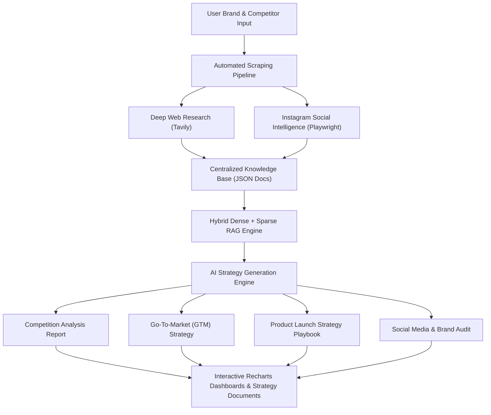

# StratAI Platform — Product Status, Vision & Competitive Benchmarking

## Executive Summary

**StratAI** is an autonomous, AI-powered Market & Competitive Intelligence Strategy Platform built for brand strategists, agency executives, chief marketing officers (CMOs), and growth marketers. 

By combining real-time multi-source web crawling (powered by Tavily Advanced Search), social media intelligence extraction (via automated Playwright Instagram scrapers), hybrid vector/BM25 RAG (Retrieval-Augmented Generation), and interactive visual dashboard generation (Recharts), StratAI transforms raw corporate and social web data into board-ready strategic playbooks in minutes.

---

## 1. Current Status of the Tool

As of **September 2026**, the StratAI platform is fully functional in local and development environments with the following operational milestones achieved:

### Core Systems & Live Functionality
- **OAuth 2.0 & Local Authentication**: Complete JWT-based authentication system integrated with Google OAuth 2.0 and local email/password credentials.
- **Automated Research Pipeline**:
  - **Competitor Discovery Engine**: Automatically identifies top direct brand rivals using `tavily_comp.py`.
  - **Deep Web Research**: Crawls company overview, product catalogs, latest news, and brand positioning using `tavily_web.py`.
  - **Instagram Social Scraper**: Headless Playwright subprocess (`insta_agent.py`) that extracts posts, captions, engagement metrics, and audience comments.
- **Hybrid RAG Retrieval Engine**:
  - Uses `sentence-transformers` (`all-MiniLM-L6-v2`, 384-dim) for dense semantic vector embeddings.
  - Uses `rank_bm25` (Okapi) for sparse keyword matching.
  - Combines results via **Reciprocal Rank Fusion (RRF)** to feed the top 6 most relevant context chunks to the LLM.
- **Multi-LLM Provider Architecture**:
  - Native integration with **Mistral AI** (`open-mistral-7b`), **Qwen** (Alibaba Cloud DashScope), **OpenAI** (GPT-4o), and **Anthropic** (Claude 3.5 Sonnet).
  - Automatic model fallback resilience (e.g., seamless failover to Mistral if an API key or quota fails).
  - Model preference persistence per chat session (`llm_provider` stored in SQLite database).
- **Interactive Visual Dashboards**:
  - Dynamic JSON-to-React chart compiler (`RechartsBlock`) embedded directly into markdown output.
  - Supports 5 distinct visual chart formats: Bar charts, Trend/Line charts, Growth Area charts, Radar Competitive Matrices, and Share of Voice Pie charts.
- **Resilient Chat UI**:
  - Unified full-canvas scroll container with fixed translucent chat input bar.
  - Automatic error handling: failed or ungenerated chats are never saved in database history.
  - Clicking an agent card always initializes a clean **New Chat** instance.

---

## 2. What We Are Building

StratAI is structured into 4 specialized strategic agents and modular workflows:

### Key Specialized Agents
1. **Competition Analysis Agent**: Outputs comprehensive market comparison tables, price index ratings, scale signals, share of voice distributions, SWOT grids, and prioritization roadmaps.
2. **Go-To-Market (GTM) Strategy Agent**: Synthesizes brand data with 4 user setup inputs (Objectives, Target Customer, Growth Constraints, Business Stage) into 90-day execution roadmaps.
3. **Product Launch Strategy Agent**: Tailors launch timelines, waitlist teaser campaigns, early-adopter acquisition strategies, and ROI metrics.
4. **Brand & Social Audit Agent**: Analyzes social engagement, content pillars, tone of voice, and brand positioning gaps.

---

## 3. End Motive & Strategic Vision

### Primary Objective
To replace weeks of expensive, manual consultancy research with an **instant, data-backed strategic brain** that delivers C-suite level competitive intelligence and actionable growth playbooks.

### Long-Term Vision Roadmap
1. **Autonomous Daily Competitive Monitoring**: Continuous background CRON web watchers that flag competitor website changes, pricing shifts, new campaign launches, and Instagram visual updates in real-time.
2. **AI Video Generation & Storyboard Expansion**: Extending strategy outputs directly into automated creative production (e.g. generating video ad scripts, creative storyboards, and AI video prompt sequences for TikTok, Instagram Reels, and YouTube Shorts).
3. **Enterprise Data Connectors**: Direct integrations with Snowflake, Airtable, HubSpot, Google Analytics, and Notion to blend internal brand performance with external market intel.

---

## 4. Competitive Benchmarking

| Capability / Feature | **StratAI** | **Klue / Crayon** | **Perplexity Pro** | **Brandwatch** | **Copy.ai / Jasper** |
| :--- | :---: | :---: | :---: | :---: | :---: |
| **Automated Competitor Discovery** | ✅ Yes | ⚠️ Manual Input | ❌ No | ⚠️ Partial | ❌ No |
| **Deep Web Scraping (News & Web)** | ✅ Yes | ✅ Yes | ✅ Yes | ✅ Yes | ⚠️ Basic |
| **Instagram Post & Comment Scraping** | ✅ Automated Playwright | ❌ No | ❌ No | ✅ Social API | ❌ No |
| **Hybrid Dense (Vector) + Sparse (BM25) RAG**| ✅ Local 384-dim + RRF | ❌ Proprietary | ⚠️ Vector Only | ❌ No | ⚠️ Basic |
| **Interactive Inline Charts (Recharts)** | ✅ Native 5 Types | ⚠️ Static Cards | ❌ Text Only | ✅ Dashboards | ❌ Text Only |
| **Board-Ready Strategy Reports** | ✅ Instant | ⚠️ Requires Setup | ❌ Brief Summaries | ❌ Raw Metrics | ⚠️ Drafts Only |
| **Multi-LLM Failover Support** | ✅ Mistral / Qwen / Claude | ❌ Locked Provider | ⚠️ Manual Switch | ❌ Proprietary | ⚠️ Basic |
| **Video Storyboard & Script Roadmap** | ✅ In Active Pipeline | ❌ No | ❌ No | ❌ No | ⚠️ Basic Text |

---

## 5. Detailed Competitor Analysis

### 1. Klue & Crayon (Enterprise Battlecard Software)
- **Strengths**: Established enterprise CI platforms with CRM integrations (Salesforce, HubSpot) and sales battlecard management.
- **Weaknesses**: Require heavy manual setup, expensive enterprise contracts ($25k–$50k+/yr), lack automated Instagram post/comment scraping, and do not auto-generate inline interactive visual charts.
- **StratAI Advantage**: StratAI provides an end-to-end automated pipeline out of the box—discovering competitors, scraping web + social data, and generating complete board-ready reports automatically.

### 2. Perplexity Pro (General Research Engine)
- **Strengths**: Fast web search, citation links, excellent general query answering.
- **Weaknesses**: Lacks structured brand knowledge base persistence, does not scrape social media comments or engagement depth, cannot generate interactive Recharts dashboards, and has no GTM/Product Launch questionnaire workflows.
- **StratAI Advantage**: StratAI is purpose-built for strategic brand intelligence with persistent multi-source knowledge bases and visual dashboard generation.

### 3. Brandwatch & Meltwater (Social Listening Platforms)
- **Strengths**: Deep social listening coverage, sentiment tracking across Twitter/Reddit/Instagram APIs.
- **Weaknesses**: Focus purely on social listening metrics (volume, mentions, sentiment) without synthesizing data into strategic business playbooks, pricing matrices, or GTM roadmaps.
- **StratAI Advantage**: StratAI bridges the gap between raw social media metrics and C-level strategic decision-making.

### 4. Copy.ai & Jasper AI (AI Marketing Generators)
- **Strengths**: Excellent text generation for short-form social posts, ad copy, and email sequences.
- **Weaknesses**: Produce generic output without grounding responses in scraped competitor knowledge base context or RAG retrieval; no interactive chart compilation.
- **StratAI Advantage**: StratAI output is strictly grounded in verifiable web and Instagram data with structured quantitative visual charts.
